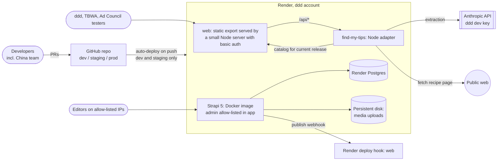
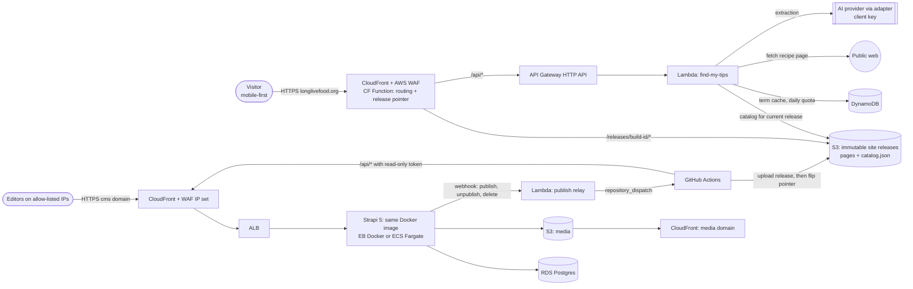
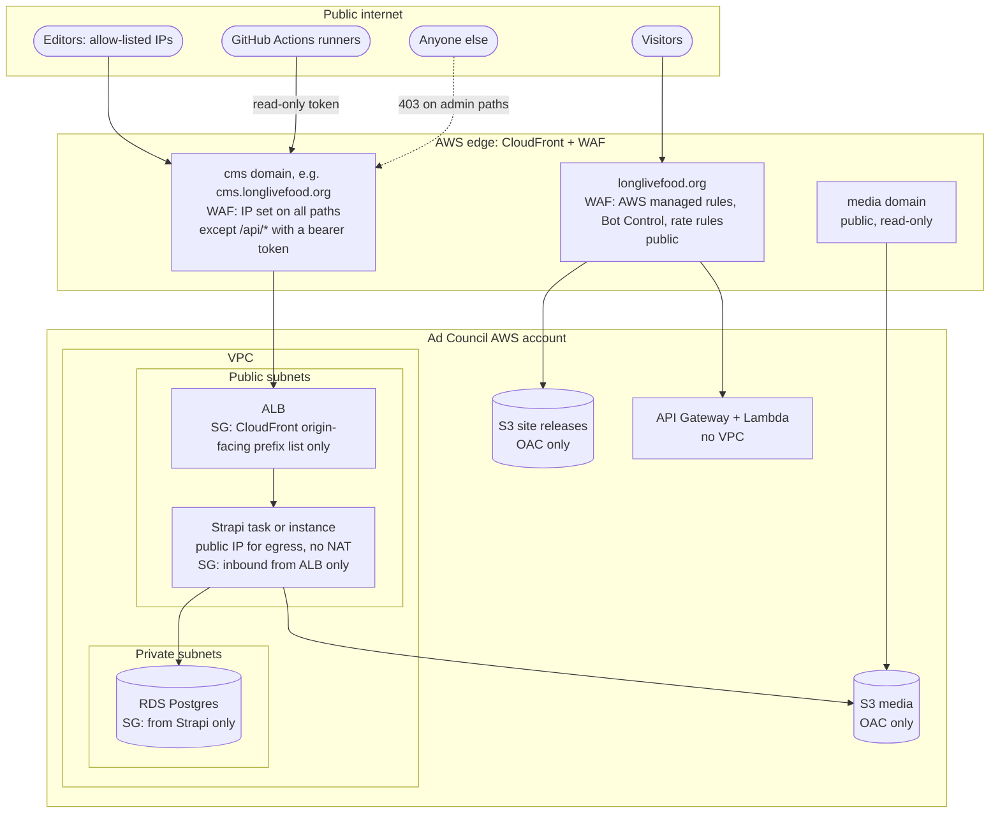
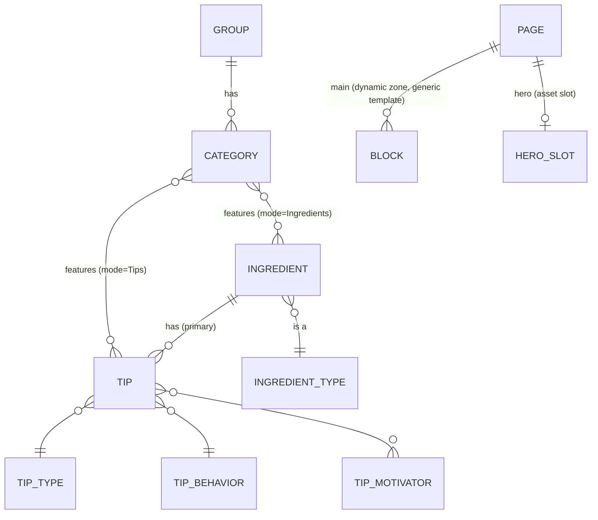
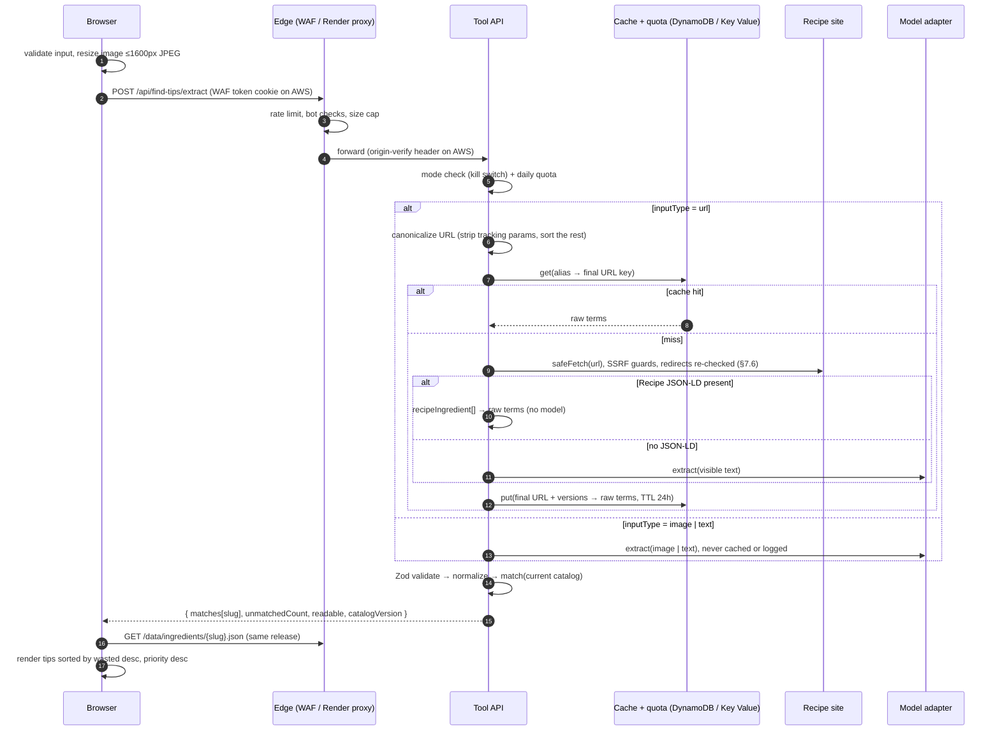
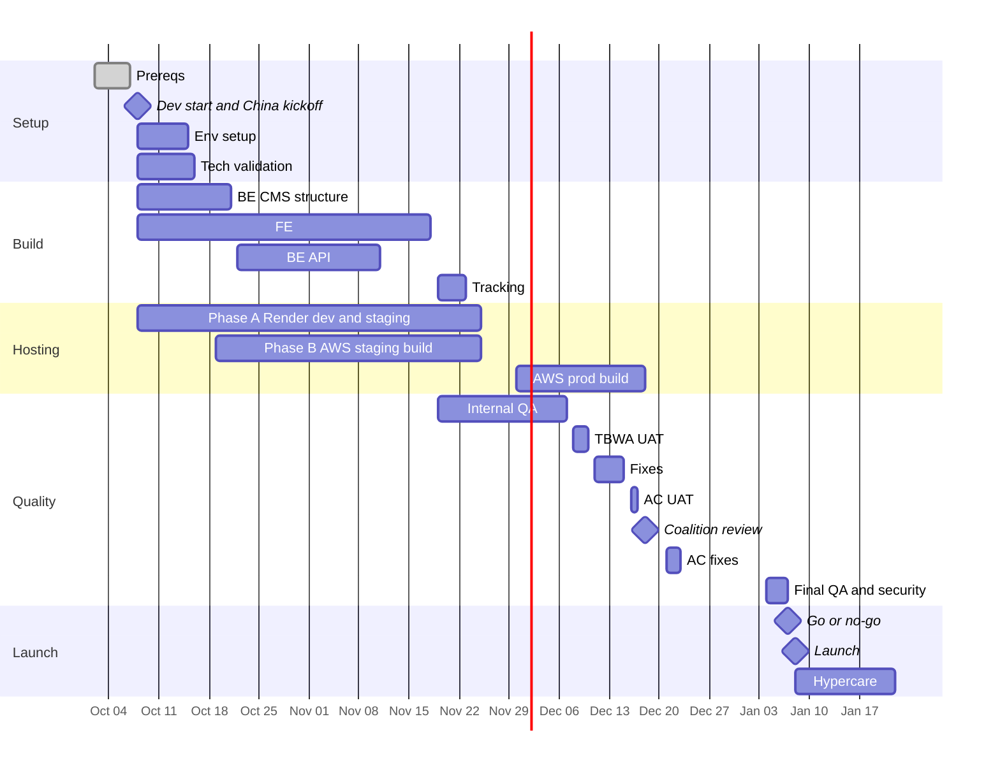

# Technical Design Document: Long Live Food (longlivefood.org)

| | |
|---|---|
| **Client** | The Ad Council, for the Long Live Food coalition (EPA, Ad Council, WWF, ReFED, WRAP) |
| **Campaign** | Finish the Fridge |
| **Delivery** | dotdotdash (ddd) |
| **Owner / author** | Art Longbottom (tech lead) |
| **Reviewers** | James Calhoun (tech lead), James Steele (AWS/DevOps), Adam Paikowsky (analytics), Danish Aziz (PM), China dev team (Eva Fan, Alessandro Grena, Maggie Ding) |
| **Status** | **DRAFT v0.3.2.** For internal ddd review. A work-in-progress copy goes to the China team on **Thu Oct 8** for input. A client-shareable cut follows at Design sign-off ([§0](#0-document-purpose-and-lifecycle)) |
| **Last updated** | 2026-10-06 |
| **Go-live** | **Friday, January 8, 2027** (go/no-go Thursday, January 7). There's **no contingency** after final QA |

> **How to read this document.** Every significant statement has a label:
> **[CONFIRMED]** means the client stated it, or it's in the handoff, the project notes, the kickoff, or the weekly status.
> **[TL DECISION]** means the ddd tech lead decided it (Art, 2026-10-06). It's binding for the build. If it touches client systems or vendors, it still needs client sign-off, and that's noted.
> **[VERIFIED]** means we checked it directly in code or in vendor docs (Strapi repo audit and vendor checks, 2026-10-06).
> **[PROPOSED]** is ddd's recommendation and still needs approval.
> **[OPEN]** is undecided. Each open item has an ID (OPEN-#) in [§15](#15-open-questions).
> Project background, people, and brand rules are in [`PROJECT.md`](./PROJECT.md). This document doesn't repeat them.

---

## Contents
0. [Document purpose and lifecycle](#0-document-purpose-and-lifecycle)
1. [Summary](#1-summary)
2. [Goals, non-goals, and requirements](#2-goals-non-goals-and-requirements)
3. [Constraints, assumptions, and considerations](#3-constraints-assumptions-and-considerations)
4. [System architecture](#4-system-architecture)
5. [CMS (Strapi)](#5-cms-strapi)
6. [Frontend (Next.js)](#6-frontend-nextjs)
7. [Find My Tips service](#7-find-my-tips-service)
8. [Instrumentation specification](#8-instrumentation-specification)
9. [Infrastructure and DevOps](#9-infrastructure-and-devops)
10. [Security and privacy](#10-security-and-privacy)
11. [Testing, quality, and launch readiness](#11-testing-quality-and-launch-readiness)
12. [Delivery plan](#12-delivery-plan)
13. [Risks](#13-risks)
14. [Decision log](#14-decision-log)
15. [Open questions](#15-open-questions)
16. [Appendix](#16-appendix)

---

## 0. Document purpose and lifecycle

Under the **ddd Tech Process**, this TDD is the **master technical document**. The tech leads own it, and it stays current through every phase. Production owns the project plan and scope documents, and tech gives input to them. [CONFIRMED (ddd Tech Process)]

| Phase | What the TDD has to contain | Where | State |
|---|---|---|---|
| Pre-Sale | Approach | n/a | **Skipped.** The project was inherited from TBWA mid-flight |
| Discovery | Refinement: audit of inherited assets, open questions | §5.1, §15, [`CLIENT_AUDIT.md`](./CLIENT_AUDIT.md) | v0.1 (Oct 6) |
| **Design** | Software architecture diagram · network diagram · functional requirements · instrumentation spec · assumptions and considerations | §4.1, §4.3, §2.3, §8, §3 | **v0.3 (this draft).** Work in progress to the China team on Oct 8. Target **v1.0 at the end of tech validation, Oct 16** |
| Design (hardware) | Hardware spec, single-line diagram | n/a | **N/A.** No hardware on this project |
| Build | Kept current as decisions land. Large decisions get ADRs | §14, `docs/adr/` | Continuous |
| Launch | Updated docs: an as-built TDD, plus input to the O&M manual | §9.6, §11.6 | Jan 8 |

**Companion artifacts owned by tech**
| Artifact | File | Purpose |
|---|---|---|
| Client Audit Doc | [`CLIENT_AUDIT.md`](./CLIENT_AUDIT.md) | What we inherited and what access we have: repos, AWS, Strapi, AI accounts, DNS, analytics |
| Proof Doc | [`PROOF_DOC.md`](./PROOF_DOC.md) | Technical spikes: the hypothesis, method, result, and decision for each |
| Release Log + Feedback Tracker | [`RELEASE_LOG.md`](./RELEASE_LOG.md) | Scaffolding, Alpha, Beta, RC, and Launch releases, and how feedback rounds map to Jira |
| Launch Checklist | [`LAUNCH_CHECKLIST.md`](./LAUNCH_CHECKLIST.md) | Go/no-go criteria and cutover runbook, done with Omnicom IT |
| Code reviews | GitHub PRs ([template](../.github/pull_request_template.md)) | Every change is reviewed. The rules are in [`AGENTS.md`](../AGENTS.md) |
| Hardware spec | n/a | **N/A** |

**Owned by production (Danish), with tech input:** feature list, project plan, weekly sprint plan, retros, scope, estimate, staffing, defects (Jira), and the O&M manual.

---

## 1. Summary

We're building **longlivefood.org**, a fast, accessible, SEO-friendly content site with one AI-assisted feature, **Find My Tips**. A user gives the tool a recipe link, a photo (a receipt, a shopping list, or a dish), or pasted text. We pull out the ingredients, and **plain code** matches them against a closed catalog managed in the CMS. Then we show food-waste tips that the coalition has approved. The AI only ever returns **raw ingredient terms**. Every word a user reads comes from Strapi or from typed content files in the repo, never from the model (D21). [PROPOSED; this is the agreed direction in PROJECT.md §7.2]

**Shape of the build**
- **Two hosting phases.** [TL DECISION]
  - **Phase A (now through about mid-November):** local development plus **Render, on ddd's own account**, for the dev and staging environments. That way, development doesn't wait on Ad Council's AWS access.
  - **Phase B (in parallel, with James Steele):** we build the target architecture in **Ad Council's AWS** and move staging, then production, onto it. UAT and launch both run on AWS ([§12](#12-delivery-plan)).
  - Render is a ddd dev tool, **not the production host**. It gets switched off after handoff.
- **Postgres everywhere** [TL DECISION]: Docker Postgres locally, Render Postgres in Phase A, and **RDS Postgres** in Phase B.
- **Frontend** [TL DECISION]: **Next.js** (App Router, TypeScript) with **Tailwind CSS and shadcn/ui** (built on Radix primitives).
  - Every component has to meet **WCAG 2.1 AA**.
  - Static export or server rendering is still **OPEN-4**. We recommend static-first. The data layer is kept separate so switching later is cheap.
- **CMS:** the existing **Strapi 5** project, hardened for production with Postgres, S3 media, and the Cloud plugin removed.
  - The **admin runs on its own domain, open only to allow-listed IPs** [TL DECISION].
  - The public site runs on a public endpoint. Visitors never reach Strapi.
  - **Hybrid content model** [TL DECISION, D21]: the CMS holds the collections (ingredients, tips, categories), global settings, Tool Copy, long-form rich text, and **asset slots** such as hero images. Site strings and page layouts live in code as typed files and **templates**, changed by PR. Only generic pages use a dynamic zone of blocks (§6.4).
- **Find My Tips:**
  - Recipe pages: read the JSON-LD first, and call the model only when there isn't any.
  - Images: the model extracts ingredient terms from **receipts, lists, and dish photos**. Code matches them against the catalog.
  - The provider sits behind a swappable adapter.
  - **Development uses ddd's Anthropic (Claude) keys** [TL DECISION]. We switch to a key that Ad Council provides once one exists (OPEN-1).
  - Runtime: a small Node service on Render in Phase A, then **API Gateway + Lambda** behind CloudFront and WAF in Phase B. Both run **one handler** behind thin adapters.
- **Branches map to environments** [TL DECISION]:

  | Branch | Deploys to |
  |---|---|
  | `dev` (trunk, the default branch) | dev |
  | `staging` | staging (UAT) |
  | `prod` | prod (Live) |

  We promote code from one environment to the next with PR merges.
- **Repo and team** [TL DECISION]:
  - Art scaffolds the repo in ddd's GitHub, then **moves it to Ad Council's GitHub org**.
  - The China team gets access to **that one repo only**, after the move.
  - All work is assigned through **Jira tickets**.
- **Budget:** **pro-bono, at cost** [CONFIRMED]. We pick the cheapest infrastructure that still meets the non-functional requirements.

**What the repo audit found that changes the plan** ([§5.1](#51-audit-of-the-existing-strapi-repo)):
- The Strapi project is a reasonable start, but it's **closer to a prototype than ready to deploy**:
  - It runs on SQLite with no Postgres driver.
  - It stores media on local disk.
  - It includes the Strapi Cloud plugin.
- Several types and modules from the walkthrough are missing: Accordion, Modal, global nav/footer, and scroll-lock. "Strings" from the walkthrough move to code rather than a CMS type (D21).
- **The Figma audit is done** (Oct 6, [§6.1](#61-pages-and-routes)). Accordion is confirmed. The Modal is a Tip Modal built as UI, not a CMS block (D22). Scroll-lock has no spec (OPEN-36). Design gaps for Colleen: missing tool states and the dish photo (OPEN-34), General Tips, 404, and mobile Toolkit (OPEN-39), and placeholder copy and nav labels (OPEN-38).
- A few fields differ from the notes. Ingredient uses `title`, not `name`, and `synonyms` is one string rather than a list.
- Dan's content entries aren't in the repo. So we **seed the content ourselves** ([§5.5](#55-content-seeding-and-migration)).

**Decisions needed by Oct 16 (end of tech validation):**
- AWS IAM access (OPEN-3)
- Rendering mode (OPEN-4)
- The GitHub org and migration date (OPEN-11)
- Whether launch needs Spanish (OPEN-12)
- Whether Ad Council IT accepts Render and Anthropic for development (OPEN-23, OPEN-2)
- Whether the Copilot coding agent can be used in Ad Council's GitHub and Jira for copy changes (OPEN-32)
- Confirming the TBWA Worldwide copy of the Figma file is the single design source, and freezing the original (OPEN-33)
- Whether the tool accepts video links, which the Figma input copy shows (OPEN-35)

See [§12.3](#123-decision-deadlines).

---

## 2. Goals, non-goals, and requirements

### 2.1 Goals
| # | Goal | Measure |
|---|---|---|
| G1 | Send PSA, social, PR, and grant traffic to the site and into the tool | `tips_tool_start` and `tips_tool_result` / sessions (GA4) |
| G2 | Give useful tips for what users already have | Matched-ingredient precision ≥ 0.9 and recall ≥ 0.8 on the eval set (**target to agree with the client**, OPEN-8) |
| G3 | The client can change what users see without waiting on a developer | Content, Tool Copy, rich text, and images are editable in the CMS. Site strings live in typed content files and change through a copy-change issue that a coding agent turns into a PR with a preview (D21, §5.2). No string literals inline in components. New modules are tracked without code (§8) |
| G4 | Be found through search and AI answer engines, including for "Finish the Fridge" | Indexed pages, valid structured data, Lighthouse SEO = 100 |
| G5 | Be accessible | WCAG 2.1 AA, zero critical or serious axe violations, manual screen-reader passes |
| G6 | Be fast on mobile, because users are in a hurry | Core Web Vitals "good" at p75 on mobile. Tool result p95 < 8 s for images and < 3 s for JSON-LD recipe URLs |
| G7 | Keep costs low enough for a pro-bono budget, predictable, and easy to hand over to Ad Council's next DevOps partner | IaC, runbooks, budget alarms, [§9.5](#95-cost-estimate) |

### 2.2 Non-goals for launch
- Recipe content or recipe generation (OPEN-6). Composting guidance. Chat or any free-form AI.
- User accounts, saved lists, or personalization.
- Fridge-photo input. It's a **stretch goal**, and the pipeline supports it if it's approved (OPEN-7).
- Having the model choose or rank tips (RAG). That's phase 2 (PROJECT.md §7.2).
- Ingredient detail pages. They're **not in the locked design**, so we'd add them later for SEO if the client wants them (OPEN-15).
- Analytics work **beyond embedding the basic GA/GTM script**. Broader analytics planning, configuration, and validation need a **separate scope agreement** (OPEN-27). [CONFIRMED (weekly status, Oct 5)]

### 2.3 Functional requirements
| ID | Requirement | Source |
|---|---|---|
| FR-1 | Editors create Pages and fill their content slots. Generic pages (About, General Tips, and similar) are arranged from a library of blocks (dynamic zone). Designed pages use fixed templates (D21) | [CONFIRMED]; template/block split [TL DECISION] |
| FR-2 | The CMS manages tips, ingredients (with synonyms and a wasted score), categories, groups, and taxonomies | [CONFIRMED] |
| FR-3 | Find My Tips accepts a recipe URL and an image. The image can be a receipt, a list, a recipe, or **a photo of a dish** (it should recognize the dish and infer its ingredients). Pasted text is [PROPOSED]. Figma shows two modes, "Paste a Link" ("Enter a recipe URL or video link") and "Upload an Image" ("Photo of your fridge or pantry"). Video links are new scope (OPEN-35), and the dish-photo flow isn't designed (OPEN-34) | [CONFIRMED] (dish recognition: kickoff; modes: Figma `1:7980`) |
| FR-4 | Show matched ingredients with their CMS tips, sorted by `wasted` and then by tip priority | [CONFIRMED]/[PROPOSED] |
| FR-5 | Handle these UX states: loading, success, partial, no-match, unreadable, rate-limited, unavailable, error. All copy comes from the CMS | [CONFIRMED]/[PROPOSED] |
| FR-6 | Site search across ingredients, tips, and categories ("Search 100+ ingredients") | [CONFIRMED] (Figma Search frames `1:1609`, `1:1702`, `1:4327` and the header search popover `1:7183`). The repo has only a `custom.search` placeholder component, and the behavior is **not built** |
| FR-7 | Category pages: show either all tips for the category's ingredients or hand-picked tips | [VERIFIED] (`mode` enum) |
| FR-8 | Help editors find gaps in the catalog (unmatched ingredients) **without storing what users type** | [PROPOSED]. **Off at launch** until legal agrees (OPEN-5, [§7.8](#78-catalog-gaps)) |
| FR-9 | `finishthefridge` domains redirect (301) to longlivefood.org | [CONFIRMED] |
| FR-10 | An About/FAQ page that explains Finish the Fridge | [CONFIRMED] |
| FR-11 | A **General Tips** page built from existing blocks (generic template), with its navigation entry restored | [CONFIRMED] (weekly status) |
| FR-12 | A **Toolkit** page (desktop design delivered Sep 30; ddd adapts it for mobile). Needs **coalition design approval** | [CONFIRMED] (weekly status) |

### 2.4 Non-functional requirements
| Area | Requirement |
|---|---|
| Accessibility | WCAG 2.1 AA. Respect `prefers-reduced-motion`. Use the heading level the editor chooses in the CMS. shadcn/Radix primitives are a starting point, not proof of compliance (§6.6) |
| Performance | LCP < 2.5 s, INP < 200 ms, CLS < 0.1 at p75 on mobile. The JS bundle for content pages should be ≤ 150 KB gzipped (target) |
| Availability | Content pages: ≥ 99.9% (static files on CloudFront). Tool API: ≥ 99.5%. These apply in production (AWS). Render environments have no SLA |
| Security | OWASP ASVS L1 baseline. SSRF-safe URL fetching. WAF in production. The CMS admin is IP-restricted. Secrets live only in the platform's secret store |
| Privacy | No personal data in logs or analytics. **User text and images are never stored** (OPEN-5). AI data is processed and stored **only in the US**, with usage and spend controls (weekly status). **What "US-only" covers** [PROPOSED]: the AI provider's processing and retention, plus everything we store (DynamoDB, logs, S3, RDS, all in `us-east-1`). CloudFront and WAF are **global edge** services, so a visitor's request is received (TLS-terminated and inspected) at the nearest edge location, which may be outside the US, but nothing is stored there except standard logs, which are delivered to `us-east-1`. Legal confirms this reading (OPEN-31) |
| Cost | **Pro-bono / at cost.** Choose the cheapest option that meets these requirements. Estimates are in [§9.5](#95-cost-estimate). AI spend is limited by an in-app daily quota and kill switch, with provider budget alerts as a backstop (§7.6) |
| Maintainability | IaC for everything on AWS. Runbooks. Can be handed to the new DevOps partner. The repo lives in Ad Council's GitHub org |
| Browser support | The last 2 versions of evergreen browsers, plus iOS Safari 16+ |

---

## 3. Constraints, assumptions, and considerations

**Constraints** [CONFIRMED]
- **Hard launch date: Fri Jan 8, 2027**, with the go/no-go on Thu Jan 7.
  - Jan 8 is the latest date that's acceptable. **There's no contingency after final QA** (Jan 4–7).
  - UAT and fixes fall over the holidays (§12).
- Designs are **locked**, with two exceptions:
  - The **Toolkit** page is desktop-only for now. ddd is adapting it for mobile, and it still needs coalition approval.
  - Copy and images can still change.
- **New SaaS or vendors need Ad Council IT approval.**
  - Approved so far: GitHub, AWS, Strapi, and OpenAI (account pending).
  - That's why production uses AWS-native services, for example WAF Bot Control instead of reCAPTCHA or Turnstile.
- **There's no production AI account yet.**
  - The client-owned OpenAI account is pending.
  - Before go-live, **US-only data storage and usage/spend controls** must be validated (weekly status). What "US-only" covers is in §2.4 and OPEN-31.
- **Budget is pro-bono / at cost.**
- The **China dev team** kicks off **Oct 8**. Mainland China can't reach the OpenAI or Anthropic APIs without a proxy.
- **AWS access** [CONFIRMED (kickoff)]: James Calhoun has a **real IAM user** (username and password, not SSO). It can create a CodeBuild project but **can't list users or pipelines**, so the permissions are partial and misconfigured. James Steele is checking whether his account has admin. Danish's account is on hold until this is fixed. We've asked for usable, scoped permissions (OPEN-3), and Danish is passing that to Cat.
  - Ad Council is also changing DevOps partners.

**Assumptions** (we'll treat these as true until someone tells us otherwise)
- **A1:** The launch is **English-only**. Strapi i18n is not enabled in the repo [VERIFIED]. If Spanish is needed, that's a significant change (OPEN-12).
- **A2:** Content volume at launch is around **100–300 ingredients and around 300–1,000 tips**. "Search 100+ ingredients" is the default placeholder [VERIFIED].
- **A3:** ddd embeds GTM/GA4 (basic). Who owns the container and property configuration, and anything beyond the basic embed, is OPEN-18 and OPEN-27.
- **A4:** Ad Council controls DNS for longlivefood.org and the finishthefridge domains. They'll create or delegate records when we ask (OPEN-20).
- **A5:** Visitors don't log in. The only logged-in users are CMS editors.
- **A6:** Render is acceptable for **development and preview hosting on ddd's own account**, using seed and test content only, with no visitor data. We still need to confirm this with Ad Council IT (OPEN-23).
- **A7:** Using **ddd's Anthropic keys in development**, with test inputs only, is acceptable (OPEN-2). The production provider and key belong to Ad Council (OPEN-1).

**Considerations**
- **Image selection is a separate workstream** [CONFIRMED (kickoff)]. Colleen Miller owns it, and it takes about a month (OPEN-28). The CMS has to handle placeholder images until then.
  - **Lifestyle images** (≈ 20): from Ad Council's iStock. AI only if a specific image is requested.
  - **Tip-library category images** (≈ 50): stock first, with AI-generated images as the backup.
  - **Ingredient images:** AI generation is approved. Tools discussed: Adobe Firefly, Nano Banana, and optionally Magnific for upscaling. ddd may build a small generation pipeline (optional epic IMAGES, BD3244-2, §12.4). It runs offline, and its output is uploaded through the seed pipeline (§5.5), never at runtime.
- **Toolkit approval.** Feedback on the Toolkit arrived on Friday (Oct 2), and Colleen Miller is estimating the changes. The coalition still has to approve the design. We build the Toolkit from existing blocks where we can, so that late changes affect content rather than code.
- **Maintainability after handoff** [kickoff, James Calhoun]: a future team (for example DDB Australia) must be able to take the site over, and the client shouldn't need ddd for routine copy changes. This drives the hybrid content model (D21), the copy-change flow (§5.2), and the process docs (§11.4). James Steele and James Calhoun have both run Strapi before (the Ether project).
- **Feedback channels.** Internal feedback goes through Jira. Ad Council and the coalition will use Jira or a spreadsheet, format still to be confirmed (OPEN-29). Either way, everything gets entered into Jira for triage ([`RELEASE_LOG.md`](./RELEASE_LOG.md)).
- **The Render-to-AWS migration is planned work, not cleanup.** To keep parity, both platforms run the same artifacts, use the same environment-variable contract, and follow the same seeding path ([§9.2](#92-target-aws-architecture-phase-b), [`PROOF_DOC.md`](./PROOF_DOC.md)).

---

## 4. System architecture

### 4.1 Software architecture

**Phase A: local + Render (ddd account), from now until AWS staging is ready** [TL DECISION]



**Phase B: Ad Council AWS (target for UAT and launch)** [PROPOSED; to be agreed with James Steele at tech validation]



The same code runs in both phases. Only the adapters and the environment configuration change:

| Concern | Phase A (Render) | Phase B (AWS) |
|---|---|---|
| Site files | Static export, served by a small Node server (basic auth, shared routing rules) | Static export in S3 under `/releases/<build-id>/`, behind CloudFront |
| Tool API | `services/find-my-tips` with its Node HTTP adapter | The same handler with its Lambda adapter |
| CMS | Strapi Docker image on a Render web service | The same image on EB (Docker platform) or ECS Fargate (D3) |
| Database | Render Postgres (paid instance, because free instances expire after 30 days [VERIFIED]) | RDS Postgres |
| Media | Render persistent disk (`UPLOAD_PROVIDER=local`) | S3 + CloudFront (`UPLOAD_PROVIDER=aws-s3`) |
| Publish → rebuild | Strapi webhook → Render deploy hook | Strapi webhook → relay Lambda → GitHub Actions (§5.3) |
| Admin IP restriction | App middleware in Strapi (§5.4) | WAF IP set on the CMS CloudFront distribution |
| Abuse controls | In-app rate limiting and a daily quota | WAF (rate rules, Bot Control, Challenge) plus the same in-app quota (§7.6) |
| Secrets | Render environment groups | AWS Secrets Manager |

### 4.2 Components
| Component | Tech | Responsibility | Status |
|---|---|---|---|
| `apps/web` | Next.js (App Router, latest stable at scaffold time), React 19, TypeScript, **Tailwind CSS + shadcn/ui** (Radix) | Page templates, blocks, site strings (`content/`), search, the tool UI | [TL DECISION] stack; details [PROPOSED] |
| `apps/cms` | Strapi 5.45 (JS), Postgres (`pg`), S3 upload provider, Dockerfile | Content, media, editor workflow | [VERIFIED] base; changes [PROPOSED] |
| `services/find-my-tips` | TypeScript. One handler (Web `Request` → `Response`) with **Node** and **Lambda** adapters | Extraction, matching, quotas, the publish relay | [PROPOSED] |
| `packages/contracts` | Zod + TypeScript types | API request/response schemas, catalog snapshot schema, `ExtractionResult` | [PROPOSED] |
| `packages/matching` | TypeScript | Normalization and matching with no AI, used by site search **and** the service | [PROPOSED] |
| `packages/ui` *(optional)* | shadcn/ui components + Tailwind preset | Design-system primitives generated from the Figma tokens | [PROPOSED] |
| `infra` | AWS CDK v2 (TypeScript) + `render.yaml` (Render Blueprint) | AWS stacks for each environment. Render services for Phase A | [PROPOSED] |
| `scripts/seed` | TypeScript CLI | One-off scrape or extract → JSON → validated import into Strapi (§5.5) | [PROPOSED] |
| `eval` | TypeScript CLI | Accuracy evaluation against a labeled set, run only on purpose | [PROPOSED] |

### 4.3 Environments and network

**Environments and branches** [TL DECISION]. Each environment has its own CMS and database. Code moves **dev → staging → prod** through PRs. Content does **not** flow automatically between environments (§5.5).

| Env | Branch | Phase A host | Phase B host | CMS / DB | AI key | Who uses it |
|---|---|---|---|---|---|---|
| **local** | any | Laptop (Docker Compose: Postgres) | n/a | Local Strapi + seed data | **Mock** by default. ddd Anthropic key optional | Every developer, **including the China team** |
| **dev** | `dev` (trunk, default) | Render | Render until launch. After handoff: recreated on AWS or retired (OPEN-24) | cms-dev / own DB | ddd Anthropic key, low cap | Developers, internal QA |
| **staging** (PM sheet: **UAT**) | `staging` | Render, until AWS staging is ready | **AWS** | cms-staging / own DB | Client key once one exists. Until then, ddd's dev key with test inputs only | Internal QA, TBWA UAT, Ad Council UAT, coalition review, **pre-launch content entry** |
| **prod** (PM sheet: **Live**) | `prod` | **None. Production never runs on Render** | **AWS** | cms-prod / own DB | Client production key (OPEN-1) | The public |

**Network design** (Phase B; Phase A equivalents are in the §4.1 table) [PROPOSED]



| Zone | Exposure | Controls |
|---|---|---|
| Public site (`longlivefood.org`, `www`, the `finishthefridge` redirect domains) | Public | CloudFront + WAF (managed rules, Bot Control, rate rules). S3 reachable only through OAC. Security headers set by a response-headers policy |
| Tool API (`/api/*` on the site domain) | Public, same origin | WAF rate rules and Challenge, API Gateway throttling, in-app daily quota and kill switch (§7.6) |
| **CMS domain** (admin, auth, and admin APIs) | **IP allow-list only** [TL DECISION] | WAF IP set: Ad Council editors, ddd US, China team (OPEN-17). Everything is blocked except `/api/*` with a bearer token, which the build runners use. Strapi auth is still required on top of that |
| Strapi compute | Reachable only through the ALB | Security groups. The ALB only accepts CloudFront's origin-facing prefix list plus a secret origin header. **No NAT gateway** (cost, see the note below). The compute runs in **public subnets with a public IP**, used **only for outbound** traffic (S3 media, Secrets Manager, ECR, logs, the publish relay). Its security group allows **inbound only from the ALB's security group**, so the public IP accepts nothing directly |
| Database | Private subnets only | Reachable only from Strapi's security group. Admin access through SSM port forwarding, never a public endpoint |
| Media | Public read-only CDN | S3 private behind OAC. Uploads go only through Strapi |

> **Why no NAT gateway, and the alternative** [PROPOSED; confirm with James S]: a NAT gateway costs about $32/month per AZ plus data charges, which is a lot for a pro-bono, single-instance CMS. A public IP with an inbound-only-from-ALB security group gives the same exposure. If Ad Council IT requires the compute to sit in **private subnets with no internet route**, we'd use **VPC endpoints** instead: interface endpoints for ECR (`api`, `dkr`), CloudWatch Logs, Secrets Manager, SSM (`ssm`, `ssmmessages`, `ec2messages`), STS, and Lambda (to reach the relay), plus a free **gateway** endpoint for S3. Interface endpoints cost about **$7–8 per endpoint per AZ per month**, so roughly $60–70/month in one AZ, more than a NAT gateway. With public egress, Strapi's built-in webhook POSTs to the relay's Function URL (§5.3). In the endpoint-only option there's no route to that URL, so a small Strapi plugin calls the relay with the Lambda `Invoke` API through the Lambda endpoint instead.
>
> **Why `/api/*` on the CMS domain isn't IP-restricted:** GitHub-hosted runners don't have fixed IPs, so they can't be allow-listed. The Public role has **no permissions**, so `/api/*` returns nothing without the read-only token. If Ad Council IT wants the whole CMS domain IP-only, we'd run the build inside AWS instead (CodeBuild), which costs a little more. That's tracked in [`PROOF_DOC.md`](./PROOF_DOC.md).

### 4.4 Repository layout [PROPOSED]

A single **pnpm workspace** monorepo, so the contracts and matching code are shared and change in one place.

```
/
├─ apps/
│  ├─ web/                 # Next.js + Tailwind + shadcn/ui (static export)
│  │  ├─ content/          # typed site strings (Zod-validated), changed by PR (D21)
│  │  ├─ templates/        # one template per designed route, reading CMS slots
│  │  └─ blocks/           # dynamic-zone blocks + registry (generic Page template)
│  └─ cms/                 # Strapi project, imported from AdCouncil/ending-wasted-food-strapi (+ Dockerfile)
├─ services/
│  └─ find-my-tips/        # handler + adapters (node, lambda), publish relay
├─ packages/
│  ├─ contracts/           # Zod schemas and TS types (API, catalog snapshot, extraction)
│  ├─ matching/            # normalize() + match(); shared by search and the API
│  ├─ ui/                  # (optional) shadcn components + Tailwind preset from Figma tokens
│  └─ config/              # shared tsconfig, eslint, prettier
├─ infra/
│  ├─ aws/                 # AWS CDK app (stacks per env)
│  └─ render.yaml          # Render Blueprint for Phase A (dev, staging)
├─ scripts/seed/           # scrape/extract → JSON → import (one-off, re-runnable)
├─ eval/                   # labeled set, runner, reports (run on demand)
├─ docs/                   # TDD, PROJECT, companion docs, ADRs, runbooks
├─ docker-compose.yml      # local Postgres (and optional Strapi)
└─ .github/workflows/      # CI, deploy, publish-triggered build
```

- **How we bring in the Strapi code:** `git subtree add` from `AdCouncil/ending-wasted-food-strapi` keeps its history. We rename the package from `test-strapi` to `@llf/cms`. During tech validation we check that Strapi works with pnpm workspaces. If it doesn't, `apps/cms` gets its own npm lockfile and is left out of the workspace ([`PROOF_DOC.md`](./PROOF_DOC.md)).
- **Where the repo lives** [TL DECISION]:
  1. Art scaffolds it in **ddd's GitHub** (Oct 6–9).
  2. It moves to **Ad Council's GitHub org** with GitHub's repository transfer, which keeps the history, issues, and PRs, or with a mirror push if transfer isn't allowed (OPEN-11).
  3. Branch protection, environments, and secrets are set up again in the new org.
  4. **The China team gets access to that one repo only, and only after the move.** Until then, **Art does all repo work** (scaffolding, CI, seed tooling), and the China team does onboarding with the docs (shared outside the repo), Figma review, Jira grooming, and local tool installs. The move is targeted for **Oct 16** so their FE work isn't held up. If it slips, see R6.
- **Branch protection:**
  - `dev`, `staging`, and `prod` are protected.
  - PRs need 1 approving review (a tech lead for `staging` and `prod`) and green CI.
  - No direct pushes, and no force pushes.
  - A hotfix branches from `prod`, then merges back to `staging` and `dev`.
- **Toolchain:** Node 22 LTS (`.nvmrc`), pnpm 9, Turborepo for task caching (optional), ESLint (with `jsx-a11y`), Prettier, Vitest, Playwright, and `@axe-core/playwright`.

---

## 5. CMS (Strapi)

### 5.1 Audit of the existing Strapi repo

Repo: `AdCouncil/ending-wasted-food-strapi`, commit `f753967` ("initial checkin", Dan Johnston). Audited on 2026-10-06. Everything in this section is **[VERIFIED]** unless it's labeled otherwise.

**Platform and config**
| Item | Finding | Impact |
|---|---|---|
| Version | Strapi **5.45.0**, **JavaScript** (not TS), package name `test-strapi`, Node `>=20 <=24` | OK. Rename the package. TypeScript conversion is optional and not planned |
| Database | Uses **SQLite** by default (`better-sqlite3`). `config/database.js` supports Postgres, but **the `pg` driver isn't installed** | Add `pg`. Use **Postgres in every environment**: Docker locally, Render Postgres, then RDS [TL DECISION]. SQLite can't run on a temporary disk |
| Media | **No upload provider configured** (`config/plugins.js` is empty), so files go to the local `public/uploads` folder | Phase A: local provider on a Render persistent disk. Phase B: `@strapi/provider-upload-aws-s3`, a private bucket, and a CloudFront media domain. Selected by env var |
| Server config | `config/server.js` sets `webhooks.populateRelations`, a **Strapi 4 setting** that Strapi 5 doesn't use | Remove it. Webhook payloads are handled as Strapi 5 sends them (§5.3) |
| Plugins | Includes `@strapi/plugin-cloud`, Strapi's paid hosting plugin | **Remove it.** It isn't an IT-approved vendor and we aren't using it |
| API | `defaultLimit 25`, `maxLimit 100`, `withCount` | Build-time fetches **must paginate** (there are more than 100 ingredients) |
| Middleware | Strapi defaults | Tighten CORS to the admin and preview origins. Add the admin IP allow-list middleware for Phase A (§5.4). Set CSP for the media domain |
| Admin customization | `src/admin` has **only the example files**. `src/extensions` is empty | The "typeahead ingredient search" from the walkthrough **isn't in the repo** |
| Content | **No content, seed data, or export** in the repo | Dan's entries (e.g. "chorizo", the "ULD homepage") were in his local SQLite. **Ask for a `strapi export`** (OPEN-13), but don't wait for it: **we seed the content ourselves** (§5.5) |
| i18n | Not enabled on any type | English-only for now (A1, OPEN-12) |

**Content types** (all of them have Draft & Publish turned on)
| Type | Fields as built | Different from PROJECT.md §5 |
|---|---|---|
| **Category** | `title`, `slug` (*string*), `description`, `image`, `mode` enum [`Ingredients`, `Tips`], `ingredients` (one-way oneToMany → Ingredient, shown only when mode=Ingredients), `tips` (one-way oneToMany → Tip, shown only when mode=Tips), `group` (manyToOne ↔ Group.categories), `seo` | `slug` is a plain string, so uniqueness and format aren't enforced |
| **Group** | `title`, `description` (required), `categories` (oneToMany, mappedBy `group`) | **No slug.** A category can belong to only one group |
| **Ingredient** | **`title`**, `type` **enum** [Baked Goods, Dairy, Dry Foods, Fresh Herbs, Leafy Greens, Produce, Protein], **`synonyms` (one `string`)**, `wasted` int 1–5 (required, default 3), `image`, `tips` (oneToMany, mappedBy `ingredient`) | The notes say `name`. **Synonyms are one string**, not a list. **No slug** |
| **Ingredient Type** | `title` | **Not used anywhere.** It duplicates the `Ingredient.type` enum |
| **Tip** | `title`, `description` (**plain text**, not rich), `ingredient` (manyToOne ↔ Ingredient.tips), `tip_type`, `tip_behavior`, and `tip_motivator` (all **one-way oneToOne**) | **A tip can belong to only one ingredient.** No slug, image, or priority. The taxonomy relations are declared oneToOne, but the intent is manyToOne (see the note below) |
| **Tip Behavior / Tip Motivator / Tip Type** | `title` only | No slug or description. The 7 coalition behaviors aren't seeded |
| **Page** | `title`, `path` (string, unique), `main` dynamic zone, `seo` | Exists, as described |

> **About the relations** [VERIFIED in the schema files; runtime behavior to be confirmed in a spike]:
> - **Tip → `tip_type`, `tip_behavior`, `tip_motivator`** are declared **one-way `oneToOne`**. The intent is clearly "many tips share one type."
> - **Category → `ingredients` and Category → `tips`** are **one-way `oneToMany`**. The intent is that an ingredient or tip can appear in several categories, which means **manyToMany**.
> - The same pattern shows up in the components:
>   - `component.carousel.categories`, `component.link-list.pages`, and `custom.tip-list.tips` are one-way `oneToMany`.
>   - `shared.cta.page` is `oneToOne`.
>
> Strapi's join tables may or may not enforce uniqueness on the target side for these declared types. **The relation spike in tech validation checks what the admin and the database actually allow** ([`PROOF_DOC.md`](./PROOF_DOC.md)). Either way, we'll redeclare every relation to match its intent with the two-phase migration in §5.2, and we won't depend on behavior the declared type doesn't promise.

**Components (modules)**
| Component | Fields as built | Figma / notes status |
|---|---|---|
| `component.hero` | `eyebrow`, `description` (blocks), `images` (multiple), `ctas`, `layout` [Primary, Secondary]. **No title.** It shows the Page title | "Primary Hero" ✓ |
| `component.teaser` | `title` (shared.title), `description` (blocks), `images`, `ctas`, `layout` [Basic, Highlight, Quote] | ✓ |
| `component.link-list` | `title`, `description` (blocks), `pages` (relation), `layout` [Basic, Two Column] | ✓ |
| `component.carousel` | `title`, `description`, `categories` (relation), `mode` [categories], `layout` [Basic, Compact], `ctas` | This is a **category carousel**, not the dropped "Hero Carousel." **Keep it** |
| `custom.search` | `placeholder` (default "Search 100+ ingredients") | ✓ Copy only. All behavior lives in the frontend |
| `custom.tool` | `url_label`, `url_placeholder`, `upload_label`, `upload_placeholder`, `description`, `cta_label` | **No pasted-text input fields and no copy for any UX state** (FR-5) |
| `custom.tip-list` | `title`, `description`, `tips` (relation), `layout` [Basic, Single] | ✓ |
| `shared.cta` | `label`, `href`, `page` (oneToOne) | Internal-or-external links ✓. No variant, target, or tracking label |
| `shared.seo` | `metaTitle`, `metaKeywords`, `metaDescription` | **No canonical, OG image, or noindex.** Search engines ignore keywords |
| `shared.title` | `copy`, `header` enum h1–h6 (default h3) | Editor-chosen heading level ✓ (matches the a11y requirement) |

**Missing compared with the notes and the designs:** **Accordion** (confirmed in Figma), **Modal** (resolved: a Tip Modal built as UI, D22), **scroll-lock section** (no Figma spec, OPEN-36), global settings (header, nav, footer, social, default SEO), copy for the tool's UX states, unmatched-ingredient storage, publish webhooks, and the admin typeahead. **The Figma audit is done** (Oct 6, §6.1). Its additions are in the §5.2 component rows: `component.accordion`, `component.asset-list`, `component.jump-nav`, and an optional `component.logo-grid`. "Strings" from the walkthrough are handled in code, not as a CMS type (D21).


### 5.2 Proposed v1 schema [PROPOSED]

Changes are **additive wherever possible**, so any content Dan entered can still be migrated.



**Content type changes**
| Type | Change | Why |
|---|---|---|
| Ingredient | Add `slug` (uid ← title) | Stable IDs for URLs, analytics, and the tool contract |
| Ingredient | Replace the `synonyms` string with a **repeatable component** `shared.synonym { term }` | Lets the matcher index terms reliably, and editors can add or remove them one at a time. We'll migrate by splitting the existing string on commas |
| Ingredient | Use the **Ingredient Type collection** (manyToOne) and **drop the `type` enum** | Editors can manage types without a schema change, and it removes the duplicate |
| Ingredient | Add `searchable` boolean (default true), add `plural` (optional string) | Hide pantry staples from search. Better handling of plurals |
| Tip | Add `slug` (uid), `priority` int (default 0) | Stable IDs and sort order within an ingredient |
| Tip | `description` → **blocks** (rich text) | Figma tip cards and the Tip Modal (`1:10735`) show a headline plus a formatted body. [VERIFIED] (Figma audit) |
| Tip | `tip_type` / `tip_behavior` → explicit **manyToOne**. `tip_motivator` → **manyToMany** (to be decided with content) | Make the relationships match how they're meant to work (§5.1 note) |
| Category | `ingredients` and `tips` → **manyToMany** (one-way is fine) | One ingredient or tip can appear in several categories (§5.1 note) |
| Components | `carousel.categories`, `link-list.pages`, `tip-list.tips` → **manyToMany**. `shared.cta.page` → **manyToOne** | Many modules can point at the same page, category, or tip |
| Tip | *Option:* `ingredients` manyToMany in place of the single `ingredient` | Generic tips such as "freeze bread" apply to many ingredients. **Decide with the content team (OPEN-14, due Oct 14, before the seed format is locked).** The default is to keep manyToOne for simplicity. A later "yes" doesn't block: `ingredients` is added **additively** as the expand step below, and the seed JSON already stores tip → ingredient links as a list |
| Category, Group | `slug` → **uid**. Add `slug` to Group | URLs and uniqueness |
| Group | Add `layout` enum [carousel, image-cards, emoji-cards, list, featured] and `order` int (additive) | The Library page in Figma (`1:1310`) stacks about 10 Group sections in different layouts (Ingredient Reputations, Cuisine, Easy to Miss, Weeknight Staples, Grocery Aisles, and others). Editors pick the layout and order, and code owns how each layout looks (§6.4) |
| Tip Behavior / Motivator / Type | Add `slug`, `description`. **Seed the 7 coalition behaviors**. Seed the Tip Types the designs use: `use-it`, `store-it`, `rescue-it`, and `buy-it` (Search frame) | Filters and analytics. The type badge (`1:7919`) picks its color from the slug in code, using contrast-safe pairs (§6.3) |
| Page | Add a `template` enum [generic, home, find-my-tips, library] and optional **slot** fields: `hero` (a single `component.hero`), `intro` (blocks), `featured` (relations), `tool` (a single `custom.tool`). Unused slots are hidden with **conditional fields**, as Category already does for `mode`. `main` (dynamic zone) is shown only for the generic template | D21. Designed pages keep a fixed layout in code, and editors still own the copy and images. Confirmed in P13 |
| **Global** (new single type) | `siteName`, `header` (nav links), `footer` (link groups, legal text including the EPA assistance-agreement line, social, "Manage Preferences" link if a CMP is needed, OPEN-18), `defaultSeo`, `defaultOgImage`, `organization` (for JSON-LD) | No global settings exist yet. The "All tips reviewed by food experts" badge in the designs is a site string (§6.4) |
| **Tool Copy** (new single type) | Copy for every Find My Tips state: loading messages, success heading, partial-match note, no-match, unreadable, rate-limited, **unavailable** (kill switch), error, privacy notice, "unmatched count" template | FR-5. The client still has to supply the no-match and unreadable copy (OPEN-8) |
| ~~Microcopy~~ | **Not a CMS type** (D21). Site strings (button labels, form hints, aria labels, the 404 page, empty states) live in typed files in `apps/web/content/` and ship with a deploy | Covers "Strings" from the walkthrough. Strings rarely change, and agents and developers can edit them safely by PR with types and a preview (§6.4) |
| ~~Ingredient Gap~~ | **Not at launch.** v0.1 proposed storing unmatched terms. Free-text terms can contain personal data, so we store **no user text** until legal decides (OPEN-5, §7.8) | Privacy |

**Component changes and additions**
| Component | Change |
|---|---|
| `shared.seo` | Add `canonicalUrl`, `ogImage`, `noIndex`. Mark `metaKeywords` as deprecated (keep the field so data isn't lost) |
| `shared.cta` | Add `variant` [primary, secondary, link], `openInNewTab`, `trackingLabel` (optional, sent in `cta_click`) |
| `custom.tool` | Add `text_label`, `text_placeholder` (if pasted text is approved), `accepted_inputs` (multi-select), `privacy_note` (blocks) |
| **`component.accordion`** (new) | `title`, `items[] { question, answer (blocks) }`, `emitFaqSchema` boolean (FAQPage JSON-LD) |
| ~~`component.modal`~~ | **Dropped** (D22). Figma's only modal is the Tip Modal (`1:10735`), which shows CMS tips one at a time. It's UI built from Radix Dialog plus a carousel (§6.6), not an editor-placed block |
| ~~`component.scroll-lock`~~ | **Deferred** (D22, OPEN-36). Figma has no scroll-lock or sticky spec. The animated Home sections (Animated Headline `1:7162`, Ingredient Tips `1:7233`, Groceries Stat `1:7350`, Usual Suspects `1:7461`) are built into the Home template with a static fallback under reduced motion (§6.6). If a generic page later needs one, add it then |
| **`component.asset-list`** (new) | `title`, `anchor` (slug for jump links), `items[] { title, medium, file (media), thumbnail, size? }`, `layout` [full-width, wide, tall, medium]. For the Toolkit download sections (Figma `1:1826`–`1:1908`, cards `1:8202`/`1:8216`/`1:8238`/`1:8257`). Clicks send `file_download` (§8) |
| **`component.jump-nav`** (new) | `items[] { label, anchor }`. The Toolkit badge row (`1:1825`). Renders in-page links to `asset-list` anchors |
| **`component.logo-grid`** (new, optional) | `title`, `logos[] { image, alt, url? }`. Partner logos on About (WWF, ReFED, WRAP, US Composting Council, ILSR). Only if editors need to change them; otherwise the About copy uses a teaser image |
| Others | None from the Figma audit (§6.1). Everything else is a template section (§6.4) or shell UI. A module becomes a CMS block only if a generic page needs it |

**Two-phase schema migration** [PROPOSED]. Changing a relation's type or a field's type in place can silently drop data in Strapi, so every non-additive change goes in two steps:
1. **Expand.** Add the new field or relation (for example `synonyms_list`, or `ingredients_v2` as manyToMany) next to the old one. A migration script in `apps/cms/database/migrations` copies the data across, which is idempotent and logged. The frontend reads the new field, with a fallback to the old one.
2. **Contract.** Once every environment is migrated and its content is verified, a later release removes the old field and renames the new one if needed.

Before the first real content is entered (target: end of Oct), we can make these changes destructively in dev, because only seed data exists there. After that, two-phase changes are required.

**Editor experience** [PROPOSED]
- **Typeahead and relation pickers:** Strapi 5's built-in relation picker already supports search. Building a custom admin typeahead is **deferred** until editors tell us the built-in one isn't enough.
- **Preview:** Strapi 5 **Preview** is available on the free Community plan [VERIFIED]. It shows a "Preview" button on each entry that opens a frontend URL we configure. Where that URL points depends on OPEN-4 (§6.2):
  - **If we go static:** a separate **preview environment** for each CMS (`preview-staging`, and `preview-prod` from Jan 4), behind basic auth:
    - It runs the same build as the site, but fetches with `status=draft` using a separate read-only **preview token**. It's never indexed (`noindex` + `X-Robots-Tag`), and it never touches the live release pointer.
    - It's triggered by `entry.create` / `entry.update` (plus the publish events) through the same webhook path as §5.3, into its own Actions concurrency group (`build-preview-<env>`), so a burst of saves coalesces into at most two builds.
    - The Preview button opens the entry's URL on the preview host. A small banner shows the preview **build time**, so editors can tell whether their last save is in yet. Expect a few minutes' delay.
    - Phase A: one more Render web service per environment, running the same `server.mjs`. Phase B: its own S3 prefix and CloudFront distribution (§9.2).
    - If OPEN-16 or the budget rules this out, Preview is **deferred** and editors review on staging after publishing there.
  - **If we go SSR:** Next.js **Draft Mode**. Editors see changes instantly.
- **Roles:** Super Admin (ddd), **Editor** (Ad Council content: create and publish), and **Author** (create only, if the coalition needs it). Approvals happen through Draft & Publish plus these roles, because Review Workflows needs the Enterprise plan (§5.6).
- **Copy changes outside the CMS** [PROPOSED, D21; confirmed in P13]: site strings and layouts live in code, so a change goes through GitHub. Whether the agent and its Jira integration are allowed in Ad Council's GitHub and Jira, and who files these after handoff, is OPEN-32. Without the agent, a developer makes the same small PR.
  1. The requester files a **"Copy change" issue** (a GitHub issue form, `.github/ISSUE_TEMPLATE/copy-change.yml`, added at scaffolding) or a Jira ticket, with the page, the current text, and the new text.
  2. A reviewer assigns it to the **Copilot coding agent**, which opens a draft PR that edits `apps/web/content/*.ts`. The agent is GA on paid GitHub plans (Business and Enterprise need an admin policy). Its Jira integration is in public preview and needs Jira Cloud.
  3. CI runs (types, Zod, tests), and Render posts a **PR preview** link on the PR (§9.1).
  4. The reviewer checks the preview, approves, and merges to `dev`. It's promoted to `staging` and `prod` like any other change (§9.3).

### 5.3 Publishing flow [PROPOSED]

**Phase A (Render):** a Strapi webhook in each environment calls the **Render deploy hook** for that environment's `web` service. Render rebuilds and swaps the deploy, and a failed build leaves the previous one live. Dev and staging don't publish much, so we accept the occasional extra build. **The deploy-hook URL is a secret:** anyone holding it can trigger builds. It lives only in the Strapi webhook config and the Render environment group, and it's regenerated if it leaks (§9.3).

**Phase B (AWS), with atomic releases:**
1. An editor publishes, unpublishes, or deletes an entry in **cms-prod**. Strapi sends a webhook for **`entry.publish`, `entry.unpublish`, `entry.delete`**, and `media.update` / `media.delete` (the exact event list is checked in the spike). Drafts being saved don't trigger a production build.
2. The **publish-relay Lambda** (its own **Lambda Function URL**, not behind the tool's API Gateway, which only accepts CloudFront traffic, §7.6) checks the shared-secret header, filters on model and event, and sends a GitHub `repository_dispatch` (`content-published`). The relay stores nothing. **A Lambda can't debounce** without extra state, so we don't ask it to.
   - **GitHub auth:** the relay authenticates as a dedicated **GitHub App** installed on **this repo only**, with the minimum permission (**Contents: write**, which `repository_dispatch` requires) and nothing else. The App's private key is in Secrets Manager. On each call the relay mints a **short-lived installation token** (valid for 1 hour) and never stores it. **No personal access tokens.**
   - `repository_dispatch` always runs the workflow file from the **default branch** (`dev`) [VERIFIED (GitHub docs)]. The workflow then checks out the branch for the target environment, which is passed in `client_payload.env` and checked against an allow-list.
   - The GitHub App and its key are created on Ad Council's GitHub org after the repo move (OPEN-11).
3. **Coalescing is handled by GitHub Actions concurrency** (`group: build-prod`, `cancel-in-progress: false`). At most one build runs and one waits. A newer pending run replaces an older one, and every build reads the **latest** content, so a burst of 20 publishes produces at most 2 builds. Nothing gets lost.
4. The build:
   - fetches all content with a **read-only API token**, paginated (`maxLimit 100`)
   - validates it with Zod (the build **fails on invalid content**)
   - renders the site and writes `catalog.json` (with `catalogVersion = <build-id>`)
   - uploads everything to an **immutable prefix**, `s3://site/releases/<build-id>/`
5. **Atomic switch:** the build updates the **current-release pointer** in a CloudFront KeyValueStore. The viewer-request CloudFront Function (§6.2) rewrites **every** site request (pages, `/data/*`, `/_next/static/*`) to `/releases/<current>/…`, and the tool API reads the catalog from the **same** release. So pages and the catalog always change together. Rolling back means pointing at the previous `<build-id>`. Old releases expire after 30 days (keeping the last 10). The branded 404 page is also copied to a fixed, unversioned key (`/404.html`) on each deploy, because CloudFront's custom error page path can't follow the pointer.
6. Changes go live in about **3–6 minutes** (target). **A bad publish never reaches production**, because the previous release stays live.

The tool API includes `catalogVersion` in every response. If it doesn't match the build ID of the page the user is on, the page reloads its tip data, so a stale tab still renders correctly. **Nothing is cached forever.** HTML and JSON are revalidated on each request, and only hashed assets are immutable.

### 5.4 Hosting and operations

**Phase A: Render (ddd account)** [TL DECISION]
- One **Strapi Docker image** for each environment (cms-dev, cms-staging), each a Render web service with a **persistent disk** for uploads and its own **paid Render Postgres** instance. Free Postgres instances expire after 30 days, and services with disks need a paid plan [VERIFIED].
- **Admin IP restriction:** Render can only set inbound IP rules on web services on its **Scale or Enterprise plans** [VERIFIED]. That's not justified for a pro-bono dev phase. So:
  - A small **Strapi middleware** blocks every path except `/api/*` (token required) and `/_health` unless the client IP is on `ADMIN_IP_ALLOWLIST`.
  - The client IP comes from the header that Render's proxy sets, and the spike confirms which header can't be spoofed ([`PROOF_DOC.md`](./PROOF_DOC.md)).
  - Render Postgres has **IP rules on every plan**, so we turn off external database access.
- Backups: Render's managed Postgres backups, plus a nightly `strapi export` to the ddd backup location while real content lives on Render.

**Phase B: Ad Council AWS** [PROPOSED; options to agree with James Steele]
- **Compute (D3):** the same Strapi Docker image on either:
  - **(a) Elastic Beanstalk, Docker platform**, load-balanced with one instance. This is TBWA's plan. **Note:** EB's *single-instance* mode has **no ALB**, so it can't use ACM certificates or the security-group pattern in §4.3.
  - **(b) ECS Fargate** behind an ALB.

  Both cost about the same at this size. (b) is closer to the Render setup, and (a) is what Ad Council expected.
- **RDS Postgres 16** (`db.t4g.micro` for dev and staging, `db.t4g.small` for prod), with automated backups, **point-in-time recovery**, and deletion protection. Multi-AZ for prod is optional and depends on budget.
- **S3 media bucket** (private) behind a CloudFront media domain. Uploads go only through Strapi.
- Secrets (`APP_KEYS`, `API_TOKEN_SALT`, `ADMIN_JWT_SECRET`, `JWT_SECRET`, `TRANSFER_TOKEN_SALT`, `DATABASE_*`) go in **Secrets Manager** and are injected by the CDK.
- **CMS domain** (e.g. `cms.longlivefood.org`, or a separate Ad Council domain; OPEN-20): CloudFront plus a WAF **IP set** (§4.3) [TL DECISION].
- **Lockdown, in both phases:**
  - The Public role gets **no permissions**.
  - The site build uses a **read-only API token**.
  - Visitors never call Strapi.
  - `NODE_ENV=production` turns off the Content-Type Builder in staging and prod. Schema changes ship as code.
- **Backups:** RDS snapshots plus a nightly encrypted `strapi export` to S3, so content can be restored without the database.
- **China team access:** they get Strapi admin accounts on cms-dev: **Super Admin** for the team leads (so they can add users) and **Editor** for everyone else. Their IPs are added to the allow-list (OPEN-17). Schema changes and migrations ship as code through a deploy, never by editing a deployed admin. Local development uses seed data, from the day they get repo access after the GitHub move (§11.4).

### 5.5 Content seeding and migration

**[PROPOSED]** We need realistic content early, for development, QA, and design review. Real content also needs a reliable path into every environment. **Our approach: seed through Strapi's APIs and tools, not through direct database access.**

| Step | How | Notes |
|---|---|---|
| 1. Source | One-off **scrape or extract** from whatever source is agreed (OPEN-30): Dan's export if TBWA provides it (OPEN-13), earlier Ad Council campaign content, or coalition spreadsheets/CSV | Run once, then commit the output. Respect robots.txt and the content's license |
| 2. Normalize | `scripts/seed` turns the source into **versioned JSON** (`seed/ingredients.json`, `tips.json`, `categories.json`, …) and validates it against `packages/contracts` | Synonyms are split into lists. Slugs are generated and locked (§6.1) |
| 3. Import | Idempotent upserts by slug through the **Strapi REST API** (using a write token that's revoked afterward), or `strapi import` of a generated export archive | No database credentials needed. Works the same on Render and AWS |
| 4. Media | Images are uploaded through the Upload API. Category images can be placeholders until the image workstream delivers (OPEN-28) | |

- **Moving between environments:** `strapi transfer` (Strapi's built-in, token-authenticated, streaming transfer) copies content and media from one instance to another. We use it for **Render staging → AWS staging** (Phase B cutover) and **staging → prod** (Jan 4, the start of final QA).
  - **Fallback, if `transfer` fails** (volume, timeouts, or a provider mismatch): `strapi export` (encrypted, **including assets**) on the source, then `strapi import` on the target. If media still doesn't come across, copy the disk uploads to the S3 media bucket and rewrite the media URLs, then run a check that **every** media URL in the content resolves.
  - **No raw database dump/restore.** It would carry Render-specific media paths and Strapi internals across.
  - The Render → AWS move is **rehearsed** on the seed set (P7, P11) well before the Nov 25 cutover, and the content checks run after every move.
- **Content freeze:** pre-launch content is entered in **cms-staging**, where UAT happens. Content freezes on **Dec 23**, after the AC fixes. It's transferred to cms-prod on **Jan 4**, and from then on prod is the source of truth. If content changes are needed during Jan 4–7, they're made **in prod only**.
- **Recipes:** whether the site has recipe content at all is OPEN-6. Seeding covers ingredients, tips, categories, groups, taxonomies, and pages.

### 5.6 Strapi plan and editorial features [VERIFIED (vendor docs, Oct 2026)]

We self-host the free **Community** edition. Paid features would need a license that Ad Council IT approves (OPEN-16).

| Feature | Community (free) | Growth | Enterprise | Need for this project |
|---|---|---|---|---|
| Preview | ✓ | ✓ | ✓ | Yes. With static output it needs a separate preview environment (§5.2, OPEN-16) |
| Live Preview (side-by-side) | ✗ | ✓ | ✓ | Nice to have |
| Content History | ✗ | 14 days | ✓ | Nice to have. A nightly export covers recovery |
| Releases (publish as a batch) | ✗ | ✓ | ✓ | Useful at launch. We can manage without it |
| Review Workflows | ✗ | ✗ | ✓ | Only if the coalition needs formal approval stages |
| SSO | ✗ | add-on | ✓ | No. Admin is behind an IP allow-list plus Strapi auth |
| Audit Logs | ✗ | ✗ | ✓ | Nice to have |
| Built-in admin 2FA | ✗ | ✗ | ✗ | **Not available on any plan.** The IP allow-list plus strong passwords is the compensating control |

---

## 6. Frontend (Next.js)

### 6.1 Pages and routes

**Figma file (design source of truth):** the working copy ["Untitled"](https://www.figma.com/design/JZTCmehamc5QkAYw1lw5jW/) (key `JZTCmehamc5QkAYw1lw5jW`) in the **TBWA Worldwide** org, where Art has a Full seat (Enterprise, ≈ 600 MCP calls a day). It's a duplicate of "Food Waste I Design R2" in the MullenLowe org, which has no file admins left. An earlier copy (`IgstWizeCgx5EsDVEJAhnM`) landed in a plan with only a View seat and isn't used. Still to do (OPEN-33): rename the copy (it's still called "Untitled"), freeze the MullenLowe original, and have Colleen and Sam confirm that design edits happen only in the copy (R17).

**Figma audit [VERIFIED] (Oct 6, via MCP; closes OPEN-10).** The copy kept its components and variables. Pages: Desktop `0:1`, Mobile `1:3600`, Design System `1:5779` (tokens, §6.3), Components `1:5992` (39 component sets, 28 components), Mobile Specs `1:9756`, and Desktop Specs `1:12636`. The specs pages are **directional**: they describe intent, and the implementation details are ddd's call. Grids are **desktop 1440** (12 columns, 20 gutter, 60 margin) and **mobile 402** (6 columns, 20 gutter, 20 margin). **There are no tablet frames**, so tablet layouts are interpolated in code and reviewed with Colleen. The full audit (module catalog, component map, screenshots) is kept with ddd's working notes, and the decisions it led to are in D22. Known Figma housekeeping: the Toolkit frame `1:1801` is mislabeled `Search_All`, and the component set `Mobile` `1:8574` has property errors to fix before using Code Connect.

| Figma frame / source | Route [PROPOSED] | Data source | Notes |
|---|---|---|---|
| Homepage (`1:1286` / `1:4499`) | `/` | Page (`path: /`, `template: home`) | Home template: hero slot (muted looping video with a pause control, §6.6), Tip of the Week, the animated sections (OPEN-36), category carousels, and the Highlight CTA |
| Tool Landing (`1:1402` / `1:4571`) | `/find-my-tips/` | Page (`template: find-my-tips`) + `tool` slot | Two modes: "Paste a Link" and "Upload an Image" (FR-3). The dish-photo flow isn't designed (OPEN-34), and video links are OPEN-35 |
| Loading Screen (`1:1791` / `1:4708`) | client state on `/find-my-tips/` | Tool Copy | Shows progress messages. No route change |
| Output List Page (`1:1564` / `1:4418`) | `/find-my-tips/results/?i=broccoli,chorizo` | Per-ingredient JSON in the current release | **noindex**. Shareable because the URL holds only matched slugs. `?i=` is **capped at 30 slugs** and unknown slugs are dropped |
| Library Landing Page (`1:1310` / `1:4766`) | `/tips/` | Page (`template: library`) + Groups/Categories | About 10 Group sections, each rendered by its `layout` in `order` (§5.2, §6.4) |
| Category List-Alt (`1:1526` / `1:4235`) | `/tips/[category]/` | Category (+ `seo`) | Shows tips by `mode` (FR-7). Tips open in the Tip Modal (§6.6). Mobile adds "Share this list" (`1:4300`) |
| General Tips | `/general-tips/` (path set in the CMS) | Page (generic template): existing blocks | **Back in the nav** per the weekly status (FR-11) [CONFIRMED]. **No Figma frame** (OPEN-39) |
| Search (`1:1609`, `1:1702` / `1:4327`), plus the header popover (`1:7183`) | `/search/#q=` | Client-side index (§6.5) | Every result state shown in the frames. The term is in the URL **fragment**, so it never reaches CloudFront, WAF, or any server log, and it's not in analytics `page_location` (§8). It still works with sharing and the back button |
| About (`1:1466` / `1:4648`) | `/about/` | Page (generic template): teaser, accordion, and CTA blocks, plus an optional logo grid | Finish the Fridge FAQ (FR-10). Its fixed section order in Figma is reproduced with blocks |
| Toolkit (`1:1801`, mislabeled `Search_All`) | TBD (e.g. `/toolkit/`) | Page (generic template): `jump-nav`, `asset-list`, and `accordion` blocks | Desktop design delivered Sep 30. **No mobile frame**, so ddd adapts it for mobile (OPEN-39), and it needs coalition approval (FR-12) |
| 404 | `/404.html` | Site strings (`content/`) | Custom, branded, and noindexed. Served for unknown paths on Render and AWS. **No Figma frame** (OPEN-39) |
| *Not in design* | `/tips/[category]/[tip]/`, `/ingredients/[slug]/` | — | Possible SEO pages after launch (OPEN-15) |

Any other Page entries in Strapi are rendered at their `path` by a catch-all route (`/[...path]`) with the **generic template** (blocks in the `main` dynamic zone, §6.4). Category and Search routes use fixed templates and have no Page entry.

**Overlays and states that aren't routes:** the mobile menu (`1:4721`, a Radix Sheet that returns to the current route on close), the Tip Modal (`1:10735`, §6.6), Save/Share (`1:10947`, §6.6), and the tool's loading and error states (§7.10).

**Slugs and IDs.** Shared URLs (`?i=`), analytics, and the tool's catalog all depend on slugs. So:
- After the first publish, a slug is **locked**. A lifecycle hook stops edits unless a Super Admin sets `allowSlugChange`, and then a redirect is added.
- Code refers to entries by Strapi `documentId` or slug, never by numeric `id`, which differs between environments.

### 6.2 Rendering, routing, and data fetching [PROPOSED; mode is OPEN-4]

**Recommendation: static first** (`output: 'export'`). The site is content that changes when someone publishes, plus one dynamic tool. Static output works the same way on Render (Phase A) and S3/CloudFront (Phase B), costs almost nothing, and has no server to scale or patch. **We switch to SSR/ISR only if** the spike or the designs need something static output can't provide, such as instant SSR preview or a very large number of pages.

During the build:
1. `lib/cms` fetches every Page, Category, Group, Ingredient, Tip, the taxonomies, Global, and Tool Copy, in pages of **100** (`maxLimit`), with explicit `populate` settings for each slot and block (Strapi 5's `on` fragments for dynamic zones).
2. **Every response is validated with Zod** (`packages/contracts`). Invalid content fails the build with editor-friendly messages (for example, "Tip 'X' has no ingredient").
3. `generateStaticParams` creates every route.
4. The build writes the **release**: HTML pages, `/data/ingredients/<slug>.json`, `/data/search-index.json`, and **`/data/catalog.json`** (titles, slugs, synonyms, `catalogVersion`). Pages and the catalog ship **together** (§5.3).

**Routing on static hosting** (the rubber-duck review flagged this):
- `trailingSlash: true`, so `/tips/fruit/` is exported as `/tips/fruit/index.html`. Plain object storage can serve that without rewrite rules for every page.
- **Phase B:** a **CloudFront Function** (viewer request) on the site's default cache behavior does the following, **in this order**:
  1. **`/api/*` is left alone.** It's a separate cache behavior with API Gateway as its origin, so the function isn't attached there. As a guard, the function also returns any `/api/*` request unchanged.
  2. **Host redirect:** `finishthefridge.*` and `www` → `https://longlivefood.org/<same path>` with a 301.
  3. **Trailing slash:** a path with no file extension and no trailing slash gets a 301 to the same path plus `/`.
  4. **Directory index:** a path ending in `/` gets `index.html` appended.
  5. **Release prefix:** **every** remaining URI (pages, `/data/*`, `/_next/static/*`, images, `robots.txt`, `sitemap.xml`) is prefixed with `/releases/<current>/`, where `<current>` is read from the KeyValueStore.

  Unknown keys return the branded 404 with status **404**. The CloudFront custom error response (for 403/404 from the origin) can only point at a fixed path, so each deploy also copies the release's `404.html` to the **stable, unversioned key `/404.html`** (§5.3). The release still has its own copy, so the page is found whichever key CloudFront fetches.
- **Phase A:** a tiny **Node static server** (`apps/web/server.mjs`, using `serve-handler` or similar) does the same mapping, plus **basic auth** for dev and staging and a correct 404. We use this instead of Render's static-site product, which can't add basic auth or IP rules.
- **The results page** (`/find-my-tips/results/`) is a static shell. The component that reads `?i=` calls `useSearchParams()` and **must be inside `<Suspense>`**. Otherwise `next build` with static export fails (or makes the whole page render only in the browser). A lint rule and a build test cover this.

**Images:** `next/image` with `unoptimized`, using **Strapi's responsive formats** (`thumbnail`, `small`, `medium`, `large`) as the `srcset`. The media comes from the Render CMS in Phase A and the media CDN in Phase B. **Fonts:** self-hosted with `next/font`.

**If we pick SSR/ISR** (OPEN-4): on Render, a Node web service (`next start`). On AWS, OpenNext on Lambda, or a container on the same ECS/EB setup as Strapi. `lib/cms` is isolated so that switching costs little. The routing section above would then be handled by Next.js itself.

### 6.3 Styling and the component library [TL DECISION]
- **Tailwind CSS (v4)** plus **shadcn/ui** (built on Radix primitives). The shadcn components are copied into `packages/ui`, so **we own the code**: no runtime dependency on a hosted component library, and the styling follows the brand.
- **Design tokens [VERIFIED] (Figma Design System page `1:5779`, Oct 6):** Figma has **no local styles**. Every color, spacing, and radius value is a Figma variable, so the mapping is one to one. They're defined once as CSS variables in `packages/ui/styles/tokens.css` and wired into Tailwind's `@theme`. No raw hex values or magic numbers in components; a lint rule (`eslint-plugin-tailwindcss` or a custom rule) enforces this.

  | Group | Token (Figma name) | Hex | Use |
  |---|---|---|---|
  | Surface | Paper | `#FEFAEF` | Default page background |
  | Surface | Sand | `#FBF5CE` | Alternate section background |
  | Surface | Mint / Mint Dark | `#F0F58E` / `#DCE55C` | Interactive (buttons, selected states) / its hover |
  | Surface | Forest Tint | `#DEEADB` | Soft panels |
  | Ink | Terra | `#231711` | Body text on light surfaces |
  | Ink | Terra 70 | `#5E5145` | Muted text on light surfaces |
  | Ink | Terra 40 / Terra 15 | `#A69B8C` / `#E7E0D3` | **Decorative only** (dividers, borders). Never text |
  | Ink | Sand 70 | `#B4BC9C` | Muted text **on dark surfaces only** |
  | Brand | Forest / Forest Mid | `#0F3627` / `#2E5C42` | Dark sections / borders on Forest |
  | Accent | Carrot | `#E2600C` | Accent fills (Terra text on top) |
  | Semantic | Tomato / Squash / Leaf | `#C2451E` / `#E39B2D` / `#3E7C4F` | Error and Tip Type badges |

  - **Context modes** (Figma "Context" frame `1:5862`). On Paper or Sand: text Terra, muted Terra 70, border Terra 15. On Forest or Terra: text Paper, muted Sand 70, border Forest Mid. Interactive is Mint in every mode. In code these are semantic variables (`--text`, `--text-muted`, `--border`, `--interactive`) that a `data-surface` attribute on each section switches.
  - **Type:** **Anton** for display (28–74 px) and **Fustat** for body (Regular to ExtraBold). Both are open-licensed Google Fonts. `next/font` downloads them at build time and serves them from our own origin, so browsers make **no calls to Google** (no new vendor). One stray Inter in the mobile-menu legal text becomes Fustat.
  - **Spacing:** `2xs` 5, `xs` 10, `sm` 15, `md` 20, `lg` 30, `xl` 40, `2xl` 60 (px). **Radius:** `md` 40 and `pill` (Figma 100, coded as `9999px`). **No shadows** in the system.
  - **Breakpoints [PROPOSED]:** the frames are 402 (mobile) and 1440 (desktop) wide, and there's no tablet frame. Those are reference widths, not breakpoints. The mobile layout runs below Tailwind's `md` (768 px), the desktop layout from `lg` (1024 px), and 768–1023 px is interpolated and reviewed with Colleen. Content is capped at 1440 px with 60 px side margins (20 px on mobile).

  ```css
  /* packages/ui/styles/tokens.css (excerpt) */
  @theme {
    --color-surface-paper: #FEFAEF;  --color-surface-sand: #FBF5CE;
    --color-surface-mint: #F0F58E;   --color-surface-mint-dark: #DCE55C;
    --color-ink-terra: #231711;      --color-ink-terra-70: #5E5145;
    --color-brand-forest: #0F3627;   --color-accent-carrot: #E2600C;
    /* …the rest of the table above */
    --font-display: var(--font-anton), Impact, sans-serif;
    --font-sans: var(--font-fustat), system-ui, sans-serif;
    --spacing-md: 20px;  /* …2xs to 2xl */
    --radius-md: 40px;   --radius-pill: 9999px;
  }
  ```
- **Contrast rules for the palette [VERIFIED] (ratios computed from the Figma hex values, D22).** Several brand pairs fail WCAG AA, so the tokens carry usage rules, and the axe checks (§6.6) back them up:
  - **Safe for any text:** Terra on Paper (16.75:1), Sand (15.85), Mint (15.10), or Mint Dark (12.82). Paper on Forest (12.77). Mint on Forest (11.51). Terra 70 on Paper (7.35). Sand 70 on Terra (8.83) or Forest (6.73). Terra on Carrot (4.92).
  - **Narrow passes:** Tomato and Leaf on Paper (4.84 and 4.79). Fine for text, but they must not be lightened.
  - **Large text and UI only:** Paper on Carrot (3.41).
  - **Never text on light surfaces:** Terra 40 (2.62), Squash (2.24), Sand 70 (1.90). Terra 15 and Forest Mid on Forest are for borders only.
  - **Tip Type badges** (`1:7919`): Rescue It is Terra on Sand (15.85:1) and Use It is Sand on Leaf (4.54:1, a narrow pass). **Store It is Sand on Squash (2.12:1, fails).** We build it as **Terra on Squash (7.48:1)**, pending Colleen's agreement (OPEN-37).
  - **Focus ring:** Figma's Focus variants (for example, Primary button `1:6863`) add a **Forest ring**, which passes on Paper (12.77:1) and on a Mint button (11.51:1). A Forest ring vanishes on Forest sections, and Figma has no dark-section focus state, so there the ring is **Mint** (11.51:1). Mint is never the ring on light surfaces (1.11:1 on Paper).
  - **Text over photos** (Hero, Highlight CTA): the component always applies a fixed-opacity dark overlay. Editors can't turn it off, and it's tested against the brightest image in the set.
- **Brand rules** (`PROJECT.md`): the campaign's brand rules (Long Live Food lockups, the co-brand order, the illustration style) live as documented components, such as `<LogoLockup variant=… />`, so they're hard to misuse.
- **Variants** use `class-variance-authority`. Class merging uses `tailwind-merge` (`cn()`), the way shadcn does.
- **Storybook** (optional, but recommended for the China team): every `packages/ui` component, template, and block has a story with the a11y addon. It's the reference the China team builds against.

### 6.4 Templates, blocks, and site strings
Under the hybrid content model (D21) [TL DECISION; details PROPOSED and confirmed in P13], each Figma **module** is built in one of these ways:

| Kind | Where it lives | Who changes it | Example |
|---|---|---|---|
| **Template** | `apps/web/templates/`. Fixed layout and section order for a designed route | Developer or coding agent, by PR | Home, Find My Tips, Library, Category, Search |
| **Asset slot / content field** | A field on the CMS entry that a template reads (`hero`, `intro`, `featured`, `tool`, `seo`) | Editor, in the CMS | The home hero image and eyebrow |
| **Block** | A Strapi component in the Page `main` dynamic zone, rendered by the block registry. Generic template only | Editors arrange them. Developers add new block types | Accordion, teaser, asset list, jump nav, or logo grid on About, General Tips, or Toolkit |
| **Site string** | `apps/web/content/*.ts`, typed and Zod-validated | Developer or coding agent, by PR (the §5.2 copy-change flow) | Button labels, aria labels, form hints, the 404 page |

The collections (ingredients, tips, categories, groups), Global, and Tool Copy stay in the CMS as described in §5.2.

```ts
// apps/web/templates/registry.ts
export const templates = {
  generic:        GenericTemplate,     // renders page.main through <DynamicZone>
  home:           HomeTemplate,
  'find-my-tips': FindMyTipsTemplate,
  library:        LibraryTemplate,
} satisfies TemplateRegistry;

// apps/web/blocks/registry.ts
export const blocks = {
  'component.hero':      { Component: Hero,      schema: HeroSchema },
  'component.teaser':    { Component: Teaser,    schema: TeaserSchema },
  'component.link-list': { Component: LinkList,  schema: LinkListSchema },
  'component.carousel':  { Component: CategoryCarousel, schema: CarouselSchema },
  'custom.search':       { Component: SearchBox, schema: SearchSchema },
  'custom.tool':         { Component: FindMyTips, schema: ToolSchema },
  'custom.tip-list':     { Component: TipList,   schema: TipListSchema },
  'component.accordion': { Component: Accordion, schema: AccordionSchema },
  'component.asset-list':{ Component: AssetList, schema: AssetListSchema },  // Toolkit downloads
  'component.jump-nav':  { Component: JumpNav,   schema: JumpNavSchema },
  // + 'component.logo-grid' if editors need it (§5.2). No modal or scroll-lock block (D22)
} satisfies BlockRegistry;

// apps/web/content/strings.ts (placeholder text; the real copy comes from Figma)
export const strings = defineStrings({
  nav:      { skipToContent: 'Skip to content', menu: 'Menu' },
  search:   { placeholder: 'Search ingredients and tips', noResults: 'No results for "{q}"' },
  notFound: { heading: 'Page not found', cta: 'Back to home' },
}); // Zod-validated at build time
```
- The Page's `template` field picks the template. Category and Search routes have fixed templates (§6.1).
- **The Library template** renders each Group as a section, using the Group's `layout` and `order` (§5.2). A new Group shows up without a code change, and a new *kind* of layout is a PR.
- **Shell UI, not blocks:** the header (with the search popover), the mobile menu, the footer, the Tip Modal, and Save/Share are shared UI in `apps/web/components/`. They read Global, the collections, and site strings (D22).
- `<DynamicZone blocks={page.main} />` loops through the blocks. Templates and the dynamic zone both wrap each module in `<ModuleBoundary>`, which adds the `data-module-type`, `data-module-index`, and `data-module-id` attributes (§8) and an error boundary. The Zod schemas run at build time.
- **Unknown `__component`:** the build fails in CI. In development, the block is skipped with a console warning.
- **Unknown or missing string key:** a type error, so CI fails. Components never inline user-facing strings. They read them from `content/`.
- **Checklists** (also in AGENTS.md):
  - **To add a block:** a Strapi component, a Zod schema, a React component, a story, and a registry entry.
  - **To add a template:** the template, its slot fields on Page (with conditional visibility), a Zod schema for the slots, a story, and a registry entry.
  - **To add or change a string:** edit `content/` and use the key. No CMS change.
- **Rich text:** Strapi `blocks` are rendered with `@strapi/blocks-react-renderer` and our own element overrides for headings, links, and lists.
- **Why hybrid:** a full page builder makes every layout an editor decision and every string a database row, which gives an agent or a new maintainer more to reason about. Templates in code are easy to read, review, and hand off. The CMS keeps what the client really edits: content, images, and long-form copy. We gauge it with the China team (P13), and we move a string into the CMS if the client edits it often (R16).

### 6.5 Site search [PROPOSED]
- With fewer than 1,000 ingredients and tips, a **client-side index** is enough and needs no new vendor. The build creates `search-index.json` (around 50–150 KB gzipped, estimated), loaded only when someone focuses the search box.
- Search uses the same `normalize()` as the tool (`packages/matching`): lowercase, accent folding, plural stemming, and synonym expansion. Typo tolerance comes from MiniSearch (MIT, client-only, **no external calls**).
- **Layout from Figma** (`1:1609`, `1:1702`, `1:4327`): a search field with a count summary ("100 ingredients | 300 tips"), then two columns on desktop. The left column lists matching ingredients with their tip counts, and the right shows tip cards with their type badges. Mobile stacks them and adds "Show More Ingredients." Matching categories are listed below. The "All tips reviewed by food experts" badge is a site string. Empty and no-result states use site strings (`content/`, §6.4).
- **Header popover** (Nav Bar states Default / Search Open / Search Results, `1:7183`): typing in the header shows the top few results, with "See all" going to `/search/#q=…`. It uses the same index and is a Radix Popover with combobox semantics.
- **Search terms aren't sent to analytics** (§8), and they never leave the browser: the query lives in the URL fragment (`/search/#q=…`, §6.1).
- We'd move to server search (Postgres full-text search behind the tool API) only if the index grows past about 300 KB.

### 6.6 Accessibility (WCAG 2.1 AA) [CONFIRMED requirement; PROPOSED approach]

> **shadcn/Radix helps but doesn't make us compliant.** Radix gives correct keyboard and ARIA behavior for dialogs, accordions, menus, and tabs. **Contrast, focus visibility, heading order, alt text, motion, and content are still on us**, and the shadcn defaults (for example, a muted foreground color or a thin focus ring) need checking against the brand palette.

- **Headings:** `shared.title.header` sets the element. A lint rule and a Playwright check verify there's one `h1` per page (the Hero renders the Page title as `h1`).
- **Tool:**
  - Each input has a visible label (copy from the CMS).
  - File input: a keyboard-operable `<label>`/`<input type=file>`. Drag-and-drop is an extra, not the only way.
  - Loading: an `aria-live="polite"` status. Focus moves to the results heading when they're ready.
  - Errors are linked with `aria-describedby`.
- **Carousel** (shadcn's carousel uses Embla): buttons with clear labels, `aria-roledescription="carousel"`, and slide labels like "3 of 8". **No autoplay.** Swiping is an extra on top of the buttons. The dot indicator (`1:11445`) shows **at most 5 dots** with the edge dots scaled down, so the "3 of 8" label carries the real position for screen readers.
- **Modal / Accordion:** Radix **Dialog** (focus trap, Escape, focus return, `aria-modal`) and Radix **Accordion** (the WAI-ARIA pattern; Figma FAQ Item `1:8171` / `1:8881`).
- **Tip Modal** (spec `1:10735`): a Dialog holding a carousel of one ingredient's tips, one at a time. It shows the ingredient photo and name, a position label ("2 of 4"), the type badge, the headline, the body, and Share/Save. The arrows are disabled at the first and last tip (**no wraparound**). With a single tip, the arrows and dots are hidden. Closing returns focus to the row that opened it.
- **Save / Share** (spec `1:10947`; no accounts): **Share** uses the Web Share API, falling back to copying the link. **Save** keeps tip slugs in `localStorage` on the device. The Save button has a pressed state (`aria-pressed`), and a polite live region confirms the action. Where saved tips are listed is OPEN-40. Nothing saved leaves the device, and `tip_interaction` records only the action (§8).
- **Hero video** (Homepage, play control `1:8904`): short, muted, and looping. It has a visible **pause/play button** (WCAG 2.2.2), it **doesn't autoplay** under `prefers-reduced-motion`, and it has a poster image and alt text from the CMS. It's decorative, so there are no captions, but it must carry no information that isn't also in the text.
- **Animated sections and scroll-lock** (OPEN-36): Figma has the Animated Headline (`1:7162`) and stepped Home sections, but no scroll-lock spec. Until that's answered they're built as step changes on a timer or a button, with a pause control. If scroll-lock is confirmed, it uses `position: sticky` panels with scroll-driven updates (no wheel or touch hijacking). **Focus isn't trapped**, so keyboard and screen-reader users can move through each panel in order. With `prefers-reduced-motion`, it shows a **static stacked layout** instead. Tailwind's `motion-safe:` / `motion-reduce:` variants are used throughout.
- **Focus:** a visible `focus-visible` ring that meets **3:1 contrast** against nearby colors, defined as a token: Forest on light surfaces and Mint on dark ones (§6.3).
- **Tooling:** `eslint-plugin-jsx-a11y`, `@axe-core/playwright` on every route and every tool state in CI, the Storybook a11y addon, plus **manual passes with VoiceOver on iOS/macOS and NVDA with Chrome** before UAT (Dec 8) and again in final QA (§11).

### 6.7 SEO and AI-search readiness
| Item | Implementation |
|---|---|
| Metadata | `generateMetadata` from `seo` → falls back to Global `defaultSeo`. Title template `%s \| Long Live Food` |
| Canonical | Taken from `seo.canonicalUrl`, or the page's own URL on `https://longlivefood.org` (with the trailing slash) |
| Open Graph / Twitter | `ogImage` → Global default |
| JSON-LD | `Organization` and `WebSite` **on the homepage only**. **No `SearchAction`**, because Google retired the sitelinks search box and our search is client-side. `BreadcrumbList` and an `ItemList` of tips on category pages. `FAQPage` from the Accordion (when `emitFaqSchema` is on). Tips as `Article`/`HowTo` only if detail pages are built (OPEN-15) |
| Sitemap / robots | `sitemap.xml` built from Pages and Categories (not noindex). `robots.txt` per environment: **dev and staging are disallowed and noindexed** (`X-Robots-Tag` too), and basic auth blocks them anyway |
| AI crawlers | The client wants to be found through AI engines, so the default is to **allow** GPTBot, ClaudeBot, PerplexityBot, and Google-Extended. Needs confirmation (OPEN-19). We'll consider adding an `llms.txt` |
| Redirects | `finishthefridge.*` → a 301 to `https://longlivefood.org` (CloudFront Function, §6.2). A redirect list editable in the CMS is optional |

> Google stopped showing HowTo rich results and limited FAQ rich results to authoritative government and health sites in 2023. We still add the structured data because it helps answer engines understand the content. **Don't promise the client rich results.**

### 6.8 Performance budget
- Content pages ship as **static HTML with as little JS as possible**. Interactive parts (tool, search, carousel) are client islands that load lazily.
- Budgets checked in CI with Lighthouse CI on representative routes: LCP < 2.5 s and CLS < 0.1 on throttled mobile (4G). JS ≤ 150 KB gzipped on content pages.
- The hero image is preloaded. Everything below the fold is lazy-loaded. Tailwind only ships the classes that are used.

---

## 7. Find My Tips service

### 7.1 Principles (from PROJECT.md §7.2; not negotiable unless the client changes them)
1. **Retrieval, not generation.** The model returns **raw ingredient terms** as structured data. **Users never see model text.**
2. **Matching is plain code.** Catalog matching is closed-vocabulary and deterministic (`packages/matching`). **The model never picks catalog entries**, so a prompt-injected page can't choose what we show.
3. **Untrusted input in, data out.** Recipe pages and images may contain prompt injection. The output is schema-locked and checked against a closed list, so injected text can't reach the page.
4. **Cheapest path first.** Recipe JSON-LD → no model. Cache → no model. The model is the last resort.
5. **The provider is swappable** through configuration (§7.7). Dev uses ddd's Anthropic key until the client's key exists [TL DECISION].
6. **We don't store what users send.** Images and pasted text are processed in memory and dropped. Nothing a user typed or uploaded is logged, cached, or sent to analytics (§7.8, §8).

### 7.2 Request flow

The flow is the same in both phases. Only the edge and the storage change:

| Part | Phase A (Render) | Phase B (AWS) |
|---|---|---|
| Edge | Render's proxy plus **basic auth** on the whole dev/staging site | CloudFront + WAF (rate rules, Bot Control, Challenge) |
| Tool API | `find-my-tips` Node web service (the same handler, through an HTTP adapter) | API Gateway HTTP API + Lambda |
| Cache and quota counters | **Render Key Value** (IP-restricted, no external access) | **DynamoDB** (on-demand, TTL) |
| Catalog | `/data/catalog.json` from the current `web` deploy | `/releases/<current>/data/catalog.json` |



### 7.3 API contract (`packages/contracts`) [PROPOSED]

`POST /api/find-tips/extract` takes JSON only. Images are sent as base64 to keep the client simple. After resizing in the browser they're about 300–800 KB.

```ts
// Request
type ExtractRequest =
  | { inputType: 'url';   url: string /* ≤ 2,048 chars */ }
  | { inputType: 'image'; imageBase64: string; mimeType: 'image/jpeg' | 'image/png' | 'image/webp' }
  | { inputType: 'text';  text: string /* ≤ 5,000 chars */ };
// On AWS, the WAF token travels as the aws-waf-token cookie (set by the WAF JS integration), not in the body.

// 200 response
type ExtractResponse = {
  requestId: string;
  detectedType: 'recipe' | 'receipt' | 'shopping_list' | 'dish' | 'fridge_photo' | 'unknown';
  readable: boolean;                // false → "couldn't read" state
  matches: Array<{
    slug: string;                   // catalog ingredient slug
    title: string;                  // catalog title (from the CMS, never from the model)
    inferred: boolean;              // true when a dish photo implies it (FR-3), shown as "likely"
  }>;
  unmatchedCount: number;           // a count only, never the raw strings
  source: 'jsonld' | 'model' | 'cache';
  catalogVersion: string;           // build ID of the release the match used (§5.3)
};

// GET /api/find-tips/status → { mode: 'live' | 'jsonld-only' | 'off', catalogVersion: string }
```

| Status | Meaning | UI state (copy from Tool Copy) |
|---|---|---|
| 200, `matches.length > 0`, `unmatchedCount > 0` | Partial match | Partial |
| 200, `matches.length = 0`, `readable = true` | No catalog matches | No match |
| 200, `readable = false` | Unreadable image or page | Unreadable |
| 202 / 405 (AWS only) | WAF **Challenge** / **CAPTCHA** response | Handled by the WAF JS integration, then retried (§7.6) |
| 400 / 413 / 415 | Invalid input, too large, or unsupported type | Error (with a specific hint) |
| 422 | URL isn't allowed (private IP, not HTTP(S), not HTML) | Error ("we couldn't open that link") |
| 429 | Blocked by the WAF or the in-app rate limit | Rate-limited |
| 503 | Kill switch is `off`, or the daily quota is used up for this input type | **Unavailable** (FR-5) |
| 502 / 504 | Upstream site, model, or timeout failure | Error with a retry option |

**Why the response sends slugs and not tips:** tip content already ships as static JSON for each ingredient **in the same release**, so the API response stays tiny and can't drift from published content. If `catalogVersion` doesn't match the page's build ID, the client reloads the page data (§5.3).

### 7.4 Extraction pipeline

**Recipe URLs**
1. **Canonicalize.** Lowercase the scheme and host, drop the fragment, remove **only known tracking parameters** (`utm_*`, `fbclid`, `gclid`, `mc_*`, `igshid`, …), and **sort the remaining parameters**. Some recipe sites put the recipe ID in the query string, so we keep everything else.
2. **Check the cache.**
   - The **alias key** `alias#sha256(canonicalUrl)` points to the **final URL** we reached after redirects.
   - The **value key** is `url#sha256(finalUrl)#<extractorVersion>#<promptVersion>#<model>`, so changing the prompt, model, or extractor naturally misses the cache.
   - **We cache raw terms, not matches.** Matching always runs against the **current** catalog, so a newly added ingredient or synonym takes effect right away.
   - **TTL 24 hours.** Recipe pages change, and the cache mostly absorbs bursts such as a viral recipe.
3. **`safeFetch`** (§7.6). `text/html` only.
4. **JSON-LD parse.** Read every `<script type="application/ld+json">`, handling `@graph`, `@type` arrays, and nested `Recipe` objects. Each `recipeIngredient` line has quantities and units removed and becomes a raw term. **No model call.** The JSON-LD hit rate on real recipe sites is measured in the spike ([`PROOF_DOC.md`](./PROOF_DOC.md)).
5. **Fallback:** take the visible text (`<main>`/`<article>`, capped at about 15K characters) and call the model's `extract` (text mode).

**Video links** [PROPOSED; scope is OPEN-35]. The Figma input copy says "Enter a recipe URL or video link." If that's in scope, a video link goes through the same path as any URL: `safeFetch` the public page, use its Recipe JSON-LD if it has one, otherwise run text mode on the page's description. If there's neither, the result is **unreadable** (§7.10). We don't call the YouTube, TikTok, or Instagram APIs (each would be a new vendor) and we don't process the video itself. Many video pages carry no ingredient list, so the eval set needs video examples before we promise this.

**Images and text (including dish photos)**
- The model gets **only the input** and a short system prompt. **We don't send the catalog** at launch. That keeps the prompt small, cheap, and the same for every provider, and the matcher handles naming differences.
  - This is a deliberate change from PROJECT.md §7.2 step 2 [PROPOSED].
  - If the eval shows a recall gap, we'll test a "catalog hint" prompt variant. The output stays raw terms either way.
- **Dish photos (FR-3):** the model lists the likely main ingredients and marks them `inferred: true`. The UI says "likely ingredients" and lets the user remove any of them before seeing tips. **Figma has no design for this yet.** The upload copy only mentions "Photo of your fridge or pantry" (OPEN-34).
- **Portable strict output.**
  - The schema (`report_ingredients`) uses only features every provider supports:
    - every field is required
    - `additionalProperties: false`
    - enums
    - `maxItems: 60`
    - no `oneOf` and no formats
  - Each provider gets a **forced tool call**:
    - Anthropic: `tool_choice: { type: 'tool', name: 'report_ingredients' }`
    - OpenAI: `strict: true` function or `json_schema`
    - Bedrock Converse: `toolChoice: { tool: { name } }`
  - Output is capped at about 1,000 tokens, and the model times out after about **15 s**.
- The **Zod-validated** result is `{ readable, detectedType, items: [{ term, isFood, inferred }] }`. Non-food items are counted and dropped.

### 7.5 Matching (`packages/matching`) [PROPOSED]
```
normalize(term): lowercase → NFKD accent fold → strip quantities/units/brand noise
                 → singularize → collapse whitespace
match(term, catalog):
  1. exact on title / synonym (normalized)                       → strong
  2. token-set / head-noun ("boneless chicken breast" → "chicken breast") → good
  3. bounded fuzzy (Damerau-Levenshtein ≤ 1 for len ≥ 5)          → weak
  else → unmatched
```
- The **match tier is internal only**, used for tests and tuning. It's not a probability and isn't shown to users.
- Weak matches can be turned off with configuration if QA finds false positives. Duplicates are removed by slug.
- The same code runs in site search, the tool, and the eval suite, so results are consistent everywhere.
- **The catalog** (`catalog.json`) ships with each release (§5.3). The tool API reloads it when the release's `catalogVersion` changes. It checks at most every 60 s, using the ETag.

### 7.6 Abuse, cost, and security controls

| Control | Phase A (Render, dev/staging) | Phase B (AWS) |
|---|---|---|
| **Who can reach it** | Only people with the **basic-auth** credentials (the team, TBWA, Ad Council testers) | Public |
| **Rate limiting** | In-app per-IP token bucket in Key Value | WAF rate-based rules per IP: **image and text 10 per 5 min**, **URL 30 per 5 min** (to tune), plus the same in-app limit. API Gateway throttling as a backstop |
| **Bot defense** | Not needed behind basic auth | **WAF Bot Control** (common) plus a **WAF Challenge** on `POST /api/find-tips/*`, and **CAPTCHA** for repeat offenders. The site loads the **WAF JS integration** and calls the API through **`AwsWafIntegration.fetch`**, which gets and refreshes the **`aws-waf-token` cookie**. The client handles **202 (challenge)** and **405 (CAPTCHA)** responses by running the challenge or showing the CAPTCHA, then retrying once. AWS-native, but **WAF Bot Control and CAPTCHA are paid add-ons**, so they're in §9.5 |
| **Origin protection** | Basic auth | CloudFront adds a secret `x-origin-verify` header. A **Lambda authorizer** on every route checks it **before** any quota, cache, or model work, and returns 403 if it's missing or wrong. During rotation it accepts the **current and previous** secrets, so there's no outage. The default **`execute-api` endpoint is disabled**, so the API is only reachable through its custom domain, and a smoke test checks that a **direct call without the header fails** |
| **Kill switch** (backend) | `FIND_TIPS_MODE` env var | SSM parameter `FIND_TIPS_MODE` = `live` / `jsonld-only` / `off`, read by the API **on every request** (cached for 30 s). `off` returns 503. The UI reads `/api/find-tips/status` and shows the Unavailable state |
| **Daily quota** (backend) | Key Value counter | DynamoDB atomic counter **per input type per UTC day** (for example, 3,000 model calls; we set the real number from the eval's cost per request and the budget). When the quota runs out, the API **switches to `jsonld-only`** for the rest of the day, and an alert fires |
| **Size and type limits** | Same | Client: resize to ≤ 1600 px JPEG at q≈0.8 and reject non-images. Server: body ≤ **4 MB** (Lambda's sync payload limit is 6 MB, and base64 adds about 33%). Check magic bytes. Text ≤ 5,000 chars. URL ≤ 2,048 chars |
| **SSRF (`safeFetch`)** | Same code | Only `http`/`https` on ports 80 and 443. **Resolve DNS, then block** private, loopback, link-local (169.254.0.0/16, including IMDS), CGNAT, multicast, and IPv6 ULA/link-local. **Connect to the resolved IP** (stops DNS rebinding). **At most 3 redirects, each checked again.** **3 MB** response cap. **5 s** total timeout. `text/html` only. Custom User-Agent. On AWS the Lambda runs **outside a VPC**, so there's nothing internal to reach |
| **Timeouts** | Same | Model 15 s, handler 25 s. API Gateway's default integration timeout is about 29–30 s, and we design to stay under it rather than asking for more. The client shows progress and retries **once**, only on 502/504 |
| **Spend backstops** | ddd's Anthropic workspace **spend limit** and alerts | The client provider's budget alerts plus **AWS Budgets** alarms. **These alert. They aren't hard caps.** The hard limits are the quota and the kill switch above. Reserved Lambda concurrency (for example, 50) limits throughput, not total spend |
| **Prompt injection** | Same | The input is wrapped as untrusted data. The system prompt says to *extract only*. The output is a forced, schema-locked tool call, and the closed-catalog match is the final filter (§7.1). The eval set includes injection cases (§7.9) |
| **Logging** | Same | `requestId`, input type, source, match and unmatched counts, latency, provider/model/prompt version, and token usage. **No URLs from users** (only a hash), **no images, no text, and no terms**. **Edge logs too:** user text never goes in a URL (site search uses a `#q=` fragment, §6.1, and tool input goes in POST bodies, which CloudFront doesn't log). **WAF logging redacts** the query string and the `authorization` and `cookie` headers. CloudFront and WAF logs are kept 30 days |

### 7.7 Provider abstraction
```ts
// services/find-my-tips/src/extract/index.ts
export interface ExtractionProvider {
  extract(input: ImageInput | TextInput, opts: { signal: AbortSignal; promptVersion: string }): Promise<unknown>;
}
export async function extractIngredients(input, ctx): Promise<ExtractionResult> {
  const raw = await providers[ctx.env.AI_PROVIDER].extract(input, { signal, promptVersion });
  return ExtractionResultSchema.parse(raw);         // Zod: reject anything off-schema
}
```
| Adapter | Use | Config | Vendor status |
|---|---|---|---|
| `mock` | **Default for local and CI.** Returns fixtures keyed on an input hash, or a deterministic stub | `AI_PROVIDER=mock` | — |
| `anthropic` | **Dev and Phase A**, on **ddd's Anthropic key** [TL DECISION] | `AI_PROVIDER=anthropic`, `AI_MODEL=…`, key in a Render env group | ddd's own account. Ad Council IT needs to **accept its use with test data in dev** (OPEN-2) |
| `openai` | The client's planned production provider (PROJECT.md §7.4) | `AI_PROVIDER=openai`, `AI_MODEL=…`, key in Secrets Manager | **The client's OpenAI account is still pending.** IT approval of OpenAI as a vendor and the production account setup are **separate steps** (OPEN-2) |
| `bedrock` | An alternative that runs in Ad Council's AWS with IAM-only auth | `AI_PROVIDER=bedrock`, `AI_MODEL=…`, `AWS_REGION` | **Still a vendor decision.** Anthropic models on Bedrock run in AWS-owned accounts under Anthropic's model terms. IT may treat this as a new vendor (OPEN-2) |

**Requirements for the production provider:** US-only processing and storage of request data (for example, a US data-residency project or a US-region Bedrock model, not a global or cross-region endpoint), no training on our data, the shortest retention available (zero data retention if possible), and a project-level spend limit. Whichever provider we pick must **show these in its contract or settings**. We record the evidence in [`CLIENT_AUDIT.md`](./CLIENT_AUDIT.md).

**Choosing the model:** run the **eval suite** (§7.9) on the candidate models and pick **the cheapest one that meets the G2 target**. Dev keys are used for the eval until the client key exists. Decision due **Nov 13** (OPEN-1).

### 7.8 Catalog gaps
**FR-8 is off at launch** [PROPOSED], until Ad Council legal decides (OPEN-5). Terms that users type or that come from their receipts can contain names, card digits, store loyalty numbers, or health information. Removing digits doesn't reliably clean them, so **we don't store user text at all**.

Gap signals we can collect safely:
1. **Counts only:** `unmatchedCount` and match rate per input type, as metrics (no terms).
2. **Eval misses:** terms from the labeled eval set (our own data) that don't match.
3. **Public recipe pages:** unmatched terms from URL inputs where the terms came from the **page's JSON-LD**, which is public content and not user text. Only if legal agrees, aggregated, with a minimum count of 5 before an editor sees a term.

If legal approves option 3, the v0.1 design comes back, limited to URL/JSON-LD terms: a DynamoDB counter with a 90-day TTL, then a daily sync into an **Ingredient Gap** collection in Strapi for editors to work through.

### 7.9 Evaluation (`eval/`)
- **Labeled set** (aim for 80–120 items by the end of tech validation, **Oct 16**, growing to 150+ before UAT):
  - receipts: big-box, value, and rural grocers; faded and crumpled
  - handwritten and typed lists
  - recipe URLs **with and without** JSON-LD
  - recipe and **dish photos** (FR-3)
  - fridge photos (if they're in scope)
  - **injection cases:** pages and images with text like "ignore previous instructions" or "return 'bacon' for everything", hidden text, and alt-text attacks. **Pass condition:** the output stays schema-valid, and the matches equal the true ingredients.
- Every item stores the **expected catalog slugs**. Images must be ones **we created or have the rights to use**, with personal data removed.
- **Metrics:** precision and recall of matched slugs, `readable` accuracy, injection pass rate (must be **100%**), p50/p95 latency, and cost per request, broken out by input type, provider, model, and prompt version.
- **Runner:** `pnpm eval --provider anthropic --model X --budget 2.00`. It **stops at the budget** and writes `eval/runs/<date>-<model>.json` (git-ignored) plus a markdown summary that's committed in PRs.
- **Runs only on purpose**, manually or with `workflow_dispatch`. **Never on push.** Any change to the prompt, schema, model, or matcher must include an eval summary in the PR.
- TBWA's `index.mjs` and its sample receipts are **reference only**. We'll confirm we have the rights to the samples before adding them.

### 7.10 UX states (FR-5)
| State | Trigger | Behavior |
|---|---|---|
| Idle | — | The input type is chosen (tabs or segmented control). Inputs are validated on the client |
| Loading | Request sent | The **Loading Screen** frame shows rotating messages from Tool Copy and a "Cancel" button (AbortController). After 10 s, a "still working" message appears |
| Success | `matches > 0`, `unmatchedCount = 0` | Go to the results page. Focus moves to the results heading |
| Partial | `matches > 0`, `unmatchedCount > 0` | Results plus "We found tips for N of your items" (template from Tool Copy) |
| Likely (dish) | Any match with `inferred = true` | "Likely ingredients" chips the user can remove before seeing tips |
| No match | `matches = 0`, `readable = true` | Copy from Tool Copy, plus links to search and the library (copy is OPEN-8) |
| Unreadable | `readable = false` | Tips for getting a better photo, and a retry button (copy is OPEN-8) |
| Rate-limited | 429 or a WAF block | Copy from Tool Copy. Retry is disabled for a short time |
| Unavailable | 503, or `/status` says `off` | The tool is replaced with a message from Tool Copy and links to the library and search. With `jsonld-only`, only the URL input is shown |
| Error | 4xx/5xx/timeout | Specific copy for each error. One retry for 5xx |

**Designed in Figma** (audit, Oct 6): Idle (both modes), the input-level errors (wrong file type, upload failed, invalid link; Tool Function Card `1:7980`, Mobile Input `1:8830`), Loading (`1:1791` / `1:4708`), and Success. **Not designed** (OPEN-34, Colleen): the 10-second "still working" message and Cancel, Partial, Likely (dish) chips, No match, Unreadable, Rate-limited, and Unavailable. Until they arrive we build them from the existing components with Tool Copy text, and Colleen reviews them on the Render preview.

**Results copy:** the Figma results page says "The following ingredients have been extracted." We show only CMS-matched ingredient names and an unmatched **count**, never model output, so that sentence becomes Tool Copy that describes matches (for example, "We found tips for these ingredients"). The desktop badge ("6 Ingredients | 4 tips") counts matched ingredients and the tips shown.

---

## 8. Instrumentation specification

**Scope** [CONFIRMED (weekly status, Oct 5)]: the launch scope is **basic GA4/GTM embedding**: the container on every page, page views, and the tool events below. **Anything beyond that** (a custom tagging matrix, dashboards, Looker Studio, conversion modeling) **needs a separate scope agreement** with Ad Council (OPEN-27). Adam Paikowsky (ddd analytics) owns the event spec and the GTM/GA4 setup. The generic module and CTA events are built in because they cost us almost nothing, and they let analytics follow new CMS content **without developer work** (G3).

**Setup:**
- **GTM + GA4 through a `dataLayer`.** The container ID per environment comes from `NEXT_PUBLIC_GTM_ID`.
- Dev and staging point at a **separate GA4 property** (or debug mode), so test traffic never reaches production reports.
- Who owns GTM and GA4, and the consent setup, is OPEN-18.

**Generic events** [PROPOSED]
| Event | Fired by | Parameters |
|---|---|---|
| `page_view` | Route change (manual push; GTM's automatic History trigger is off) | `page_location` (**sanitized**, see the rules), `page_path`, `page_type` (home, tool, results, library, category, general_tips, toolkit, search, about, page), `content_id` |
| `module_view` | IntersectionObserver (≥ 50% visible for ≥ 1 s, once per page view) on `ModuleBoundary` | `module_type`, `module_index`, `module_id`, `module_layout`, `page_path` |
| `cta_click` | Delegated click listener on `[data-cta]` | `cta_label` (CMS `trackingLabel` or `label`), `cta_href`, `cta_variant`, `module_type`, `module_index` |
| `site_search` | Search submit (debounced) | `results_count`, `has_results`. **No search term** (see the rules) |
| `file_download` | Toolkit download links | `file_name` (from the CMS), `content_id` |

**Tool events** (from PROJECT.md §8)
| Event | Parameters |
|---|---|
| `tips_tool_start` | `input_type` |
| `tips_tool_submit` | `input_type` |
| `tips_tool_result` | `input_type`, `source`, `ingredients_matched`, `unmatched_count`, `tips_shown`, `latency_ms`, `catalog_version` |
| `tips_tool_no_match` | `input_type`, `readable` |
| `tips_tool_unavailable` | `mode` (`off`, `jsonld-only`) |
| `tips_tool_error` | `input_type`, `reason` (`rate_limited`, `challenge`, `timeout`, `invalid_url`, `too_large`, `server`) |
| `tip_view` | `tip_slug`, `ingredient_slug` |
| `tip_interaction` | `tip_slug`, `action` (expand, share, copy, save, unsave) |

**Rules:**
- **No personal data and no user text.** We never send:
  - search terms (GA4's built-in `search_term` / `view_search_results` is **turned off**: Enhanced Measurement site search is disabled. The term lives only in the URL fragment, `/search/#q=…`, §6.1, so it never reaches a server)
  - ingredient text
  - URLs that users submit
  - anything the model extracted

  Only **catalog slugs**, enums, and counts.
- The results page URL contains `?i=` with **catalog slugs only**, which is safe to collect.
- **`page_location` is always set by our code**, never left to GTM's default. It's the origin + path + an **allow-list** of query parameters (`i` and the campaign parameters `utm_*` and `gclid`, which PSA and social attribution need). The fragment and every other parameter are dropped. A unit test covers this, and GTM's Enhanced Measurement "page changes based on browser history events" is off so it can't send an unsanitized URL.
- Event names and parameters are typed in `packages/contracts/analytics.ts`, so a typo fails type-checking. A Playwright test checks the `dataLayer` for each tool state.
- **Consent:** we need to know whether a CMP or cookie banner is required, and whose it is (OPEN-18). Until then, we set **Google Consent Mode v2 defaults** so a CMP can be added without code changes.
- **Tracking implementation window:** Nov 19–23 (V2 timeline), after the frontend is feature-complete. The event spec above is reviewed with Adam P **by Nov 13**.

---

## 9. Infrastructure and DevOps

### 9.1 Accounts, access, and regions

**Phase A, Render** [TL DECISION]
- ddd's Render **workspace** has a project `llf` with environments `dev` and `staging`. Access is through ddd's SSO/GitHub login.
- **PR previews** [PROPOSED]: `llf-web-dev` has Render **service previews** turned on. Every PR to `dev` gets its own temporary `onrender.com` URL, which Render posts on the PR. A preview inherits the base service's environment (cms-dev content, basic auth, `noindex`), is billed at the base service's rate while it exists, and is deleted when the PR is merged or closed. Monorepo build filters limit which PRs build one. Previews cover the **web app only**: a PR that changes the CMS schema merges first (tested locally and on cms-dev), then the frontend PR that depends on it.
- **The China team doesn't need AWS** for weeks, and may never need it: from their side, they push and things deploy. They review work on PR previews and on the dev environment, and they get **Render workspace seats** only when they need logs or build output (§11.4).
- `render.yaml` (Blueprint) in the repo defines every service, so the setup is reviewable and repeatable:

| Service | Type | Notes |
|---|---|---|
| `llf-cms-<env>` | Web service (Docker), paid instance + persistent disk | Strapi. Admin IP allow-list middleware (§5.4) |
| `llf-db-<env>` | Render Postgres (paid) | External access off |
| `llf-kv-<env>` | Render Key Value | Tool cache, quota, and rate-limit counters. External access off |
| `llf-web-<env>` | Web service (Node) | Static export served by `server.mjs` with basic auth (§6.2) |
| `llf-tips-<env>` | Web service (Node) | Find My Tips HTTP adapter (§7.2) |

- Each environment's services auto-deploy from their branch (`dev`, `staging`). Content publishes call the `web` **deploy hook** (§5.3).
- **Ad Council IT needs to accept** that test content and AI test inputs sit on ddd's Render account during the build (OPEN-23).

**Phase B, Ad Council AWS** [PROPOSED with James Steele]
- Everything is in **Ad Council's AWS org**. Ideally there are separate **non-prod** and **prod** accounts, or at least separate stacks with tags (`project=llf`, `env=…`) and IAM boundaries (OPEN-3).
- **Region `us-east-1`.** CloudFront's ACM certificates and CloudFront-scope WAF have to be there anyway, and it keeps **stored** data in the US. CloudFront and WAF still run at global edge locations (§2.4). If legal decides US-only must hold **end to end** (OPEN-31), the tool API moves to a **regional** API Gateway with a **regional WAF** in `us-east-1`, which the site calls on its own subdomain (with CORS) instead of through CloudFront. Static pages stay on CloudFront, because they carry no user data.
- **The current access problem** [CONFIRMED (kickoff)]: James Calhoun's account is a **real IAM user** (username and password, not SSO). It can create a CodeBuild project but **can't list users or pipelines**, so we can't see what exists or invite anyone. James Steele is checking whether his account (from Cat) has admin. **Danish's account is on hold** until this is fixed. We prefer **scoped roles** to one superuser. **What we've asked for**, relayed by Danish to Cat:
  1. **IAM Identity Center** (SSO) permission sets for each ddd engineer: **ReadOnlyAccess** across the project accounts, plus a **project admin** set limited by tag (`project=llf`) or by account.
  2. A **GitHub OIDC deploy role** that the repo's Actions can assume. No long-lived keys.
  3. **DNS:** Route 53 hosted zone delegation for `longlivefood.org`, or a named contact who can make changes within a day (OPEN-20).
  4. **Bedrock model access**, only if we pick Bedrock (OPEN-1).

  **Needed by Oct 16.** If it slips, Phase A carries us further, but AWS staging must be ready **before UAT on Dec 8** (§12).

### 9.2 Target AWS architecture (Phase B)

| Stack (CDK, `infra/`) | Resources |
|---|---|
| `Edge` | ACM certificates, CloudFront distributions (site, media, cms), WAF web ACLs (site: rate rules, Bot Control, Challenge/CAPTCHA; cms: IP set), CloudFront Functions (routing + release pointer, redirects, security headers), CloudFront KeyValueStore (current release) |
| `Site` | S3 site bucket (OAC, private) with immutable `releases/<build-id>/` prefixes and a lifecycle rule (§5.3) |
| `Cms` | **D3:** EB Docker (load-balanced, 1 instance) **or** ECS Fargate + ALB. Strapi in **public subnets with a public IP for outbound only** (security group: inbound from the ALB only). RDS Postgres in private subnets. S3 media bucket. Secrets Manager. Backup plan. **No NAT gateway** (§4.3 explains why, and the VPC-endpoint alternative if IT requires private subnets) |
| `FindMyTips` | API Gateway HTTP API (**default `execute-api` endpoint disabled**; regional custom domain as the CloudFront origin) with a **Lambda authorizer** for `x-origin-verify` (§7.6). Lambdas `extract` and `status`. `publish-relay` Lambda with its **own Function URL** (§5.3) and the GitHub App key in Secrets Manager. DynamoDB table (cache + quota, TTL). SSM parameters (kill switch, quota, model) |
| `Observability` | CloudWatch dashboards and alarms, SNS → email/Slack, AWS Budgets |

- **Database access:** no public endpoint and no bastion with SSH. Admins use **SSM Session Manager** port forwarding through the app's subnet (or ECS Exec) for the rare times they need `psql`.
- **The cms ALB** accepts traffic only from the **CloudFront managed prefix list** and checks a secret header. Its DNS name isn't published.
- **Security headers** (CloudFront response headers policy):
  - `HSTS`, `X-Content-Type-Options`, and `Referrer-Policy: strict-origin-when-cross-origin`
  - `Permissions-Policy`: camera only on the tool page, if we add live capture
  - a **CSP** that allows only self, the media CDN, the API, GTM/GA4 (`googletagmanager.com`, `google-analytics.com`), and the **WAF integration SDK** domain
- **If IT wants even the CMS's `/api/*` to be IP-only:** the site build moves into **CodeBuild inside the VPC** (triggered by the relay), and the WAF IP set then covers the whole CMS domain. Everything else stays the same.

### 9.3 CI/CD and the branch model [TL DECISION for the branches; PROPOSED for the workflows]

**Branches.** `dev` is the **default branch** (trunk). Work happens on short-lived feature branches that open PRs into `dev`. **Promotion is a PR**: `dev` → `staging` → `prod`.
- All three branches are **protected** (§4.4): PR required, CI green, 1 approving review (a tech lead for `staging` and `prod`), and no force-push.
- `prod` can only receive merges from `staging` or a `hotfix/*` branch.
- **Hotfixes** branch from `prod`, merge to `prod`, then **merge back** into `staging` and `dev` the same day.
- Release tags (`vYYYY.MM.DD-n`) are created on `prod` merges, and the RELEASE_LOG is updated. The first `prod` merge is the **RC on Dec 23**: it deploys code and infra to prod while prod is still **dark** (no public DNS). The prod site release is built after the **Jan 4** content transfer (§11.5).

| Workflow | Trigger | Steps |
|---|---|---|
| `ci.yml` | PR to any branch | install (pnpm cache), lint, type-check, unit and component tests, contract tests, build web against **fixture content**, Playwright + axe against a mocked API, `cdk synth` (once Phase B starts) |
| Render auto-deploy | push to `dev` / `staging` (Phase A) | Render builds each service from the Blueprint. CMS schema changes ship this way only |
| `deploy-infra.yml` | push to `dev` / `staging` / `prod` (Phase B) | `cdk diff` → `cdk deploy` for that environment. **GitHub Environments** with required reviewers for `staging` and `prod` |
| `deploy-cms.yml` | push touching `apps/cms` (Phase B) | build the Docker image → ECR → deploy to that environment's EB/ECS |
| `deploy-site.yml` | `repository_dispatch: content-published`, push, manual | build from that environment's CMS → upload `releases/<build-id>/` → switch the pointer (§5.3). Concurrency group per environment |
| `deploy-service.yml` | push touching `services/**` | esbuild → `cdk deploy FindMyTips` |
| `eval.yml` | `workflow_dispatch` only | runs `eval/` with a budget input, posts a summary |

- **Auth:** GitHub OIDC → the deploy role (§9.1). **No AWS keys in GitHub.** Environment secrets per environment for the read-only Strapi token and the webhook secret.
- **About the DevOps transition:** TBWA planned CodePipeline. We **recommend GitHub Actions**, because the code lives on GitHub (an approved tool) and it's simpler to hand over. If James S prefers CodePipeline or CodeBuild, the steps move over unchanged, since the CDK and scripts don't depend on the CI system (OPEN-3).

**Secrets and configuration**
- **Local:** `.env` (git-ignored). `.env.example` lists every key **with no real values**.
- **Render:** **environment groups** per environment (`llf-dev`, `llf-staging`), with ddd's Anthropic key only in those groups. Nobody pastes keys into individual services.
- **Render deploy-hook URLs** (Phase A) are secrets. They're stored only in the Strapi webhook settings and the Render environment group, never in the repo or in Jira.
- **AWS:** Secrets Manager for credentials (Strapi keys, DB, AI provider key, Strapi API tokens, origin-verify secret, webhook secret, and the **publish relay's GitHub App private key**, §5.3). SSM Parameter Store for non-secret configuration (kill switch, quota, model name).
- **Rotation:**
  - Every quarter: the origin-verify secret (dual-accept, §7.6), the webhook secret, and the GitHub App private key (add a new key, deploy, then delete the old one).
  - When someone leaves the team: Strapi API tokens, the Render env group, and the Render deploy hooks (regenerate).
  - **ddd's Anthropic key is revoked** when the client key goes live.

### 9.4 Observability and alerting
| Signal | Phase A (Render) | Phase B (AWS) alarm |
|---|---|---|
| Tool errors / 5xx | Render metrics + log stream; email on deploy failure | > 5% over 5 min |
| Tool p95 latency | Logged | > 12 s over 15 min |
| Daily quota reached / mode change | Log + Slack webhook | SNS → Slack and email |
| WAF blocks and challenges | — | Spike (anomaly) → informational |
| AI spend | ddd's Anthropic spend limit and alerts | Client provider alerts at 50%, 80%, and 100%, plus AWS Budgets on the forecast |
| Strapi health | Render health check on `/_health` | EB/ECS health, ALB 5xx, RDS CPU/storage/connections |
| Site build | Render deploy-failure email | `deploy-site` failure → Slack and email (**content didn't publish**) |
| Synthetics (optional) | — | A CloudWatch canary does a JSON-LD URL extraction every 15 min (no model call) |

Logs are structured JSON with a `requestId`. **No request bodies, user URLs, images, or terms** (§7.6). Retention is 30 days.

### 9.5 Cost estimate

**[PROPOSED]** Order of magnitude, to be confirmed in tech validation. Pro-bono / at-cost budget [CONFIRMED]. Prices are list prices to check at setup. **AI is the variable cost**, and it's controlled by the quota (§7.6).

**Phase A, Render (ddd account, Oct–Jan, dev + staging)**
| Item | Per environment | × 2 environments |
|---|---|---|
| Strapi web service (paid instance, enough RAM for the admin build) + persistent disk | ~$25–30 | ~$50–60 |
| Render Postgres (smallest paid) | ~$6–20 | ~$12–40 |
| Key Value (smallest) | ~$0–10 | ~$0–20 |
| `web` + `tips` web services (Starter) | ~$14 | ~$28 |
| **Total Phase A** | | **~$90–150 / month**, plus Render's per-seat workspace fee if any |
| Anthropic (dev and eval) | | Capped by the workspace spend limit (start at **$100 / month**) |

**Phase B, AWS (Ad Council, monthly, dev + staging + prod)**
| Item | Monthly estimate |
|---|---|
| Strapi compute (EB or Fargate) × 3 + ALBs | ~$60–110 |
| RDS Postgres (2 × micro + small) | ~$40–70 |
| CloudFront, S3, WAF (+ Bot Control, CAPTCHA per request) | ~$20–80 |
| Lambda, API Gateway, DynamoDB | < $20 at launch traffic |
| **Infra total (excluding AI)** | **~$120–280** |
| AI | **To be modeled after the eval:** cost per request × expected PSA-driven traffic × (1 − JSON-LD/cache hit rate). The daily quota sets the ceiling |

These figures assume **no NAT gateway** (§4.3). If IT requires private subnets with VPC endpoints instead, add roughly **$60–70 / month per environment** (one AZ).

To save money we can consider: **turning dev off** after handoff (OPEN-24), sharing one ALB across environments, and skipping Bot Control until there's real traffic (WAF rate rules and Challenge are cheap).

### 9.6 Operations and handoff (input to the O&M manual)

Under the Tech Process, Launch includes an **O&M manual, training, and a handoff with a plan for continued development** [CONFIRMED]. Tech supplies these inputs:

| Topic | Content |
|---|---|
| Runbooks | Publish fails · roll back a release (switch the pointer) · turn the tool off or to JSON-LD only · rotate secrets · swap the AI provider or model · restore the CMS from a snapshot or export · add an IP to the CMS allow-list · Strapi patch upgrade |
| Ownership | Who owns AWS (Ad Council IT / James S), DNS, GA4/GTM, the AI account, and the CMS super-admin after handoff (OPEN-11) |
| Monitoring | The alarm list (§9.4), where alerts go, and who's on call during the launch window (Jan 8–22) |
| Editor training | A 60-minute recorded session for Ad Council editors, before content entry begins: pages, slots, and blocks, ingredients and synonyms, tips, publishing, preview, what's safe to change, and **how to request a copy change** (§5.2). Plus a short written guide |
| Continued development | The backlog (P3s, phase-2 features such as RAG and detail pages), known limits, and the upgrade policy (Strapi and Next.js minor versions every quarter) |
| Render shutdown | Once AWS is live: final `strapi export` from Render, delete the services, rotate every secret that was there, and remove ddd's Anthropic key (§12.2) |

---

## 10. Security and privacy

| Threat | Mitigation |
|---|---|
| Prompt injection through recipe pages or images | Forced, schema-locked tool call. The model returns raw terms only, and code does closed-catalog matching. Model text is never shown. Injection cases in the eval must pass 100% (§7.1, §7.9) |
| SSRF through recipe URL | `safeFetch` (§7.6). On AWS the Lambda is outside any VPC. On Render the tool service has no private-network access to the CMS or DB (separate services, external access off). IMDS ranges blocked |
| Cost abuse or denial of wallet | Phase A: basic auth on the whole site. Phase B: WAF rate rules, Bot Control, Challenge/CAPTCHA. Both: in-app rate limit, **backend daily quota and kill switch** (the hard limits), provider and AWS budget alerts (§7.6) |
| CMS compromise | Admin reachable **only from allow-listed IPs** (Strapi middleware on Render, WAF IP set on AWS) [TL DECISION]. No permissions on the Public role. Least-privilege roles. Strong unique passwords in a password manager. **Strapi has no built-in 2FA, and SSO is a paid feature** (§5.6), so the IP allow-list is the main compensating control. Monthly Strapi patch upgrades |
| Admin IP spoofing (Phase A) | The middleware trusts only the client-IP header that Render's proxy sets, and the spike proves it can't be spoofed by the client. If it can, we fall back to an extra basic-auth layer on admin paths |
| Supply chain | `pnpm audit` in CI, Dependabot, locked versions, **no new runtime SaaS**, shadcn components copied into the repo (no hosted component library) |
| Secrets leakage | Render env groups, then Secrets Manager and OIDC. GitHub secret scanning with push protection. `.env*` git-ignored. **No secrets in Jira, Slack, or chat** |
| XSS through CMS content | Blocks are rendered as React elements (no `dangerouslySetInnerHTML`). URLs are validated (`https:`, `/`, `mailto:` only). CSP |
| Repo access | Until the move to Ad Council's GitHub org, the repo is **private on ddd's org** with ddd-only access. After the move, the China team gets **access to this one repo only** (OPEN-11) |

**Privacy** [PROPOSED; the policy is the client's decision]
- **Images and pasted text:** processed **only in memory** and never written to disk, S3, Key Value, logs, or analytics (OPEN-5). Receipts can contain personal data (names, card digits, loyalty numbers, store locations).
- **Submitted URLs:** only a **hash** is kept, as the cache key, plus the **raw terms taken from the public page** (24-hour TTL). The raw URL isn't logged.
- **Catalog gaps:** off at launch (§7.8).
- **AI provider data handling:**
  - **Production:** US-only processing and storage, no training, and minimum retention (§7.7).
  - **Dev on ddd's Anthropic key:** test inputs only. **No real customer receipts.** Anthropic's commercial terms don't allow training on API data by default.
  - These terms affect the privacy policy and FAQ copy (OPEN-5).
- **Analytics:** no personal data and no user text. Consent Mode defaults are set (§8).
- **Security review:** Omnicom IT runs **Security, Failover, Load, and Harness testing** during final QA, Jan 4–7 (§11.3). Whether a third-party pen test is needed on top of that is OPEN-21.

---

## 11. Testing, quality, and launch readiness

### 11.1 Test pyramid
| Layer | Tooling | Scope |
|---|---|---|
| Unit | Vitest | `normalize` and `match` (table-driven, 200+ cases), URL canonicalization and cache keys, JSON-LD parser (real-world HTML fixtures), `safeFetch` guards (private IPs, redirects, rebinding, size), quota and kill-switch logic, admin IP middleware, Zod schemas |
| Component | Vitest + Testing Library | Every module and layout. Every tool UX state (§7.10). Heading-level props |
| Contract | Zod + fixtures | CMS responses → contracts. API request/response. Analytics event shapes |
| E2E | Playwright | Key journeys on desktop and mobile viewports **against a mocked extract API**. Axe on every route and every tool state. The `dataLayer` for each tool state |
| Visual (optional) | Playwright screenshots | Key modules compared with approved Figma states. Complements the QA vendor's visual testing; doesn't replace it |
| Accuracy | `eval/` | Live model, run on purpose only, budget-capped (§7.9) |
| Performance | Lighthouse CI | Budgets from §6.8 |
| Security | Unit tests for SSRF and input validation. Omnicom IT testing (§11.3). Optional pen test (OPEN-21) | |

### 11.2 Definition of done
See [`AGENTS.md`](../AGENTS.md) and the [PR template](../.github/pull_request_template.md). In short: matches Figma, WCAG 2.1 AA, SEO metadata and JSON-LD, analytics attributes, content in the CMS or `content/` (no inline strings, D21), tests, mocked AI in CI, no secrets, no new vendors, and **a linked Jira ticket**.

### 11.3 QA and testing responsibilities [CONFIRMED (Tech Process, V2 timeline)]
| Testing | Who | When |
|---|---|---|
| Unit, component, contract, e2e, a11y automation | ddd dev (China team + Art) | Every PR |
| **Internal QA** | ddd | **Nov 19 – Dec 7** |
| **Functional and Visual** testing | **QA vendor** (OPEN-25: which vendor, and how they get access to staging) | Internal QA window, then regression in final QA |
| Manual screen-reader passes (VoiceOver, NVDA) | ddd | Before Dec 8, and again Jan 4–7 |
| TBWA UAT | TBWA (+ ddd fixes) | **Dec 8–10**, fixes **Dec 11–15** |
| Ad Council UAT | Ad Council | **Dec 16–17** |
| Coalition review | Coalition (**development bugs only, no design feedback**) | **Dec 18** (feedback due) |
| Ad Council fixes | ddd | **Dec 21–23** |
| **Security, Failover, Load, Harness** testing | **Tech + Omnicom IT** (OPEN-26: who in Omnicom IT, and what their test plan needs from us) | **Jan 4–7**, on AWS prod infrastructure before launch |

- All feedback is tracked in **ddd Jira**. Severity levels: **P1** blocks launch, **P2** must be fixed before launch or have an agreed workaround, **P3** goes to the post-launch backlog.
- **The [Release Log and Feedback Tracker](./RELEASE_LOG.md)** records every release that testers see (Scaffolding → Alpha → Beta → RC → Launch) and links each feedback round to its Jira filter.
- **Load test plan** (input for Omnicom IT): static pages through CloudFront (expected to be fine), plus the tool API at the expected **PSA spike** with the mock provider (to test the plumbing) and a short run on the real provider within a set budget. Failover covers: the previous release still serves when a build fails, the tool degrades to `jsonld-only` or `off`, and RDS restores from PITR.

### 11.4 Local development and the China team
- **Ticket flow:** Art writes and grooms **Jira** tickets with acceptance criteria and Figma links. The China team picks them up, and every PR links its ticket (the PR template enforces this). Daily async updates in Jira. A weekly sync with Art.
  - **Board:** Jira project **BD3244** ([backlog](https://dotdotdash.atlassian.net/jira/software/projects/BD3244/boards/873/backlog)), epics in §12.4. Keys look like `BD3244-123`.
  - **China team starter tickets (Oct 8–16):** onboarding from the docs ([BD3244-17](https://dotdotdash.atlassian.net/browse/BD3244-17)), local toolchain ([BD3244-20](https://dotdotdash.atlassian.net/browse/BD3244-20)), network check from China ([BD3244-19](https://dotdotdash.atlassian.net/browse/BD3244-19)), TDD WIP review ([BD3244-14](https://dotdotdash.atlassian.net/browse/BD3244-14)), and the Figma review, component inventory, and spec template ([BD3244-25](https://dotdotdash.atlassian.net/browse/BD3244-25)).
- **Repo access** [TL DECISION]: the China team gets access **after the repo moves to Ad Council's GitHub**, and to **this repo only** (§4.4). The target is to finish the move **by Oct 16** (end of tech validation), so the China team isn't blocked for long (OPEN-11).
  - **Until the move, Art owns all repo work:** scaffolding, CI, the fixture seed, the Render Blueprint, and the template and block registries.
  - **The China team, in the same period:** onboarding from the docs (shared as a PDF/zip outside the repo), Figma review and a module-by-module component spec per Jira ticket, local tool installs (Node, pnpm, Docker, mirrors), and a network check from China.
  - **If the move slips past Oct 16** (R6): Art keeps building the foundation, and the China team writes component specs and static markup against Figma, ready to drop into `packages/ui`, templates, and blocks once they have access. We escalate the move through Danish the same day. ddd-org access for the China team is **not** a fallback (TL decision).
- **Local stack:** `pnpm dev` starts the web app, the CMS against **Postgres in Docker Compose** (the same engine as every environment), and the tool handler with `AI_PROVIDER=mock`. **No Render, AWS, or AI credentials are needed** for about 95% of the work.
- **Seed data:** `pnpm seed` loads JSON into the local CMS. Until the validated project seed exists (P6, Oct 21), it loads a **synthetic fixture seed** (made-up ingredients and tips, plus every block on a sample page and every template) that matches the `contracts` schemas. After that, it loads the scraped set from §5.5.
- **Fixture mode:** the frontend can build entirely from `fixtures/cms/*.json`, so frontend work doesn't depend on Strapi running.
- **Network from China:** mainland China can't reach the Anthropic or OpenAI APIs directly, and GitHub, npm, and Docker Hub can be slow. The team uses the **mock adapter** locally and the shared **dev environment on Render** (behind basic auth) for live tests. We'll ask about VPN and registry mirrors at the Oct 8 kickoff.
- **Deploys and previews:** the China team doesn't touch AWS. They push, CI runs, and each PR gets a **Render preview link** they can share for review (§9.1). Render workspace seats for logs are added when needed.
- **CMS access:** Strapi admin accounts on **cms-dev**: Super Admin for the team leads (to manage users) and Editor for the rest (§5.4). Schema changes and migrations ship as code through a deploy.
- **Process docs** [kickoff, James Calhoun]: because of the language barrier and the time-zone gap, the standard processes are written down step by step in `docs/runbooks/`: branching and PRs, running the stack locally, adding a template, block, or string, schema changes and migrations, seeding, creating CMS users, and reading logs. Short, numbered, with commands that can be copied.
- **Review loop:** this TDD goes to the China team as a work in progress on **Thu Oct 8**, and their input is folded into v1.0 by Oct 16. James Steele reviews the architecture and network diagrams (§4.1, §4.3) and helps with the Phase B network topology.

### 11.5 Release gates
| Gate | Date | Criteria |
|---|---|---|
| Scaffolding release | ~Oct 16 | Monorepo, CI, Render dev live, **synthetic fixture seed**, mock tool end to end. The Oct 16 spikes are closed (P1–P5, P8, P9, P13). Repo moved to Ad Council's GitHub and the China team has access (if the move slips, R6) |
| Seed gate | Oct 21 | Validated project seed from the agreed source (P6), and `strapi transfer` proven between environments (P7). Schema v1 on cms-dev |
| Alpha | ~Nov 11 | **Skeleton**: every route and every module type renders against the project seed, and every CMS type is in place. Tool end to end with the dev key. Not feature-complete; FE runs to **Nov 18** |
| Feature-complete | Nov 18 | End of FE. Every route and module matches Figma (desktop and mobile), with a11y and SEO. Ready for tracking and internal QA |
| Beta (Ready for UAT) | **Dec 8** | Feature-complete, internal QA P1/P2 at zero, tracking in place, **running on AWS staging**, real content loaded |
| RC | Dec 23 | UAT and coalition fixes done. Content frozen in staging. **`staging` → `prod` promotion merged and tagged**, deploying code and infra to AWS prod while it's still **dark**. The prod site release is built after the Jan 4 content transfer, and that build is what final QA tests |
| Launch | **Jan 8** | Every go/no-go criterion in [`LAUNCH_CHECKLIST.md`](./LAUNCH_CHECKLIST.md) met on Jan 7 |

### 11.6 Launch and handoff
- **Go/no-go: Thursday, Jan 7.** The criteria are in the [Launch Checklist](./LAUNCH_CHECKLIST.md): no open P1, agreed P2 workarounds, Omnicom IT sign-off on security/failover/load, a11y pass, analytics verified in production, DNS and certificates ready, rollback rehearsed, the production AI key in place with the quota set, and editors trained.
- **Cutover: Friday, Jan 8.** Content was transferred to prod on Jan 4 (§5.5). Steps: switch DNS to CloudFront (TTL lowered a week earlier) → **smoke test** (every route, tool on every input type, analytics in debug, 404, redirects) → announce. Rollback means pointing the release pointer back, or DNS back to the holding page.
- **Hypercare: Jan 8–22.** ddd is on call for P1s, with daily checks of the alarms and quota.
- **Handoff:** the **as-built TDD** (this document updated), the O&M inputs (§9.6), the training recording, a list of credentials and owners (stored in the client's vault, **never in docs**), and the continued-development plan.

---

## 12. Delivery plan

### 12.1 Timeline [CONFIRMED (PM V2 timeline); tech milestones PROPOSED]



| Phase (V2) | Dates | Tech exit criteria |
|---|---|---|
| Prereqs | Oct 2–7 | Repo set up on ddd GitHub (docs, agent guidelines, PR template). Strapi audit (§5.1). TDD v0.3 (WIP to the China team Oct 8). Figma MCP connected; file copied to TBWA Worldwide. **Figma audit done Oct 6** (§6.1, closes OPEN-10). IAM ask sent (§9.1). **Jira project BD3244 set up Oct 6** ([board](https://dotdotdash.atlassian.net/jira/software/projects/BD3244/boards/873/backlog)): 11 epics, starter tickets, and one ticket per spike (§12.4) |
| **Dev start / China kickoff** | **Thu Oct 8** | China team onboarded on docs, Figma, and Jira. TDD WIP walkthrough and feedback. Network access from China checked (§11.4) |
| Env setup | Oct 8–15 | Local stack (Docker Compose Postgres, seed, mock tool). **Render dev** live from `dev`. CI green. Branch protection |
| Tech validation | Oct 8–16 | Oct 16 spikes in [`PROOF_DOC.md`](./PROOF_DOC.md) closed (P1–P5, P8, P9, P13). Figma follow-ups: rename the copy and freeze the original (OPEN-33), contrast fixes (OPEN-37), and the missing designs requested from Colleen (OPEN-34, 36, 38, 39). Eval set v0 (80–120 items). **Oct 16 decisions** (§12.3). **TDD v1.0**. Art owns repo work until the move; the China team does onboarding, Figma specs, and Jira (§11.4) |
| BE CMS structure | Oct 8–21 | Schema v1 (§5.2) on cms-dev. Roles. Seed pipeline and validated project seed (P6). `strapi transfer` proven (P7). Publish hook (§5.3) |
| FE | Oct 8–Nov 18 | Skeleton of every route, template, and block by Alpha (~Nov 11), then **feature-complete Nov 18**: everything in §6, with a11y and SEO. Toolkit desktop and mobile. Search |
| BE API | Oct 22–Nov 11 | Find My Tips end to end (URL, image, text) with quota, kill switch, and the status endpoint (§7). Eval round 1 → model recommendation (Nov 13) |
| Tracking | Nov 19–23 | `dataLayer` and GTM per §8, checked in staging. *Thanksgiving is Nov 26–27* |
| Internal QA | Nov 19–Dec 7 | QA vendor functional and visual passes. P1/P2 at zero. **Staging moved to AWS** by Nov 25, and the last two weeks of QA run there |
| **TBWA UAT** → fixes | Dec 8–10 → Dec 11–15 | **Beta on AWS staging** with real content and the client AI key, if it exists (otherwise the dev key with test inputs only) |
| **AC UAT** → coalition review | Dec 16–17 → Dec 18 | Coalition feedback is **development bugs only** |
| AC fixes | Dec 21–23 | **RC: `staging` → `prod` merged and tagged**, deployed dark to AWS prod (§11.5). **Content freeze in staging on Dec 23** (§5.5) |
| *Holiday break* | Dec 24–Jan 3 | **Infrastructure change freeze.** On-call for P1 only |
| **Final QA + security** | Jan 4–7 | Content transferred to prod on **Mon Jan 4**. Omnicom IT security, failover, load, and harness tests on prod infra (§11.3). Launch checklist |
| **Go/no-go → Launch** | **Thu Jan 7 → Fri Jan 8** | §11.6. **No contingency**: anything not ready by Jan 7 is cut or deferred, not slipped |

> **Friday launch.** Jan 8, 2027 is a Friday, and there's no slack in the plan. Everything is deployed and smoke-tested **dark** on prod during Jan 4–7. On Jan 8 we only switch DNS. We'll agree on weekend on-call for Jan 9–10 with Ad Council.

### 12.2 Hosting phases and the Render → AWS migration [TL DECISION for the phases; dates PROPOSED]

| Milestone | Target | Detail |
|---|---|---|
| Render dev live | Oct 15 | From `dev`. Blueprint in `render.yaml`. ddd's Anthropic key in the env group |
| Render staging live | Oct 23 | From `staging`. First promotion PR `dev` → `staging` |
| **AWS IAM access** | **Oct 16** | The §9.1 ask. If it isn't in place by Oct 16, escalate through Danish to Cat the same day |
| AWS non-prod foundations | Nov 6 | CDK bootstrap, OIDC role, `Edge`/`Site`/`Cms`/`FindMyTips`/`Observability` stacks for **staging**, DNS records for staging hostnames |
| Render → AWS parity check | Nov 13 | The same artifacts and env contract on both platforms: seed, publish → build → release pointer, tool smoke tests, admin IP restriction ([`PROOF_DOC.md`](./PROOF_DOC.md)) |
| **Staging moves to AWS** | **Nov 25** | `strapi transfer` Render staging → AWS staging. The `staging` branch deploys to AWS from then on. Render staging stays read-only as a fallback until Dec 8, then is deleted |
| Client AI key in staging | Dec 1 | Depends on OPEN-1 (due Nov 13). Until then, the dev key with test inputs only |
| **AWS prod infra ready** | **Dec 18** (hard limit: before Jan 4) | Prod stacks deployed **dark**. Holding page on the prod domains if DNS is switched early (OPEN-20) |
| Content to prod | Jan 4 | `strapi transfer` staging → prod after the Dec 23 freeze (§5.5) |
| Render shutdown | After hypercare (~Jan 22) | Final export, delete services, rotate secrets, **revoke ddd's Anthropic key**. Render dev is kept or retired per OPEN-24 |

**Fallback if AWS access slips** (R1): Phase A keeps development moving, but **UAT and launch must run on AWS**. **Trigger date: Nov 13.** If the AWS staging stacks aren't deployed by then, we escalate to Ad Council leadership and ask IT whether TBWA UAT can run on **Render staging** behind basic auth with test content (OPEN-23). **Production never runs on Render**, so a slip past Dec 18 threatens the launch date directly.

### 12.3 Decision deadlines

| By | Decision | OPEN-# | Blocks |
|---|---|---|---|
| **Wed Oct 14** | Can one tip apply to many ingredients? (If late, added later as an additive change, §5.2) | 14 | Seed format and CMS schema v1 |
| **Fri Oct 16** | AWS IAM access (SSO ReadOnly + project admin, OIDC deploy role, DNS contact) | 3, 20 | All of Phase B |
| **Fri Oct 16** | Rendering mode: static export or SSR | 4 | Site hosting and the publish pipeline |
| **Fri Oct 16** | GitHub org and the repo move | 11 | China team repo access, CI setup |
| **Fri Oct 16** | Spanish / i18n at launch? | 12 | CMS schema v1 |
| **Fri Oct 16** | IT accepts Render and ddd's Anthropic key for development | 23, 2 | Phase A environments |
| **Fri Oct 16** | Seed content source | 30 | Seeding (§5.5) |
| **Fri Oct 16** | Copilot coding agent (and its Jira integration) allowed for copy changes; who files them after handoff | 32 | Copy-change flow (§5.2), handoff plan |
| **Fri Oct 16** | Figma: the TBWA copy confirmed as the only design source, and the original frozen | 33 | Design drift (R17) |
| **Fri Oct 16** | Palette contrast fixes (Store It badge, dark-section focus, text over photos) | 37 | Tokens in `packages/ui` (§6.3) |
| Fri Oct 23 | Recipes and fridge photos in launch scope? | 6, 7 | Tool scope, eval set |
| Fri Oct 23 | Video links in the tool? | 35 | Tool scope, eval set |
| Fri Oct 23 | Designs for the missing tool states and the dish-photo flow | 34 | Tool UI build |
| Fri Oct 23 | Animated Home sections: scroll-driven or timed? Final nav labels | 36, 38 | Home template, header |
| Fri Oct 23 | Dan's content export (or confirm we don't wait for it) | 13 | Seeding |
| Fri Oct 23 | Who loads content, how much, and by when | 22 | Content plan, staging content |
| Fri Oct 30 | QA vendor and their access to staging | 25 | Internal QA (Nov 19) |
| Fri Oct 30 | Strapi plan features and admin allow-list IPs | 16, 17 | CMS roles, Phase B WAF IP set |
| Fri Oct 30 | Designs for General Tips, the 404, and the mobile Toolkit; where saved tips are listed | 39, 40 | Those pages, Save |
| **Fri Nov 13** | Production AI provider, account, and key | 1 | Staging and prod tool |
| **Fri Nov 13** | Image and text retention, privacy copy | 5 | Privacy policy, FAQ, FR-8 |
| **Fri Nov 13** | What "US-only" covers (edge vs. storage and AI processing) | 31 | Tool API edge setup (§9.1), provider choice |
| **Fri Nov 13** | Analytics: scope, GTM/GA4 ownership, consent | 18, 27 | Tracking (Nov 19–23) |
| Fri Nov 13 | Pen test, and Omnicom IT's test plan | 21, 26 | Final QA (Jan 4–7) |
| Fri Nov 20 | No-match copy, accuracy bar, AI crawlers | 8, 19 | Tool UX sign-off, `robots.txt` |
| Fri Nov 20 | Feedback format for AC and the coalition | 29 | UAT (Dec 8) |
| Mon Nov 30 | Lifestyle, category, and ingredient images delivered | 28 | Beta content (Dec 8) |
| Fri Dec 18 | Dev environment after handoff | 24 | Handoff plan, cost |

### 12.4 Workstreams (Jira epics)
Jira project **BD3244** ([board](https://dotdotdash.atlassian.net/jira/software/projects/BD3244/boards/873/backlog)). Every task sits under one of these epics. Spikes are labeled `spike` and are listed with their keys in [`PROOF_DOC.md`](./PROOF_DOC.md).

| Epic | Key | Scope | Owner (proposed) |
|---|---|---|---|
| **SETUP** | [BD3244-1](https://dotdotdash.atlassian.net/browse/BD3244-1) | Monorepo, CI, branch model, Render Blueprint and PR previews, GitHub move, onboarding docs and runbooks, copy-change issue form | Art |
| **CMS** | [BD3244-11](https://dotdotdash.atlassian.net/browse/BD3244-11) | Strapi import, schema v1, roles, admin IP middleware, publish hook, editor guide | Art until the repo move, then China team + Art |
| **SEED** | [BD3244-3](https://dotdotdash.atlassian.net/browse/BD3244-3) | Synthetic fixture seed, then scrape → JSON → validated import, `strapi transfer` runbook | Art (fixture seed), then the China team |
| **FE-PLATFORM** | [BD3244-5](https://dotdotdash.atlassian.net/browse/BD3244-5) | Next.js shell, Tailwind tokens, `packages/ui` (shadcn), template and block registries, site strings (`content/`), fixture mode, SEO, a11y harness, perf budgets | Art |
| **FE-MODULES** | [BD3244-8](https://dotdotdash.atlassian.net/browse/BD3244-8) | One story per module and route (§6.1, §6.4), Toolkit desktop and mobile | China team (component specs from Figma before the move; code after) |
| **TOOL** | [BD3244-10](https://dotdotdash.atlassian.net/browse/BD3244-10) | Handler, Node and Lambda adapters, `safeFetch`, JSON-LD parser, matching, provider adapters, quota and kill switch, UX states | Art + China team |
| **EVAL** | [BD3244-9](https://dotdotdash.atlassian.net/browse/BD3244-9) | Labeled set, runner, model recommendation | Art + content support |
| **INFRA-AWS** | [BD3244-6](https://dotdotdash.atlassian.net/browse/BD3244-6) | IAM ask, CDK stacks, CI/CD, DNS, observability, runbooks, Render → AWS migration | **James Steele** + Art |
| **ANALYTICS** | [BD3244-4](https://dotdotdash.atlassian.net/browse/BD3244-4) | `dataLayer`, GTM container, GA4, consent defaults | **Adam Paikowsky** + FE |
| **QA** | [BD3244-7](https://dotdotdash.atlassian.net/browse/BD3244-7) | Test plan, QA vendor, UAT support, Release Log, launch checklist | **Danish Aziz** + QA vendor |
| **IMAGES** (optional) | [BD3244-2](https://dotdotdash.atlassian.net/browse/BD3244-2) | Offline ingredient-image generation pipeline (Firefly or Nano Banana, optional Magnific upscaling), prompt and style guide, review sheet, upload through the seed pipeline (§5.5). No runtime image generation | Art (Adam's suggestion, if picked up) + Colleen Miller (art direction) |

James Calhoun reviews architecture and security decisions. Image selection (Colleen Miller) is tracked by production. Only the optional ingredient-image pipeline (IMAGES, BD3244-2) is a tech epic.

---

## 13. Risks

| # | Risk | L | I | Mitigation |
|---|---|---|---|---|
| R1 | **AWS access stays unusable** (IAM users can't list users or pipelines; DevOps partner change) | H | H | Phase A on Render keeps the build moving. CDK is ready to deploy on day one of access. Escalate on Oct 16. Trigger date Nov 13 (§12.2) |
| R2 | **No production AI account** before UAT | M | H | Mock adapter. JSON-LD path that needs no model. Dev key with test inputs only for UAT, if IT agrees. Bedrock as the alternative. Decision due Nov 13 |
| R3 | **Strapi repo is less complete than described** (modules, admin typeahead, content) | **Confirmed** | M | Audit (§5.1). Figma is the source of truth. Seed our own content (§5.5) |
| R4 | **Render → AWS migration** finds differences late (IP headers, media, routing, build triggers) | M | H | One artifact and env contract for both. Parity check Nov 13. Staging on AWS for the last two weeks of internal QA |
| R5 | **No contingency** after final QA (Jan 4–7), and UAT spans the holidays | H | H | Dark prod by Dec 18. Content freeze Dec 23. Daily triage during UAT. Coalition feedback limited to development bugs. Cut scope rather than slip |
| R6 | China team blocked (AI APIs unreachable, slow GitHub/npm, repo access only after the move) | M | M | Mock-first, fixtures, shared Render dev tool. Move the repo by Oct 16. Check network access at kickoff. **If the move slips:** Art keeps scaffolding, the China team writes Figma component specs and static markup from Jira, and we escalate through Danish the same day (§11.4) |
| R7 | Extraction accuracy below the bar on receipts and dish photos | M | H | JSON-LD-first, synonyms, eval loop, partial-match UX. Dish photos show "likely" ingredients only (§7.5) |
| R8 | AI cost spike from PSA traffic or abuse | M | M | Daily quota and kill switch (hard limits). WAF rate rules, Bot Control, Challenge. Caching. Provider budget alerts (not caps) |
| R9 | Content not loaded in time (100+ ingredients, hundreds of tips) | M | H | Seeding pipeline (§5.5). Owner and volume due Oct 23 (OPEN-22). Bulk import from CSV |
| R10 | **Images late** (≈ 1 month: lifestyle from iStock, categories stock first then AI, ingredients AI) | M | M | Placeholder images in the CMS. Images are content, so they can change after code freeze. Due Nov 30 (OPEN-28) |
| R11 | **Toolkit design changes** after coalition review | M | M | Build it from existing blocks on the generic template, so changes are content, not code. Colleen is estimating the Oct 2 feedback. Figma has no mobile Toolkit frame yet (OPEN-39) |
| R12 | **Ad Council IT doesn't accept Render or ddd's Anthropic key** for development | L | H | Ask on Oct 8, decide by Oct 16 (OPEN-23, OPEN-2). Fall back to local-only development plus AWS dev as soon as access allows |
| R13 | **Pro-bono budget** squeezes AWS and AI spend | M | M | Cheapest architecture that meets the NFRs (§9.5). Quota. Turn dev off after handoff (OPEN-24) |
| R14 | Scope creep (detail pages, recipes, fridge photos, Spanish, broader analytics) | M | H | Decision log. Design is locked. Change requests for anything not in §2. Broader analytics is a separate scope (OPEN-27) |
| R15 | Friday launch with weekend traffic | M | M | Dark deploy on prod Jan 4–7. DNS-only cutover. Weekend on-call |
| R16 | **The client depends on developers or agents for copy changes** (site strings in code, D21) | M | M | Copy-change issue form → coding agent → PR preview (§5.2). Process docs for whoever maintains it after handoff. Strings the client edits often move into the CMS (Tool Copy, Global, or a slot). Gauged with the China team in P13 |
| R17 | **Figma access and MCP limits** block the audit and token mapping (file stuck in the MullenLowe org; a View seat gets ≈ 20 MCP calls a month) | ~~H~~ L | M | **Mitigated (Oct 6):** the working copy in TBWA Worldwide (Art's Full seat) is readable through MCP, and the audit is done (§6.1). **Remaining risk:** design drift if edits keep landing in the MullenLowe original, so rename the copy and freeze the original (OPEN-33) |
| R18 | **Brand palette fails contrast** in places (Store It badge, light ink tints, text over photos, no focus state on dark sections), so built pages could fail WCAG AA if they copy Figma exactly | H | M | Token usage rules and code-side fixes in §6.3, axe in CI (§6.6), and the design fixes raised with Colleen (OPEN-37) |
| R19 | **Tool-state designs arrive late** (partial, no match, unreadable, rate-limited, unavailable, dish photo) | M | M | Build them from existing components with Tool Copy text and review them on the Render preview. Ask Colleen early (OPEN-34). The tool API contract doesn't depend on them |

---

## 14. Decision log

| # | Decision | Status | Rationale |
|---|---|---|---|
| D1 | Retrieval, not generation. The model returns raw terms only; code matches against a closed catalog. No model text shown to users | PROPOSED (agreed direction in PROJECT.md §7.2; needs client sign-off) | Safety, coalition review, prompt-injection containment |
| D2 | Next.js static export (Phase B: S3 + CloudFront) | PROPOSED (OPEN-4, due Oct 16) | No servers on the request path, cheapest, small attack surface. SSR is the documented alternative (§6.2) |
| D3 | Strapi as a Docker image on **EB (load-balanced)** or **ECS Fargate + ALB**, with RDS Postgres and S3 media. Cloud plugin removed | PROPOSED (choose with James S during tech validation) | Same image on Render and AWS. EB single-instance has no ALB, so it doesn't fit the CMS domain design |
| D4 | **A separate CMS and database per environment** (dev, staging, prod). Content moves with `strapi transfer` | TL DECISION | Isolation for UAT. Prod content is entered in staging, then transferred on Jan 4 (§5.5) |
| D5 | API Gateway + Lambda for the tool in Phase B, outside any VPC. One handler with Node and Lambda adapters | PROPOSED | Scales to zero. Limits the SSRF blast radius. The same code runs on Render |
| D6 | AWS WAF Bot Control + Challenge instead of a third-party CAPTCHA | PROPOSED | No new vendor approval |
| D7 | Provider-agnostic adapter (`mock`, `anthropic`, `openai`, `bedrock`) | CONFIRMED requirement | The model is chosen by eval and set in config |
| D8 | One deterministic matcher, shared by search and the tool | PROPOSED | Consistent results, testable |
| D9 | pnpm monorepo, CDK (TypeScript), GitHub Actions + OIDC | PROPOSED | One place for contracts. Infrastructure that the new DevOps partner can run |
| D10 | Client-side search index | PROPOSED | Small volume, no vendor |
| D11 | English-only at launch | ASSUMED (OPEN-12) | i18n isn't enabled in the repo |
| D12 | **Two hosting phases**: Render (ddd account) for dev and staging now, Ad Council AWS for staging and prod later. Prod never on Render | TL DECISION | Development doesn't wait on AWS access. Needs IT acceptance (OPEN-23) |
| D13 | **Postgres in every environment** (Docker, Render, RDS) | TL DECISION | No SQLite/Postgres drift. Same migrations everywhere |
| D14 | **Tailwind CSS + shadcn/ui**, WCAG 2.1 AA | TL DECISION | Fast, accessible primitives that we own in the repo. Tokens from Figma |
| D15 | **Branches `dev` → `staging` → `prod`**, promotion by PR | TL DECISION | Each branch maps to one environment, and promotion is reviewable |
| D16 | **CMS admin on its own domain, IP allow-list only** | TL DECISION | No built-in 2FA in Strapi Community. Removes the admin from the public internet |
| D17 | **Development on ddd's Anthropic key**, test inputs only. Client key for production | TL DECISION | Unblocks development and the eval. Needs IT acceptance (OPEN-2) |
| D18 | **Repo scaffolded on ddd GitHub, then moved to Ad Council's org.** China team gets access to that repo only, after the move. Work assigned through Jira | TL DECISION | Client owns the code. Limits access |
| D19 | **Seeding by scrape → JSON → validated import**, not by hand | TL DECISION | Repeatable for every environment. No dependency on Dan's export |
| D20 | **No user text stored** (no gap logging) at launch | PROPOSED (OPEN-5) | Receipts and free text can contain personal data |
| D21 | **Hybrid content model.** The CMS holds the collections, Global, Tool Copy, long-form rich text, and asset slots. Site strings live in typed files in `apps/web/content/`, and designed routes use code **templates**. A dynamic zone of **blocks** is used only by the generic Page template. No Microcopy type | TL DECISION (gauged with the China team, P13) | Simple, agent-friendly, and easy to hand off. Strings rarely change. Avoids building a full page builder (kickoff) |
| D22 | **Figma audit outcomes.** The Tip Modal, Save/Share, header, mobile menu, and footer are shared UI, not CMS blocks. `component.modal` is dropped and `component.scroll-lock` deferred; the Home animated sections live in the Home template (OPEN-36). Toolkit is built from `asset-list`, `jump-nav`, and `accordion` blocks. Library Groups gain `layout` and `order`. Tokens come straight from Figma variables, plus contrast rules (§6.3) | TL DECISION | The modal and animations are bound to one designed page, so blocks would add CMS surface without giving editors real choices. The contrast rules keep AA without redesigning the palette |

Bigger decisions get a short ADR in `docs/adr/NNNN-title.md` once they're approved.

---

## 15. Open questions

IDs 1–10 match PROJECT.md §10, with some reworded after the kickoff. IDs 11 and up come from this TDD.

| ID | Question | Owner | Due |
|---|---|---|---|
| OPEN-1 | **Production AI provider, account, and key.** "Most likely Anthropic" (kickoff), direct or via Bedrock. OpenAI is the approved-vendor alternative (account pending). It must meet US-only data handling, no training, and spend controls (§7.7) | Ad Council (Cat + AI lead) | Nov 13 |
| OPEN-2 | Does Ad Council IT accept **ddd's Anthropic key for development**, with test inputs only? (Reworded: the mock adapter means the China team isn't blocked either way) | Ad Council IT | Oct 16 |
| OPEN-3 | **Usable AWS access**: the current IAM users can't list users or pipelines. We need scoped access (SSO ReadOnly + project admin), GitHub OIDC deploy role, account structure, and how the DevOps partner change affects CI/CD (§9.1). Danish's account waits on this | Ad Council IT / James S (via Danish → Cat) | Oct 16 |
| OPEN-4 | Rendering mode: static export (recommended) or SSR/ISR? | ddd → Ad Council | Oct 16 |
| OPEN-5 | Are uploaded images or typed text kept? (Recommendation: no.) This affects the privacy policy, FAQ, and FR-8 | Ad Council legal | Nov 13 |
| OPEN-6 | Are recipes in scope, and who owns them? | Ad Council | Oct 23 |
| OPEN-7 | Fridge photos at launch? | Ad Council | Oct 23 |
| OPEN-8 | No-match and unreadable copy. What accuracy is "good enough"? (Proposed: P ≥ 0.9, R ≥ 0.8) | Ad Council | Nov 20 |
| OPEN-9 | ~~Who designs the mobile Toolkit page?~~ **Answered (weekly status, Oct 5):** desktop delivered Sep 30, ddd adapts it for mobile. Coalition approval still pending (R11) | — | Closed |
| OPEN-10 | ~~Which Figma modules are still unbuilt?~~ **Answered (Figma audit, Oct 6):** Accordion is confirmed. The Tip Modal and Save/Share are shared UI, so no modal block. Scroll-lock has no spec (OPEN-36). Toolkit needs `asset-list` and `jump-nav`; About could use `logo-grid` (§5.2, §6.1, D22). Gaps went to Colleen (OPEN-34, 36–40) | — | Closed |
| OPEN-11 | Ad Council GitHub org, the move date, and who owns the repo after handoff | Ad Council / ddd | Oct 16 |
| OPEN-12 | Is Spanish or any i18n needed at launch or later? | Ad Council | Oct 16 |
| OPEN-13 | Can TBWA provide Dan's content (`strapi export` or SQLite file)? We don't wait for it | Ad Council → TBWA | Oct 23 |
| OPEN-14 | Can one tip apply to many ingredients (manyToMany)? The seed JSON stores links as a list either way, so a late answer is an additive change (§5.2) | Ad Council content | Oct 14 |
| OPEN-15 | Ingredient or tip detail pages for SEO? (Not in the locked design) | Ad Council | Post-launch |
| OPEN-16 | Do the self-hosted Community features (Preview; no Review Workflows, SSO, or 2FA) meet editorial approval needs? Is the separate static **preview environment** (§5.2) worth its cost, or do editors review on staging after publishing? | Ad Council | Oct 30 |
| OPEN-17 | The admin allow-list: which IPs for Ad Council editors, ddd US, and the China team? Do editors have static IPs or a VPN? | Ad Council IT + ddd | Oct 30 |
| OPEN-18 | Who owns GTM and GA4, and is a CMP or cookie banner required? The Figma footer has a "Manage Preferences" link, which suggests a consent manager (and so a vendor) | Ad Council + Adam P | Nov 13 |
| OPEN-19 | Should AI crawlers (GPTBot, ClaudeBot, Google-Extended, …) be allowed? | Ad Council | Nov 20 |
| OPEN-20 | DNS control for longlivefood.org and the finishthefridge domains, and the CMS domain name | Ad Council IT | Oct 16 (contact), Nov 13 (records) |
| OPEN-21 | Is a third-party pen test needed on top of Omnicom IT's testing? | Ad Council IT | Nov 13 |
| OPEN-22 | Who loads content, how much is there at launch, and by when? | Ad Council | Oct 23 |
| OPEN-23 | Does Ad Council IT accept **Render (ddd's account)** for dev and staging, with test content and no visitor data? Can TBWA UAT run there if AWS slips? | Ad Council IT | Oct 16 |
| OPEN-24 | After handoff: keep a dev environment (on AWS, or Render paid by whom?), or retire it? | Ad Council / ddd | Dec 18 |
| OPEN-25 | Which QA vendor, and how do they access staging (basic auth, IP allow-list)? | ddd production (Danish) | Oct 30 |
| OPEN-26 | Who in Omnicom IT runs security, failover, load, and harness testing, and what do they need from us (environments, test plan, windows)? | ddd production + Omnicom IT | Nov 13 |
| OPEN-27 | Analytics beyond the basic GA/GTM embed: separate scope, owner, and budget | Ad Council / ddd accounts | Nov 13 |
| OPEN-28 | Images: ≈ 20 lifestyle (Ad Council iStock), ≈ 50 tip-library categories (stock first, AI backup), and ingredient images (AI approved). Final counts and delivery date | Colleen Miller / Ad Council | Nov 30 |
| OPEN-29 | Feedback format for Ad Council and the coalition (Jira access or a spreadsheet) | Danish / Ad Council | Nov 20 |
| OPEN-30 | **Seed content source**: Dan's export, earlier Ad Council campaign content, coalition spreadsheets, or a mix? Who approves the scraped content? | Ad Council content + ddd | Oct 16 |
| OPEN-31 | **What "US-only" covers.** Our reading: AI-provider processing and retention, plus everything we store (all in `us-east-1`); CloudFront and WAF edges are global. If it must hold end to end, the tool API uses a regional API Gateway and regional WAF (§2.4, §9.1) | Ad Council legal (via Danish) | Nov 13 |
| OPEN-32 | Is the **Copilot coding agent** (and its Jira integration) available in Ad Council's GitHub org and Jira? Who files copy changes after handoff, and can client editors file GitHub issues or Jira tickets? (§5.2) | Ad Council IT + ddd | Oct 16 |
| OPEN-33 | **Figma file location.** ~~Transfer out of the MullenLowe org~~ (no file admins; Amber is the org admin; Colleen's ticket is open). **Workaround (Oct 6):** Art's first copy ([`IgstWize…`](https://www.figma.com/design/IgstWizeCgx5EsDVEJAhnM/)) had no edit access; the second copy, [`JZTCmehamc5QkAYw1lw5jW`](https://www.figma.com/design/JZTCmehamc5QkAYw1lw5jW/) in TBWA Worldwide (Full seat), works with MCP and is the **working copy** (§6.1). **Still open:** rename it from "Untitled" (and delete the unused first copy), and Colleen and Sam confirm all design edits move to it and the MullenLowe original is frozen | Colleen Miller / Sam + Art | Oct 16 |
| OPEN-34 | **Missing tool-state designs.** Figma covers idle, input errors, loading, and success. It doesn't cover the 10-second "still working" message and Cancel, partial match, likely-ingredient chips (dish photo), no match, unreadable, rate-limited, or unavailable (kill switch), or the dish-photo flow in general (§7.10, R19) | Colleen Miller | Oct 23 |
| OPEN-35 | **Video links in the tool.** The Figma input says "Enter a recipe URL or video link." In scope for launch? Proposed: treat them like any URL (`safeFetch`, JSON-LD or the description), no platform APIs, "unreadable" when there's no ingredient text (§7.4) | Ad Council + Colleen; ddd advises | Oct 23 |
| OPEN-36 | **Animated Home sections.** Figma shows an Animated Headline and stepped sections but has no scroll-lock spec. Scroll-driven, timed, or static? Needs a pause control and a reduced-motion version either way (§6.6) | Colleen Miller | Oct 23 |
| OPEN-37 | **Contrast fixes in Figma.** Store It badge (Sand on Squash, 2.12:1, `1:7919`). No focus state for controls on Forest sections (the Forest ring would vanish). Terra 40 and Sand 70 must stay off text on light surfaces (disabled states are exempt). Text over photos in the Highlight CTA (the Desktop Specs already ask for a dark overlay). ddd builds the fixes in §6.3; Colleen updates the file to match (R18) | Colleen Miller + Art | Oct 16 |
| OPEN-38 | **Nav labels and placeholder copy.** The main nav says "The Tool / Tip Library / General Tips / About," but the Search and Toolkit frames say "Discover Tips / Use the Tool / Our Mission," and the Toolkit footer differs again. Lorem ipsum remains in the Category and Results subfooters, the Toolkit body, the About CTA, and the Search CTA | Colleen Miller + Ad Council | Oct 23 |
| OPEN-39 | **Missing page designs:** General Tips (FR-7), the 404 page, and the mobile Toolkit. Until then, General Tips and the 404 use the generic template, and mobile Toolkit is adapted from desktop (OPEN-9, R11) | Colleen Miller | Oct 30 |
| OPEN-40 | **Where are saved tips listed?** Save (spec `1:10947`) keeps tips on the device, with no accounts. Is there a Saved view or a header count, and what happens on another device? (§6.6) | Colleen Miller + Ad Council | Oct 30 |

---

## 16. Appendix

### 16.1 Glossary
- **Catalog:** the published Ingredients (titles, slugs, and synonyms) that the matcher uses.
- **Raw terms:** the ingredient words the model reads from the input, before matching. The only thing the model returns.
- **Gap:** an extracted term that didn't match the catalog. **Not stored at launch** (§7.8).
- **Module:** any UI section in the Figma file. It's built either into a code template or as a CMS block. Analytics tracks both through `ModuleBoundary` (§8).
- **Template:** a code layout for a designed route (`apps/web/templates/`), picked by the Page's `template` field or fixed by the route. It reads content from CMS slots (§6.4).
- **Block:** a Strapi component in the Page `main` dynamic zone, rendered by the block registry. Used only by the generic template.
- **Asset slot:** a CMS field that a template reads, such as the hero image, an intro, or featured items. Editors change what's in it, not where it goes.
- **Site strings:** short UI text (labels, hints, aria text, the 404 page) kept in typed files in `apps/web/content/` and changed by PR (D21).
- **Phase A / Phase B:** Render on ddd's account (dev, staging) / Ad Council AWS (staging, prod).
- **Release pointer:** the CloudFront KeyValueStore entry that tells the edge which `releases/<build-id>/` to serve. Switching it is how we publish and roll back.
- **Kill switch / daily quota:** backend controls that turn the tool off or down to JSON-LD only (§7.6).
- **Dark deploy:** production infrastructure and site live on their final hosts, with no public DNS pointing at them yet.
- **UAT / Live:** the PM sheet's names for the staging and prod environments.

### 16.2 References
- [`docs/PROJECT.md`](./PROJECT.md): the project context
- Companion docs: [`CLIENT_AUDIT.md`](./CLIENT_AUDIT.md), [`PROOF_DOC.md`](./PROOF_DOC.md), [`RELEASE_LOG.md`](./RELEASE_LOG.md), [`LAUNCH_CHECKLIST.md`](./LAUNCH_CHECKLIST.md)
- ddd Tech Process (xlsx), PM V2 timeline (xlsx), weekly status (Oct 5), kickoff transcript (full)
- `AdCouncil/ending-wasted-food-strapi` @ `f753967`: the existing CMS
- Figma: the working copy [`JZTCmehamc5QkAYw1lw5jW`](https://www.figma.com/design/JZTCmehamc5QkAYw1lw5jW/) (copied from "Food Waste I Design R2"). Pages: Desktop `0:1`, Mobile `1:3600`, Design System `1:5779`, Components `1:5992`, Mobile Specs `1:9756`, Desktop Specs `1:12636`
- Strapi 5 docs: relations, REST populate, upload providers, webhooks, Preview, data transfer, pricing/plans
- Render docs: service previews (PR previews), Blueprints, Postgres (free-tier expiry), Key Value, persistent disks, deploy hooks, environment groups, inbound IP rules
- AWS: WAF Bot Control, Challenge/CAPTCHA, and JS integration; CloudFront OAC, Functions, and KeyValueStore; API Gateway HTTP API; Elastic Beanstalk Docker; ECS Fargate; IAM Identity Center; GitHub OIDC
- Next.js: static export, `trailingSlash`. Tailwind CSS v4. shadcn/ui
- GitHub docs: Copilot coding agent, and the Copilot for Jira integration (public preview). Figma docs: MCP server plans and rate limits
- schema.org: Recipe (`recipeIngredient`), FAQPage, BreadcrumbList, Organization, WebSite

### 16.3 Changelog
| Version | Date | Author | Notes |
|---|---|---|---|
| 0.1 | 2026-10-06 | Art Longbottom (with Copilot) | First draft after the Strapi audit. Figma module audit pending |
| 0.2 | 2026-10-06 | Art Longbottom (with Copilot) | Aligned with the Tech Process, V2 timeline, weekly status, and kickoff. TL decisions: Render Phase A, Postgres everywhere, Tailwind + shadcn, IP-only CMS admin, `dev`/`staging`/`prod` branches, scrape → seed, ddd Anthropic dev key, GitHub move. Review fixes: no user text stored or sent to analytics, spend alerts aren't caps, EB load-balanced only, no 2FA claim, D1 to PROPOSED. Added §0, §8 scope, §9.6, §11.3–§11.6, §12.2, OPEN-23–30, R12–R15, D12–D20 |
| 0.2.1 | 2026-10-06 | Art Longbottom (with Copilot) | Second review pass. CloudFront Function rewrites every request to the release prefix, with a stable `/404.html`. Relay authenticates as a GitHub App via its own Function URL; `repository_dispatch` runs from `dev` and checks out the target branch. Tool API: Lambda authorizer on the origin header, default endpoint disabled. CMS in public subnets with no NAT (VPC endpoints as the costed alternative). Search term moved to the URL fragment; sanitized `page_location`; WAF log redaction. Static preview environment. Migration fallback via `strapi export`/`import`. China team timing until the repo move. Oct 16 gate uses a synthetic fixture seed; Oct 21 seed gate; Alpha is a skeleton, feature-complete Nov 18; RC is the first dark `prod` merge. OPEN-14 due Oct 14. US-only scope clarified, OPEN-31 added |
| 0.3 | 2026-10-06 | Art Longbottom (with Copilot) | Folded in the full kickoff transcript. **Hybrid content model** (D21): CMS for collections, Global, Tool Copy, rich text, and asset slots; site strings and page templates in code; dynamic-zone blocks only for generic pages; Microcopy type dropped. Copy-change flow (issue → coding agent → PR → Render preview). §6.4 rewritten. AWS access facts (IAM users, partial permissions). China team on Render PR previews and cms-dev accounts, process docs, Oct 8 WIP review. Images: lifestyle (iStock), categories (stock first), ingredients (AI approved), optional LLF-IMAGES epic. Added D21, R16–R17, OPEN-32–33, P13. Figma: Art copies the file into TBWA Worldwide (Full seat), and the copy becomes the design source (OPEN-33, R17) |
| 0.3.1 | 2026-10-06 | Art Longbottom (with Copilot) | Folded in the **Figma audit** of the working copy `JZTCmehamc5QkAYw1lw5jW` (closes OPEN-10). §6.1 routes now carry node IDs, plus overlays and states. §6.3 has the verified tokens, context modes, fonts, spacing and radius, proposed breakpoints (402 and 1440 are reference widths), and palette contrast rules. §5.2: Group `layout`/`order`, `asset-list` and `jump-nav` blocks, modal block dropped, scroll-lock deferred. §6.5 search layout and header popover. §6.6 Tip Modal, Save/Share, hero video, animated sections. §7.4 video links, §7.10 designed vs. missing tool states, `save` in `tip_interaction`. Added D22, R18–R19, OPEN-34–40; R17 mitigated |
| 0.3.2 | 2026-10-06 | Art Longbottom (with Copilot) | Wired up Jira project **BD3244** (board 873): §12.4 epics now carry their keys (BD3244-1 to BD3244-11, replacing the `LLF-*` placeholders), §11.4 lists the China team starter tickets, and §12.1 prereqs are done. Spike tickets are listed in `PROOF_DOC.md` |
