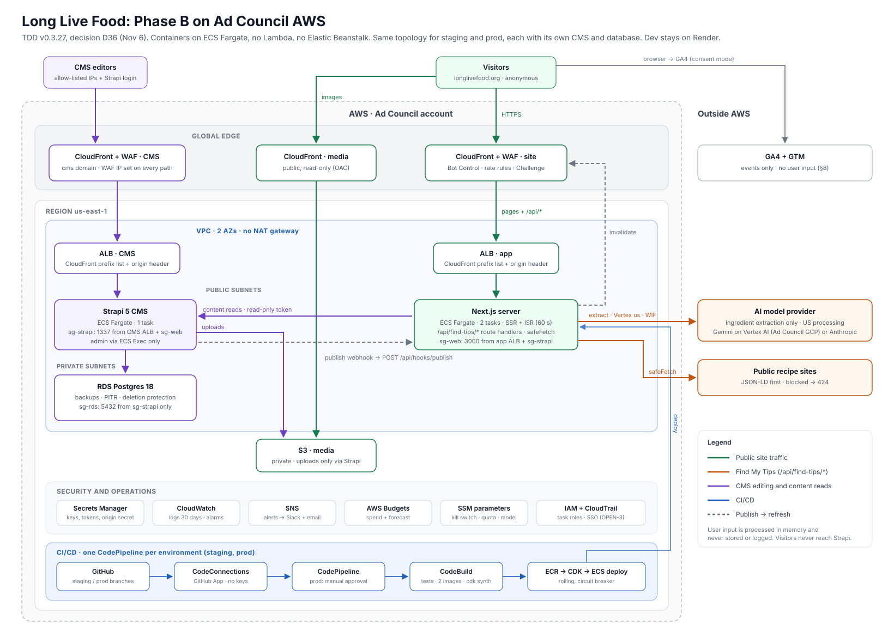
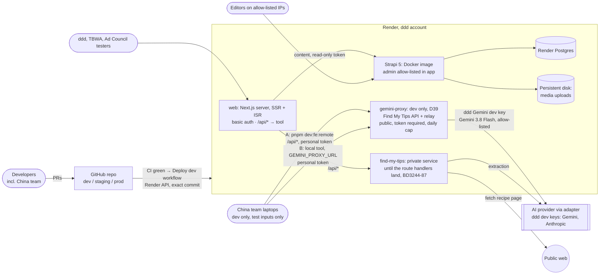
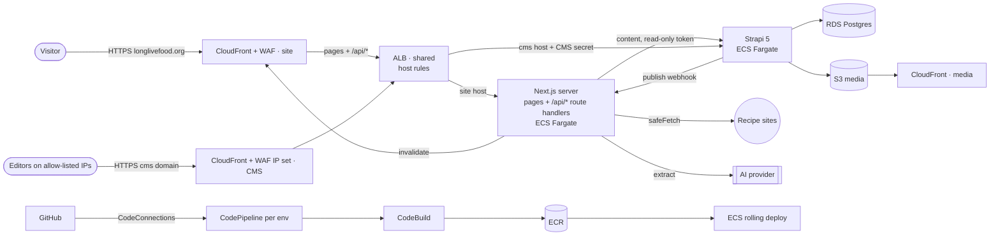
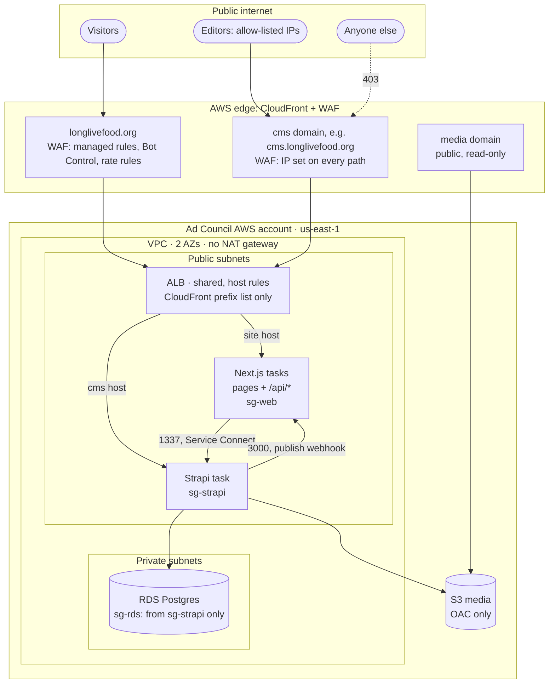
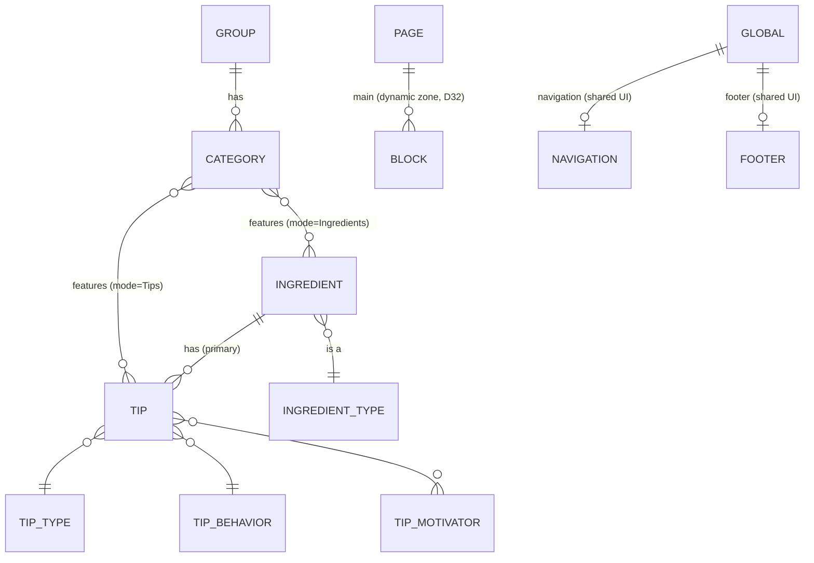
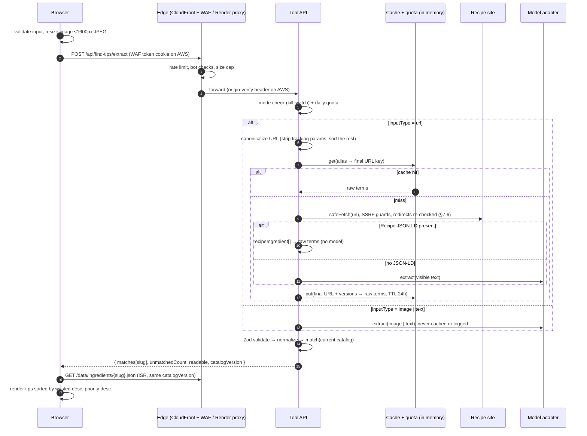
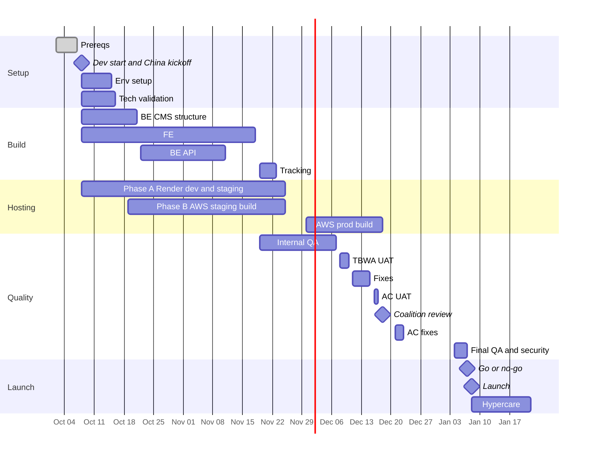

# Technical Design Document: Long Live Food (longlivefood.org)

| | |
|---|---|
| **Client** | The Ad Council, for the Long Live Food coalition (EPA, Ad Council, WWF, ReFED, WRAP) |
| **Campaign** | Finish the Fridge |
| **Delivery** | dotdotdash (ddd) |
| **Owner / author** | Art Longbottom (tech lead) |
| **Reviewers** | James Calhoun (tech lead), James Steele (AWS/DevOps), Adam Paikowsky (analytics), Danish Aziz (PM), China dev team (Eva Fan, Alessandro Grena, Maggie Ding) |
| **Status** | **DRAFT v0.3.32.** For internal ddd review. A work-in-progress copy goes to the China team on **Thu Oct 8** for input. A client-shareable cut follows at Design sign-off ([§0](#0-document-purpose-and-lifecycle)) |
| **Last updated** | 2026-11-17 |
| **Go-live** | **Friday, January 8, 2027** (go/no-go Thursday, January 7). There's **no contingency** after final QA |

> **How to read this document.** Every significant statement has a label:
> **[CONFIRMED]** means the client stated it, or it's in the handoff, the project notes, the kickoff, or the weekly status.
> **[TL DECISION]** means the ddd tech lead decided it (Art, 2026-10-06). It's binding for the build. If it touches client systems or vendors, it still needs client sign-off, and that's noted.
> **[VERIFIED]** means we checked it directly in code or in vendor docs (Strapi repo audit and vendor checks, 2026-10-06).
> **[PROPOSED]** is ddd's recommendation and still needs approval.
> **[OPEN]** is undecided. Each open item has an ID (OPEN-#) in [§15](#15-open-questions).
> Project background, people, and brand rules are in [`PROJECT.md`](./PROJECT.md). This document doesn't repeat them.

---

## Contents
0. [Document purpose and lifecycle](#0-document-purpose-and-lifecycle)
1. [Summary](#1-summary)
2. [Goals, non-goals, and requirements](#2-goals-non-goals-and-requirements)
3. [Constraints, assumptions, and considerations](#3-constraints-assumptions-and-considerations)
4. [System architecture](#4-system-architecture)
5. [CMS (Strapi)](#5-cms-strapi)
6. [Frontend (Next.js)](#6-frontend-nextjs)
7. [Find My Tips service](#7-find-my-tips-service)
8. [Instrumentation specification](#8-instrumentation-specification)
9. [Infrastructure and DevOps](#9-infrastructure-and-devops)
10. [Security and privacy](#10-security-and-privacy)
11. [Testing, quality, and launch readiness](#11-testing-quality-and-launch-readiness)
12. [Delivery plan](#12-delivery-plan)
13. [Risks](#13-risks)
14. [Decision log](#14-decision-log)
15. [Open questions](#15-open-questions)
16. [Appendix](#16-appendix)

---

## 0. Document purpose and lifecycle

Under the **ddd Tech Process**, this TDD is the **master technical document**. The tech leads own it, and it stays current through every phase. Production owns the project plan and scope documents, and tech gives input to them. [CONFIRMED (ddd Tech Process)]

| Phase | What the TDD has to contain | Where | State |
|---|---|---|---|
| Pre-Sale | Approach | n/a | **Skipped.** The project was inherited from TBWA mid-flight |
| Discovery | Refinement: audit of inherited assets, open questions | §5.1, §15, [`CLIENT_AUDIT.md`](./CLIENT_AUDIT.md) | v0.1 (Oct 6) |
| **Design** | Software architecture diagram · network diagram · functional requirements · instrumentation spec · assumptions and considerations | §4.1, §4.3, §2.3, §8, §3 | **v0.3 (this draft).** Work in progress to the China team on Oct 8. Target **v1.0 at the end of tech validation, Oct 16** |
| Design (hardware) | Hardware spec, single-line diagram | n/a | **N/A.** No hardware on this project |
| Build | Kept current as decisions land. Large decisions get ADRs | §14, `docs/adr/` | Continuous |
| Launch | Updated docs: an as-built TDD, plus input to the O&M manual | §9.6, §11.6 | Jan 8 |

**Companion artifacts owned by tech**
| Artifact | File | Purpose |
|---|---|---|
| Client Audit Doc | [`CLIENT_AUDIT.md`](./CLIENT_AUDIT.md) | What we inherited and what access we have: repos, AWS, Strapi, AI accounts, DNS, analytics |
| Proof Doc | [`PROOF_DOC.md`](./PROOF_DOC.md) | Technical spikes: the hypothesis, method, result, and decision for each |
| Release Log + Feedback Tracker | [`RELEASE_LOG.md`](./RELEASE_LOG.md) | Scaffolding, Alpha, Beta, RC, and Launch releases, and how feedback rounds map to Jira |
| Launch Checklist | [`LAUNCH_CHECKLIST.md`](./LAUNCH_CHECKLIST.md) | Go/no-go criteria and cutover runbook, done with Omnicom IT |
| Code reviews | GitHub PRs ([template](../.github/pull_request_template.md)) | Every change is reviewed. The rules are in [`AGENTS.md`](../AGENTS.md) |
| Hardware spec | n/a | **N/A** |

**Owned by production (Danish), with tech input:** feature list, project plan, weekly sprint plan, retros, scope, estimate, staffing, defects (Jira), and the O&M manual.

---

## 1. Summary

We're building **longlivefood.org**, a fast, accessible, SEO-friendly content site with one AI-assisted feature, **Find My Tips**. A user gives the tool a recipe link, a photo (a receipt, a shopping list, or a dish), or pasted text. We pull out the ingredients, and **plain code** matches them against a closed catalog managed in the CMS. Then we show food-waste tips that the coalition has approved. The AI only ever returns **raw ingredient terms**. Every word a user reads comes from Strapi or from typed content files in the repo, never from the model (D21). [PROPOSED; this is the agreed direction in PROJECT.md §7.2]

**Shape of the build**
- **Two hosting phases.** [TL DECISION]
  - **Phase A (now through about mid-November):** local development plus **Render, on ddd's own account**, for the dev and staging environments. That way, development doesn't wait on Ad Council's AWS access.
  - **Phase B (in parallel, with James Steele):** we build the target architecture in **Ad Council's AWS** and move staging, then production, onto it. UAT and launch both run on AWS ([§12](#12-delivery-plan)).
  - Render is a ddd dev tool, **not the production host**. It gets switched off after handoff.
- **Postgres everywhere** [TL DECISION]: Docker Postgres locally, Render Postgres in Phase A, and **RDS Postgres** in Phase B.
- **Containers on Fargate, no Lambda** [TL DECISION, D36]: in Phase B there are two Docker images on **ECS Fargate**: the Next.js server (pages **and** the tool API) and Strapi. No Lambda, API Gateway, or Elastic Beanstalk. AWS deploys run on **CodePipeline**.
- **Frontend** [TL DECISION]: **Next.js** (App Router, TypeScript) with **Tailwind CSS and shadcn/ui** (built on Radix primitives).
  - Every component has to meet **WCAG 2.1 AA**.
  - **Server-rendered** (D36): the Next.js server (`output: 'standalone'`) runs as a container, pages render on request and are cached for about a minute (ISR). No static export, no OpenNext.
- **CMS:** the existing **Strapi 5** project, hardened for production with Postgres, S3 media, and the Cloud plugin removed.
  - The **admin runs on its own domain, open only to allow-listed IPs** [TL DECISION]. Staging and production always enforce this. On **dev** during the build, the allow-list is lifted, except for the first-admin sign-up (D31).
  - The public site runs on a public endpoint. Visitors never reach Strapi.
  - **Hybrid content model** [TL DECISION, D21, updated by D32]: the CMS holds the collections (ingredients, tips, categories), global settings, Tool Copy, long-form rich text, and the **pages**. Every page is built from **blocks named after the Figma components**, in the Page `main` dynamic zone. Site strings live in code as typed files, changed by PR. Data-driven routes (Category, Search, tool results) stay in code (§6.4).
- **Find My Tips:**
  - Recipe pages: read the JSON-LD first, and call the model only when there isn't any.
  - Images: the model extracts ingredient terms from **receipts, lists, and dish photos**. Code matches them against the catalog.
  - The provider sits behind a swappable adapter.
  - **Development uses ddd's Anthropic (Claude) keys** [TL DECISION]. We switch to a key that Ad Council provides once one exists (OPEN-1).
  - Runtime: **Next.js route handlers** in the site's own server (D36). The handler (`Request` → `Response`) is a library the routes call, on Render in Phase A and **ECS Fargate** in Phase B. No separate API service.
- **Branches map to environments** [TL DECISION]:

  | Branch | Deploys to |
  |---|---|
  | `dev` (trunk, the default branch) | dev |
  | `staging` | staging (UAT) |
  | `prod` | prod (Live) |

  We promote code from one environment to the next with PR merges.
- **Repo and team** [TL DECISION]:
  - Art scaffolds the repo in ddd's GitHub, then **moves it to Ad Council's GitHub org**.
  - The China team gets access to **that one repo only**, after the move.
  - All work is assigned through **Jira tickets**.
- **Budget:** **pro-bono, at cost** [CONFIRMED]. We pick the cheapest infrastructure that still meets the non-functional requirements.

**What the repo audit found that changes the plan** ([§5.1](#51-audit-of-the-existing-strapi-repo)):
- The Strapi project is a reasonable start, but it's **closer to a prototype than ready to deploy**:
  - It runs on SQLite with no Postgres driver.
  - It stores media on local disk.
  - It includes the Strapi Cloud plugin.
- Several types and modules from the walkthrough are missing: Accordion, Modal, global nav/footer, and scroll-lock. "Strings" from the walkthrough move to code rather than a CMS type (D21).
- **The Figma audit is done** (Oct 6, [§6.1](#61-pages-and-routes)). Accordion is confirmed. The Modal is a Tip Modal built as UI, not a CMS block (D22). Scroll-lock has no spec (OPEN-36). Design gaps for Colleen: missing tool states and the dish photo (OPEN-34), General Tips, 404, and mobile Toolkit (OPEN-39), and placeholder copy and nav labels (OPEN-38).
- A few fields differ from the notes. Ingredient uses `title`, not `name`, and `synonyms` is one string rather than a list.
- Dan's content entries aren't in the repo. So we **seed the content ourselves** ([§5.5](#55-content-seeding-and-migration)).

**Decisions needed by Oct 16 (end of tech validation):**
- AWS IAM access (OPEN-3)
- Rendering mode (OPEN-4)
- The GitHub org and migration date (OPEN-11)
- Whether launch needs Spanish (OPEN-12)
- Whether Ad Council IT accepts Render for development (OPEN-23), and Google (Gemini) as an AI vendor (OPEN-2)
- Whether the Copilot coding agent can be used in Ad Council's GitHub and Jira for copy changes (OPEN-32)
- Confirming the TBWA Worldwide copy of the Figma file is the single design source, and freezing the original (OPEN-33)
- Whether the tool accepts video links, which the Figma input copy shows (OPEN-35)

See [§12.3](#123-decision-deadlines).

---

## 2. Goals, non-goals, and requirements

### 2.1 Goals
| # | Goal | Measure |
|---|---|---|
| G1 | Send PSA, social, PR, and grant traffic to the site and into the tool | `tips_tool_start` and `tips_tool_result` / sessions (GA4) |
| G2 | Give useful tips for what users already have | Matched-ingredient precision ≥ 0.9 and recall ≥ 0.8 on the eval set (**target to agree with the client**, OPEN-8) |
| G3 | The client can change what users see without waiting on a developer | Content, Tool Copy, rich text, and images are editable in the CMS. Site strings live in typed content files and change through a copy-change issue that a coding agent turns into a PR with a preview (D21, §5.2). No string literals inline in components. New modules are tracked without code (§8) |
| G4 | Be found through search and AI answer engines, including for "Finish the Fridge" | Indexed pages, valid structured data, Lighthouse SEO = 100 |
| G5 | Be accessible | WCAG 2.1 AA, zero critical or serious axe violations, manual screen-reader passes |
| G6 | Be fast on mobile, because users are in a hurry | Core Web Vitals "good" at p75 on mobile. Tool result p95 < 8 s for images and < 3 s for JSON-LD recipe URLs |
| G7 | Keep costs low enough for a pro-bono budget, predictable, and easy to hand over to Ad Council's next DevOps partner | IaC, runbooks, budget alarms, [§9.5](#95-cost-estimate) |

### 2.2 Non-goals for launch
- Recipe content or recipe generation (OPEN-6). Composting guidance. Chat or any free-form AI.
- User accounts, saved lists, or personalization.
- Fridge-photo input. It's a **stretch goal**, and the pipeline supports it if it's approved (OPEN-7).
- Having the model choose or rank tips (RAG). That's phase 2 (PROJECT.md §7.2).
- Ingredient detail pages. They're **not in the locked design**, so we'd add them later for SEO if the client wants them (OPEN-15).
- Analytics work **beyond embedding the basic GA/GTM script**. Broader analytics planning, configuration, and validation need a **separate scope agreement** (OPEN-27). [CONFIRMED (weekly status, Oct 5)]

### 2.3 Functional requirements
| ID | Requirement | Source |
|---|---|---|
| FR-1 | Editors create Pages and arrange them from a library of blocks (dynamic zone) named after the Figma components. Designed pages (Home, Find My Tips, Library, About, Toolkit) are seeded in the Figma order, and editors can add blocks (D32) | [CONFIRMED]; pages from blocks [TL DECISION, D32] |
| FR-2 | The CMS manages tips, ingredients (with synonyms and a wasted score), categories, groups, and taxonomies | [CONFIRMED] |
| FR-3 | Find My Tips accepts a recipe URL and an image. The image can be a receipt, a list, a recipe, or **a photo of a dish** (it should recognize the dish and infer its ingredients). Pasted text is [PROPOSED]. Figma shows two modes, "Paste a Link" ("Enter a recipe URL or video link") and "Upload an Image" ("Photo of your fridge or pantry"). Video links are new scope (OPEN-35), and the dish-photo flow isn't designed (OPEN-34) | [CONFIRMED] (dish recognition: kickoff; modes: Figma `1:7980`) |
| FR-4 | Show matched ingredients with their CMS tips, sorted by `wasted` and then by tip priority | [CONFIRMED]/[PROPOSED] |
| FR-5 | Handle these UX states: loading, success, partial, no-match, unreadable, rate-limited, unavailable, error. All copy comes from the CMS | [CONFIRMED]/[PROPOSED] |
| FR-6 | Site search across ingredients, tips, and categories ("Search 100+ ingredients") | [CONFIRMED] (Figma Search frames `1:1609`, `1:1702`, `1:4327` and the header search popover `1:7183`). The repo has only a `custom.search` placeholder component, and the behavior is **not built** |
| FR-7 | Category pages: show either all tips for the category's ingredients or hand-picked tips | [VERIFIED] (`mode` enum) |
| FR-8 | Help editors find gaps in the catalog: a report of unmatched items, classified as **edible, inedible, or compostable**, so new tips can be written (Ad Council request, Nov 4). **No data retention on our side**: one stateless request, with people, pets, and personal data filtered out (D35) | [PROPOSED]. Built behind `GAP_LOG`, **off until legal agrees** (OPEN-5, [§7.8](#78-catalog-gaps)) |
| FR-9 | `finishthefridge` domains redirect (301) to longlivefood.org | [CONFIRMED] |
| FR-10 | An About/FAQ page that explains Finish the Fridge | [CONFIRMED] |
| FR-11 | A **General Tips** page built from existing blocks (generic template), with its navigation entry restored | [CONFIRMED] (weekly status) |
| FR-12 | A **Toolkit** page (desktop design delivered Sep 30; ddd adapts it for mobile). Needs **coalition design approval** | [CONFIRMED] (weekly status) |

### 2.4 Non-functional requirements
| Area | Requirement |
|---|---|
| Accessibility | WCAG 2.1 AA. Respect `prefers-reduced-motion`. Use the heading level the editor chooses in the CMS. shadcn/Radix primitives are a starting point, not proof of compliance (§6.6) |
| Performance | LCP < 2.5 s, INP < 200 ms, CLS < 0.1 at p75 on mobile. The JS bundle for content pages should be ≤ 150 KB gzipped (target) |
| Availability | Content pages: ≥ 99.9% (static files on CloudFront). Tool API: ≥ 99.5%. These apply in production (AWS). Render environments have no SLA |
| Security | OWASP ASVS L1 baseline. SSRF-safe URL fetching. WAF in production. The CMS admin is IP-restricted. Secrets live only in the platform's secret store |
| Privacy | No personal data in logs or analytics. **User text and images are never stored** (OPEN-5). AI data is processed and stored **only in the US**, with usage and spend controls (weekly status). **What "US-only" covers** [PROPOSED]: the AI provider's processing and retention, plus everything we store (logs, S3, RDS, all in `us-east-1`). CloudFront and WAF are **global edge** services, so a visitor's request is received (TLS-terminated and inspected) at the nearest edge location, which may be outside the US, but nothing is stored there except standard logs, which are delivered to `us-east-1`. Legal confirms this reading (OPEN-31) |
| Cost | **Pro-bono / at cost.** Choose the cheapest option that meets these requirements. Estimates are in [§9.5](#95-cost-estimate). AI spend is limited by an in-app daily quota and kill switch, with provider budget alerts as a backstop (§7.6) |
| Maintainability | IaC for everything on AWS. Runbooks. Can be handed to the new DevOps partner. The repo lives in Ad Council's GitHub org |
| Browser support | The last 2 versions of evergreen browsers, plus iOS Safari 16+ |
| One codebase | **All work happens in this repo, starting from the `dev` scaffold** (§4.4, D29). Work started anywhere else is **ported into the scaffold** to match this TDD (blocks, `packages/ui`, `content/`, Zod contracts, schema as code), not merged in from a separate base. No parallel apps, no second CMS |
| Hosting during the build | Code, content, and CMS instances run **only** locally, on ddd's Render account (dev, staging), or in Ad Council's AWS. **No other hosting**, including team-run servers or third-party Strapi hosts, even for demos (D29) |
| Change control | Every change reaches `dev`, `staging`, and `prod` by **PR only**: green CI, 1 approving code-owner review, resolved threads, and a **title that starts with its Jira key** (`BD3244-123: …`). No direct or force pushes (§9.3, D28) |
| Review link | A **stable dev URL** on Render for client and team review, behind basic auth and `noindex`, updated only from commits that passed CI (§9.1, D27) |

---

## 3. Constraints, assumptions, and considerations

**Constraints** [CONFIRMED]
- **Hard launch date: Fri Jan 8, 2027**, with the go/no-go on Thu Jan 7.
  - Jan 8 is the latest date that's acceptable. **There's no contingency after final QA** (Jan 4–7).
  - UAT and fixes fall over the holidays (§12).
- Designs are **locked**, with two exceptions:
  - The **Toolkit** page is desktop-only for now. ddd is adapting it for mobile, and it still needs coalition approval.
  - Copy and images can still change.
- **New SaaS or vendors need Ad Council IT approval.**
  - Approved so far: GitHub, AWS, Strapi, and two AI vendors: **Anthropic** [CONFIRMED (Art, Oct 19)] and **Google (Gemini)** [CONFIRMED (Art, Nov 6), D37]. Production Gemini runs on **Vertex AI in Ad Council's own Google Cloud project** (BD3244-86).
  - **OpenAI is not authorized.** Earlier drafts listed it as approved; that was wrong. TBWA's capped OpenAI test key is used for the eval only.
  - ddd's own Gemini key stays **dev/eval only**, with test data (§7.7, D25). Production never uses it.
  - That's why production uses AWS-native services, for example WAF Bot Control instead of reCAPTCHA or Turnstile.
- **There's no production AI account yet.**
  - No client-owned Anthropic account or production key exists yet (OPEN-1).
  - Before go-live, **US-only data storage and usage/spend controls** must be validated (weekly status). What "US-only" covers is in §2.4 and OPEN-31.
- **Budget is pro-bono / at cost.**
- The **China dev team** kicks off **Oct 8**. Mainland China can't reach the OpenAI or Anthropic APIs without a proxy.
- **AWS access** [CONFIRMED (kickoff)]: James Calhoun has a **real IAM user** (username and password, not SSO). It can create a CodeBuild project but **can't list users or pipelines**, so the permissions are partial and misconfigured. James Steele is checking whether his account has admin. Danish's account is on hold until this is fixed. We've asked for usable, scoped permissions (OPEN-3), and Danish is passing that to Cat.
  - Ad Council is also changing DevOps partners.

**Assumptions** (we'll treat these as true until someone tells us otherwise)
- **A1:** The launch is **English-only**. Strapi i18n is not enabled in the repo [VERIFIED]. If Spanish is needed, that's a significant change (OPEN-12).
- **A2:** Content volume at launch is around **100–300 ingredients and around 300–1,000 tips**. "Search 100+ ingredients" is the default placeholder [VERIFIED].
- **A3:** ddd embeds GTM/GA4 (basic). Who owns the container and property configuration, and anything beyond the basic embed, is OPEN-18 and OPEN-27.
- **A4:** Ad Council controls DNS for longlivefood.org and the finishthefridge domains. They'll create or delegate records when we ask (OPEN-20).
- **A5:** Visitors don't log in. The only logged-in users are CMS editors.
- **A6:** Render is acceptable for **development and preview hosting on ddd's own account**, using seed and test content only, with no visitor data. We still need to confirm this with Ad Council IT (OPEN-23).
- **A7:** Using **ddd's Anthropic keys in development**, with test inputs only, is acceptable. Anthropic is authorized (confirmed Oct 19). The production provider and key belong to Ad Council (OPEN-1).

**Considerations**
- **Image selection is a separate workstream** [CONFIRMED (kickoff)]. Colleen Miller owns it, and it takes about a month (OPEN-28). The CMS has to handle placeholder images until then.
  - **Lifestyle images** (≈ 20): from Ad Council's iStock. AI only if a specific image is requested.
  - **Tip-library category images** (≈ 50): stock first, with AI-generated images as the backup.
  - **Ingredient images:** AI generation is approved. Tools discussed: Adobe Firefly, Nano Banana, and optionally Magnific for upscaling. ddd may build a small generation pipeline (optional epic IMAGES, BD3244-2, §12.4). It runs offline, and its output is uploaded through the seed pipeline (§5.5), never at runtime.
- **Toolkit approval.** Feedback on the Toolkit arrived on Friday (Oct 2), and Colleen Miller is estimating the changes. The coalition still has to approve the design. We build the Toolkit from existing blocks where we can, so that late changes affect content rather than code.
- **Maintainability after handoff** [kickoff, James Calhoun]: a future team (for example DDB Australia) must be able to take the site over, and the client shouldn't need ddd for routine copy changes. This drives the hybrid content model (D21), the copy-change flow (§5.2), and the process docs (§11.4). James Steele and James Calhoun have both run Strapi before (the Ether project).
- **Feedback channels.** Internal feedback goes through Jira. Ad Council and the coalition will use Jira or a spreadsheet, format still to be confirmed (OPEN-29). Either way, everything gets entered into Jira for triage ([`RELEASE_LOG.md`](./RELEASE_LOG.md)).
- **The Render-to-AWS migration is planned work, not cleanup.** To keep parity, both platforms run the same artifacts, use the same environment-variable contract, and follow the same seeding path ([§9.2](#92-target-aws-architecture-phase-b), [`PROOF_DOC.md`](./PROOF_DOC.md)).

---

## 4. System architecture

### 4.1 Software architecture



*Phase B at a glance (D36, D37). Source: the "LLF · Phase B · AWS + Google Cloud · D36/D37" frame in the [Figma architecture file](https://www.figma.com/design/fbvFTow5YUbtCoXNfrQC4n/?node-id=54-710), exported to [`docs/architecture/phase-b.svg`](./architecture/phase-b.svg). Edit it in Figma and re-export; AWS-style icons are stand-ins.*

**Phase A: local + Render (ddd account), from now until AWS staging is ready** [TL DECISION]



**Phase B: Ad Council AWS (target for UAT and launch)** [TL DECISION, D36; details with James Steele]



The same code runs in both phases. Only the hosting and the environment configuration change:

| Concern | Phase A (Render) | Phase B (AWS) |
|---|---|---|
| Site | Next.js server (`next start`, standalone build) on a Render web service, with basic auth in middleware | The same image on **ECS Fargate** behind the shared ALB (site host rule), with CloudFront + WAF in front |
| Tool API | Next.js route handlers (`app/api/find-tips/*`) in the web service | The same, in the same Fargate service |
| CMS | Strapi Docker image on a Render web service | The same image on **ECS Fargate** behind the shared ALB (CMS host rule) |
| Database | Render Postgres (paid instance, because free instances expire after 30 days [VERIFIED]) | RDS Postgres |
| Media | Render persistent disk (`UPLOAD_PROVIDER=local`) | S3 + CloudFront (`UPLOAD_PROVIDER=aws-s3`) |
| Publish → live | Pages refresh on their own within about a minute (ISR) | The same, plus a CloudFront invalidation from the publish route (§5.3) |
| Admin IP restriction | App middleware in Strapi (§5.4) | WAF IP set on the CMS CloudFront distribution |
| Abuse controls | In-app rate limiting and a daily quota | WAF (rate rules, Bot Control, Challenge) plus the same in-app quota (§7.6) |
| Secrets | Render environment groups | AWS Secrets Manager |
| Deploys | `deploy-dev.yml` (GitHub Actions → Render API) | **CodePipeline** per environment (§9.3) |

### 4.2 Components
| Component | Tech | Responsibility | Status |
|---|---|---|---|
| `apps/web` | Next.js (App Router, latest stable at scaffold time), React 19, TypeScript, **Tailwind CSS + shadcn/ui** (Radix). Standalone server build (D36) | Blocks, data-driven routes, site strings (`content/`), search, the tool UI | [TL DECISION] stack; details [PROPOSED] |
| `apps/cms` | Strapi 5.45 (JS), Postgres (`pg`), S3 upload provider, Dockerfile | Content, media, editor workflow | [VERIFIED] base; changes [PROPOSED] |
| `services/find-my-tips` | TypeScript library. One handler (Web `Request` → `Response`), called by the Next.js route handlers (D36) | Extraction, matching, quotas, and the publish hook | [PROPOSED] |
| `packages/contracts` | Zod + TypeScript types | API request/response schemas, catalog snapshot schema, `ExtractionResult` | [PROPOSED] |
| `packages/matching` | TypeScript | Normalization and matching with no AI, used by site search **and** the service | [PROPOSED] |
| `packages/ui` *(optional)* | shadcn/ui components + Tailwind preset | Design-system primitives generated from the Figma tokens | [PROPOSED] |
| `infra` | AWS CDK v2 (TypeScript) + `render.yaml` (Render Blueprint) | AWS stacks and the CodePipeline for each environment. Render services for Phase A | [PROPOSED] |
| `scripts/seed` | TypeScript CLI | Validated JSON → idempotent import into Strapi through the REST API (§5.5). The synthetic fixture seed is built; the one-off scrape or extract of the project seed is not | [VERIFIED] synthetic seed (BD3244-24); [PROPOSED] scrape |
| `eval` | TypeScript CLI (`services/find-my-tips/src/eval/`), data in root `eval/` | Accuracy evaluation against a labeled set, run only on purpose | [VERIFIED] harness (BD3244-33); labeled set pending |

### 4.3 Environments and network

**Environments and branches** [TL DECISION]. Each environment has its own CMS and database. Code moves **dev → staging → prod** through PRs. Content does **not** flow automatically between environments (§5.5).

| Env | Branch | Phase A host | Phase B host | CMS / DB | AI key | Who uses it |
|---|---|---|---|---|---|---|
| **local** | any | Laptop (Docker Compose: Postgres) | n/a | Local Strapi + seed data | **Mock** by default. ddd's dev key (Gemini or Anthropic) optional (D33). From mainland China: the Render dev tool or the Gemini relay, never a Google key (D38, §11.4) | Every developer, **including the China team** |
| **dev** | `dev` (trunk, default) | Render | Render until launch. After handoff: recreated on AWS or retired (OPEN-24) | cms-dev / own DB | ddd Anthropic key, low cap | Developers, internal QA |
| **staging** (PM sheet: **UAT**) | `staging` | Render, until AWS staging is ready | **AWS** | cms-staging / own DB | Client key once one exists. Until then, ddd's dev key with test inputs only | Internal QA, TBWA UAT, Ad Council UAT, coalition review, **pre-launch content entry** |
| **prod** (PM sheet: **Live**) | `prod` | **None. Production never runs on Render** | **AWS** | cms-prod / own DB | Client production key (OPEN-1) | The public |

**Network design** (Phase B; Phase A equivalents are in the §4.1 table) [TL DECISION, D36; details with James Steele]



| Zone | Exposure | Controls |
|---|---|---|
| Public site (`longlivefood.org`, `www`, the `finishthefridge` redirect domains) | Public | CloudFront + WAF (managed rules, Bot Control, rate rules). Security headers set by a response-headers policy. HTML is cached briefly at the edge, `/_next/static/*` for a year (hashed) |
| Tool API (`/api/*` on the site domain) | Public, same origin | WAF rate rules and Challenge, in-app rate limit, daily quota, and kill switch (§7.6). Not cached |
| **CMS domain** (admin, auth, and APIs) | **IP allow-list only** [TL DECISION] | WAF IP set on **every path**: Ad Council editors, ddd US, China team (OPEN-17). The site reads content **inside the VPC** (Service Connect), so nothing outside needs `/api/*` on this domain. Strapi auth is still required on top of that |
| Fargate tasks (web, Strapi) | Reachable only through their ALB, or from each other on named ports | **One ALB per environment** with host-based listener rules (James S, Nov 10). It accepts only CloudFront's origin-facing prefix list, and **each CloudFront distribution sends its own secret origin header**: the site rule needs the site host and the site secret, the CMS rule needs the CMS host and the CMS secret, and anything else gets a fixed 403. That way a request through the site distribution with a forged `Host: cms…` can't reach Strapi and skip the CMS WAF IP set. `sg-web` accepts 3000 from the ALB and `sg-strapi` (publish webhook); `sg-strapi` accepts 1337 from the ALB and `sg-web`. **No NAT gateway**: tasks run in **public subnets with a public IP used only for outbound** traffic (AI provider, recipe sites, ECR, logs, Secrets Manager) |
| Database | Private subnets only | `sg-rds` accepts 5432 only from `sg-strapi`. Admin access through **ECS Exec** / SSM Session Manager, never a public endpoint |
| Media | Public read-only CDN | S3 private behind OAC. Uploads go only through Strapi |

> **Why no NAT gateway, and the alternative** [PROPOSED; confirm with James S]: a NAT gateway costs about $32/month per AZ plus data charges, which is a lot for a pro-bono site. A public IP with an inbound-only-from-ALB security group gives the same exposure. If Ad Council IT requires **private subnets with no internet route**, the CMS and web tasks can use **VPC endpoints** (ECR `api` and `dkr`, CloudWatch Logs, Secrets Manager, SSM, STS, and a free S3 gateway endpoint), about **$60–70/month per environment** in one AZ. The web service still needs the internet for the tool (recipe sites and the AI provider), so it would need a NAT gateway or stay in a public subnet.
>
> **The SSRF boundary** (§7.6): the tool fetches arbitrary recipe URLs from the same tasks that read Strapi. `safeFetch` resolves DNS first and blocks private and link-local ranges (including the ECS task metadata endpoint and the Service Connect addresses), so a recipe URL can't reach Strapi or RDS, and RDS isn't reachable from `sg-web` at all. **If IT wants a hard network boundary**, the same image runs as a second ECS service that serves only `/api/*` (an ALB path rule) with no route to Strapi. No code change, about $20–40/month more.

### 4.4 Repository layout [VERIFIED for apps/, services/, packages/, scripts/, and root tooling; and eval/ (harness, BD3244-33); PROPOSED for the rest of infra/ and the project-seed scrape]

A single **pnpm workspace** monorepo, so the contracts and matching code are shared and change in one place. **The scaffold is built** (BD3244-16, Oct 7). The [README Quickstart](../README.md) is the onboarding entry point.

```
/
├─ apps/
│  ├─ web/                 # Next.js + Tailwind + shadcn/ui (standalone server, SSR + ISR, D36)
│  │  ├─ content/          # typed site strings (Zod-validated), changed by PR (D21)
│  │  ├─ blocks/           # dynamic-zone blocks + registry (every Page, D32)
│  │  ├─ fixtures/cms/     # recorded CMS JSON for builds without Strapi (CMS_FIXTURES=1)
│  │  └─ e2e/              # Playwright + axe specs (API mocked with page.route)
│  └─ cms/                 # Strapi project, imported from AdCouncil/ending-wasted-food-strapi (+ Dockerfile)
├─ services/
│  └─ find-my-tips/        # handler library called by apps/web route handlers; src/extract (providers, prompts), src/eval (runner)
├─ packages/
│  ├─ contracts/           # Zod schemas and TS types (API, catalog snapshot, extraction)
│  ├─ matching/            # normalize() + match(); shared by search and the API
│  ├─ ui/                  # shadcn components; Figma tokens in styles/tokens.css
│  └─ config/              # shared tsconfig, eslint, prettier
├─ infra/
│  ├─ aws/                 # AWS CDK app (stacks + CodePipeline per env)
│  └─ cloudfront-functions/ # host redirects + trailing slash (§6.2) + unit tests
├─ render.yaml             # Render Blueprint for Phase A (dev now; staging later). At the root, where Render looks for it
├─ scripts/
│  ├─ ensure-cms-env.mjs   # creates apps/cms/.env with random local secrets if missing (unset keys commented out)
│  ├─ render-deploy.mjs    # deploys one commit to Render dev via the API, then smoke-tests it (D27)
│  └─ seed/                # synthetic fixture seed: JSON → validate → upsert → publish → verify (re-runnable); the project-seed scrape lands here later
├─ eval/                   # sets/ (labeled sets), runs/ (git-ignored), reports/; run on demand
├─ docs/                   # TDD, PROJECT, companion docs, ADRs, runbooks
├─ docker-compose.yml      # local Postgres (and optional Strapi)
└─ .github/workflows/      # ci.yml, deploy-dev.yml, pr-title.yml; later deploy and publish-triggered builds
```

- **How we bring in the Strapi code:** `git subtree add` from `AdCouncil/ending-wasted-food-strapi` keeps its history. We rename the package from `test-strapi` to `@llf/cms`. **[VERIFIED] (P2, Oct 7):** Strapi 5.45 installs, builds, and runs inside the pnpm workspace with the default isolated linker and one lockfile, with no hoisting. `apps/cms/Dockerfile` is a multi-stage `node:22-alpine` build that uses `pnpm deploy --prod`. The admin bundle goes to `build/` and is built per environment, because `ADMIN_PATH` and the backend URL are baked in ([`PROOF_DOC.md`](./PROOF_DOC.md#p2-strapi-5-in-a-pnpm-workspace)).
- **Where the repo lives** [TL DECISION]:
  1. Art scaffolds it in **ddd's GitHub** (Oct 6–9).
  2. It moves to **Ad Council's GitHub org** with GitHub's repository transfer, which keeps the history, issues, and PRs, or with a mirror push if transfer isn't allowed (OPEN-11).
  3. Branch protection, environments, and secrets are set up again in the new org.
  4. **The China team works in this one repo.** *Updated Oct 19:* the move slipped (OPEN-11), so the China team has **write** access (no admin) to `dotdotdashdev/3244_tbw_ad_council` now, under the same branch protection. The scaffold is on **`dev`**, which is the default branch; **all work starts there** (D29). Their access carries over when the repo moves.
- **Branch protection** (D28; **applied Oct 19** to `dev` and `main` in ddd's org, and re-applied after the move):
  - `dev`, `staging`, and `prod` are protected. `main` (the original upload) is locked too; nothing new goes there.
  - PRs need 1 approving **code-owner** review (a tech lead for `staging` and `prod`), green CI (the required checks in §9.3), and resolved review threads. New commits dismiss earlier approvals.
  - The PR title starts with its Jira key (`BD3244-123: …`), checked by `pr-title.yml`. Promotion PRs are exempt.
  - No direct pushes, and no force pushes. ddd admins can bypass in an emergency and note it on the PR.
  - A hotfix branches from `prod`, then merges back to `staging` and `dev`.
- **Toolchain:** Node 22 LTS (`.nvmrc`; `engines` `>=22.12 <23`), pnpm **9.15.2** pinned by `packageManager` (Corepack), ESLint flat config (with `jsx-a11y`), Prettier (`format:check` runs in CI), Vitest, Playwright, and `@axe-core/playwright`. Turborepo isn't used yet; plain `pnpm -r` is fast enough at this size. `.github/CODEOWNERS` makes the China team leads code owners everywhere, so they approve and merge into `dev`; the tech lead reviews after merge (D34).

---

## 5. CMS (Strapi)

### 5.1 Audit of the existing Strapi repo

Repo: `AdCouncil/ending-wasted-food-strapi`, commit `f753967` ("initial checkin", Dan Johnston). Audited on 2026-10-06. Everything in this section is **[VERIFIED]** unless it's labeled otherwise.

**Platform and config**
| Item | Finding | Impact |
|---|---|---|
| Version | Strapi **5.45.0**, **JavaScript** (not TS), package name `test-strapi`, Node `>=20 <=24` | OK. Rename the package. TypeScript conversion is optional and not planned |
| Database | Uses **SQLite** by default (`better-sqlite3`). `config/database.js` supports Postgres, but **the `pg` driver isn't installed** | Add `pg`. Use **Postgres 16 in every environment**: Docker locally, Render Postgres, then RDS Postgres 16 [TL DECISION]. SQLite can't run on a temporary disk. `config/database.js` becomes Postgres-only (`DATABASE_URL` or `DATABASE_*`, with SSL settings ready for RDS) [VERIFIED in P2] |
| Media | **No upload provider configured** (`config/plugins.js` is empty), so files go to the local `public/uploads` folder | Phase A: local provider on a Render persistent disk. Phase B: `@strapi/provider-upload-aws-s3`, a private bucket, and a CloudFront media domain. Selected by env var |
| Server config | `config/server.js` sets `webhooks.populateRelations`, a **Strapi 4 setting** that Strapi 5 doesn't use | Remove it. Webhook payloads are handled as Strapi 5 sends them (§5.3) |
| Plugins | Includes `@strapi/plugin-cloud`, Strapi's paid hosting plugin | **Remove it.** It isn't an IT-approved vendor and we aren't using it |
| Strapi AI | Strapi 5.45's admin and content-type builder ship **Strapi AI**, which uses the Vercel `ai` SDK and calls `strapi-ai.apps.strapi.io`. It only runs with `admin.ai.enabled` (default `true`) **and** an Enterprise `cms-ai` license [VERIFIED in P2] | No license, so it's off. We still set `admin.ai.enabled: false` in `config/admin.js` and list it in the IT third-party review so nothing calls out by accident |
| Admin auth | `config/admin.js` uses `auth.options.expiresIn`, which Strapi 5.45 marks as deprecated [VERIFIED in P2] | Move it to `auth.sessions` (`maxRefreshTokenLifespan`, `maxSessionLifespan`) in the scaffold |
| Lockfile and engines | Ships an npm `package-lock.json`, the `deploy` (Strapi Cloud) script, and Node `>=20 <=24` | Delete the npm lockfile (the root pnpm lockfile replaces it), remove `deploy`, and pin engines to Node 22 [VERIFIED in P2] |
| API | `defaultLimit 25`, `maxLimit 100`, `withCount` | Build-time fetches **must paginate** (there are more than 100 ingredients) |
| Middleware | Strapi defaults | Tighten CORS to the admin and preview origins. Add the admin IP allow-list middleware for Phase A (§5.4). Set CSP for the media domain |
| Admin customization | `src/admin` has **only the example files**. `src/extensions` is empty | The "typeahead ingredient search" from the walkthrough **isn't in the repo** |
| Content | **No content, seed data, or export** in the repo | Dan's entries (e.g. "chorizo", the "ULD homepage") were in his local SQLite. **Ask for a `strapi export`** (OPEN-13), but don't wait for it: **we seed the content ourselves** (§5.5) |
| i18n | Not enabled on any type | English-only for now (A1, OPEN-12) |

**Content types** (all of them have Draft & Publish turned on)
| Type | Fields as built | Different from PROJECT.md §5 |
|---|---|---|
| **Category** | `title`, `slug` (*string*), `description`, `image`, `mode` enum [`Ingredients`, `Tips`], `ingredients` (one-way manyToMany → Ingredient, shown only when mode=Ingredients), `tips` (one-way manyToMany → Tip, shown only when mode=Tips), `group` (manyToOne ↔ Group.categories), `seo` | `slug` is a plain string, so uniqueness and format aren't enforced |
| **Group** | `title`, `description` (required), `categories` (oneToMany, mappedBy `group`) | **No slug.** A category can belong to only one group |
| **Ingredient** | **`title`**, `type` **enum** [Baked Goods, Dairy, Dry Foods, Fresh Herbs, Leafy Greens, Produce, Protein], **`synonyms` (one `string`)**, `wasted` int 1–5 (required, default 3), `image`, `tips` (oneToMany, mappedBy `ingredient`) | The notes say `name`. **Synonyms are one string**, not a list. **No slug** |
| **Ingredient Type** | `title` | **Not used anywhere.** It duplicates the `Ingredient.type` enum |
| **Tip** | `title`, `description` (**plain text**, not rich), `ingredient` (manyToOne ↔ Ingredient.tips), `tip_type`, `tip_behavior`, and `tip_motivator` (all **one-way manyToOne**) | **A tip can belong to only one ingredient.** No slug, image, or priority. The taxonomy relations were inherited as oneToOne and are now manyToOne (see the note below) |
| **Tip Behavior / Tip Motivator / Tip Type** | `title` only | No slug or description. The 7 coalition behaviors aren't seeded |
| **Page** | `title`, `path` (string, unique), `main` dynamic zone, `seo` | Exists, as described |

> **About the relations** [VERIFIED in the schema files; runtime behavior VERIFIED in spike P1, Oct 12]. The inherited schema declared these as follows, and they are now redeclared to match intent (decision D26):
> - **Tip → `tip_type`, `tip_behavior`, `tip_motivator`** were declared **one-way `oneToOne`**. The intent is clearly "many tips share one type."
> - **Category → `ingredients` and Category → `tips`** were **one-way `oneToMany`**. The intent is that an ingredient or tip can appear in several categories, which means **manyToMany**.
> - The same pattern shows up in the components:
>   - `component.carousel.categories`, `component.link-list.pages`, and `custom.tip-list.tips` were one-way `oneToMany`.
>   - `shared.cta.page` was `oneToOne`, and `Page.featured` was one-way `oneToMany`.
>
> **Spike P1 result** ([`PROOF_DOC.md`](./PROOF_DOC.md)): on Strapi 5.45 and Postgres, the join tables of **one-way** relations have a unique key on the (source, target) pair only, so the inherited declarations did **not** block sharing a target. The redeclaration is still made because the declared type is the contract (admin UI, API validation, future bidirectional links), and we don't depend on behavior the declared type doesn't promise. It changes **no table DDL**, so no data migration was needed and the two-phase migration (§5.2) wasn't required. `Page.featured` had the same pattern and is now manyToMany too. `scripts/check-cms-relations.mjs` is the regression check.

**Components (modules)**
| Component | Fields as built | Figma / notes status |
|---|---|---|
| `component.hero` | `eyebrow`, `description` (blocks), `images` (multiple), `ctas`, `layout` [Primary, Secondary]. **No title.** It shows the Page title | "Primary Hero" ✓ |
| `component.teaser` | `title` (shared.title), `description` (blocks), `images`, `ctas`, `layout` [Basic, Highlight, Quote] | ✓ |
| `component.link-list` | `title`, `description` (blocks), `pages` (relation), `layout` [Basic, Two Column] | ✓ |
| `component.carousel` | `title`, `description`, `categories` (relation), `mode` [categories], `layout` [Basic, Compact], `ctas` | This is a **category carousel**, not the dropped "Hero Carousel." **Keep it** |
| `custom.search` | `placeholder` (default "Search 100+ ingredients") | ✓ Copy only. All behavior lives in the frontend |
| `custom.tool` | `url_label`, `url_placeholder`, `upload_label`, `upload_placeholder`, `description`, `cta_label` | **No pasted-text input fields and no copy for any UX state** (FR-5) |
| `custom.tip-list` | `title`, `description`, `tips` (relation), `layout` [Basic, Single] | ✓ |
| `shared.cta` | `label`, `href`, `page` (manyToOne) | Internal-or-external links ✓. No variant, target, or tracking label |
| `shared.seo` | `metaTitle`, `metaKeywords`, `metaDescription` | **No canonical, OG image, or noindex.** Search engines ignore keywords |
| `shared.title` | `copy`, `header` enum h1–h6 (default h3) | Editor-chosen heading level ✓ (matches the a11y requirement) |

**Missing compared with the notes and the designs:** **Accordion** (confirmed in Figma), **Modal** (resolved: a Tip Modal built as UI, D22), **scroll-lock section** (no Figma spec, OPEN-36), global settings (header, nav, footer, social, default SEO), copy for the tool's UX states, unmatched-ingredient storage, publish webhooks, and the admin typeahead. **The Figma audit is done** (Oct 6, §6.1). Its additions are in the §5.2 component rows: `component.accordion`, `component.asset-list`, `component.jump-nav`, and an optional `component.logo-grid`. "Strings" from the walkthrough are handled in code, not as a CMS type (D21).


### 5.2 Proposed v1 schema [PROPOSED]

Changes are **additive wherever possible**, so any content Dan entered can still be migrated.



**Content type changes**
| Type | Change | Why |
|---|---|---|
| Ingredient | Add `slug` (uid ← title) | Stable IDs for URLs, analytics, and the tool contract |
| Ingredient | Replace the `synonyms` string with a **repeatable component** `shared.synonym { term }` | Lets the matcher index terms reliably, and editors can add or remove them one at a time. We'll migrate by splitting the existing string on commas |
| Ingredient | Use the **Ingredient Type collection** (manyToOne) and **drop the `type` enum** | Editors can manage types without a schema change, and it removes the duplicate |
| Ingredient | Add `searchable` boolean (default true), add `plural` (optional string) | Hide pantry staples from search. Better handling of plurals |
| Tip | Add `slug` (uid), `priority` int (default 0) | Stable IDs and sort order within an ingredient |
| Tip | `description` → **blocks** (rich text) | Figma tip cards and the Tip Modal (`1:10735`) show a headline plus a formatted body. [VERIFIED] (Figma audit) |
| Tip | `tip_type` / `tip_behavior` → explicit **manyToOne** (done, P1). `tip_motivator` → **manyToOne** (done, P1); revisit as manyToMany only if content needs several motivators per tip | Make the relationships match how they're meant to work (§5.1 note) |
| Category | `ingredients` and `tips` → **manyToMany** (one-way is fine; done, P1) | One ingredient or tip can appear in several categories (§5.1 note) |
| Components | `carousel.categories`, `link-list.pages`, `tip-list.tips` → **manyToMany**. `shared.cta.page` → **manyToOne**. `Page.featured` → **manyToMany**. All done in P1 | Many modules can point at the same page, category, or tip |
| Tip | *Option:* `ingredients` manyToMany in place of the single `ingredient` | Generic tips such as "freeze bread" apply to many ingredients. **Decide with the content team (OPEN-14, due Oct 14, before the seed format is locked).** The default is to keep manyToOne for simplicity. A later "yes" doesn't block: `ingredients` is added **additively** as the expand step below, and the seed JSON already stores tip → ingredient links as a list |
| Category, Group | `slug` → **uid**. Add `slug` to Group | URLs and uniqueness |
| Group | Add `layout` enum [carousel, image-cards, emoji-cards, list, featured] and `order` int (additive) | The Library page in Figma (`1:1310`) stacks about 10 Group sections in different layouts (Ingredient Reputations, Cuisine, Easy to Miss, Weeknight Staples, Grocery Aisles, and others). Editors pick the layout and order, and code owns how each layout looks (§6.4) |
| Tip Behavior / Motivator / Type | Add `slug`, `description`. **Seed the 7 coalition behaviors**. Seed the Tip Types the designs use: `use-it`, `store-it`, `rescue-it`, and `buy-it` (Search frame) | Filters and analytics. The type badge (`1:7919`) picks its color from the slug in code, using contrast-safe pairs (§6.3) |
| Page | `title`, `path`, `main` (dynamic zone of blocks), `seo`. **No `template` enum or slot fields** (D32, replacing the P13 template/slot model). Blocks are named after the Figma components (`component.hero`, `component.tool-input`, `component.category-carousel-feature`, `component.highlight-component`, …). The designed pages are seeded in the Figma order | D32. The China team found the designed pages unlikely to be reused, so a template per page added code without giving editors anything. Removing `template` and the slots is a one-time breaking change, accepted because cms-dev holds only seed content (§5.2 two-phase rule applies once real content exists) |
| **Global** (new single type, API ID `global`) | As built in BD3244-42: `title` (site name), `navigation`, `footer` (link groups, legal text including the EPA assistance-agreement line, social, "Manage Preferences" link if a CMP is needed, OPEN-18), `seo` (default SEO), `load` (loading screen). Add `defaultOgImage` and `organization` (for JSON-LD) with the SEO work. Field names in camelCase so the Zod contracts stay consistent | `navigation` and `footer` feed shared UI, never page blocks (D22, D32). The "All tips reviewed by food experts" badge in the designs is a site string (§6.4) |
| **Tool Copy** (new single type) | Copy for every Find My Tips state: loading messages, success heading, partial-match note, no-match, unreadable, rate-limited, **unavailable** (kill switch), error, privacy notice, "unmatched count" template | FR-5. The client still has to supply the no-match and unreadable copy (OPEN-8) |
| ~~Microcopy~~ | **Not a CMS type** (D21). Site strings (button labels, form hints, aria labels, the 404 page, empty states) live in typed files in `apps/web/content/` and ship with a deploy | Covers "Strings" from the walkthrough. Strings rarely change, and agents and developers can edit them safely by PR with types and a preview (§6.4) |
| ~~Ingredient Gap~~ | **Not a CMS type** (D35). The gap report is built from a GA4 event (`tips_tool_gap`, §8), so nothing about submissions is stored by us | No data retention (D20, D35) |

**Component changes and additions**
| Component | Change |
|---|---|
| `shared.seo` | Add `canonicalUrl`, `ogImage`, `noIndex`. Mark `metaKeywords` as deprecated (keep the field so data isn't lost) |
| `shared.cta` | Add `variant` [primary, secondary, link], `openInNewTab`, `trackingLabel` (optional, sent in `cta_click`) |
| `custom.tool` | Add `text_label`, `text_placeholder` (if pasted text is approved), `accepted_inputs` (multi-select), `privacy_note` (blocks) |
| **`component.accordion`** (new) | `title`, `items[] { question, answer (blocks) }`, `emitFaqSchema` boolean (FAQPage JSON-LD) |
| ~~`component.modal`~~ | **Dropped** (D22). Figma's only modal is the Tip Modal (`1:10735`), which shows CMS tips one at a time. It's UI built from Radix Dialog plus a carousel (§6.6), not an editor-placed block |
| ~~`component.scroll-lock`~~ | **Deferred** (D22, OPEN-36). Figma has no scroll-lock or sticky spec. The animated Home sections (Animated Headline `1:7162`, Ingredient Tips `1:7233`, Groceries Stat `1:7350`, Usual Suspects `1:7461`) are built into the Home template with a static fallback under reduced motion (§6.6). If a generic page later needs one, add it then |
| **`component.asset-list`** (new) | `title`, `anchor` (slug for jump links), `items[] { title, medium, file (media), thumbnail, size? }`, `layout` [full-width, wide, tall, medium]. For the Toolkit download sections (Figma `1:1826`–`1:1908`, cards `1:8202`/`1:8216`/`1:8238`/`1:8257`). Clicks send `file_download` (§8) |
| **`component.jump-nav`** (new) | `items[] { label, anchor }`. The Toolkit badge row (`1:1825`). Renders in-page links to `asset-list` anchors |
| **`component.logo-grid`** (new, optional) | `title`, `logos[] { image, alt, url? }`. Partner logos on About (WWF, ReFED, WRAP, US Composting Council, ILSR). Only if editors need to change them; otherwise the About copy uses a teaser image |
| Others | None from the Figma audit (§6.1). Everything else is a template section (§6.4) or shell UI. A module becomes a CMS block only if a generic page needs it |

**Two-phase schema migration** [PROPOSED]. Changing a relation's type or a field's type in place can silently drop data in Strapi, so every non-additive change goes in two steps:
1. **Expand.** Add the new field or relation (for example `synonyms_list`, or `ingredients_v2` as manyToMany) next to the old one. A migration script in `apps/cms/database/migrations` copies the data across, which is idempotent and logged. The frontend reads the new field, with a fallback to the old one.
2. **Contract.** Once every environment is migrated and its content is verified, a later release removes the old field and renames the new one if needed.

Before the first real content is entered (target: end of Oct), we can make these changes destructively in dev, because only seed data exists there. After that, two-phase changes are required.

**Editor experience** [PROPOSED]
- **Typeahead and relation pickers:** Strapi 5's built-in relation picker already supports search. Building a custom admin typeahead is **deferred** until editors tell us the built-in one isn't enough.
- **Preview:** Strapi 5 **Preview** is available on the free Community plan [VERIFIED]. It shows a "Preview" button on each entry that opens a frontend URL we configure. Where that URL points (§6.2):
  - **Server-rendered (D36):** the Preview button opens the entry's URL on the same site with Next.js **draft mode** turned on through `/api/preview?secret=…&path=…`. Draft-mode pages fetch with `status=draft` using a separate read-only **preview token**, skip the ISR cache, and send `noindex`. No separate preview environment or build. On staging and dev the site is behind basic auth anyway; on prod, draft mode needs the preview secret.
- **Roles:** Super Admin (ddd), **Editor** (Ad Council content: create and publish), and **Author** (create only, if the coalition needs it). Approvals happen through Draft & Publish plus these roles, because Review Workflows needs the Enterprise plan (§5.6).
- **Copy changes outside the CMS** [PROPOSED, D21; agent flow pending P13]: site strings and layouts live in code, so a change goes through GitHub. Whether the agent and its Jira integration are allowed in Ad Council's GitHub and Jira, and who files these after handoff, is OPEN-32. Without the agent, a developer makes the same small PR.
  1. The requester files a **"Copy change" issue** (a GitHub issue form, `.github/ISSUE_TEMPLATE/copy-change.yml`, built in BD3244-26) or a Jira ticket, with the page, the current text, and the new text.
  2. A reviewer assigns it to the **Copilot coding agent**, which opens a draft PR that edits `apps/web/content/*.ts`. The agent is GA on paid GitHub plans (Business and Enterprise need an admin policy). Its Jira integration is in public preview and needs Jira Cloud.
  3. CI runs (types, Zod, tests), and Render posts a **PR preview** link on the PR (§9.1).
  4. The reviewer checks the preview, approves, and merges to `dev`. It's promoted to `staging` and `prod` like any other change (§9.3).

### 5.3 Publishing flow [TL DECISION, D36]

There is **no rebuild on publish**. The site is server-rendered, so a page reads current content the next time it renders.

1. An editor publishes, unpublishes, or deletes an entry (or changes media) in the environment's CMS. Saving a draft changes nothing on the site.
2. **ISR does the rest on its own.** Pages and the data routes (`/data/catalog.json`, `/data/ingredients/<slug>.json`, `/data/search-index.json`) are cached by Next.js with **`revalidate: 60`**. Within about a minute each web task re-renders from Strapi in the background and swaps in the new version. A visitor never waits on Strapi.
3. **Phase B also clears the edge.** Strapi's webhook (`entry.publish`, `entry.unpublish`, `entry.delete`, `media.update`, `media.delete`) calls the web service's route **`POST /api/hooks/publish`** inside the VPC (Service Connect) with a shared-secret header. The route checks the secret, filters on model and event, revalidates the catalog on that task, and asks CloudFront for one invalidation of `/*` (debounced to at most one per minute). It stores nothing.
4. Changes are live in about **1–2 minutes**.

**If content is bad.** Every CMS response is still **validated with Zod** (`packages/contracts`). If a page's content fails validation, Next.js **keeps serving the last good version** of that page (ISR doesn't replace a page when the render throws), the failing block is hidden by its error boundary where possible, and a CloudWatch alarm fires on validation errors. Staging is where editors preview before publishing to production.

**Catalog consistency.** The tool API reads the catalog from the web service and returns `catalogVersion` (the catalog's content hash) with every response. If it doesn't match the version the page loaded, the page reloads its tip data, so a stale tab still renders correctly.

**Phase A (Render):** the same ISR behavior. No deploy hook and no rebuild; the Render web service re-renders pages within about a minute.

### 5.4 Hosting and operations

**Phase A: Render (ddd account)** [TL DECISION]
- One **Strapi Docker image** for each environment (cms-dev, cms-staging), each a Render web service with a **persistent disk** for uploads and its own **paid Render Postgres** instance. Free Postgres instances expire after 30 days, and services with disks need a paid plan [VERIFIED].
- **Admin IP restriction:** Render can only set inbound IP rules on web services on its **Scale or Enterprise plans** [VERIFIED]. That's not justified for a pro-bono dev phase. So:
  - A **Strapi middleware** (`apps/cms/src/middlewares/admin-ip-allowlist.js`, registered first) blocks every path except `/api/*` (token required), `/uploads/*`, and `/_health` with a 403 unless the client IP is on `ADMIN_IP_ALLOWLIST` (IPs and CIDRs) [**built**, BD3244-15].
  - **`/uploads/*` stays open** because Phase A media is served by the CMS itself and the site's pages load it (Phase B moves media to S3 + CloudFront).
  - **Fails closed:** with `NODE_ENV=production` (how Render runs it) an empty list blocks the admin for everyone. An invalid entry or a `/0` range stops Strapi from starting. Locally, with no list, the admin is open.
  - **Client IP:** the second `X-Forwarded-For` entry from the right (`ADMIN_IP_TRUSTED_HOPS=2`). Render appends the visitor's address and then Cloudflare's edge address, and entries to their left are client-supplied and ignored (verified on cms-dev, P4). `cf-connecting-ip` or the socket address can be selected with `ADMIN_IP_HEADER`. A manual spike from a non-listed network confirms a forged header can't get through ([`PROOF_DOC.md`](./PROOF_DOC.md), P4).
  - CI builds the Docker image and checks that `/admin` returns 403 with an empty list, including with a forged header. Every dev deploy checks the live URL (§9.3).
  - **Open on dev (D31) [TL DECISION, Oct 20]:** while the team is building, cms-dev sets `DEPLOY_ENV=dev` and `ADMIN_IP_OPEN=true`, so the admin is reachable from any IP and Strapi's login is the only gate. Strapi's first-admin sign-up (`/admin/register-admin`) **stays on the allow-list**, so nobody can claim an empty CMS. The CMS **refuses to start** if `ADMIN_IP_OPEN` is set without `DEPLOY_ENV=dev`, so staging and production can't be opened by a stray variable. The dev deploy smoke test checks that the sign-up still returns 403 from GitHub's runners. cms-dev holds only seed and draft content, no user data.
  - `IS_PROXIED=true` makes Koa trust Render's TLS proxy so secure admin cookies work.
  - Render Postgres has **IP rules on every plan**, so we turn off external database access.
- Backups: Render's managed Postgres backups, plus a nightly `strapi export` to the ddd backup location while real content lives on Render.

**Phase B: Ad Council AWS** [TL DECISION, D36; sizes with James Steele]
- **Compute:** the same Strapi Docker image on **ECS Fargate** behind the shared ALB on its own host rule (one task; Strapi's admin isn't built for several writers on local state). No Elastic Beanstalk.
- **RDS Postgres 18:** `db.t4g.micro` for staging; for prod, a **non-bursting** class (James S, Nov 10: burstable `t4g` is for dev, staging and preview, not production). We use the smallest Graviton general-purpose class, **`db.m8g.large`** (or `m7g` if `m8g` isn't available), rather than the `r8g.large` in the Nov 6 diagram, since reads are cached. Automated backups, **point-in-time recovery**, and deletion protection (§9.5).
- **S3 media bucket** (private) behind a CloudFront media domain. Uploads go only through Strapi.
- Secrets (`APP_KEYS`, `API_TOKEN_SALT`, `ADMIN_JWT_SECRET`, `JWT_SECRET`, `TRANSFER_TOKEN_SALT`, `DATABASE_*`) go in **Secrets Manager** and are injected into the task definition by the CDK.
- **CMS domain** (e.g. `cms.longlivefood.org`, or a separate Ad Council domain; OPEN-20): CloudFront plus a WAF **IP set** on every path (§4.3) [TL DECISION].
- **Lockdown, in both phases:**
  - The Public role gets **no permissions**.
  - The web service reads content with a **read-only API token**, inside the VPC.
  - Visitors never call Strapi.
  - `NODE_ENV=production` turns off the Content-Type Builder in staging and prod. Schema changes ship as code.
- **Backups:** RDS snapshots plus a nightly encrypted `strapi export` to S3, so content can be restored without the database.
- **China team access:** they get Strapi admin accounts on cms-dev: **Super Admin** for the team leads (so they can add users) and **Editor** for everyone else. On dev they don't need allow-listed IPs while the admin is open (D31); for staging their IPs go on the allow-list (OPEN-17). Schema changes and migrations ship as code through a deploy, never by editing a deployed admin.

### 5.5 Content seeding and migration

**[PROPOSED]** We need realistic content early, for development, QA, and design review. Real content also needs a reliable path into every environment. **Our approach: seed through Strapi's APIs and tools, not through direct database access.**

| Step | How | Notes |
|---|---|---|
| 1. Source | One-off **scrape or extract** from whatever source is agreed (OPEN-30): Dan's export if TBWA provides it (OPEN-13), earlier Ad Council campaign content, or coalition spreadsheets/CSV | Run once, then commit the output. Respect robots.txt and the content's license |
| 2. Normalize | `scripts/seed` turns the source into **versioned JSON** (`seed/ingredients.json`, `tips.json`, `categories.json`, …) and validates it against `packages/contracts` | Synonyms are split into lists. Slugs are generated and locked (§6.1) |
| 3. Import | Idempotent upserts by slug through the **Strapi REST API** (using a write token that's revoked afterward), or `strapi import` of a generated export archive | No database credentials needed. Works the same on Render and AWS |
| 4. Media | Images are uploaded through the Upload API. Category images can be placeholders until the image workstream delivers (OPEN-28) | |

**[VERIFIED] Synthetic fixture seed (BD3244-24).** Steps 2 and 3 are built in `scripts/seed` and run with `pnpm seed`. The fixtures live in `scripts/seed/fixtures/` and are validated with the `seed` schemas in `packages/contracts` (relations by natural key; dangling references fail). The import upserts by natural key (title, slug, or path) through the REST API with a full-access token that is revoked after the run, publishes each entry, then **verifies** by reading the content back with the web app's `populate` tree and parsing it with the `cms.*` schemas. Against local Strapi 5.45 on Postgres 16, the first run created 43 entries covering every block and every template route; a rerun only updated them. No media yet (step 4, OPEN-28). The scrape (step 1) and the project seed are still PROPOSED (P6). Synthetic content only: never run it against staging or prod. See [`scripts/seed/README.md`](../scripts/seed/README.md).

- **Moving between environments:** `strapi transfer` (Strapi's built-in, token-authenticated, streaming transfer) copies content and media from one instance to another. We use it for **Render staging → AWS staging** (Phase B cutover) and **staging → prod** (Jan 4, the start of final QA).
  - **Fallback, if `transfer` fails** (volume, timeouts, or a provider mismatch): `strapi export` (encrypted, **including assets**) on the source, then `strapi import` on the target. If media still doesn't come across, copy the disk uploads to the S3 media bucket and rewrite the media URLs, then run a check that **every** media URL in the content resolves.
  - **No raw database dump/restore.** It would carry Render-specific media paths and Strapi internals across.
  - The Render → AWS move is **rehearsed** on the seed set (P7, P11) well before the Nov 25 cutover, and the content checks run after every move.
- **Content freeze:** pre-launch content is entered in **cms-staging**, where UAT happens. Content freezes on **Dec 23**, after the AC fixes. It's transferred to cms-prod on **Jan 4**, and from then on prod is the source of truth. If content changes are needed during Jan 4–7, they're made **in prod only**.
- **Recipes:** whether the site has recipe content at all is OPEN-6. Seeding covers ingredients, tips, categories, groups, taxonomies, and pages.

### 5.6 Strapi plan and editorial features [VERIFIED (vendor docs, Oct 2026)]

We self-host the free **Community** edition. Paid features would need a license that Ad Council IT approves (OPEN-16).

| Feature | Community (free) | Growth | Enterprise | Need for this project |
|---|---|---|---|---|
| Preview | ✓ | ✓ | ✓ | Yes. With static output it needs a separate preview environment (§5.2, OPEN-16) |
| Live Preview (side-by-side) | ✗ | ✓ | ✓ | Nice to have |
| Content History | ✗ | 14 days | ✓ | Nice to have. A nightly export covers recovery |
| Releases (publish as a batch) | ✗ | ✓ | ✓ | Useful at launch. We can manage without it |
| Review Workflows | ✗ | ✗ | ✓ | Only if the coalition needs formal approval stages |
| SSO | ✗ | add-on | ✓ | No. Admin is behind an IP allow-list plus Strapi auth |
| Audit Logs | ✗ | ✗ | ✓ | Nice to have |
| Built-in admin 2FA | ✗ | ✗ | ✗ | **Not available on any plan.** The IP allow-list plus strong passwords is the compensating control |

---

## 6. Frontend (Next.js)

### 6.1 Pages and routes

**Figma file (design source of truth):** the working copy ["Untitled"](https://www.figma.com/design/JZTCmehamc5QkAYw1lw5jW/) (key `JZTCmehamc5QkAYw1lw5jW`) in the **TBWA Worldwide** org, where Art has a Full seat (Enterprise, ≈ 600 MCP calls a day). It's a duplicate of "Food Waste I Design R2" in the MullenLowe org, which has no file admins left. An earlier copy (`IgstWizeCgx5EsDVEJAhnM`) landed in a plan with only a View seat and isn't used. Still to do (OPEN-33): rename the copy (it's still called "Untitled"), freeze the MullenLowe original, and have Colleen and Sam confirm that design edits happen only in the copy (R17).

**Figma audit [VERIFIED] (Oct 6, via MCP; closes OPEN-10).** The copy kept its components and variables. Pages: Desktop `0:1`, Mobile `1:3600`, Design System `1:5779` (tokens, §6.3), Components `1:5992` (39 component sets, 28 components), Mobile Specs `1:9756`, and Desktop Specs `1:12636`. The specs pages are **directional**: they describe intent, and the implementation details are ddd's call. Grids are **desktop 1440** (12 columns, 20 gutter, 60 margin) and **mobile 402** (6 columns, 20 gutter, 20 margin). **There are no tablet frames**, so tablet layouts are interpolated in code and reviewed with Colleen. The full audit (module catalog, component map, screenshots) is kept with ddd's working notes, and the decisions it led to are in D22. Known Figma housekeeping: the Toolkit frame `1:1801` is mislabeled `Search_All`, and the component set `Mobile` `1:8574` has property errors to fix before using Code Connect.

| Figma frame / source | Route [PROPOSED] | Data source | Notes |
|---|---|---|---|
| Homepage (`1:1286` / `1:4499`) | `/` | Page (`path: /`): blocks | Hero block (muted looping video with a pause control, §6.6), Tip of the Week, the animated sections (OPEN-36), category carousels, and the Highlight CTA |
| Tool Landing (`1:1402` / `1:4571`) | `/find-my-tips/` | Page (`path: /find-my-tips/`): blocks, including `component.tool-input` | Two modes: "Paste a Link" and "Upload an Image" (FR-3). The dish-photo flow isn't designed (OPEN-34), and video links are OPEN-35 |
| Loading Screen (`1:1791` / `1:4708`) | client state on `/find-my-tips/` | Tool Copy | Shows progress messages. No route change |
| Output List Page (`1:1564` / `1:4418`) | `/find-my-tips/results/?i=broccoli,chorizo` | Per-ingredient JSON in the current release | **noindex**. Shareable because the URL holds only matched slugs. `?i=` is **capped at 30 slugs** and unknown slugs are dropped |
| Library Landing Page (`1:1310` / `1:4766`) | `/tips/` | Page (`path: /tips/`): blocks that reference Groups/Categories | About 10 Group sections, each rendered by its `layout` in `order` (§5.2, §6.4) |
| Category List-Alt (`1:1526` / `1:4235`) | `/tips/[category]/` | Category (+ `seo`) | Shows tips by `mode` (FR-7). Tips open in the Tip Modal (§6.6). Mobile adds "Share this list" (`1:4300`) |
| General Tips | `/general-tips/` (path set in the CMS) | Page: existing blocks | **Back in the nav** per the weekly status (FR-11) [CONFIRMED]. **No Figma frame** (OPEN-39) |
| Search (`1:1609`, `1:1702` / `1:4327`), plus the header popover (`1:7183`) | `/search/#q=` | Client-side index (§6.5) | Every result state shown in the frames. The term is in the URL **fragment**, so it never reaches CloudFront, WAF, or any server log, and it's not in analytics `page_location` (§8). It still works with sharing and the back button |
| About (`1:1466` / `1:4648`) | `/about/` | Page: blocks (accordion, logo cards, 50/50 text and image, …) | Finish the Fridge FAQ (FR-10). Its fixed section order in Figma is reproduced with blocks |
| Toolkit (`1:1801`, mislabeled `Search_All`) | TBD (e.g. `/toolkit/`) | Page: `jump-nav`, `asset-list`, and `accordion` blocks | Desktop design delivered Sep 30. **No mobile frame**, so ddd adapts it for mobile (OPEN-39), and it needs coalition approval (FR-12) |
| 404 | `/404.html` | Site strings (`content/`) | Custom, branded, and noindexed. Served for unknown paths on Render and AWS. **No Figma frame** (OPEN-39) |
| *Not in design* | `/tips/[category]/[tip]/`, `/ingredients/[slug]/` | — | Possible SEO pages after launch (OPEN-15) |

Every Page entry in Strapi, including Home, Find My Tips, and Library, is rendered at its `path` by one page renderer (blocks in the `main` dynamic zone, §6.4). Category, Search, the tool results, and the 404 are data-driven routes in code and have no Page entry.

**Overlays and states that aren't routes:** the mobile menu (`1:4721`, a Radix Sheet that returns to the current route on close), the Tip Modal (`1:10735`, §6.6), Save/Share (`1:10947`, §6.6), and the tool's loading and error states (§7.10).

**Slugs and IDs.** Shared URLs (`?i=`), analytics, and the tool's catalog all depend on slugs. So:
- After the first publish, a slug is **locked**. A lifecycle hook stops edits unless a Super Admin sets `allowSlugChange`, and then a redirect is added.
- Code refers to entries by Strapi `documentId` or slug, never by numeric `id`, which differs between environments.

### 6.2 Rendering, routing, and data fetching [TL DECISION, D36; replaces the static export (D2)]

**Server-rendered Next.js in a container.** `next.config` uses **`output: 'standalone'`**, and the image runs `node server.js` on Render (Phase A) and ECS Fargate (Phase B). **No OpenNext**: it exists to run Next.js on Lambda, and on Fargate the standard Node server is all we need.

**Data fetching**
1. `lib/cms` fetches Pages, Categories, Groups, Ingredients, Tips, the taxonomies, Global, and Tool Copy on the server, in pages of **100** (`maxLimit`), with explicit `populate` settings (Strapi 5's `on` fragments for dynamic zones). Requests carry the **read-only token** and go to Strapi **inside the network** (Render private network, or ECS Service Connect in Phase B).
2. **Every response is validated with Zod** (`packages/contracts`). On failure the page keeps its last good version and an alarm fires (§5.3).
3. Pages use **ISR with `revalidate: 60`**. `generateStaticParams` can return the known routes, but the build **doesn't need Strapi**: pages render on the first request and are cached after that. So images build once and deploy to any environment.
4. **The tool API** lives here too: `app/api/find-tips/extract` and `/status` are route handlers that call the `services/find-my-tips` handler (Node runtime, never cached). The Phase A `llf-tips` service is retired once they land.
5. **Data routes** are route handlers with the same revalidation: `/data/catalog.json` (titles, slugs, synonyms, `catalogVersion`), `/data/ingredients/<slug>.json`, and `/data/search-index.json`.

**Cache and scaling.** Each web task keeps its own ISR cache. With one-minute revalidation that's fine: tasks converge within a minute, and CloudFront is invalidated on publish (§5.3). We don't add a shared cache (Redis, EFS) unless traffic needs more than a few tasks.

**Routing**
- `trailingSlash: true`, with Next.js issuing the 301 itself (the query string is kept, so `?i=` survives).
- A small **CloudFront Function** on the site distribution does only the **host redirects**: `finishthefridge.*` and `www` → `https://longlivefood.org/<same path>` with a 301. Release pointers and rewrites are gone.
- **404:** Next.js renders the branded `not-found` page with status 404.
- **The results page** (`/find-my-tips/results/`) reads `?i=` with `useSearchParams()` inside `<Suspense>`, as before. It's `noindex`.
- **Basic auth** for dev and staging moves into Next.js **middleware** (`BASIC_AUTH`). `apps/web/server.mjs` and the static-hosting helpers are retired.

**Caching headers.** HTML: `s-maxage=60, stale-while-revalidate`. `/_next/static/*`: immutable for a year. `/data/*`: same as HTML. `/api/*`: never cached.

**Images:** `next/image` with `unoptimized`, using **Strapi's responsive formats** (`thumbnail`, `small`, `medium`, `large`) as the `srcset`. The media comes from the Render CMS in Phase A and the media CDN in Phase B. **Fonts:** self-hosted with Fontsource packages.

### 6.3 Styling and the component library [TL DECISION]
- **Tailwind CSS (v4)** plus **shadcn/ui** (built on Radix primitives). The shadcn components are copied into `packages/ui`, so **we own the code**: no runtime dependency on a hosted component library, and the styling follows the brand.
- **Design tokens [VERIFIED] (Figma Design System page `1:5779`, Oct 6):** Figma has **no local styles**. Every color, spacing, and radius value is a Figma variable, so the mapping is one to one. They're defined once as CSS variables in `packages/ui/styles/tokens.css` and wired into Tailwind's `@theme`. No raw hex values or magic numbers in components; a lint rule (`eslint-plugin-tailwindcss` or a custom rule) enforces this.

  | Group | Token (Figma name) | Hex | Use |
  |---|---|---|---|
  | Surface | Paper | `#FEFAEF` | Default page background |
  | Surface | Sand | `#FBF5CE` | Alternate section background |
  | Surface | Mint / Mint Dark | `#F0F58E` / `#DCE55C` | Interactive (buttons, selected states) / its hover |
  | Surface | Forest Tint | `#DEEADB` | Soft panels |
  | Ink | Terra | `#231711` | Body text on light surfaces |
  | Ink | Terra 70 | `#5E5145` | Muted text on light surfaces |
  | Ink | Terra 40 / Terra 15 | `#A69B8C` / `#E7E0D3` | **Decorative only** (dividers, borders). Never text |
  | Ink | Sand 70 | `#B4BC9C` | Muted text **on dark surfaces only** |
  | Brand | Forest / Forest Mid | `#0F3627` / `#2E5C42` | Dark sections / borders on Forest |
  | Accent | Carrot | `#E2600C` | Accent fills (Terra text on top) |
  | Semantic | Tomato / Squash / Leaf | `#C2451E` / `#E39B2D` / `#3E7C4F` | Error and Tip Type badges |

  - **Context modes** (Figma "Context" frame `1:5862`). On Paper or Sand: text Terra, muted Terra 70, border Terra 15. On Forest or Terra: text Paper, muted Sand 70, border Forest Mid. Interactive is Mint in every mode. In code these are semantic variables (`--text`, `--text-muted`, `--border`, `--interactive`) that a `data-surface` attribute on each section switches.
  - **Type:** **Anton** for display (28–74 px) and **Fustat** for body (Regular to ExtraBold). Both are open-licensed Google Fonts. The Fontsource npm packages (`@fontsource/anton`, `@fontsource-variable/fustat`, imported in `app/layout.tsx`) bundle the font files at build time and serve them from our own origin, so browsers make **no calls to Google** (no new vendor), and builds don't need network access to Google either. One stray Inter in the mobile-menu legal text becomes Fustat.
  - **Spacing:** `2xs` 5, `xs` 10, `sm` 15, `md` 20, `lg` 30, `xl` 40, `2xl` 60 (px). **Radius:** `md` 40 and `pill` (Figma 100, coded as `9999px`). **No shadows** in the system.
  - **Breakpoints [PROPOSED]:** the frames are 402 (mobile) and 1440 (desktop) wide, and there's no tablet frame. Those are reference widths, not breakpoints. The mobile layout runs below Tailwind's `md` (768 px), the desktop layout from `lg` (1024 px), and 768–1023 px is interpolated and reviewed with Colleen. Content is capped at 1440 px with 60 px side margins (20 px on mobile).

  ```css
  /* packages/ui/styles/tokens.css (excerpt) */
  @theme {
    --color-surface-paper: #FEFAEF;  --color-surface-sand: #FBF5CE;
    --color-surface-mint: #F0F58E;   --color-surface-mint-dark: #DCE55C;
    --color-ink-terra: #231711;      --color-ink-terra-70: #5E5145;
    --color-brand-forest: #0F3627;   --color-accent-carrot: #E2600C;
    /* …the rest of the table above */
    --font-display: var(--font-anton), Impact, sans-serif;
    --font-sans: var(--font-fustat), system-ui, sans-serif;
    --spacing-md: 20px;  /* …2xs to 2xl */
    --radius-md: 40px;   --radius-pill: 9999px;
  }
  ```
- **Contrast rules for the palette [VERIFIED] (ratios computed from the Figma hex values, D22).** Several brand pairs fail WCAG AA, so the tokens carry usage rules, and the axe checks (§6.6) back them up:
  - **Safe for any text:** Terra on Paper (16.75:1), Sand (15.85), Mint (15.10), or Mint Dark (12.82). Paper on Forest (12.77). Mint on Forest (11.51). Terra 70 on Paper (7.35). Sand 70 on Terra (8.83) or Forest (6.73). Terra on Carrot (4.92).
  - **Narrow passes:** Tomato and Leaf on Paper (4.84 and 4.79). Fine for text, but they must not be lightened.
  - **Large text and UI only:** Paper on Carrot (3.41).
  - **Never text on light surfaces:** Terra 40 (2.62), Squash (2.24), Sand 70 (1.90). Terra 15 and Forest Mid on Forest are for borders only.
  - **Tip Type badges** (`1:7919`): Rescue It is Terra on Sand (15.85:1) and Use It is Sand on Leaf (4.54:1, a narrow pass). **Store It is Sand on Squash (2.12:1, fails).** We build it as **Terra on Squash (7.48:1)**, pending Colleen's agreement (OPEN-37).
  - **Focus ring:** Figma's Focus variants (for example, Primary button `1:6863`) add a **Forest ring**, which passes on Paper (12.77:1) and on a Mint button (11.51:1). A Forest ring vanishes on Forest sections, and Figma has no dark-section focus state, so there the ring is **Mint** (11.51:1). Mint is never the ring on light surfaces (1.11:1 on Paper).
  - **Text over photos** (Hero, Highlight CTA): the component always applies a fixed-opacity dark overlay. Editors can't turn it off, and it's tested against the brightest image in the set.
- **Brand rules** (`PROJECT.md`): the campaign's brand rules (Long Live Food lockups, the co-brand order, the illustration style) live as documented components, such as `<LogoLockup variant=… />`, so they're hard to misuse.
- **Variants** use `class-variance-authority`. Class merging uses `tailwind-merge` (`cn()`), the way shadcn does.
- **Storybook** (optional, but recommended for the China team): every `packages/ui` component, template, and block has a story with the a11y addon. It's the reference the China team builds against.

### 6.4 Blocks, routes, and site strings
Under the content model (D21, updated by **D32** on Oct 26) [TL DECISION], each Figma **module** is built in one of these ways:

| Kind | Where it lives | Who changes it | Example |
|---|---|---|---|
| **Block** | A Strapi component in the Page `main` dynamic zone, named after the Figma component, rendered by the block registry. **Every Page** is built from blocks | Editors arrange them. Developers add new block types | Hero, tool input, category carousel, highlight, accordion, logo cards, asset list |
| **Data-driven route** | `apps/web/app/`. Fixed layout for pages generated from collections | Developer or coding agent, by PR | Category (`/tips/[category]/`), Search, tool results, 404 |
| **Shared UI** | `apps/web/components/`, reading Global, the collections, and site strings | Developer, by PR | Navigation (site header), mobile menu, footer, Tip Modal, Save/Share (D22) |
| **Site string** | `apps/web/content/*.ts`, typed and Zod-validated | Developer or coding agent, by PR (the §5.2 copy-change flow) | Button labels, aria labels, form hints, the 404 page |

The collections (ingredients, tips, categories, groups), Global, and Tool Copy stay in the CMS as described in §5.2.

```ts
// apps/web/blocks/registry.ts (keys match the Strapi components, BD3244-42)
export const blocks = {
  'component.hero':                      entry({ schema: HeroSchema, Component: Hero }),
  'component.header':                    entry({ schema: HeaderSchema, Component: PageHeader }),  // page title block, not the site header
  'component.tool-input':                entry({ schema: ToolInputSchema, Component: ToolInput }),
  'component.category-carousel-feature': entry({ schema: CategoryCarouselSchema, Component: CategoryCarousel }),
  'component.highlight-component':       entry({ schema: HighlightSchema, Component: Highlight }),
  'component.accordion':                 entry({ schema: AccordionSchema, Component: Accordion }),
  // … one entry per Figma component in the Page dynamic zone
} satisfies BlockRegistry;

// apps/web/content/strings.ts (placeholder text; the real copy comes from Figma)
export const strings = defineStrings({
  nav:      { skipToContent: 'Skip to content', menu: 'Menu' },
  search:   { placeholder: 'Search ingredients and tips', noResults: 'No results for "{q}"' },
  notFound: { heading: 'Page not found', cta: 'Back to home' },
}); // Zod-validated at build time
```
- **One page renderer:** every Page renders `<DynamicZone blocks={page.main} />`. Blocks that need collection data (category carousels, tip lists, the tool input) reference it by relation and resolve it at build time.
- **Designed pages keep the Figma order through the seed:** `scripts/seed` creates Home, Find My Tips, Library, About, and Toolkit with their blocks in the Figma order. Editors can add or reorder blocks; a visual review on dev catches layouts that drift from the design.
- **Shell UI, not blocks:** the navigation (site header, with the search popover), the mobile menu, the footer, the Tip Modal, and Save/Share are shared UI. They read Global, the collections, and site strings (D22). `navigation` and `footer` live only in Global, never in the dynamic zone.
- Every block is wrapped in `<ModuleBoundary>`, which adds the `data-module-type`, `data-module-index`, and `data-module-id` attributes (§8) and an error boundary. The Zod schemas run at build time.
- **Unknown `__component`:** the build fails in CI. In development, the block is skipped with a console warning.
- **Unknown or missing string key:** a type error, so CI fails. Components never inline user-facing strings. They read them from `content/`.
- **Checklists** (also in AGENTS.md):
  - **To add a block:** a Strapi component, a Zod schema, a React component, a story, and a registry entry.
  - **To add or change a string:** edit `content/` and use the key. No CMS change.
- **Rich text:** Strapi `blocks` are rendered with `@strapi/blocks-react-renderer` and our own element overrides for headings, links, and lists. A rich-text **title** (for example the hero `Title`, used for highlighted words) renders inside one heading element with inline marks only.
- **Moving off templates:** the scaffold's `apps/web/templates/` (P13) is retired as the Home, Find My Tips, and Library pages move to blocks in the FE tickets. Until then the template code stays, so `dev` keeps building.
- **Why pages from blocks (D32):** the China team built the designed pages and found that apart from the Toolkit they're unlikely to be reused, so a code template per page added work without giving editors anything. One renderer and design-named blocks keep the mapping from Figma to code direct. Strings stay in code (D21), and we move a string into the CMS if the client edits it often (R16).

### 6.5 Site search [PROPOSED]
- With fewer than 1,000 ingredients and tips, a **client-side index** is enough and needs no new vendor. The build creates `search-index.json` (around 50–150 KB gzipped, estimated), loaded only when someone focuses the search box.
- Search uses the same `normalize()` as the tool (`packages/matching`): lowercase, accent folding, plural stemming, and synonym expansion. Typo tolerance comes from MiniSearch (MIT, client-only, **no external calls**).
- **Layout from Figma** (`1:1609`, `1:1702`, `1:4327`): a search field with a count summary ("100 ingredients | 300 tips"), then two columns on desktop. The left column lists matching ingredients with their tip counts, and the right shows tip cards with their type badges. Mobile stacks them and adds "Show More Ingredients." Matching categories are listed below. The "All tips reviewed by food experts" badge is a site string. Empty and no-result states use site strings (`content/`, §6.4).
- **Header popover** (Nav Bar states Default / Search Open / Search Results, `1:7183`): typing in the header shows the top few results, with "See all" going to `/search/#q=…`. It uses the same index and is a Radix Popover with combobox semantics.
- **Search terms aren't sent to analytics** (§8), and they never leave the browser: the query lives in the URL fragment (`/search/#q=…`, §6.1).
- We'd move to server search (Postgres full-text search behind the tool API) only if the index grows past about 300 KB.

### 6.6 Accessibility (WCAG 2.1 AA) [CONFIRMED requirement; PROPOSED approach]

> **shadcn/Radix helps but doesn't make us compliant.** Radix gives correct keyboard and ARIA behavior for dialogs, accordions, menus, and tabs. **Contrast, focus visibility, heading order, alt text, motion, and content are still on us**, and the shadcn defaults (for example, a muted foreground color or a thin focus ring) need checking against the brand palette.

- **Headings:** `shared.title.header` sets the element. A lint rule and a Playwright check verify there's one `h1` per page (the Hero renders the Page title as `h1`; a rich-text title keeps inline marks only, D32).
- **Tool:**
  - Each input has a visible label (copy from the CMS).
  - File input: a keyboard-operable `<label>`/`<input type=file>`. Drag-and-drop is an extra, not the only way.
  - Loading: an `aria-live="polite"` status. Focus moves to the results heading when they're ready.
  - Errors are linked with `aria-describedby`.
- **Carousel** (shadcn's carousel uses Embla): buttons with clear labels, `aria-roledescription="carousel"`, and slide labels like "3 of 8". **No autoplay.** Swiping is an extra on top of the buttons. The dot indicator (`1:11445`) shows **at most 5 dots** with the edge dots scaled down, so the "3 of 8" label carries the real position for screen readers.
- **Modal / Accordion:** Radix **Dialog** (focus trap, Escape, focus return, `aria-modal`) and Radix **Accordion** (the WAI-ARIA pattern; Figma FAQ Item `1:8171` / `1:8881`).
- **Tip Modal** (spec `1:10735`): a Dialog holding a carousel of one ingredient's tips, one at a time. It shows the ingredient photo and name, a position label ("2 of 4"), the type badge, the headline, the body, and Share/Save. The arrows are disabled at the first and last tip (**no wraparound**). With a single tip, the arrows and dots are hidden. Closing returns focus to the row that opened it.
- **Save / Share** (spec `1:10947`; no accounts): **Share** uses the Web Share API, falling back to copying the link. **Save** keeps tip slugs in `localStorage` on the device. The Save button has a pressed state (`aria-pressed`), and a polite live region confirms the action. Where saved tips are listed is OPEN-40. Nothing saved leaves the device, and `tip_interaction` records only the action (§8).
- **Hero video** (Homepage, play control `1:8904`): short, muted, and looping. It has a visible **pause/play button** (WCAG 2.2.2), it **doesn't autoplay** under `prefers-reduced-motion`, and it has a poster image and alt text from the CMS. It's decorative, so there are no captions, but it must carry no information that isn't also in the text.
- **Animated sections and scroll-lock** (OPEN-36): Figma has the Animated Headline (`1:7162`) and stepped Home sections, but no scroll-lock spec. Until that's answered they're built as step changes on a timer or a button, with a pause control. If scroll-lock is confirmed, it uses `position: sticky` panels with scroll-driven updates (no wheel or touch hijacking). **Focus isn't trapped**, so keyboard and screen-reader users can move through each panel in order. With `prefers-reduced-motion`, it shows a **static stacked layout** instead. Tailwind's `motion-safe:` / `motion-reduce:` variants are used throughout.
- **Focus:** a visible `focus-visible` ring that meets **3:1 contrast** against nearby colors, defined as a token: Forest on light surfaces and Mint on dark ones (§6.3).
- **Tooling:** `eslint-plugin-jsx-a11y`, `@axe-core/playwright` on every route and every tool state in CI, the Storybook a11y addon, plus **manual passes with VoiceOver on iOS/macOS and NVDA with Chrome** before UAT (Dec 8) and again in final QA (§11).

### 6.7 SEO and AI-search readiness
| Item | Implementation |
|---|---|
| Metadata | `generateMetadata` from `seo` → falls back to Global `defaultSeo`. Title template `%s \| Long Live Food` |
| Canonical | Taken from `seo.canonicalUrl`, or the page's own URL on `https://longlivefood.org` (with the trailing slash) |
| Open Graph / Twitter | `ogImage` → Global default |
| JSON-LD | `Organization` and `WebSite` **on the homepage only**. **No `SearchAction`**, because Google retired the sitelinks search box and our search is client-side. `BreadcrumbList` and an `ItemList` of tips on category pages. `FAQPage` from the Accordion (when `emitFaqSchema` is on). Tips as `Article`/`HowTo` only if detail pages are built (OPEN-15) |
| Sitemap / robots | `sitemap.xml` built from Pages and Categories (not noindex). `robots.txt` per environment: **dev and staging are disallowed and noindexed** (`X-Robots-Tag` too), and basic auth blocks them anyway |
| AI crawlers | The client wants to be found through AI engines, so the default is to **allow** GPTBot, ClaudeBot, PerplexityBot, and Google-Extended. Needs confirmation (OPEN-19). We'll consider adding an `llms.txt` |
| Redirects | `finishthefridge.*` → a 301 to `https://longlivefood.org` (CloudFront Function, §6.2). A redirect list editable in the CMS is optional |

> Google stopped showing HowTo rich results and limited FAQ rich results to authoritative government and health sites in 2023. We still add the structured data because it helps answer engines understand the content. **Don't promise the client rich results.**

### 6.8 Performance budget
- Content pages ship as **static HTML with as little JS as possible**. Interactive parts (tool, search, carousel) are client islands that load lazily.
- Budgets checked in CI with Lighthouse CI on representative routes: LCP < 2.5 s and CLS < 0.1 on throttled mobile (4G). JS ≤ 150 KB gzipped on content pages.
- The hero image is preloaded. Everything below the fold is lazy-loaded. Tailwind only ships the classes that are used.

---

## 7. Find My Tips service

### 7.1 Principles (from PROJECT.md §7.2; not negotiable unless the client changes them)
1. **Retrieval, not generation.** The model returns **raw ingredient terms** as structured data. **Users never see model text.**
2. **Matching is plain code.** Catalog matching is closed-vocabulary and deterministic (`packages/matching`). **The model never picks catalog entries**, so a prompt-injected page can't choose what we show.
3. **Untrusted input in, data out.** Recipe pages and images may contain prompt injection. The output is schema-locked and checked against a closed list, so injected text can't reach the page.
4. **Cheapest path first.** Recipe JSON-LD → no model. Cache → no model. The model is the last resort.
5. **The provider is swappable** through configuration (§7.7). Dev uses ddd's Anthropic key until the client's key exists [TL DECISION].
6. **We don't store what users send.** Images and pasted text are processed in memory and dropped. Nothing a user typed or uploaded is logged, cached, or sent to analytics (§7.8, §8).

### 7.2 Request flow

The flow is the same in both phases. Only the edge and the storage change:

| Part | Phase A (Render) | Phase B (AWS) |
|---|---|---|
| Edge | Render's proxy plus **basic auth** on the whole dev/staging site | CloudFront + WAF (rate rules, Bot Control, Challenge) |
| Tool API | Next.js route handlers in `llf-web` | The same route handlers in the Next.js Fargate service |
| Cache and quota counters | In the service's memory | **In the service's memory** (no DynamoDB; Nov 6 review). Counters are per web task, so the daily quota is split across the fixed task count (§7.6) |
| Catalog | `/data/catalog.json` from the web service | The same route, read inside the VPC and cached until the next publish |



### 7.3 API contract (`packages/contracts`) [PROPOSED]

`POST /api/find-tips/extract` takes JSON only. Images are sent as base64 to keep the client simple. After resizing in the browser they're about 300–800 KB.

```ts
// Request
type ExtractRequest =
  | { inputType: 'url';   url: string /* ≤ 2,048 chars */ }
  | { inputType: 'image'; imageBase64: string; mimeType: 'image/jpeg' | 'image/png' | 'image/webp' }
  | { inputType: 'text';  text: string /* ≤ 5,000 chars */ };
// On AWS, the WAF token travels as the aws-waf-token cookie (set by the WAF JS integration), not in the body.

// 200 response
type ExtractResponse = {
  requestId: string;
  detectedType: 'recipe' | 'receipt' | 'shopping_list' | 'dish' | 'fridge_photo' | 'unknown';
  readable: boolean;                // false → "couldn't read" state
  matches: Array<{
    slug: string;                   // catalog ingredient slug
    title: string;                  // catalog title (from the CMS, never from the model)
    inferred: boolean;              // true when a dish photo implies it (FR-3), shown as "likely"
  }>;
  unmatchedCount: number;           // a count only, never the raw strings
  source: 'jsonld' | 'model' | 'cache';
  catalogVersion: string;           // build ID of the release the match used (§5.3)
};

// GET /api/find-tips/status → { mode: 'live' | 'jsonld-only' | 'off', catalogVersion: string }
```

| Status | Meaning | UI state (copy from Tool Copy) |
|---|---|---|
| 200, `matches.length > 0`, `unmatchedCount > 0` | Partial match | Partial |
| 200, `matches.length = 0`, `readable = true` | No catalog matches | No match |
| 200, `readable = false` | Unreadable image or page | Unreadable |
| 202 / 405 (AWS only) | WAF **Challenge** / **CAPTCHA** response | Handled by the WAF JS integration, then retried (§7.6) |
| 400 / 413 / 415 | Invalid input, too large, or unsupported type | Error (with a specific hint) |
| 422 | URL isn't allowed (private IP, not HTTP(S), not HTML) | Error ("we couldn't open that link") |
| 429 | Blocked by the WAF or the in-app rate limit | Rate-limited |
| 503 | Kill switch is `off`, or the daily quota is used up for this input type | **Unavailable** (FR-5) |
| 502 / 504 | Upstream site, model, or timeout failure | Error with a retry option |
| 424 | `source_unavailable`: the recipe site refused or challenged our fetch (origin 401/403/429/451, or a Cloudflare/Akamai/Imperva/DataDome/PerimeterX challenge page). **Built** (BD3244-36) | "Site blocked" copy, no retry option, never auto-retried |

**Why the response sends slugs and not tips:** tip content already ships as static JSON for each ingredient **in the same release**, so the API response stays tiny and can't drift from published content. If `catalogVersion` doesn't match the page's build ID, the client reloads the page data (§5.3).

### 7.4 Extraction pipeline

**Recipe URLs**
1. **Canonicalize.** Lowercase the scheme and host, drop the fragment, remove **only known tracking parameters** (`utm_*`, `fbclid`, `gclid`, `mc_*`, `igshid`, …), and **sort the remaining parameters**. Some recipe sites put the recipe ID in the query string, so we keep everything else.
2. **Check the cache.**
   - The **alias key** `alias#sha256(canonicalUrl)` points to the **final URL** we reached after redirects.
   - The **value key** is `url#sha256(finalUrl)#<extractorVersion>#<promptVersion>#<model>`, so changing the prompt, model, or extractor naturally misses the cache.
   - **We cache raw terms, not matches.** Matching always runs against the **current** catalog, so a newly added ingredient or synonym takes effect right away.
   - **TTL 24 hours.** Recipe pages change, and the cache mostly absorbs bursts such as a viral recipe.
3. **`safeFetch`** (§7.6). `text/html` only.
4. **JSON-LD parse.** Read every `<script type="application/ld+json">`, handling `@graph`, `@type` arrays, and nested `Recipe` objects. Each `recipeIngredient` line has quantities and units removed and becomes a raw term. **No model call.** **[VERIFIED]** Spike P8 ([`PROOF_DOC.md`](./PROOF_DOC.md#p8-json-ld-hit-rate)): 37 of 63 URLs from 13 top US recipe sites (59%) were fetched, and every page that returned 200 had `Recipe` JSON-LD (median 170 ms). The other 26 were 403 bot blocks (25, including every Dotdash Meredith site, blocked by IP or TLS fingerprint) and 1 timeout.
5. **Fallback:** take the visible text (`<main>`/`<article>`, capped at about 15K characters) and call the model's `extract` (text mode). This only runs for a page that returned 200 without JSON-LD. A blocked or failed fetch **never reaches the model**; it returns an error (§7.10, BD3244-36).

**Video links** [PROPOSED; scope is OPEN-35]. The Figma input copy says "Enter a recipe URL or video link." If that's in scope, a video link goes through the same path as any URL: `safeFetch` the public page, use its Recipe JSON-LD if it has one, otherwise run text mode on the page's description. If there's neither, the result is **unreadable** (§7.10). We don't call the YouTube, TikTok, or Instagram APIs (each would be a new vendor) and we don't process the video itself. Many video pages carry no ingredient list, so the eval set needs video examples before we promise this.

**Images and text (including dish photos)**
- The model gets **only the input** and a short system prompt. **We don't send the catalog** at launch. That keeps the prompt small, cheap, and the same for every provider, and the matcher handles naming differences.
  - This is a deliberate change from PROJECT.md §7.2 step 2 [PROPOSED].
  - If the eval shows a recall gap, we'll test a "catalog hint" prompt variant. The output stays raw terms either way.
- **Dish photos (FR-3):** the model lists the likely main ingredients and marks them `inferred: true`. The UI says "likely ingredients" and lets the user remove any of them before seeing tips. **Figma has no design for this yet.** The upload copy only mentions "Photo of your fridge or pantry" (OPEN-34).
- **Portable strict output.**
  - The schema (`report_ingredients`) uses only features every provider supports:
    - every field is required
    - `additionalProperties: false`
    - enums
    - `maxItems: 60`
    - no `oneOf` and no formats
  - Each provider is held to the schema with a **forced tool call or structured output**:
    - Anthropic: structured outputs (`output_config.format: json_schema`). Sonnet 5.5, Opus 5.5 and Fable 5.1 reject a forced `tool_choice`, and the API rejects `maxItems`, so that one keyword is dropped from the schema sent to Anthropic. The 60-item cap is still enforced by Zod.
    - OpenAI: `strict: true` function or `json_schema`
    - Bedrock Converse: `toolChoice: { tool: { name } }`
  - Output is capped at about 1,000 tokens, and the model times out after about **15 s**.
- The **Zod-validated** result is `{ readable, detectedType, items: [{ term, isFood, inferred }] }`. Non-food items are counted and dropped.

### 7.5 Matching (`packages/matching`) [PROPOSED]
```
normalize(term): lowercase → NFKD accent fold → strip quantities/units/brand noise
                 → singularize → collapse whitespace
match(term, catalog):
  1. exact on title / synonym (normalized)                       → strong
  2. token-set / head-noun ("boneless chicken breast" → "chicken breast") → good
  3. bounded fuzzy (Damerau-Levenshtein ≤ 1 for len ≥ 5)          → weak
  else → unmatched
```
- **Recipe lines** (JSON-LD `recipeIngredient` goes to the matcher with no model call, §7.4): the name is in the first comma segment that has a real word ("1 lb boneless, skinless chicken breast" → chicken breast). A trailing phrase starting with *and, in, on, for, with, to, into,* or *from* is dropped ("1 onion peeled and sliced", "tuna in water"). Preparation, size, and plant-part words (leaves, stalk, sprig) are skipped when finding the head noun. For "A or B", the first alternative that matches on its own wins ("zucchini or yellow squash" → zucchini); "red or yellow peppers" falls through to "yellow peppers" (BD3244-37, measured in [`docs/eval/arena/recipes-2026-10.md`](eval/arena/recipes-2026-10.md)). "roast" counts as a cooking word, not the head noun ("beef roast" → beef). In the token-set step, a name whose words sit together in the term beats one spread across it, and then the longest wins: "red chili pepper" is a chili pepper, not the bell-pepper synonym "red pepper" ([`p3-2026-10.md`](eval/arena/p3-2026-10.md)).
- The **match tier is internal only**, used for tests and tuning. It's not a probability and isn't shown to users.
- Weak matches can be turned off with configuration if QA finds false positives. Duplicates are removed by slug.
- The same code runs in site search, the tool, and the eval suite, so results are consistent everywhere.
- **The catalog** (`catalog.json`) ships with each release (§5.3). The tool API reloads it when the release's `catalogVersion` changes. It checks at most every 60 s, using the ETag.

### 7.6 Abuse, cost, and security controls

| Control | Phase A (Render, dev/staging) | Phase B (AWS) |
|---|---|---|
| **Who can reach it** | Only people with the **basic-auth** credentials (the team, TBWA, Ad Council testers) | Public |
| **Rate limiting** | In-app per-IP token bucket (in memory) | WAF rate-based rules per IP: **image and text 10 per 5 min**, **URL 30 per 5 min** (to tune), plus the same in-app limit per task |
| **Bot defense** | Not needed behind basic auth | **WAF Bot Control** (common) plus a **WAF Challenge** on `POST /api/find-tips/*`, and **CAPTCHA** for repeat offenders. The site loads the **WAF JS integration** and calls the API through **`AwsWafIntegration.fetch`**, which gets and refreshes the **`aws-waf-token` cookie**. The client handles **202 (challenge)** and **405 (CAPTCHA)** responses by running the challenge or showing the CAPTCHA, then retrying once. AWS-native, but **WAF Bot Control and CAPTCHA are paid add-ons**, so they're in §9.5 |
| **Origin protection** | Basic auth | CloudFront adds a secret `x-origin-verify` header. The **ALB's site listener rule** forwards only requests that carry the site's secret (anything else gets a fixed 403), and the route handler checks it again **before** any quota, cache, or model work. During rotation both accept the **current and previous** secrets, so there's no outage. The ALB security group accepts only CloudFront's origin-facing prefix list, and a smoke test checks that a **direct call without the header fails** |
| **Kill switch** (backend) | `FIND_TIPS_MODE` env var | SSM parameter `FIND_TIPS_MODE` = `live` / `jsonld-only` / `off`, read by the API **on every request** (cached for 30 s). `off` returns 503. The UI reads `/api/find-tips/status` and shows the Unavailable state |
| **Daily quota** (backend) | In-memory counter | An in-memory counter **per input type per UTC day** in each web task (for example, 3,000 model calls in total, split across the task count). The web service runs a **fixed task count** (no auto-scaling) so the total stays predictable. When a task's share runs out it **switches to `jsonld-only`** for the rest of the day, and an alert fires. A restart resets that task's counter, which the spend alerts backstop |
| **Size and type limits** | Same | Client: reject non-images and files over 25 MB before decoding, then resize to ≤ 1600 px JPEG at q≈0.8. Server: body ≤ **4 MB** (checked in the route handler; base64 adds about 33%), decoded image ≤ 3 MB. Check magic bytes. Text ≤ 5,000 chars. URL ≤ 2,048 chars |
| **SSRF (`safeFetch`)** | Same code | Only `http`/`https` on ports 80 and 443. **Resolve DNS, then block** private, loopback, link-local (169.254.0.0/16, including IMDS), CGNAT, multicast, and IPv6 ULA/link-local. **Connect to the resolved IP** (stops DNS rebinding). **At most 3 redirects, each checked again.** **3 MB** response cap. **5 s** total timeout. `text/html` only. Custom User-Agent. The ECS task metadata endpoint (169.254.170.2) is in the blocked range, and so are the Service Connect addresses, so a recipe URL can never reach Strapi; RDS isn't reachable from the web tasks at all (§4.3) |
| **Timeouts** | Same | Model 15 s, handler 25 s. The ALB idle timeout is set to 60 s, and CloudFront's origin response timeout to 60 s, so neither cuts off a slow extraction. The client aborts at 35 s, shows progress, and retries **once**, only on 502/504. The local static server's `/api` proxy times out at 40 s so it never cuts off the client first. A blocked recipe page gets its own error code, `source_unavailable` (HTTP 424), and is never auto-retried, since a retry fails the same way (§7.10, BD3244-36, built) |
| **Spend backstops** | ddd's Anthropic workspace **spend limit** and alerts | The client provider's budget alerts plus **AWS Budgets** alarms. **These alert. They aren't hard caps.** The hard limits are the quota and the kill switch above. The fixed web task count limits throughput, not total spend |
| **Prompt injection** | Same | The input is wrapped as untrusted data. The system prompt says to *extract only*. The output is a forced, schema-locked tool call, and the closed-catalog match is the final filter (§7.1). The eval set includes injection cases (§7.9) |
| **Logging** | Same | `requestId`, input type, source, match and unmatched counts, latency, provider/model/prompt version, and token usage. **No URLs from users** (only a hash), **no images, no text, and no terms**. **Edge logs too:** user text never goes in a URL (site search uses a `#q=` fragment, §6.1, and tool input goes in POST bodies, which CloudFront doesn't log). **WAF logging redacts** the query string and the `authorization` and `cookie` headers. CloudFront and WAF logs are kept 30 days |

### 7.7 Provider abstraction
```ts
// services/find-my-tips/src/extract/index.ts
export interface ExtractionProvider {
  extract(input: ImageInput | TextInput, opts: { signal: AbortSignal; promptVersion: string }): Promise<unknown>;
}
export async function extractIngredients(input, ctx): Promise<ExtractionResult> {
  const raw = await providers[ctx.env.AI_PROVIDER].extract(input, { signal, promptVersion });
  return ExtractionResultSchema.parse(raw);         // Zod: reject anything off-schema
}
```
| Adapter | Use | Config | Vendor status |
|---|---|---|---|
| `mock` | **Always used in CI; the default locally** (a dev key is optional, D33). Returns fixtures keyed on an input hash, or a deterministic stub | `AI_PROVIDER=mock` | — |
| `anthropic` | **Dev and Phase A**, on **ddd's Anthropic key** [TL DECISION]. **Built** (`extract/anthropic.ts`, BD3244-33): Messages API with a forced `report_ingredients` tool call, output checked with Zod. `bedrock` stays a stub until OPEN-1 | `AI_PROVIDER=anthropic`, `AI_MODEL=…`, `PROMPT_VERSION=p1`, `ANTHROPIC_API_KEY` in a Render env group | **Authorized** by Ad Council IT [CONFIRMED (Art, Oct 19)]. Dev uses ddd's account with test data (D17); production needs a client account and key (OPEN-1) |
| `openai` | The prototype's provider (PROJECT.md §7.4), kept as an arena comparison point. **Built** (`extract/openai.ts`, BD3244-37) for the arena: Chat Completions with a strict JSON schema, output checked with Zod, and `reasoning_effort` sent only when `AI_REASONING_EFFORT` is set (`minimal`, `low`, `medium`, `high`). With no key it fails as `upstream_error` | `AI_PROVIDER=openai`, `AI_MODEL=…`, optional `AI_REASONING_EFFORT`. For eval, `OPENAI_API_KEY` is **TBWA's capped test key**, used locally and on Render dev only. No production key | **Not authorized** by Ad Council IT [CONFIRMED (Art, Oct 19)]. Eval only, on TBWA's capped key. No production use unless IT approves OpenAI |
| `bedrock` | An alternative that runs in Ad Council's AWS with IAM-only auth | `AI_PROVIDER=bedrock`, `AI_MODEL=…`, `AWS_REGION` | **Still a vendor decision.** Anthropic models on Bedrock run in AWS-owned accounts under Anthropic's model terms. IT may treat this as a new vendor (OPEN-2) |
| `gemini` | Gemini over REST, no SDK. **Built** (`extract/gemini.ts`): `generateContent` with a JSON response schema, Zod-checked; `AI_REASONING_EFFORT` maps to `thinkingBudget`. **Vertex AI mode built** (D37, #22): with `GEMINI_VERTEX=1` it calls the publisher model at `aiplatform.us.rep.googleapis.com/v1/projects/{project}/locations/us/publishers/google/models/{model}:generateContent`, signed with a bound API key (dev) or an OAuth token (staging and prod). **To add with BD3244-87:** the token source, Google's `google-auth-library` reading a Workload Identity Federation credential config for the ECS task role [PROPOSED; Google's official library, an authorized vendor] | All: `AI_PROVIDER=gemini`, `AI_MODEL`, `GEMINI_VERTEX=1`, `GOOGLE_CLOUD_PROJECT=iconic-indexer-513915-t1`, `GOOGLE_CLOUD_LOCATION=us`. Dev and local: plus `GEMINI_API_KEY` (the key bound to `llf-gemini-dev`). Staging and prod: plus the WIF credential config (no key) | **Authorized** (D37). Production runs on **Vertex AI in Ad Council's own GCP project** (`us` multi-region), with separate service identities for staging and prod, federated from each environment's ECS task role. ddd's key stays dev/eval only (D25) |

**Requirements for the production provider:** US-only processing and storage of request data (for example, a US data-residency project or a US-region Bedrock model, not a global or cross-region endpoint), no training on our data, the shortest retention available (zero data retention if possible), and a project-level spend limit. Whichever provider we pick must **show these in its contract or settings**. We record the evidence in [`CLIENT_AUDIT.md`](./CLIENT_AUDIT.md).

**One model, no fallback** [CONFIRMED Oct 26]: production runs a single provider and model. There is no backup model or automatic failover to a second provider. If the provider fails, the kill switch drops the tool to `jsonld-only` or `off` (§7.6), and switching models is an env change (`AI_PROVIDER`, `AI_MODEL`) after a passing eval run.

**Choosing the model:** run the **eval suite** (§7.9) on the candidate models and pick **the cheapest one that meets the G2 target**. Dev keys are used for the eval until the client key exists. Decision due **Nov 13** (OPEN-1). The **arena** (`pnpm arena`, §7.9, D24) runs the candidates side by side and adds a **$/month forecast** at 25K and 50K uses against the client's **~$500/month cap**. If we add a guardrail pre-call, each use costs two calls (`callsPerUse: 2` in the matrix). The model only **classifies**: it returns ingredient names, never user-facing text (D21).

### 7.8 Catalog gaps [PROPOSED, D35]
Ad Council wants a report of the items people submit that we have no tips for, sorted into **edible, inedible, and compostable**, so editors can write new tips (Cat Boyce, Nov 4). Extraction output (§7.4) can contain names, card digits, loyalty numbers, pets, or pharmacy items. So the gap signal comes from a **second, text-only step inside the same request** that turns each unmatched term into a generic item name and a class, then code filters.

**No data retention, one stateless and idempotent request.**
- **Nothing is stored or logged by us:** no database, no cache, no queue, no counter, and no CMS collection.
- **Stateless:** each tool request runs extract → match → classify → filter in memory and then forgets everything.
- **Idempotent:** the same terms always produce the same output, because the classifier runs at temperature 0 with a versioned prompt and the filters are pure functions. A retried request yields the same result and the same event, which carries the `requestId`, so a retry can't double-count.
- **Where the report comes from:** the only thing that leaves the request is a GA4 event with the filtered generic names (§8). The report is built in GA4, where Ad Council already reports.

**Off until legal agrees.** Everything below sits behind `GAP_LOG` (`off` by default). Until OPEN-5 is answered, it's `off` wherever real users can submit (staging with UAT testers, and prod), and it runs on dev with test data only.

**Flow (inside the tool request)**
1. **Input:** after matching (§7.5), the unmatched terms, including items the extractor marked `isFood: false`. At most 60. Never the image, the URL, or the user's own text, only the extractor's terms. If there are none, the step is skipped.
2. **Classify:** `classifyGapTerms(terms, ctx): Promise<GapResult>`, through the same provider adapter as extraction (§7.7), with the same provider-swap rules and strict output, validated with Zod. Text only, at temperature 0, on the cheapest model that passes the eval. Budget about **3 s**; on a timeout or error the step returns nothing, and the user's result is unaffected.
   - The output for each term is `{ name, class }`. `name` is a **generic, singular, lowercase item name** with no brand, store, quantity, or person: "Kirkland 2% milk" becomes "milk", and "mom's lasagna" becomes "lasagna".
   - `class` is one of:
     - `edible`: food or drink people eat
     - `compostable`: food scraps and inedible food parts (peels, cores, bones, coffee grounds, eggshells)
     - `inedible`: non-food household items (packaging, foil, containers)
     - `exclude`: people, pets and other animals, body parts, medicines and pharmacy items, brands or stores, anything that identifies a person (names, numbers, addresses, account or card details), and anything that isn't a physical item
3. **Filter (pure function, after the model).** Drop the term if any of these is true:
   - its class is `exclude`;
   - its `name` contains digits, `@`, `/`, `.` or `:`;
   - it's longer than 32 characters or 3 words;
   - it isn't lowercase letters, spaces and hyphens;
   - it hits a denylist (people words, pet and animal names, pharmacy terms, common first names);
   - it now matches the catalog.

   Duplicates are collapsed, and at most 20 terms are kept. **Defence in depth:** the model is asked to exclude, and code drops anything that slips through.
4. **Return, never render.** The API response gains `gaps: [{ name, class }]`. The web app **never displays it** (D21). It pushes one `tips_tool_gap` event per gap to the `dataLayer`, once per `requestId`, subject to consent (§8). Logs keep only a `gap_terms_kept` count (§7.6).
5. **Report:** GA4 aggregates the events, and its reporting thresholds hide rare values. A saved exploration ("unmatched items by class, last 30 days") is the editors' list for writing tips and adding aliases. Its retention is GA4's setting, which Ad Council owns (§8).

**Cost:** one small text-only call per tool use that has unmatched items. It's measured in the arena (`callsPerUse` adds about 0.1–0.3 of a call, §7.9) before it's switched on.

**Eval:** the labeled set gains gap cases with known answers: planted names, card and phone numbers, pets ("Max", "my dog"), prescriptions, brands, and injected instructions. **The bar is 100% exclusion of planted personal data**, plus class accuracy on food, scrap, and packaging terms. The gap step doesn't ship without passing it.

**Privacy notice:** if `GAP_LOG` goes on, the tool's privacy notice (Tool Copy) should say that anonymous, generic names of unmatched food items are counted in analytics so we can write new tips. Legal owns the wording (OPEN-5).

### 7.9 Evaluation (`eval/`) [VERIFIED harness; labeled set PROPOSED]
- **Labeled set** (aim for 80–120 items by the end of tech validation, **Oct 16**, growing to 150+ before UAT):
  - receipts: big-box, value, and rural grocers; faded and crumpled
  - handwritten and typed lists
  - recipe URLs **with and without** JSON-LD. Spike P8 found no real page without it, so the fallback is covered with **synthesized** non-JSON-LD pages, plus blocked-site (403) and timeout error cases
  - recipe and **dish photos** (FR-3)
  - fridge photos (if they're in scope)
  - **injection cases:** pages and images with text like "ignore previous instructions" or "return 'bacon' for everything", hidden text, and alt-text attacks. **Pass condition:** the output stays schema-valid, and the matches equal the true ingredients.
- Every item stores the **expected catalog slugs**. Images must be ones **we created or have the rights to use**, with personal data removed.
- **Metrics:** precision and recall of matched slugs, `readable` accuracy, injection pass rate (must be **100%**), p50/p95 latency, and cost per request, broken out by input type, provider, model, and prompt version.
- **Runner** (built, BD3244-33; usage in the [`find-my-tips` README](../services/find-my-tips/README.md#model-eval-p9)): `pnpm eval -- --provider anthropic --model X --price-in <USD/Mtok> --price-out <USD/Mtok> --budget 2.00`. It **stops at the budget** and writes `eval/runs/<stamp>.json` (git-ignored) plus `eval/reports/<stamp>.md`, the summary that's committed in PRs. `--strict` exits non-zero when a run misses the targets. The checked-in `eval/sets/v0-synthetic.json` is a 15-case **smoke set** (text only, our own data), not the G2 gate; the mock provider scores 11/15 on it, which proves the harness catches misses. The `eval.yml` workflow isn't built yet.
- **Arena** (built, BD3244-37; usage in the [`find-my-tips` README](../services/find-my-tips/README.md#arena-bd3244-37)): `pnpm arena` runs every enabled cell (provider × model × reasoning effort) in a **matrix file** (`eval/arena.example.json`) on the same set and prompt. Each cell has its own budget, and a **global budget** stops the whole run. `--dry-run` lists what would run and why cells are skipped (missing key, no adapter). It writes `eval/runs/arena-<stamp>.json` (git-ignored) and an `eval/reports/arena-<stamp>.md` **scorecard**: precision, recall, not-food rejection, injection, p50/p95, $/call, $/month at each volume, whether the cap holds over 12 months, and the G2 bar. The matrix prices are list prices and must be re-checked on the run date.
- **Set provenance:** every image case **must** name a `source` (text cases should), and the set's `sources` map records the description, license, and PII review for each one. The loader **refuses** a set with an unsourced image case, an unknown source, or a source that hasn't been PII-reviewed. How to build a set: [`eval/sets/README.md`](../eval/sets/README.md). The Oct 8 meeting proposed a **~20-item pilot**, growing toward **~500** for the final call. That's larger than the 80–120 / 150+ target above; we'll settle the size when the set's owner is named.
- **Built (BD3244-37):** images above **1 MP** are downscaled in memory before every model call, for every provider (`downscaleImage`, applied inside `extractIngredients`), using `sharp` (local native library, no external calls, no new service; added to `services/find-my-tips` only). Bytes are never persisted or logged. Image token counts are still unmeasured: a figure of ~27K tokens per image was quoted, but the published rates suggest ~1–2K. The first live image run must record tokens per image before the forecast is trusted.
- **Runs only on purpose**, manually or with `workflow_dispatch`. **Never on push.** Any change to the prompt, schema, model, or matcher must include an eval summary in the PR.
- TBWA's `index.mjs` and its sample receipts are **reference only**. We'll confirm we have the rights to the samples before adding them.
- **Product set and load (Oct 15, BD3244-37):** `eval/sets/v3-product.json` (92 cases) adds synthetic receipts and lists (labeled by construction), Commons fridge photos (two Opus labeling passes), and **image injection probes**: a case's `injectedSlugs` are the planted items, and the case fails if any of them is matched. `pnpm rescore` re-scores a saved run against new labels without calling a model; `pnpm soak` measures error and 429 rates at a set request rate and burst width; `pnpm catalog-diff` maps the eval vocabulary onto a CMS export (OPEN-8). Fridge precision is reported as a strict-to-lenient range because Opus labeled the fridges and is also the reference. **[PROPOSED]** one server-side retry on a model timeout or 503, with a ~9 s retry timeout so the handler stays within 25 s (pending Danish). Report: [`docs/eval/arena/product-2026-10.md`](eval/arena/product-2026-10.md).

### 7.10 UX states (FR-5)
| State | Trigger | Behavior |
|---|---|---|
| Idle | — | The input type is chosen (tabs or segmented control). Inputs are validated on the client |
| Loading | Request sent | The **Loading Screen** frame shows rotating messages from Tool Copy and a "Cancel" button (AbortController). After 10 s, a "still working" message appears |
| Success | `matches > 0`, `unmatchedCount = 0` | Go to the results page. Focus moves to the results heading |
| Partial | `matches > 0`, `unmatchedCount > 0` | Results plus "We found tips for N of your items" (template from Tool Copy) |
| Likely (dish) | Any match with `inferred = true` | "Likely ingredients" chips the user can remove before seeing tips |
| No match | `matches = 0`, `readable = true` | Copy from Tool Copy, plus links to search and the library (copy is OPEN-8) |
| Unreadable | `readable = false` | Tips for getting a better photo, and a retry button (copy is OPEN-8) |
| Rate-limited | 429 or a WAF block | Copy from Tool Copy. Retry is disabled for a short time |
| Unavailable | 503, or `/status` says `off` | The tool is replaced with a message from Tool Copy and links to the library and search. With `jsonld-only`, only the URL input is shown |
| Site blocked | `source_unavailable` (HTTP 424; the recipe site refused or challenged the fetch, Spike P8; built in BD3244-36) | Copy from Tool Copy suggests pasting the ingredients or uploading a photo instead. No auto-retry (BD3244-36) |
| Error | 4xx/5xx/timeout | Specific copy for each error. One retry for 5xx, except Site blocked |

**Designed in Figma** (audit, Oct 6): Idle (both modes), the input-level errors (wrong file type, upload failed, invalid link; Tool Function Card `1:7980`, Mobile Input `1:8830`), Loading (`1:1791` / `1:4708`), and Success. **Not designed** (OPEN-34, Colleen): the 10-second "still working" message and Cancel, Partial, Likely (dish) chips, No match, Unreadable, Rate-limited, Unavailable, and Site blocked. Until they arrive we build them from the existing components with Tool Copy text, and Colleen reviews them on the Render preview.

**Results copy:** the Figma results page says "The following ingredients have been extracted." We show only CMS-matched ingredient names and an unmatched **count**, never model output, so that sentence becomes Tool Copy that describes matches (for example, "We found tips for these ingredients"). The desktop badge ("6 Ingredients | 4 tips") counts matched ingredients and the tips shown.

---

## 8. Instrumentation specification

**Scope** [CONFIRMED (weekly status, Oct 5)]: the launch scope is **basic GA4/GTM embedding**: the container on every page, page views, and the tool events below. **Anything beyond that** (a custom tagging matrix, dashboards, Looker Studio, conversion modeling) **needs a separate scope agreement** with Ad Council (OPEN-27). Adam Paikowsky (ddd analytics) owns the event spec and the GTM/GA4 setup. The generic module and CTA events are built in because they cost us almost nothing, and they let analytics follow new CMS content **without developer work** (G3).

**Setup:**
- **GTM + GA4 through a `dataLayer`.** The container ID per environment comes from `NEXT_PUBLIC_GTM_ID`.
- Dev and staging point at a **separate GA4 property** (or debug mode), so test traffic never reaches production reports.
- Who owns GTM and GA4, and the consent setup, is OPEN-18.

**Generic events** [PROPOSED]
| Event | Fired by | Parameters |
|---|---|---|
| `page_view` | Route change (manual push; GTM's automatic History trigger is off) | `page_location` (**sanitized**, see the rules), `page_path`, `page_type` (home, tool, results, library, category, general_tips, toolkit, search, about, page), `content_id` |
| `module_view` | IntersectionObserver (≥ 50% visible for ≥ 1 s, once per page view) on `ModuleBoundary` | `module_type`, `module_index`, `module_id`, `module_layout`, `page_path` |
| `cta_click` | Delegated click listener on `[data-cta]` | `cta_label` (CMS `trackingLabel` or `label`), `cta_href`, `cta_variant`, `module_type`, `module_index` |
| `site_search` | Search submit (debounced) | `results_count`, `has_results`. **No search term** (see the rules) |
| `file_download` | Toolkit download links | `file_name` (from the CMS), `content_id` |

**Tool events** (from PROJECT.md §8)
| Event | Parameters |
|---|---|
| `tips_tool_start` | `input_type` |
| `tips_tool_submit` | `input_type` |
| `tips_tool_result` | `input_type`, `source`, `ingredients_matched`, `unmatched_count`, `tips_shown`, `latency_ms`, `catalog_version` |
| `tips_tool_gap` | `gap_name` (generic item name from the filtered gap classifier, §7.8), `gap_class` (`edible` / `inedible` / `compostable`), `input_type`, `request_id`. **Only when `GAP_LOG` is on** (D35, OPEN-5) |
| `tips_tool_no_match` | `input_type`, `readable` |
| `tips_tool_unavailable` | `mode` (`off`, `jsonld-only`) |
| `tips_tool_error` | `input_type`, `reason` (`rate_limited`, `challenge`, `timeout`, `invalid_url`, `too_large`, `site_blocked`, `server`) |
| `tip_view` | `tip_slug`, `ingredient_slug` |
| `tip_interaction` | `tip_slug`, `action` (expand, share, copy, save, unsave) |

**Rules:**
- **No personal data and no user text.** We never send:
  - search terms (GA4's built-in `search_term` / `view_search_results` is **turned off**: Enhanced Measurement site search is disabled. The term lives only in the URL fragment, `/search/#q=…`, §6.1, so it never reaches a server)
  - ingredient text
  - URLs that users submit
  - anything the model extracted (the one exception is `tips_tool_gap`: a **generic, filtered** item name from the gap classifier, behind `GAP_LOG` and legal sign-off, D35)

  Only **catalog slugs**, enums, and counts.
- The results page URL contains `?i=` with **catalog slugs only**, which is safe to collect.
- **`page_location` is always set by our code**, never left to GTM's default. It's the origin + path + an **allow-list** of query parameters (`i` and the campaign parameters `utm_*` and `gclid`, which PSA and social attribution need). The fragment and every other parameter are dropped. A unit test covers this, and GTM's Enhanced Measurement "page changes based on browser history events" is off so it can't send an unsanitized URL.
- Event names and parameters are typed in `packages/contracts/analytics.ts`, so a typo fails type-checking. A Playwright test checks the `dataLayer` for each tool state.
- **Consent:** we need to know whether a CMP or cookie banner is required, and whose it is (OPEN-18). Until then, we set **Google Consent Mode v2 defaults** so a CMP can be added without code changes.
- **Tracking implementation window:** Nov 19–23 (V2 timeline), after the frontend is feature-complete. The event spec above is reviewed with Adam P **by Nov 13**.

---

## 9. Infrastructure and DevOps

### 9.1 Accounts, access, and regions

**Phase A, Render** [TL DECISION]
- ddd's Render **workspace** has a project `llf` with environments `dev` and `staging`. Access is through ddd's SSO/GitHub login.
- **PR previews** [TL DECISION, manual]: `llf-web-dev` has Render **service previews** in **manual** mode. A PR to `dev` whose title contains `[render preview]` gets its own temporary `onrender.com` URL, which Render posts on the PR. Manual mode keeps preview builds (and their cost) to the PRs that need one. A preview inherits the base service's environment (cms-dev content, basic auth, `noindex`), is billed at the base service's rate while it exists, and is deleted when the PR is merged or closed. Monorepo build filters limit which PRs build one. Previews cover the **web app only**: a PR that changes the CMS schema merges first (tested locally and on cms-dev), then the frontend PR that depends on it.
- **The China team doesn't need AWS** for weeks, and may never need it: from their side, they push and things deploy. They review work on PR previews and on the dev environment, and they get **Render workspace seats** only when they need logs or build output (§11.4).
- `render.yaml` (Blueprint) in the repo defines every service, so the setup is reviewable and repeatable:

| Service | Type | Notes |
|---|---|---|
| `llf-cms-<env>` | Web service (Docker), paid instance + persistent disk | Strapi. Admin IP allow-list middleware (§5.4) |
| `llf-db-<env>` | Render Postgres (paid) | External access off |
| `llf-kv-<env>` | Render Key Value | Tool cache, quota, and rate-limit counters. External access off. **Not in the Blueprint yet:** the tool keeps them in memory on its single instance until the shared store adapter lands |
| `llf-web-<env>` | Web service (Node) | Next.js standalone server (SSR + ISR) with basic auth in middleware (§6.2). **The review link** (D27) |
| `llf-tips-<env>` | **Private service** (Node) | Find My Tips service. **Retired** once the route handlers land in `llf-web` (D36). Reachable only from `llf-web-<env>` over Render's private network; `TIPS_URL` comes from the Blueprint. `TRUSTED_PROXY_HOPS=2` so rate limits key on the visitor's IP, not Cloudflare's or the web service's (P4) |

- **`render.yaml` is at the repo root** and defines `dev` today (`llf-db-dev`, `llf-cms-dev`, `llf-tips-dev`, `llf-web-dev`, and the `llf-dev-tool` env group). Staging gets the same services with `-staging` names when the `staging` branch exists. Secrets are `sync: false` (entered once in Render) or generated by Render; none are in the file.
- **Deploys** (D27): every service has `autoDeployTrigger: off`. After **CI passes on a push to `dev`**, `deploy-dev.yml` deploys **that exact commit** to cms → tips → web through the Render API, waits for each to go live, and smoke-tests the live URLs. A red build never reaches the review link. Content changes reach the site through ISR within about a minute; no deploy hook (§5.3).
- **Deploy mirror** (D30): Render's GitHub link can't fetch `dotdotdashdev/3244_tbw_ad_council`, so the services build from a private mirror, `dotdotdash-OMC/3244_tbw_ad_council` (ddd's EMU org, as on other OMC projects). Nobody works in the mirror: `deploy-dev.yml` pushes the CI-tested tree (minus `.github/workflows`, which the deploy key may not change) to its `dev` as a commit named after the source SHA, with a write deploy key, then deploys that commit. It goes away when the repo moves (OPEN-11). The dev services were created through the Render API from `render.yaml` (the API can't apply a Blueprint), so the file and the services are kept in step by hand until the Blueprint is linked.
- **The review link** for TBWA and Ad Council is the `llf-web-dev` URL (`https://llf-web-dev.onrender.com`), behind basic auth. It always reflects the last green commit on `dev`. Setup: [`render-dev`](./runbooks/render-dev.md).
- **Ad Council IT needs to accept** that test content and AI test inputs sit on ddd's Render account during the build (OPEN-23).

**Phase B, Ad Council AWS** [PROPOSED with James Steele]
- Everything is in **Ad Council's AWS org**. Ideally there are separate **non-prod** and **prod** accounts, or at least separate stacks with tags (`project=llf`, `env=…`) and IAM boundaries (OPEN-3).
- **Region `us-east-1`.** CloudFront's ACM certificates and CloudFront-scope WAF have to be there anyway, and it keeps **stored** data in the US. CloudFront and WAF still run at global edge locations (§2.4). If legal decides US-only must hold **end to end** (OPEN-31), the tool API is served from the **ALB directly** with a **regional WAF** in `us-east-1`, on its own subdomain (with CORS) instead of through CloudFront. Pages stay on CloudFront, because they carry no user data.
- **The current access problem** [CONFIRMED (kickoff)]: James Calhoun's account is a **real IAM user** (username and password, not SSO). It can create a CodeBuild project but **can't list users or pipelines**, so we can't see what exists or invite anyone. James Steele is checking whether his account (from Cat) has admin. **Danish's account is on hold** until this is fixed. We prefer **scoped roles** to one superuser. **What we've asked for**, relayed by Danish to Cat:
  1. **IAM Identity Center** (SSO) permission sets for each ddd engineer: **ReadOnlyAccess** across the project accounts, plus a **project admin** set limited by tag (`project=llf`) or by account.
  2. **CodePipeline / CodeBuild service roles** and a **CodeConnections** link to the GitHub org (D36). No long-lived keys.
  3. **DNS:** Route 53 hosted zone delegation for `longlivefood.org`, or a named contact who can make changes within a day (OPEN-20).
  4. **Bedrock model access**, only if we pick Bedrock (OPEN-1).

  **Needed by Oct 16.** If it slips, Phase A carries us further, but AWS staging must be ready **before UAT on Dec 8** (§12).

### 9.2 Target AWS architecture (Phase B) [TL DECISION, D36; sizes with James Steele]

Same topology for **staging** and **prod**, each with its own CMS and database. Dev stays on Render until handoff (OPEN-24).

| Stack (CDK, `infra/`) | Resources |
|---|---|
| `Edge` | ACM certificates, CloudFront distributions (site, media, CMS), WAF web ACLs (site: managed rules, rate rules, Bot Control, Challenge/CAPTCHA; CMS: IP set), the host-redirect CloudFront Function, response-headers policies |
| `Network` | VPC across **2 AZs**, public and private subnets, **no NAT gateway** (§4.3), security groups `sg-app-alb`, `sg-cms-alb`, `sg-web`, `sg-strapi`, `sg-rds`, the ECS cluster and a **Service Connect** namespace |
| `Cms` | Strapi on **ECS Fargate** (1 task, 1 vCPU / 2 GB) behind the shared ALB (CMS host rule). RDS Postgres 18 in private subnets. S3 media bucket. Backup plan |
| `App` | **Next.js** service (Fargate, fixed 2 tasks in prod, 1 vCPU / 2 GB for image handling) behind the shared ALB (site host rule), serving pages and `/api/*`. SSM parameters (kill switch, quota, model) |
| `Pipeline` | One **CodePipeline** per environment (§9.3): CodeConnections source → CodeBuild (tests + two images) → ECR → CDK deploy → ECS rolling deploys |
| `Observability` | CloudWatch dashboards, alarms, and log groups (30-day retention, KMS-encrypted), SNS → email/Slack, AWS Budgets, and an account-level **CloudTrail** trail if Ad Council doesn't already run one |

- **Database access:** no public endpoint and no bastion. Admins use **ECS Exec** (SSM Session Manager) on the Strapi task for the rare times they need `psql`.
- **The ALB** accepts traffic only from the **CloudFront managed prefix list**, and each host rule requires its own distribution's secret origin header. Their DNS names aren't published.
- **Deploys** are ECS rolling updates with the deployment circuit breaker on, so a task that fails its health check rolls back on its own.
- **Security headers** (CloudFront response headers policy):
  - `HSTS`, `X-Content-Type-Options`, and `Referrer-Policy: strict-origin-when-cross-origin`
  - `Permissions-Policy`: camera only on the tool page, if we add live capture
  - a **CSP** that allows only self, the media CDN, GTM/GA4 (`googletagmanager.com`, `google-analytics.com`), and the **WAF integration SDK** domain

### 9.3 CI/CD and the branch model [TL DECISION for the branches; VERIFIED for `ci.yml`; PROPOSED for the other workflows]

**Branches.** `dev` is the **default branch** (trunk). Work happens on short-lived feature branches that open PRs into `dev`. **Promotion is a PR**: `dev` → `staging` → `prod`.
- All three branches are **protected** (§4.4, D28; on `dotdotdashdev` the plan doesn't allow it yet, so these rules are followed by agreement): PR required, CI green, 1 approving code-owner review (a tech lead for `staging` and `prod`), resolved threads, and no force-push. `main` is locked the same way.
- **Required checks on `dev`:** `Format, lint, typecheck, unit tests`, `Build and e2e (Playwright + axe)`, `CMS image build and smoke`, and `Jira key in PR title`.
- **PR titles start with the Jira key**: `BD3244-123: feat(web): hero block`. Commits keep conventional prefixes (AGENTS.md).
- `prod` can only receive merges from `staging` or a `hotfix/*` branch.
- **Hotfixes** branch from `prod`, merge to `prod`, then **merge back** into `staging` and `dev` the same day.
- Release tags (`vYYYY.MM.DD-n`) are created on `prod` merges, and the RELEASE_LOG is updated. The first `prod` merge is the **RC on Dec 23**: it deploys code and infra to prod while prod is still **dark** (no public DNS). The prod site release is built after the **Jan 4** content transfer (§11.5).

| Workflow | Trigger | Steps |
|---|---|---|
| `ci.yml` (**built**) | PR to `dev`, `staging`, or `prod`; push to `dev`; manual | Two jobs with `AI_PROVIDER=mock`, `CMS_FIXTURES=1`, read-only permissions, **no secrets**, and actions pinned by SHA. **checks:** `pnpm install --frozen-lockfile` (pnpm cache) → `format:check` → `lint` → `typecheck` → `test` (unit, component, and contract tests). **e2e:** build web against **fixture content** → Playwright (Chromium) + axe with the API mocked by `page.route` → upload the report on failure. `cdk synth` is added once Phase B starts |
| `ci.yml` **cms-image** (**built**) | same as `ci.yml` | Builds the CMS Docker image (the one Render runs), starts it against a Postgres 16 service container with throwaway secrets and an **empty allow-list**, and checks `/_health` → 204, `/admin` → 403 (also with a forged `X-Forwarded-For`), `/api/pages` → 401/403 |
| `pr-title.yml` (**built**) | PR to `dev`, `staging`, or `prod` (opened, edited, synchronized) | Fails unless the title starts with `BD3244-<n>`. The title is passed through `env`, never interpolated into the script. Promotion PRs (`dev` → `staging`, `staging` → `prod`) are exempt. No permissions |
| `deploy-dev.yml` (**built**, Phase A) | `workflow_run`: CI completed **successfully** on a **push** to `dev`; manual | GitHub Environment `dev` (`RENDER_API_KEY` secret; `RENDER_SERVICE_ID_*_DEV` variables). `scripts/render-deploy.mjs` deploys the CI-tested commit to cms → tips → web, polls until live, smoke-tests (`/admin` 200 or 403, first-admin sign-up 403, `/api` 401/403, web `/` 401), and writes the URLs to the run summary. Skips cleanly until the secret exists. One deploy at a time. CMS schema changes ship this way only |
| **CodePipeline** `llf-<env>` (Phase B, D36) | push to `staging` / `prod` (CodeConnections); manual | **Source** (GitHub via CodeConnections) → **Build** (CodeBuild: `pnpm install` → tests with `AI_PROVIDER=mock` → `cdk synth` → build the **web** and **CMS** images → push to ECR) → **Deploy** (`cdk deploy` for the environment, then ECS rolling deploys CMS → web). `prod` has a **manual approval** action before Deploy |
| `eval.yml` | `workflow_dispatch` only | runs `eval/` with a budget input, posts a summary. **Not built yet** (James Steele); the CLI it wraps is built (§7.9) |

- **Auth:** GitHub Actions has **no AWS access**. AWS deploys run inside AWS: CodeConnections reads the repo, and the pipeline and build use their own service roles (§9.1). `ci.yml` stays on GitHub for PR checks, and `deploy-dev.yml` keeps deploying dev to Render.
- **CI/CD on AWS is CodePipeline** [TL DECISION, D36; Nov 6 review]. It matches Ad Council's DevOps partner and keeps AWS deploy credentials out of GitHub. The CDK and scripts don't depend on the CI system, so the steps are the same ones `ci.yml` runs.

**Secrets and configuration**
**Google Cloud, Vertex AI** [VERIFIED (Nov 6) for the project, APIs, service accounts, role, and pool; PROPOSED for the AWS providers] (D37, BD3244-86)
- **Project:** `iconic-indexer-513915-t1` ("Long-Live-Food", project number `889077788394`), in **Ad Council's Google Cloud organization**, on Ad Council's billing account. Owners: Cat (Ad Council) and Art. Setup steps: [`vertex-gemini`](./runbooks/vertex-gemini.md).
- **Endpoint:** the **US multi-region**, location `us`, host `aiplatform.us.rep.googleapis.com`. Google keeps ML processing in the US on it. **Never the `global` endpoint**, which Google says may process requests anywhere and gives no residency. `gemini-3.8-flash` answered on `us` on Nov 6; it isn't served from `us-central1`.
- **One identity per environment**, each with only the custom role **`llfGeminiInvoker`** (`aiplatform.endpoints.predict`: call models, nothing else):

| Environment | Service account | How it signs in |
|---|---|---|
| dev (Render) and local | (`llf-gemini-dev`, unused) | **Not on Vertex.** Dev and local use **ddd's capped Gemini API key** (D25, D33) with test inputs only, in Render (`GEMINI_API_KEY` on `llf-tips-dev`) and in developers' git-ignored `.env` via Art's secure share. A Vertex key bound to the service account is blocked by Ad Council's org policy and isn't needed (Nov 12) |
| staging | `llf-gemini-staging` | **Workload Identity Federation**, no key: pool `llf-aws`, with an AWS provider for the non-prod account. Only the staging web task role (`assumed-role/<llf-web-staging task role>`) may impersonate the service account |
| prod | `llf-gemini-prod` | The same pool, with an AWS provider for the prod account and the prod web task role only |

- **Waiting on James Steele (BD3244-77):** the AWS account IDs and task-role names, then the two providers and impersonation bindings in the runbook. Until then the pool has no providers, so nothing can sign in to it.
- **Waiting on Cat:** billing alerts on the billing account, and the abuse-monitoring logging exemption request (BD3244-86).

- **Local:** one root `.env` (git-ignored). `.env.example` lists every key **with no real values**. `scripts/ensure-cms-env.mjs` creates `apps/cms/.env` with random local-only Strapi secrets the first time `pnpm dev` or `pnpm dev:cms` runs. Keys with no value are written commented out (`# KEY=`), so Strapi falls back to its defaults instead of reading an empty string.
- **Render:** non-secret tool settings live in an **environment group** per environment (`llf-dev-tool`). Render groups can't hold Blueprint `sync: false` values, so each secret sits on the one service that needs it (`GEMINI_API_KEY` on tips, ddd's dev key, D33; `ADMIN_IP_ALLOWLIST` on cms, `BASIC_AUTH` on web), entered once in the dashboard, and the Strapi secrets are generated by Render. The **Render API key** used by `deploy-dev.yml` is account-wide: it lives only in the GitHub `dev` environment (deployments limited to `dev`).
- **AWS:** Secrets Manager for credentials (Strapi keys, DB, an AI provider key only if production runs on Anthropic, since Gemini on Vertex signs in through WIF with no key (D37), the read-only Strapi API token, the origin-verify secret, and the publish-webhook secret, §5.3). SSM Parameter Store for non-secret configuration (kill switch, quota, model name).
- **Rotation:**
  - Every quarter: the origin-verify secret (dual-accept, §7.6) and the publish-webhook secret.
  - When someone leaves the team: Strapi API tokens and the Render env group.
  - **ddd's Anthropic key is revoked** when the client key goes live.

### 9.4 Observability and alerting
| Signal | Phase A (Render) | Phase B (AWS) alarm |
|---|---|---|
| Tool errors / 5xx | Render metrics + log stream; email on deploy failure | > 5% over 5 min. [PROPOSED] Blocked recipe sites (`source_unavailable`) are counted separately by input type and kept out of this alarm, because Spike P8 expects about 40% of URLs to fail that way (R20) |
| Tool p95 latency | Logged | > 12 s over 15 min |
| Daily quota reached / mode change | Log + Slack webhook | SNS → Slack and email |
| WAF blocks and challenges | — | Spike (anomaly) → informational |
| AI spend | ddd's Anthropic spend limit and alerts | Client provider alerts at 50%, 80%, and 100%, plus AWS Budgets on the forecast |
| Service health | Render health checks | ECS service health (web, API, Strapi), ALB 5xx and target health, RDS CPU/storage/connections |
| Content validation | Logged | Zod validation errors on page renders → Slack and email (**a page is serving its last good version**, §5.3) |
| Deploys | Render deploy-failure email | CodePipeline failure or ECS rollback → Slack and email |
| Synthetics (optional) | — | A CloudWatch canary does a JSON-LD URL extraction every 15 min (no model call), against a site that passed Spike P8 |

Logs are structured JSON with a `requestId`. **No request bodies, user URLs, images, or terms** (§7.6). Retention is 30 days.

**Ownership** [PROPOSED]: Ad Council owns the AWS account. ddd delivers the logging, dashboards, and alarms above as IaC (`Observability` stack) and hands them to Ad Council's DevOps partner with the runbooks. Who receives alerts and who is on call after hypercare is OPEN-42.

### 9.5 Cost estimate

**[PROPOSED]** Order of magnitude, to be confirmed in tech validation. Pro-bono / at-cost budget [CONFIRMED]. Prices are list prices to check at setup. **AI is the variable cost**, and it's controlled by the quota (§7.6).

**Phase A, Render (ddd account, Oct–Jan, dev + staging)**
| Item | Per environment | × 2 environments |
|---|---|---|
| Strapi web service (paid instance, enough RAM for the admin build) + persistent disk | ~$25–30 | ~$50–60 |
| Render Postgres (smallest paid) | ~$6–20 | ~$12–40 |
| Key Value (smallest) | ~$0–10 | ~$0–20 |
| `web` (Next.js server) + `tips` services (Starter; `tips` retired later) | ~$14 | ~$28 |
| **Total Phase A** | | **~$90–150 / month**, plus Render's per-seat workspace fee if any |
| Anthropic (dev and eval) | | Capped by the workspace spend limit (start at **$100 / month**) |
| OpenAI test key (eval only) | | TBWA's capped key; the cap is set by TBWA. Arena runs stay inside the per-cell and global budgets in the matrix (§7.9) |

**Phase B, AWS (Ad Council, monthly, staging + prod; dev stays on Render, OPEN-24)**
| Item | Monthly estimate |
|---|---|
| ECS Fargate: web (2 tasks) + Strapi (1) in prod; 1 each in staging | ~$90–120 |
| ALB (one, shared) × 2 environments | ~$35–45 |
| RDS Postgres (staging `t4g.micro` + prod `m8g.large`, single-AZ) | ~$135–150 (James to confirm; ~$190 with `r8g.large`) |
| CloudFront, S3, WAF (+ Bot Control, CAPTCHA per request) | ~$20–80 |
| CodePipeline + CodeBuild + ECR | ~$5–20 |
| **Infra total (excluding AI)** | **~$290–420** |
| AI | **To be modeled after the eval:** cost per request × expected PSA-driven traffic × (1 − JSON-LD/cache hit rate). The daily quota sets the ceiling. Spike P8: a URL with JSON-LD costs about $0 (no model call), and about 40% of URLs fail at fetch and also cost nothing, so AI cost comes from photo and typed-text input. The model arena (§7.9, D24) forecasts $/month per model at **25K and 50K uses/month** against the client's **~$500/month** AI budget. A guardrail pre-call doubles the calls per use |

Containers cost more than the static design (which had no servers on the request path), mainly the always-on Fargate tasks, an ALB per environment, and a non-bursting prod database.

These figures assume **no NAT gateway** (§4.3). If IT requires private subnets with VPC endpoints instead, add roughly **$60–70 / month per environment** (one AZ).

To save money we can consider: **Fargate Spot** for staging, running staging at one task per service, skipping Bot Control until there's real traffic, and **turning dev off** after handoff (OPEN-24).

### 9.6 Operations and handoff (input to the O&M manual)

Under the Tech Process, Launch includes an **O&M manual, training, and a handoff with a plan for continued development** [CONFIRMED]. Tech supplies these inputs:

| Topic | Content |
|---|---|
| Runbooks | Publish fails · roll back a release (switch the pointer) · turn the tool off or to JSON-LD only · rotate secrets · swap the AI provider or model · restore the CMS from a snapshot or export · add an IP to the CMS allow-list · Strapi patch upgrade |
| Ownership | Who owns AWS (Ad Council IT / James S), DNS, GA4/GTM, the AI account, and the CMS super-admin after handoff (OPEN-11) |
| Monitoring | The alarm list (§9.4), where alerts go, and who's on call during the launch window (Jan 8–22) |
| Editor training | A 60-minute recorded session for Ad Council editors, before content entry begins: pages, slots, and blocks, ingredients and synonyms, tips, publishing, preview, what's safe to change, and **how to request a copy change** (§5.2). Plus a short written guide |
| Continued development | The backlog (P3s, phase-2 features such as RAG and detail pages), known limits, and the upgrade policy (Strapi and Next.js minor versions every quarter) |
| Render shutdown | Once AWS is live: final `strapi export` from Render, delete the services, rotate every secret that was there, and remove ddd's Anthropic key (§12.2) |

---

## 10. Security and privacy

| Threat | Mitigation |
|---|---|
| Prompt injection through recipe pages or images | Forced, schema-locked tool call. The model returns raw terms only, and code does closed-catalog matching. Model text is never shown. Injection cases in the eval must pass 100% (§7.1, §7.9) |
| SSRF through recipe URL | `safeFetch` (§7.6). On AWS `safeFetch` blocks the task metadata and Service Connect ranges, and RDS isn't reachable from the web tasks. On Render the tool service has no access to the CMS or DB (external access off) |
| Cost abuse or denial of wallet | Phase A: basic auth on the whole site. Phase B: WAF rate rules, Bot Control, Challenge/CAPTCHA. Both: in-app rate limit, **backend daily quota and kill switch** (the hard limits), provider and AWS budget alerts (§7.6) |
| CMS compromise | Admin reachable **only from allow-listed IPs** (Strapi middleware on Render, WAF IP set on AWS) [TL DECISION]. Exception: cms-dev during the build, which holds no user data (D31). No permissions on the Public role. Least-privilege roles. Strong unique passwords in a password manager. **Strapi has no built-in 2FA, and SSO is a paid feature** (§5.6), so the IP allow-list is the main compensating control. Monthly Strapi patch upgrades |
| Admin IP spoofing (Phase A) | The middleware trusts only the client-IP header that Render's proxy sets, and the spike proves it can't be spoofed by the client. If it can, we fall back to an extra basic-auth layer on admin paths |
| Supply chain | `pnpm audit` in CI, Dependabot, locked versions, **no new runtime SaaS**, shadcn components copied into the repo (no hosted component library) |
| Eavesdropping or downgrade (encryption in transit) | **HTTPS only, TLS 1.2 minimum** [TL DECISION]. CloudFront viewer policy `TLSv1.2_2021`, so TLS 1.0/1.1 and legacy ciphers are off. HTTP redirects to HTTPS, plus HSTS. The ALB uses a TLS 1.2+ policy, and the CMS → RDS connection requires TLS (`rds.force_ssl`). Render dev serves TLS 1.2/1.3 only [VERIFIED Oct 26: TLS 1.0/1.1 handshakes refused] |
| Data exposure at rest | **AES-256 encryption at rest** [TL DECISION] through AWS KMS: RDS (including snapshots and automated backups), S3 (media and backups), and CloudWatch Logs. The nightly `strapi export` is encrypted too. No user text or images are stored (D20) |
| Secrets leakage | Render env groups, then Secrets Manager and OIDC. GitHub secret scanning with push protection. `.env*` git-ignored. **No secrets in Jira, Slack, or chat** |
| XSS through CMS content | Blocks are rendered as React elements (no `dangerouslySetInnerHTML`). URLs are validated (`https:`, `/`, `mailto:` only). CSP |
| Repo access | Until the move to Ad Council's GitHub org, the repo is **private on ddd's org** with ddd-only access. After the move, the China team gets **access to this one repo only** (OPEN-11) |

**Privacy** [PROPOSED; the policy is the client's decision]
- **Images and pasted text:** processed **only in memory** and never written to disk, S3, Key Value, logs, or analytics (OPEN-5). Receipts can contain personal data (names, card digits, loyalty numbers, store locations).
- **Submitted URLs:** only a **hash** is kept, as the cache key, plus the **raw terms taken from the public page** (24-hour TTL). The raw URL isn't logged.
- **Catalog gaps:** off at launch (§7.8).
- **AI provider data handling:**
  - **Production:** US-only processing and storage, no training, and minimum retention (§7.7).
  - **Dev on ddd's Anthropic key:** test inputs only. **No real customer receipts.** Anthropic's commercial terms don't allow training on API data by default.
  - These terms affect the privacy policy and FAQ copy (OPEN-5).
- **Analytics:** no personal data and no user text. Consent Mode defaults are set (§8).
- **Security review:** Omnicom IT runs **Security, Failover, Load, and Harness testing** during final QA, Jan 4–7 (§11.3). Whether a third-party pen test is needed on top of that is OPEN-21.

---

## 11. Testing, quality, and launch readiness

### 11.1 Test pyramid
| Layer | Tooling | Scope |
|---|---|---|
| Unit | Vitest | `normalize` and `match` (table-driven, 200+ cases), URL canonicalization and cache keys, JSON-LD parser (real-world HTML fixtures), `safeFetch` guards (private IPs, redirects, rebinding, size), quota and kill-switch logic, admin IP middleware, Zod schemas |
| Component | Vitest + Testing Library | Every module and layout. Every tool UX state (§7.10). Heading-level props |
| Contract | Zod + fixtures | CMS responses → contracts. API request/response. Analytics event shapes |
| E2E | Playwright | Key journeys on desktop and mobile viewports **against a mocked extract API**. Axe on every route and every tool state. The `dataLayer` for each tool state |
| Visual (optional) | Playwright screenshots | Key modules compared with approved Figma states. Complements the QA vendor's visual testing; doesn't replace it |
| Accuracy | `eval/` | Live model, run on purpose only, budget-capped (§7.9) |
| Performance | Lighthouse CI | Budgets from §6.8 |
| Security | Unit tests for SSRF and input validation. Omnicom IT testing (§11.3). Optional pen test (OPEN-21) | |

### 11.2 Definition of done
See [`AGENTS.md`](../AGENTS.md) and the [PR template](../.github/pull_request_template.md). In short: matches Figma, WCAG 2.1 AA, SEO metadata and JSON-LD, analytics attributes, content in the CMS or `content/` (no inline strings, D21), tests, mocked AI in CI, no secrets, no new vendors, and **a linked Jira ticket**.

### 11.3 QA and testing responsibilities [CONFIRMED (Tech Process, V2 timeline)]
| Testing | Who | When |
|---|---|---|
| Unit, component, contract, e2e, a11y automation | ddd dev (China team + Art) | Every PR |
| **Internal QA** | ddd | **Nov 19 – Dec 7** |
| **Functional and Visual** testing | **QA vendor** (OPEN-25: which vendor, and how they get access to staging) | Internal QA window, then regression in final QA |
| Manual screen-reader passes (VoiceOver, NVDA) | ddd | Before Dec 8, and again Jan 4–7 |
| TBWA UAT | TBWA (+ ddd fixes) | **Dec 8–10**, fixes **Dec 11–15** |
| Ad Council UAT | Ad Council | **Dec 16–17** |
| Coalition review | Coalition (**development bugs only, no design feedback**) | **Dec 18** (feedback due) |
| Ad Council fixes | ddd | **Dec 21–23** |
| **Security, Failover, Load, Harness** testing | **Tech + Omnicom IT** (OPEN-26: who in Omnicom IT, and what their test plan needs from us) | **Jan 4–7**, on AWS prod infrastructure before launch |

- All feedback is tracked in **ddd Jira**. Severity levels: **P1** blocks launch, **P2** must be fixed before launch or have an agreed workaround, **P3** goes to the post-launch backlog.
- **The [Release Log and Feedback Tracker](./RELEASE_LOG.md)** records every release that testers see (Scaffolding → Alpha → Beta → RC → Launch) and links each feedback round to its Jira filter.
- **Load test plan** (input for Omnicom IT): static pages through CloudFront (expected to be fine), plus the tool API at the expected **PSA spike** with the mock provider (to test the plumbing) and a short run on the real provider within a set budget. Failover covers: the previous release still serves when a build fails, the tool degrades to `jsonld-only` or `off`, and RDS restores from PITR.

### 11.4 Local development and the China team
- **Ticket flow:** Art writes and grooms **Jira** tickets with acceptance criteria and Figma links. The China team picks them up, and every PR links its ticket (the PR template enforces this). Daily async updates in Jira. A weekly sync with Art.
  - **Board:** Jira project **BD3244** ([backlog](https://dotdotdash.atlassian.net/jira/software/projects/BD3244/boards/873/backlog)), epics in §12.4. Keys look like `BD3244-123`.
  - **China team starter tickets (Oct 8–16):** onboarding from the docs ([BD3244-17](https://dotdotdash.atlassian.net/browse/BD3244-17)), local toolchain ([BD3244-20](https://dotdotdash.atlassian.net/browse/BD3244-20)), network check from China ([BD3244-19](https://dotdotdash.atlassian.net/browse/BD3244-19)), TDD WIP review ([BD3244-14](https://dotdotdash.atlassian.net/browse/BD3244-14)), and the Figma review, component inventory, and spec template ([BD3244-25](https://dotdotdash.atlassian.net/browse/BD3244-25)).
- **Repo access** [TL DECISION, updated Oct 19]: the China team has **write** access to **this repo only** (`dotdotdashdev/3244_tbw_ad_council`), because the move to Ad Council's GitHub slipped (OPEN-11). Everything goes through a reviewed PR (D28, D34). The current GitHub plan doesn't allow branch protection on this private repo, so the rules are followed by agreement until the repo move or a plan change. The plan below was the pre-move arrangement; it's kept for the record.
- **Work from the scaffold** [TL DECISION, D29]: **`dev` is the only starting point.** Every branch is cut from `dev` and every PR targets `dev`. Work the team built before they had access (a separate frontend, a hosted Strapi with its own content types) is **ported into the scaffold**, piece by piece, under Jira tickets:
  - **Components and pages** → `apps/web/blocks/` (with registry entries) and `packages/ui`, using Tailwind + shadcn and the Figma tokens. Strings go to `apps/web/content/`. Each comes with its Zod schema, a story, and tests ([add-template-block-or-string](./runbooks/add-template-block-or-string.md)).
  - **Content types** → `apps/cms/src` as code, additive only (§5.2), with matching Zod schemas in `packages/contracts`. No Content-Type Builder changes on a hosted instance.
  - **CMS data access** → `apps/web/lib/cms` at build time, validated with Zod. Visitors never call Strapi.
  - **Content** → seed JSON (`pnpm seed`) or the §5.5 pipeline, not a database copy.
  - Nothing is merged from another base branch, and no second app or CMS lives alongside the scaffold.
- **No team-hosted environments** (D29): the CMS runs **locally** (`pnpm dev:cms` + `pnpm seed`, or `CMS_FIXTURES=1` for frontend work) until cms-dev is up on Render. The Strapi instance the team ran on a third-party host (`ending-wasted-food-cms.proferotech.com`) is exported and **taken down** (OPEN-41), and its leaked token rotated (BD3244-43).
  - **Until the move, ddd owns all repo work.** Art owns scaffolding, CI, the fixture seed, and the block registry. James Steele owns the Render Blueprint ([BD3244-15](https://dotdotdash.atlassian.net/browse/BD3244-15)) and the DevOps spikes (P4, P5, P7, P10–P12). James Calhoun owns the runbooks ([BD3244-18](https://dotdotdash.atlassian.net/browse/BD3244-18)).
  - **The China team, in the same period:** onboarding from the docs (shared as a PDF/zip outside the repo), Figma review and a module-by-module component spec per Jira ticket, local tool installs (Node, pnpm, Docker, mirrors), and a network check from China.
  - **If the move slips past Oct 16** (R6): Art keeps building the foundation, and the China team writes component specs and static markup against Figma, ready to drop into `packages/ui`, templates, and blocks once they have access. We escalate the move through Danish the same day. ddd-org access for the China team is **not** a fallback (TL decision).
- **Local stack:** `pnpm dev` starts the web app, the CMS against **Postgres in Docker Compose** (the same engine as every environment), and the tool handler with `AI_PROVIDER=mock`. **No Render, AWS, or AI credentials are needed** for about 95% of the work. **[VERIFIED]** `pnpm dev` runs `db:up` → `ensure-cms-env` → web (port 3000) + tool (8787, `TOOL_PORT`) + Strapi (1337). `pnpm dev:fe` runs only web + tool, and `pnpm dev:cms` runs only Postgres + Strapi. See the [README Quickstart](../README.md).
- **Seed data [VERIFIED]:** `pnpm seed` loads JSON into the local CMS. Until the validated project seed exists (P6, Oct 21), it loads the **synthetic fixture seed** (BD3244-24): made-up ingredients and tips, every block, and a page for every template route, validated against the `contracts` schemas. It's idempotent, and it verifies what it wrote. After P6, it loads the scraped set from §5.5. See [`scripts/seed/README.md`](../scripts/seed/README.md).
- **Fixture mode:** with `CMS_FIXTURES=1`, the frontend builds entirely from `apps/web/fixtures/cms/*.json`, so frontend work doesn't depend on Strapi running. Without it, `CMS_URL` and `CMS_TOKEN` are required and the build fails fast if they're missing.
- **Network from China:** mainland China can't reach the Anthropic, OpenAI, or Google (Gemini) APIs directly, and GitHub, npm, and Docker Hub can be slow. Render is reachable (BD3244-19). The Omnicom VPN exits in the US, but Gemini still wasn't reachable from the team's office network (Nov 12), so live model calls go through ddd's Render account instead (D38).
- **Dev-only considerations for the China team** [TL DECISION, D39 (replaces D38), BD3244-121, BD3244-109]. Everything here exists only on **dev** and only on **ddd's Render account**. Staging and prod call the model directly from AWS (§9.2, D37) and have no proxy.
  - **Default: the mock adapter.** Tests and CI always run on mock (D33). Most work needs nothing else.
  - **The Gemini proxy** (`services/gemini-proxy`, on the `llf-gemini-relay-dev` service and URL). One URL and one **personal token** in `.env` (`GEMINI_PROXY_URL`, `GEMINI_PROXY_TOKEN`) cover both kinds of work; `pnpm proxy:check` confirms the setup. Handover doc: [gemini-proxy](./runbooks/gemini-proxy.md).
    - **A. Front-end work:** `pnpm dev:fe:remote` runs the web app locally and `scripts/remote-api.mjs` forwards `/api/*` to the proxy, which serves the **full Find My Tips API** (the `find-my-tips` handler, Gemini only). No model key on the laptop. It runs the code on `dev`.
    - **B. Tool work:** the local `find-my-tips` falls back to the proxy URL and token when no real key is set, and sends `generateContent` to the proxy's **relay route**, which swaps in ddd's capped dev key. It runs the developer's own branch.
    - Guardrails: one token per person (revocable on its own), the model locked to the arena's pick (Gemini 3.8 Flash, `p3`, thinking off) with an allow-list, the tool's daily quota plus a shared relay cap, size and time limits, and logs with no bodies, tokens, or keys (D20). The Google key's own spend cap still applies.
  - **Test inputs only.** No real receipts, names, or personal photos.
  - **Secrets.** Tokens go through a secure share only, never Jira, Slack, PRs, or docs. No Google key is held in China. Issue and revoke tokens with [gemini-proxy](./runbooks/gemini-proxy.md#for-art-tokens-deploys-logs).
  - **Terms.** Google's Gemini API terms restrict use from unsupported regions, and mainland China is one. The proxy is limited to development with test data on ddd's account.
  - **Retirement.** The proxy goes when dev moves to AWS or is retired (OPEN-24), or earlier if the team gets a working VPN. It's never copied to staging or prod.
- **Deploys and previews:** the China team doesn't touch AWS or the Render dashboard. They open a PR into `dev`; CI runs; after review and merge, `deploy-dev.yml` puts the commit on the **dev review link** (§9.1). A PR can get its own **Render preview link** by adding `[render preview]` to its title. Render workspace seats for logs are added when needed.
- **CMS access:** Strapi admin accounts on **cms-dev**: Super Admin for the team leads (to manage users) and Editor for the rest (§5.4). The admin is IP-restricted, so each person sends the **public IP** they'll work from (OPEN-17). Schema changes and migrations ship as code through a deploy.
- **Process docs** [kickoff, James Calhoun]: because of the language barrier and the time-zone gap, the standard processes are written down step by step in `docs/runbooks/`: branching and PRs, running the stack locally, adding a template, block, or string, schema changes and migrations, seeding, creating CMS users, and reading logs. Short, numbered, with commands that can be copied. James Calhoun owns them ([BD3244-18](https://dotdotdash.atlassian.net/browse/BD3244-18)), and Art reviews them for technical accuracy.
- **Review loop:** this TDD goes to the China team as a work in progress on **Thu Oct 8**, and their input is folded into v1.0 by Oct 16. James Steele reviews the architecture and network diagrams (§4.1, §4.3) and helps with the Phase B network topology.

### 11.5 Release gates
| Gate | Date | Criteria |
|---|---|---|
| Scaffolding release | ~Oct 16 | Monorepo, CI, Render dev live, **synthetic fixture seed** (built, BD3244-24), mock tool end to end. The Oct 16 spikes are closed (P1–P5, P8, P9, P13). Repo moved to Ad Council's GitHub and the China team has access (if the move slips, R6) |
| Seed gate | Oct 21 | Validated project seed from the agreed source (P6), and `strapi transfer` proven between environments (P7). Schema v1 on cms-dev |
| Alpha | ~Nov 11 | **Skeleton**: every route and every module type renders against the project seed, and every CMS type is in place. Tool end to end with the dev key. Not feature-complete; FE runs to **Nov 18** |
| Feature-complete | Nov 18 | End of FE. Every route and module matches Figma (desktop and mobile), with a11y and SEO. Ready for tracking and internal QA |
| Beta (Ready for UAT) | **Dec 8** | Feature-complete, internal QA P1/P2 at zero, tracking in place, **running on AWS staging**, real content loaded |
| RC | Dec 23 | UAT and coalition fixes done. Content frozen in staging. **`staging` → `prod` promotion merged and tagged**, deploying code and infra to AWS prod while it's still **dark**. The prod site release is built after the Jan 4 content transfer, and that build is what final QA tests |
| Launch | **Jan 8** | Every go/no-go criterion in [`LAUNCH_CHECKLIST.md`](./LAUNCH_CHECKLIST.md) met on Jan 7 |

### 11.6 Launch and handoff
- **Go/no-go: Thursday, Jan 7.** The criteria are in the [Launch Checklist](./LAUNCH_CHECKLIST.md): no open P1, agreed P2 workarounds, Omnicom IT sign-off on security/failover/load, a11y pass, analytics verified in production, DNS and certificates ready, rollback rehearsed, the production AI key in place with the quota set, and editors trained.
- **Cutover: Friday, Jan 8.** Content was transferred to prod on Jan 4 (§5.5). Steps: switch DNS to CloudFront (TTL lowered a week earlier) → **smoke test** (every route, tool on every input type, analytics in debug, 404, redirects) → announce. Rollback means redeploying the previous ECS task definition (images are tagged by commit), or DNS back to the holding page.
- **Hypercare: Jan 8–22.** ddd is on call for P1s, with daily checks of the alarms and quota.
- **Handoff:** the **as-built TDD** (this document updated), the O&M inputs (§9.6), the training recording, a list of credentials and owners (stored in the client's vault, **never in docs**), and the continued-development plan.

---

## 12. Delivery plan

### 12.1 Timeline [CONFIRMED (PM V2 timeline); tech milestones PROPOSED]



| Phase (V2) | Dates | Tech exit criteria |
|---|---|---|
| Prereqs | Oct 2–7 | Repo set up on ddd GitHub (docs, agent guidelines, PR template). Strapi audit (§5.1). TDD v0.3 (WIP to the China team Oct 8). Figma MCP connected; file copied to TBWA Worldwide. **Figma audit done Oct 6** (§6.1, closes OPEN-10). IAM ask sent (§9.1). **Jira project BD3244 set up Oct 6** ([board](https://dotdotdash.atlassian.net/jira/software/projects/BD3244/boards/873/backlog)): 11 epics, starter tickets, and one ticket per spike (§12.4) |
| **Dev start / China kickoff** | **Thu Oct 8** | China team onboarded on docs, Figma, and Jira. TDD WIP walkthrough and feedback. Network access from China checked (§11.4) |
| Env setup | Oct 8–15 | Local stack (Docker Compose Postgres, seed, mock tool). **Render dev** live from `dev`. CI green. Branch protection |
| Tech validation | Oct 8–16 | Oct 16 spikes in [`PROOF_DOC.md`](./PROOF_DOC.md) closed (P1–P5, P8, P9, P13). Figma follow-ups: rename the copy and freeze the original (OPEN-33), contrast fixes (OPEN-37), and the missing designs requested from Colleen (OPEN-34, 36, 38, 39). Eval set v0 (80–120 items). **Oct 16 decisions** (§12.3). **TDD v1.0**. Art owns repo work until the move; the China team does onboarding, Figma specs, and Jira (§11.4) |
| BE CMS structure | Oct 8–21 | Schema v1 (§5.2) on cms-dev. Roles. Seed pipeline and validated project seed (P6). `strapi transfer` proven (P7). Publish hook (§5.3) |
| FE | Oct 8–Nov 18 | Skeleton of every route and block by Alpha (~Nov 11), then **feature-complete Nov 18**: everything in §6, with a11y and SEO. Toolkit desktop and mobile. Search |
| BE API | Oct 22–Nov 11 | Find My Tips end to end (URL, image, text) with quota, kill switch, and the status endpoint (§7). Eval round 1 → model recommendation (Nov 13) |
| Tracking | Nov 19–23 | `dataLayer` and GTM per §8, checked in staging. *Thanksgiving is Nov 26–27* |
| Internal QA | Nov 19–Dec 7 | QA vendor functional and visual passes. P1/P2 at zero. **Staging moved to AWS** by Nov 25, and the last two weeks of QA run there |
| **TBWA UAT** → fixes | Dec 8–10 → Dec 11–15 | **Beta on AWS staging** with real content and the client AI key, if it exists (otherwise the dev key with test inputs only) |
| **AC UAT** → coalition review | Dec 16–17 → Dec 18 | Coalition feedback is **development bugs only** |
| AC fixes | Dec 21–23 | **RC: `staging` → `prod` merged and tagged**, deployed dark to AWS prod (§11.5). **Content freeze in staging on Dec 23** (§5.5) |
| *Holiday break* | Dec 24–Jan 3 | **Infrastructure change freeze.** On-call for P1 only |
| **Final QA + security** | Jan 4–7 | Content transferred to prod on **Mon Jan 4**. Omnicom IT security, failover, load, and harness tests on prod infra (§11.3). Launch checklist |
| **Go/no-go → Launch** | **Thu Jan 7 → Fri Jan 8** | §11.6. **No contingency**: anything not ready by Jan 7 is cut or deferred, not slipped |

> **Friday launch.** Jan 8, 2027 is a Friday, and there's no slack in the plan. Everything is deployed and smoke-tested **dark** on prod during Jan 4–7. On Jan 8 we only switch DNS. We'll agree on weekend on-call for Jan 9–10 with Ad Council.

### 12.2 Hosting phases and the Render → AWS migration [TL DECISION for the phases; dates PROPOSED]

| Milestone | Target | Detail |
|---|---|---|
| Render dev live | Oct 15 | From `dev`. Blueprint in `render.yaml`. ddd's Anthropic key in the env group |
| Render staging live | Oct 23 | From `staging`. First promotion PR `dev` → `staging` |
| **AWS IAM access** | **Oct 16** | The §9.1 ask. If it isn't in place by Oct 16, escalate through Danish to Cat the same day |
| AWS non-prod foundations | Nov 6 | CDK bootstrap, OIDC role, `Edge`/`Site`/`Cms`/`FindMyTips`/`Observability` stacks for **staging**, DNS records for staging hostnames |
| Render → AWS parity check | Nov 13 | The same artifacts and env contract on both platforms: seed, publish → ISR refresh → CloudFront invalidation, tool smoke tests, admin IP restriction ([`PROOF_DOC.md`](./PROOF_DOC.md)) |
| **Staging moves to AWS** | **Nov 25** | `strapi transfer` Render staging → AWS staging. The `staging` branch deploys to AWS from then on. Render staging stays read-only as a fallback until Dec 8, then is deleted |
| Client AI key in staging | Dec 1 | Depends on OPEN-1 (due Nov 13). Until then, the dev key with test inputs only |
| **AWS prod infra ready** | **Dec 18** (hard limit: before Jan 4) | Prod stacks deployed **dark**. Holding page on the prod domains if DNS is switched early (OPEN-20) |
| Content to prod | Jan 4 | `strapi transfer` staging → prod after the Dec 23 freeze (§5.5) |
| Render shutdown | After hypercare (~Jan 22) | Final export, delete services, rotate secrets, **revoke ddd's Anthropic key**. Render dev is kept or retired per OPEN-24 |

**Fallback if AWS access slips** (R1): Phase A keeps development moving, but **UAT and launch must run on AWS**. **Trigger date: Nov 13.** If the AWS staging stacks aren't deployed by then, we escalate to Ad Council leadership and ask IT whether TBWA UAT can run on **Render staging** behind basic auth with test content (OPEN-23). **Production never runs on Render**, so a slip past Dec 18 threatens the launch date directly.

### 12.3 Decision deadlines

| By | Decision | OPEN-# | Blocks |
|---|---|---|---|
| **Wed Oct 14** | Can one tip apply to many ingredients? (If late, added later as an additive change, §5.2) | 14 | Seed format and CMS schema v1 |
| **Fri Oct 16** | AWS IAM access (SSO ReadOnly + project admin, OIDC deploy role, DNS contact) | 3, 20 | All of Phase B |
| ~~**Fri Oct 16**~~ | Rendering mode: **decided Nov 6, SSR on Fargate (D36)** | 4 | Site hosting and the publish flow |
| **Fri Oct 16** | GitHub org and the repo move | 11 | China team repo access, CI setup |
| **Fri Oct 16** | Spanish / i18n at launch? | 12 | CMS schema v1 |
| **Fri Oct 16** | IT accepts Render for development (Anthropic: authorized, confirmed Oct 19) | 23 | Phase A environments |
| **Fri Oct 16** | Seed content source | 30 | Seeding (§5.5) |
| **Fri Oct 16** | Copilot coding agent (and its Jira integration) allowed for copy changes; who files them after handoff | 32 | Copy-change flow (§5.2), handoff plan |
| **Fri Oct 16** | Figma: the TBWA copy confirmed as the only design source, and the original frozen | 33 | Design drift (R17) |
| **Fri Oct 16** | Palette contrast fixes (Store It badge, dark-section focus, text over photos) | 37 | Tokens in `packages/ui` (§6.3) |
| Fri Oct 23 | Recipes and fridge photos in launch scope? | 6, 7 | Tool scope, eval set |
| Fri Oct 23 | Video links in the tool? | 35 | Tool scope, eval set |
| Fri Oct 23 | Designs for the missing tool states and the dish-photo flow | 34 | Tool UI build |
| Fri Oct 23 | Animated Home sections: scroll-driven or timed? Final nav labels | 36, 38 | Home blocks, navigation |
| Fri Oct 23 | Dan's content export (or confirm we don't wait for it) | 13 | Seeding |
| Fri Oct 23 | Who loads content, how much, and by when | 22 | Content plan, staging content |
| Fri Oct 30 | QA vendor and their access to staging | 25 | Internal QA (Nov 19) |
| Fri Oct 30 | Strapi plan features and admin allow-list IPs | 16, 17 | CMS roles, Phase B WAF IP set |
| Fri Oct 30 | Designs for General Tips, the 404, and the mobile Toolkit; where saved tips are listed | 39, 40 | Those pages, Save |
| **Fri Nov 13** | Production AI provider, account, and key | 1 | Staging and prod tool |
| **Fri Nov 13** | Image and text retention, privacy copy | 5 | Privacy policy, FAQ, FR-8 |
| **Fri Nov 13** | What "US-only" covers (edge vs. storage and AI processing) | 31 | Tool API edge setup (§9.1), provider choice |
| **Fri Nov 13** | Analytics: scope, GTM/GA4 ownership, consent | 18, 27 | Tracking (Nov 19–23) |
| Fri Nov 13 | Pen test, and Omnicom IT's test plan | 21, 26 | Final QA (Jan 4–7) |
| Fri Nov 20 | No-match copy, accuracy bar, AI crawlers | 8, 19 | Tool UX sign-off, `robots.txt` |
| Fri Nov 20 | Feedback format for AC and the coalition | 29 | UAT (Dec 8) |
| Mon Nov 30 | Lifestyle, category, and ingredient images delivered | 28 | Beta content (Dec 8) |
| Fri Dec 18 | Dev environment after handoff | 24 | Handoff plan, cost |

### 12.4 Workstreams (Jira epics)
Jira project **BD3244** ([board](https://dotdotdash.atlassian.net/jira/software/projects/BD3244/boards/873/backlog)). Every task sits under one of these epics. Spikes are labeled `spike` and are listed with their keys in [`PROOF_DOC.md`](./PROOF_DOC.md).

| Epic | Key | Scope | Owner (proposed) |
|---|---|---|---|
| **SETUP** | [BD3244-1](https://dotdotdash.atlassian.net/browse/BD3244-1) | Monorepo, CI, branch model, Render Blueprint and PR previews, GitHub move, onboarding docs and runbooks, copy-change issue form | Art (Render Blueprint: **James Steele**; runbooks: **James Calhoun**) |
| **CMS** | [BD3244-11](https://dotdotdash.atlassian.net/browse/BD3244-11) | Strapi import, schema v1, roles, admin IP middleware, publish hook, editor guide | Art until the repo move, then China team + Art |
| **SEED** | [BD3244-3](https://dotdotdash.atlassian.net/browse/BD3244-3) | Synthetic fixture seed, then scrape → JSON → validated import, `strapi transfer` runbook | Art (fixture seed), then the China team |
| **FE-PLATFORM** | [BD3244-5](https://dotdotdash.atlassian.net/browse/BD3244-5) | Next.js shell, Tailwind tokens, `packages/ui` (shadcn), block registry, site strings (`content/`), fixture mode, SEO, a11y harness, perf budgets | Art |
| **FE-MODULES** | [BD3244-8](https://dotdotdash.atlassian.net/browse/BD3244-8) | One story per module and route (§6.1, §6.4), Toolkit desktop and mobile | China team (component specs from Figma before the move; code after) |
| **TOOL** | [BD3244-10](https://dotdotdash.atlassian.net/browse/BD3244-10) | Handler and Next.js route handlers, `safeFetch`, JSON-LD parser, matching, provider adapters, quota and kill switch, UX states | Art + China team |
| **EVAL** | [BD3244-9](https://dotdotdash.atlassian.net/browse/BD3244-9) | Labeled set, runner, model recommendation | Art + content support |
| **INFRA-AWS** | [BD3244-6](https://dotdotdash.atlassian.net/browse/BD3244-6) | IAM ask, CDK stacks, CI/CD, DNS, observability, runbooks, Render → AWS migration | **James Steele** + Art |
| **ANALYTICS** | [BD3244-4](https://dotdotdash.atlassian.net/browse/BD3244-4) | `dataLayer`, GTM container, GA4, consent defaults | **Adam Paikowsky** + FE |
| **QA** | [BD3244-7](https://dotdotdash.atlassian.net/browse/BD3244-7) | Test plan, QA vendor, UAT support, Release Log, launch checklist | **Danish Aziz** + QA vendor |
| **IMAGES** (optional) | [BD3244-2](https://dotdotdash.atlassian.net/browse/BD3244-2) | Offline ingredient-image generation pipeline (Firefly or Nano Banana, optional Magnific upscaling), prompt and style guide, review sheet, upload through the seed pipeline (§5.5). No runtime image generation | Art (Adam's suggestion, if picked up) + Colleen Miller (art direction) |

James Calhoun reviews architecture and security decisions and owns the process docs and runbooks ([BD3244-18](https://dotdotdash.atlassian.net/browse/BD3244-18)). James Steele owns the DevOps tickets: the Render Blueprint ([BD3244-15](https://dotdotdash.atlassian.net/browse/BD3244-15)), INFRA-AWS, and spikes P4, P5, P7, and P10–P12 (with Art). Image selection (Colleen Miller) is tracked by production. Only the optional ingredient-image pipeline (IMAGES, BD3244-2) is a tech epic.

---

## 13. Risks

| # | Risk | L | I | Mitigation |
|---|---|---|---|---|
| R1 | **AWS access stays unusable** (IAM users can't list users or pipelines; DevOps partner change) | H | H | Phase A on Render keeps the build moving. CDK is ready to deploy on day one of access. Escalate on Oct 16. Trigger date Nov 13 (§12.2) |
| R2 | **No production AI account** before UAT | M | H | Mock adapter. JSON-LD path that needs no model. Dev key with test inputs only for UAT, if IT agrees. Bedrock as the alternative. Decision due Nov 13 |
| R3 | **Strapi repo is less complete than described** (modules, admin typeahead, content) | **Confirmed** | M | Audit (§5.1). Figma is the source of truth. Seed our own content (§5.5) |
| R4 | **Render → AWS migration** finds differences late (IP headers, media, routing, build triggers) | M | H | One artifact and env contract for both. Parity check Nov 13. Staging on AWS for the last two weeks of internal QA |
| R5 | **No contingency** after final QA (Jan 4–7), and UAT spans the holidays | H | H | Dark prod by Dec 18. Content freeze Dec 23. Daily triage during UAT. Coalition feedback limited to development bugs. Cut scope rather than slip |
| R6 | China team blocked (AI APIs unreachable, slow GitHub/npm, repo access only after the move) | M | M | Mock-first, fixtures, shared Render dev tool, and the dev-only Gemini proxy (D39) for tool work (D38). Move the repo by Oct 16. Check network access at kickoff. **If the move slips:** Art keeps scaffolding, the China team writes Figma component specs and static markup from Jira, and we escalate through Danish the same day (§11.4) |
| R7 | Extraction accuracy below the bar on receipts and dish photos | M | H | JSON-LD-first, synonyms, eval loop, partial-match UX. Dish photos show "likely" ingredients only (§7.5) |
| R8 | AI cost spike from PSA traffic or abuse | M | M | Daily quota and kill switch (hard limits). WAF rate rules, Bot Control, Challenge. Caching. Provider budget alerts (not caps) |
| R9 | Content not loaded in time (100+ ingredients, hundreds of tips) | M | H | Seeding pipeline (§5.5). Owner and volume due Oct 23 (OPEN-22). Bulk import from CSV |
| R10 | **Images late** (≈ 1 month: lifestyle from iStock, categories stock first then AI, ingredients AI) | M | M | Placeholder images in the CMS. Images are content, so they can change after code freeze. Due Nov 30 (OPEN-28) |
| R11 | **Toolkit design changes** after coalition review | M | M | Build it from existing blocks, so changes are content, not code. Colleen is estimating the Oct 2 feedback. Figma has no mobile Toolkit frame yet (OPEN-39) |
| R12 | **Ad Council IT doesn't accept Render** for development (Anthropic is authorized) | L | H | Ask on Oct 8, decide by Oct 16 (OPEN-23). Fall back to local-only development plus AWS dev as soon as access allows |
| R13 | **Pro-bono budget** squeezes AWS and AI spend | M | M | Cheapest architecture that meets the NFRs (§9.5). Quota. Turn dev off after handoff (OPEN-24) |
| R14 | Scope creep (detail pages, recipes, fridge photos, Spanish, broader analytics) | M | H | Decision log. Design is locked. Change requests for anything not in §2. Broader analytics is a separate scope (OPEN-27) |
| R15 | Friday launch with weekend traffic | M | M | Dark deploy on prod Jan 4–7. DNS-only cutover. Weekend on-call |
| R16 | **The client depends on developers or agents for copy changes** (site strings in code, D21) | M | M | Copy-change issue form → coding agent → PR preview (§5.2). Process docs for whoever maintains it after handoff. Strings the client edits often move into the CMS (Tool Copy, Global, or a slot). Gauged with the China team in P13 |
| R17 | **Figma access and MCP limits** block the audit and token mapping (file stuck in the MullenLowe org; a View seat gets ≈ 20 MCP calls a month) | ~~H~~ L | M | **Mitigated (Oct 6):** the working copy in TBWA Worldwide (Art's Full seat) is readable through MCP, and the audit is done (§6.1). **Remaining risk:** design drift if edits keep landing in the MullenLowe original, so rename the copy and freeze the original (OPEN-33) |
| R18 | **Brand palette fails contrast** in places (Store It badge, light ink tints, text over photos, no focus state on dark sections), so built pages could fail WCAG AA if they copy Figma exactly | H | M | Token usage rules and code-side fixes in §6.3, axe in CI (§6.6), and the design fixes raised with Colleen (OPEN-37) |
| R19 | **Tool-state designs arrive late** (partial, no match, unreadable, rate-limited, unavailable, dish photo) | M | M | Build them from existing components with Tool Copy text and review them on the Render preview. Ask Colleen early (OPEN-34). The tool API contract doesn't depend on them |
| R20 | **Recipe sites block our fetcher** (Spike P8: 25 of 63 URLs got 403; Dotdash Meredith, including allrecipes, blocks by IP or TLS fingerprint) | H | M | Honest User-Agent, no spoofing (a browser UA scored worse). Clear fallback copy that suggests pasting or a photo. Monitor the error-code rate by input type (§9.4). Distinct error code with no auto-retry (BD3244-36). Design in OPEN-34 |
| R21 | **Parallel work drifts from the scaffold** (a separate frontend and a team-hosted CMS built before repo access), so porting it late costs time or skips the TDD's rules | M | H | D29: `dev` is the only base, protected; port by ticket into templates/blocks/`packages/ui` and schema-as-code; PR review against the definition of done. Art checks the first ported module from each person |

---

## 14. Decision log

| # | Decision | Status | Rationale |
|---|---|---|---|
| D1 | Retrieval, not generation. The model returns raw terms only; code matches against a closed catalog. No model text shown to users | PROPOSED (agreed direction in PROJECT.md §7.2; needs client sign-off) | Safety, coalition review, prompt-injection containment |
| D2 | ~~Next.js static export (Phase B: S3 + CloudFront)~~ | **Superseded by D36** (Nov 6) | Server rendering on Fargate replaced it |
| D3 | ~~Strapi on EB (load-balanced) or ECS Fargate + ALB~~ | **Superseded by D36** (Nov 6): ECS Fargate only | No Elastic Beanstalk |
| D4 | **A separate CMS and database per environment** (dev, staging, prod). Content moves with `strapi transfer` | TL DECISION | Isolation for UAT. Prod content is entered in staging, then transferred on Jan 4 (§5.5) |
| D5 | ~~API Gateway + Lambda for the tool in Phase B~~ | **Superseded by D36** (Nov 6): Next.js route handlers on ECS Fargate | No Lambdas |
| D6 | AWS WAF Bot Control + Challenge instead of a third-party CAPTCHA | PROPOSED | No new vendor approval |
| D7 | Provider-agnostic adapter (`mock`, `anthropic`, `openai`, `bedrock`) | CONFIRMED requirement | The model is chosen by eval and set in config |
| D8 | One deterministic matcher, shared by search and the tool | PROPOSED | Consistent results, testable |
| D9 | pnpm monorepo, CDK (TypeScript), GitHub Actions + OIDC | PROPOSED | One place for contracts. Infrastructure that the new DevOps partner can run |
| D10 | Client-side search index | PROPOSED | Small volume, no vendor |
| D11 | English-only at launch | ASSUMED (OPEN-12) | i18n isn't enabled in the repo |
| D12 | **Two hosting phases**: Render (ddd account) for dev and staging now, Ad Council AWS for staging and prod later. Prod never on Render | TL DECISION | Development doesn't wait on AWS access. Needs IT acceptance (OPEN-23) |
| D13 | **Postgres 16 in every environment** (Docker locally, Render Postgres, then RDS Postgres 16) | TL DECISION (Strapi verified on Postgres 16 in P2) | No SQLite/Postgres drift. Same migrations everywhere |
| D14 | **Tailwind CSS + shadcn/ui**, WCAG 2.1 AA | TL DECISION | Fast, accessible primitives that we own in the repo. Tokens from Figma |
| D15 | **Branches `dev` → `staging` → `prod`**, promotion by PR | TL DECISION | Each branch maps to one environment, and promotion is reviewable |
| D16 | **CMS admin on its own domain, IP allow-list only** | TL DECISION | No built-in 2FA in Strapi Community. Removes the admin from the public internet |
| D17 | **Development on ddd's Anthropic key**, test inputs only. Client key for production | TL DECISION | Unblocks development and the eval. Anthropic is authorized (confirmed Oct 19) |
| D18 | **Repo scaffolded on ddd GitHub, then moved to Ad Council's org.** China team gets access to that repo only, after the move. Work assigned through Jira | TL DECISION | Client owns the code. Limits access |
| D19 | **Seeding by scrape → JSON → validated import**, not by hand | TL DECISION | Repeatable for every environment. No dependency on Dan's export |
| D20 | **No user text stored** (no gap logging) at launch | PROPOSED (OPEN-5) | Receipts and free text can contain personal data |
| D21 | **Hybrid content model.** The CMS holds the collections, Global, Tool Copy, long-form rich text, and asset slots. Site strings live in typed files in `apps/web/content/`, and designed routes use code **templates**. A dynamic zone of **blocks** is used by the generic Page template and below the Home slots. No Microcopy type | TL DECISION (gauged with the China team, P13); **templates and slots superseded by D32** | Simple, agent-friendly, and easy to hand off. Strings rarely change. Avoids building a full page builder (kickoff) |
| D22 | **Figma audit outcomes.** The Tip Modal, Save/Share, header, mobile menu, and footer are shared UI, not CMS blocks. `component.modal` is dropped and `component.scroll-lock` deferred; the Home animated sections live in the Home template (OPEN-36). Toolkit is built from `asset-list`, `jump-nav`, and `accordion` blocks. Library Groups gain `layout` and `order`. Tokens come straight from Figma variables, plus contrast rules (§6.3) | TL DECISION | The modal and animations are bound to one designed page, so blocks would add CMS surface without giving editors real choices. The contrast rules keep AA without redesigning the palette |
| D23 | **Scaffold conventions** (BD3244-16). CI runs on GitHub Actions with the mock AI provider and CMS fixtures, no secrets, read-only permissions, and SHA-pinned actions. One root `.env`, with `apps/cms/.env` generated locally. Fonts are self-hosted with Fontsource instead of `next/font`. No Turborepo until build times need it | TL DECISION | CI can run on forks and PRs without secrets. Fontsource builds offline and gives the same no-Google-calls result. Fewer tools for the China team to learn |
| D24 | **Model arena for provider-neutral model selection** (BD3244-37). Every candidate (vendor × model × settings) runs the same labeled set, prompt, and harness (`pnpm arena`, §7.9). The pick is the **cheapest cell that meets G2** (precision ≥ 0.9, recall ≥ 0.8; bar still to agree, OPEN-8) **with 100% injection resistance, and** whose forecast stays under the monthly AI cap at 25K–50K uses. Feeds the OPEN-1 recommendation | TL DECISION | Same inputs across vendors make the comparison fair. Per-cell and global budgets cap eval spend. Tying the forecast to the client's budget keeps the choice honest about cost, not only accuracy |
| D25 | **Gemini on ddd's own key for dev and eval** (BD3244-37). The `gemini` adapter runs in the arena and on Render dev with test data only. Production Gemini runs on Ad Council's Vertex AI instead (D37) | TL DECISION | A cheap comparison point in the arena. The dev key never reaches staging or prod |
| D26 | **Relations redeclared in place** (BD3244-23, spike P1). Tip taxonomy → manyToOne, Category `ingredients`/`tips`, `Page.featured`, and the carousel, link-list, and tip-list relations → manyToMany, `shared.cta.page` → manyToOne. Done as a direct schema edit, not expand/contract | TL DECISION | Strapi 5.45 generates identical join-table DDL for old and new declarations, so no data moves and nothing can be dropped. Two-phase (§5.2) stays the rule for any change that alters tables or columns |
| D27 | **Render dev deploys from GitHub Actions after CI** (BD3244-15). Blueprint at the repo root (`render.yaml`); Render auto-deploy is off. `deploy-dev.yml` deploys the CI-tested commit to cms → tips → web via the Render API, then smoke-tests the live URLs (first-admin sign-up 403, API 401/403, web basic auth). The tool is a Render **private service**. The `llf-web-dev` URL is the stable **review link** for TBWA and Ad Council | TL DECISION | A red build never reaches the link the client reviews. Deploying the exact SHA CI tested avoids Render building a newer commit. The smoke test proves the first-admin sign-up is still locked after every deploy (D31). A private tool service keeps the model endpoint off the internet |
| D28 | **Branch protection now, in ddd's org, and Jira keys in PR titles** (BD3244-15). `dev` and `main` are protected from Oct 19 (PR, code-owner review, required checks, resolved threads, no force-push); `staging` and `prod` get the same rules when created. PR titles start with `BD3244-<n>` (required check). `dev` is the default branch | TL DECISION | The China team has write access before the repo move, so the rules can't wait for it. Titles with keys keep every change traceable to a ticket in the GitHub UI and in Jira's development panel |
| D29 | **One codebase, one place to run it.** All work starts from the `dev` scaffold; earlier work is ported into it to follow this TDD, not merged from another base. No environments outside local, ddd's Render, and Ad Council's AWS, so the team-hosted Strapi comes down | TL DECISION | A parallel app and CMS had drifted from the TDD (no Tailwind/shadcn, schema changed in a hosted admin, a token in the repo). One scaffold keeps the contracts, tests, and security rules in force, and keeps test content and credentials on accounts the client can audit |
| D30 | **Render builds from a deploy mirror in ddd's EMU org** (BD3244-15). `dotdotdash-OMC/3244_tbw_ad_council` is a private, push-only mirror; `deploy-dev.yml` pushes the tested tree (without workflow files) to it with a write deploy key before each deploy. `dotdotdashdev` stays canonical | TL DECISION | Render's GitHub link returned "repository URL is invalid or unfetchable" for the canonical repo, and ddd's other Render projects build from `dotdotdash-OMC`. The China team can't join an EMU org, so the work stays in `dotdotdashdev`. Removed when the repo moves (OPEN-11) |
| D31 | **The CMS admin IP allow-list is lifted on dev during the build** (Oct 20). `ADMIN_IP_OPEN=true` is honoured only with `DEPLOY_ENV=dev`; anywhere else the CMS refuses to start. The first-admin sign-up stays on the allow-list, and Strapi login still applies. Staging and production keep the allow-list (D16) | TL DECISION | The China team and editors can work on cms-dev without collecting IPs first (OPEN-17 stays open for staging). cms-dev holds only seed and draft content. Accepted risk: the dev admin login faces the internet, so we use strong unique passwords, keep Strapi's login rate limit, and give no real content or user data to dev. Revisit before real content is entered |
| D32 | **Pages are built from design-named blocks; Page templates are retired** (Oct 26, BD3244-42). Page keeps `title`, `path`, `main`, and `seo`; the `template` enum and slot fields go. Every Page renders through one block renderer, and the designed pages are seeded in the Figma order. Data-driven routes (Category, Search, tool results, 404) stay in code. `navigation` and `footer` live in Global as shared UI. Replaces the template half of D21 | TL DECISION (proposed by the China team, Eva Fan, BD3244-42) | The team found the designed pages unlikely to be reused, so per-page templates added code without editor value. Block names match Figma, which keeps design-to-code mapping direct. Accepted risk: editors can reorder designed pages, mitigated by the seed and a visual review on dev. The schema break is accepted once because cms-dev has no real content |
| D33 | **Local dev may use a real AI dev key; CI stays on mock** (Nov 2, BD3244-72). Mock remains the default. A developer may set `AI_PROVIDER` and ddd's capped dev key (Gemini or Anthropic) in their git-ignored `.env`. CI keeps `AI_PROVIDER=mock` with no secrets. Unit and component tests run on mock regardless. Keys are shared by Art through a secure share and are revocable. Replaces the "local dev runs on mock" half of the AGENTS.md rule | TL DECISION | The team needs to see real model behaviour while building the tool UI (loading time, partial matches, unreadable input) without waiting on Render dev. CI stays deterministic and secret-free. Accepted risks: more spend, mitigated by the key's cap and the service's daily quota; key exposure on more machines, mitigated by revocable dev-only keys that are rotated if a developer leaves; and no change to the vendor position, since Gemini stays dev-only pending IT (OPEN-2) |
| D34 | **The China team merges its own PRs into `dev`; Art reviews after merge** (Nov 2, BD3244-72). Feihu (`omc-panghu`) and Davis (`DavisWang-Omc`) are code owners for every path, Chad (`chadwang0919`) also for `apps/cms/`, and any one of them can approve and merge into `dev`. Art is a co-owner everywhere but **never a gate on `dev`**: he reviews merged work and raises problems as follow-up Jira tickets or PRs, and a "changes requested" review from him is a checklist, not a block. The other §9.3 rules stand: PR only, green CI, Jira key in the title, 1 approving review from a teammate, resolved threads. `staging` and `prod` promotions still need a tech lead | TL DECISION | Waiting on Art's review was holding up the build team, which owns delivery to Alpha (Nov 11) and feature-complete (Nov 18). CI, the TDD, and AGENTS.md carry the rules, and fixes after merge are cheap on `dev`. The gate stays where mistakes are costly: promotion to `staging` and `prod`. Accepted risk: issues found after merge land on `dev` first and reach the dev review link before they're fixed |
| D35 | **Catalog gaps from a second, text-only classification step in the same stateless request** (Nov 4, Ad Council request). Unmatched extractor terms go to `classifyGapTerms()` (temperature 0), which returns a generic item name and a class (`edible` / `inedible` / `compostable` / `exclude`). Pure-function filters drop anything personal. The only output is a `tips_tool_gap` GA4 event per kept term, keyed by `requestId`. **No data retention on our side**: no store, cache, queue, counter, or CMS collection. Behind `GAP_LOG`, off until legal answers OPEN-5 | PROPOSED (OPEN-5) | Ad Council needs to know which items lack tips in order to write new ones. Keeping it stateless and idempotent means there's nothing of ours to secure, retain, or delete, and retries can't double-count. Accepted: one small extra call per tool use with unmatched items, and a narrow exception to "nothing the model extracted goes to analytics" (generic, filtered names only). Accepted risk: a model miss could pass a personal term; mitigated by the code filters, GA4 thresholds, and a 100% eval bar on planted personal data |
| D36 | **Containers on ECS Fargate; no Lambda, API Gateway, or Elastic Beanstalk** (Nov 6 architecture review, Art). The **site** is a server-rendered Next.js app (`output: 'standalone'`, ISR with 60 s revalidation) in a Fargate service, with **no OpenNext**. The **tool API** is Next.js **route handlers** in the same service, calling the `services/find-my-tips` handler, with cache and quota in memory (no DynamoDB). **No Express**: it would only be added if Next.js couldn't run self-hosted, and it can. The **CMS** is the Strapi image on Fargate. CloudFront + WAF front **one ALB per environment** with host rules for the site and CMS, each rule tied to its distribution's secret origin header (Nov 10, James S). **Prod RDS is non-bursting** (`db.m8g.large`). Publishing needs no rebuild: ISR picks up changes, and Strapi's webhook to `POST /api/hooks/publish` invalidates CloudFront. AWS CI/CD is **CodePipeline** per environment (CodeConnections → CodeBuild → ECR → CDK/ECS). Supersedes D2, D3, and D5; closes OPEN-4 | TL DECISION | Ad Council's DevOps partner runs Fargate, so one runtime (containers) and one deploy path is easier to own than Lambda, EB, and S3 releases together. SSR removes the release-pointer machinery and makes publishes live in about a minute. One Next.js service is one codebase, one image, and one runtime for the China team. Accepted: higher fixed cost than static (always-on tasks and ALBs, §9.5); Strapi now serves runtime reads (cached, inside the VPC); a bad publish can reach a page (mitigated by Zod + last-good ISR + alarms); and the tool shares tasks with the pages, so the SSRF boundary is `safeFetch`, not the network (a second service from the same image is the fallback, §4.3) |
| D37 | **Google (Gemini) is an authorized AI vendor, on its own Vertex AI setup** (Nov 6, Art). Production Gemini runs on **Vertex AI in Ad Council's own Google Cloud project** (`us` multi-region), not on ddd's key or the Gemini API. Staging and prod each get their own service identity, reached through **Workload Identity Federation** from that environment's ECS task role, so there are no Google keys to store. Billing alerts sit on Ad Council's billing account; the abuse-monitoring logging exemption is Ad Council's request to Google (BD3244-86). The `gemini` adapter gains a Vertex mode; the provider stays swappable by env config | TL DECISION | Ad Council owns the account, billing, and data terms, and Vertex keeps processing in the US with no training on customer data. Federation avoids long-lived keys crossing from AWS to Google. Anthropic stays authorized, so OPEN-1 (which model ships) is still Ad Council's choice. **Set up Nov 6** [VERIFIED]: see [§9.1 Google Cloud](#91-accounts-access-and-regions) and [`vertex-gemini`](./runbooks/vertex-gemini.md) |
| D38 | **Developers in mainland China reach live models only through ddd's Render dev** (Nov 12, BD3244-109). Front-end work uses the tool on Render dev from a local web app (`pnpm dev:fe:remote`); tool work uses `llf-gemini-relay-dev`, a dev-only relay that takes per-person tokens, swaps in ddd's capped Gemini dev key, and forwards `generateContent` for allow-listed models. `GEMINI_BASE_URL` points the tool's Gemini adapter at it. Never on staging or prod | TL DECISION | Google's API is unreachable from mainland China, so the shared key didn't work there, and a VPN isn't agreed. Render is reachable and already runs dev, so no new vendor is added (Render is approved for dev). Per-person tokens keep the Google key off China laptops and can be revoked one by one. Accepted: the relay is a public endpoint (mitigated by tokens, a model allow-list, a daily cap, and logs without bodies), and Google's terms restrict use from unsupported regions (dev with test data only, raised with Danish and Ad Council IT) |
| D39 | **A dev-only Gemini proxy replaces the relay** (Nov 17, BD3244-121). `services/gemini-proxy` is a small **Express** service on the relay's Render service and URL (`llf-gemini-relay-dev`). Behind the same per-person tokens it serves the **full Find My Tips API** (the `find-my-tips` handler, Gemini only, locked to the arena's pick) for front-end work, and keeps the **`generateContent` relay** route for a locally run tool. Developers set two values (`GEMINI_PROXY_URL`, `GEMINI_PROXY_TOKEN`) for both. **Express here only:** D36 still holds for staging and prod (route handlers in Next.js, no Express). Supersedes D38 | TL DECISION | The China team needs structured tool results, not just raw model calls, and one setup that works for both front-end and tool work while dev depends on a US-side service. Keeping the relay's URL and tokens means nothing changes for developers already set up. Express is the smallest familiar server for a temporary dev service, and it calls no outside service. All tool logic stays in `services/find-my-tips`. Accepted: one more public dev endpoint shape (mitigated as in D38), and Express as a dev-only dependency |

Bigger decisions get a short ADR in `docs/adr/NNNN-title.md` once they're approved.

---

## 15. Open questions

IDs 1–10 match PROJECT.md §10, with some reworded after the kickoff. IDs 11 and up come from this TDD.

| ID | Question | Owner | Due |
|---|---|---|---|
| OPEN-1 | **Production AI provider, account, and key.** "Most likely Anthropic" (kickoff), direct or via Bedrock. **Anthropic and Google (Gemini) are both authorized; OpenAI is not** (Oct 19, Nov 6, D37). Ad Council has created a Google Cloud project for Gemini on Vertex AI (BD3244-86). The eval's best value is Gemini 3.8 Flash; Claude Opus 5.5 meets G2 but costs about $806/month on product photos at 50K, over the cap. It must meet US-only data handling, no training, and spend controls (§7.7). **Progress (Oct 8):** the model arena is built (D24, BD3244-37) and the `anthropic` and `openai` adapters are ready; live runs wait on keys and the labeled set | Ad Council (Cat + AI lead) | Nov 13 |
| OPEN-2 | ~~Does Ad Council IT accept ddd's Anthropic key for development? Will IT approve Google (Gemini) for production?~~ **Answered:** Anthropic is authorized (Oct 19); **Google (Gemini) is authorized** (Nov 6), on Vertex AI in Ad Council's own GCP project (D37). OpenAI is not. **One production model, no backup model** (decided Oct 26) | Ad Council IT | Closed |
| OPEN-3 | **Usable AWS access**: the current IAM users can't list users or pipelines. We need scoped access (SSO ReadOnly + project admin), GitHub OIDC deploy role, account structure, and how the DevOps partner change affects CI/CD (§9.1). Danish's account waits on this | Ad Council IT / James S (via Danish → Cat) | Oct 16 |
| OPEN-4 | ~~Rendering mode: static export or SSR/ISR?~~ **Closed Nov 6:** server-rendered Next.js (ISR) on Fargate, no OpenNext (D36) | ddd | Closed |
| OPEN-5 | Are uploaded images or typed text kept? (Recommendation: no.) Also: may we send **generic unmatched item names** (edible/inedible/compostable, filtered for people, pets, and personal data) to GA4 for the catalog-gap report? Nothing is stored by us (D35, §7.8). This affects the privacy policy, FAQ, the tool's privacy notice, and FR-8 | Ad Council legal | Nov 13 |
| OPEN-6 | Are recipes in scope, and who owns them? | Ad Council | Oct 23 |
| OPEN-7 | Fridge photos at launch? | Ad Council | Oct 23 |
| OPEN-8 | No-match and unreadable copy. What accuracy is "good enough"? (Proposed: P ≥ 0.9, R ≥ 0.8) | Ad Council | Nov 20 |
| OPEN-9 | ~~Who designs the mobile Toolkit page?~~ **Answered (weekly status, Oct 5):** desktop delivered Sep 30, ddd adapts it for mobile. Coalition approval still pending (R11) | — | Closed |
| OPEN-10 | ~~Which Figma modules are still unbuilt?~~ **Answered (Figma audit, Oct 6):** Accordion is confirmed. The Tip Modal and Save/Share are shared UI, so no modal block. Scroll-lock has no spec (OPEN-36). Toolkit needs `asset-list` and `jump-nav`; About could use `logo-grid` (§5.2, §6.1, D22). Gaps went to Colleen (OPEN-34, 36–40) | — | Closed |
| OPEN-11 | Ad Council GitHub org, the move date, and who owns the repo after handoff | Ad Council / ddd | Oct 16 |
| OPEN-12 | Is Spanish or any i18n needed at launch or later? | Ad Council | Oct 16 |
| OPEN-13 | Can TBWA provide Dan's content (`strapi export` or SQLite file)? We don't wait for it | Ad Council → TBWA | Oct 23 |
| OPEN-14 | Can one tip apply to many ingredients (manyToMany)? The seed JSON stores links as a list either way, so a late answer is an additive change (§5.2) | Ad Council content | Oct 14 |
| OPEN-15 | Ingredient or tip detail pages for SEO? (Not in the locked design) | Ad Council | Post-launch |
| OPEN-16 | Do the self-hosted Community features (Preview; no Review Workflows, SSO, or 2FA) meet editorial approval needs? Is the separate static **preview environment** (§5.2) worth its cost, or do editors review on staging after publishing? | Ad Council | Oct 30 |
| OPEN-17 | The admin allow-list: which IPs for Ad Council editors, ddd US, and the China team? Do editors have static IPs or a VPN? | Ad Council IT + ddd | Oct 30 |
| OPEN-18 | Who owns GTM and GA4, and is a CMP or cookie banner required? The Figma footer has a "Manage Preferences" link, which suggests a consent manager (and so a vendor) | Ad Council + Adam P | Nov 13 |
| OPEN-19 | Should AI crawlers (GPTBot, ClaudeBot, Google-Extended, …) be allowed? | Ad Council | Nov 20 |
| OPEN-20 | DNS control for longlivefood.org and the finishthefridge domains, and the CMS domain name | Ad Council IT | Oct 16 (contact), Nov 13 (records) |
| OPEN-21 | Is a third-party pen test needed on top of Omnicom IT's testing? | Ad Council IT | Nov 13 |
| OPEN-22 | Who loads content, how much is there at launch, and by when? | Ad Council | Oct 23 |
| OPEN-23 | Does Ad Council IT accept **Render (ddd's account)** for dev and staging, with test content and no visitor data? Can TBWA UAT run there if AWS slips? | Ad Council IT | Oct 16 |
| OPEN-24 | After handoff: keep a dev environment (on AWS, or Render paid by whom?), or retire it? | Ad Council / ddd | Dec 18 |
| OPEN-25 | Which QA vendor, and how do they access staging (basic auth, IP allow-list)? | ddd production (Danish) | Oct 30 |
| OPEN-26 | Who in Omnicom IT runs security, failover, load, and harness testing, and what do they need from us (environments, test plan, windows)? | ddd production + Omnicom IT | Nov 13 |
| OPEN-27 | Analytics beyond the basic GA/GTM embed: separate scope, owner, and budget | Ad Council / ddd accounts | Nov 13 |
| OPEN-28 | Images: ≈ 20 lifestyle (Ad Council iStock), ≈ 50 tip-library categories (stock first, AI backup), and ingredient images (AI approved). Final counts and delivery date | Colleen Miller / Ad Council | Nov 30 |
| OPEN-29 | Feedback format for Ad Council and the coalition (Jira access or a spreadsheet) | Danish / Ad Council | Nov 20 |
| OPEN-30 | **Seed content source**: Dan's export, earlier Ad Council campaign content, coalition spreadsheets, or a mix? Who approves the scraped content? | Ad Council content + ddd | Oct 16 |
| OPEN-31 | **What "US-only" covers.** Our reading: AI-provider processing and retention, plus everything we store (all in `us-east-1`); CloudFront and WAF edges are global. If it must hold end to end, the tool API is served from the ALB with a regional WAF on its own subdomain (§2.4, §9.1) | Ad Council legal (via Danish) | Nov 13 |
| OPEN-32 | Is the **Copilot coding agent** (and its Jira integration) available in Ad Council's GitHub org and Jira? Who files copy changes after handoff, and can client editors file GitHub issues or Jira tickets? (§5.2) | Ad Council IT + ddd | Oct 16 |
| OPEN-33 | **Figma file location.** ~~Transfer out of the MullenLowe org~~ (no file admins; Amber is the org admin; Colleen's ticket is open). **Workaround (Oct 6):** Art's first copy ([`IgstWize…`](https://www.figma.com/design/IgstWizeCgx5EsDVEJAhnM/)) had no edit access; the second copy, [`JZTCmehamc5QkAYw1lw5jW`](https://www.figma.com/design/JZTCmehamc5QkAYw1lw5jW/) in TBWA Worldwide (Full seat), works with MCP and is the **working copy** (§6.1). **Still open:** rename it from "Untitled" (and delete the unused first copy), and Colleen and Sam confirm all design edits move to it and the MullenLowe original is frozen | Colleen Miller / Sam + Art | Oct 16 |
| OPEN-34 | **Missing tool-state designs.** Figma covers idle, input errors, loading, and success. It doesn't cover the 10-second "still working" message and Cancel, partial match, likely-ingredient chips (dish photo), no match, unreadable, rate-limited, unavailable (kill switch), or blocked recipe site (Spike P8, R20), or the dish-photo flow in general (§7.10, R19) | Colleen Miller | Oct 23 |
| OPEN-35 | **Video links in the tool.** The Figma input says "Enter a recipe URL or video link." In scope for launch? Proposed: treat them like any URL (`safeFetch`, JSON-LD or the description), no platform APIs, "unreadable" when there's no ingredient text (§7.4) | Ad Council + Colleen; ddd advises | Oct 23 |
| OPEN-36 | **Animated Home sections.** Figma shows an Animated Headline and stepped sections but has no scroll-lock spec. Scroll-driven, timed, or static? Needs a pause control and a reduced-motion version either way (§6.6) | Colleen Miller | Oct 23 |
| OPEN-37 | **Contrast fixes in Figma.** Store It badge (Sand on Squash, 2.12:1, `1:7919`). No focus state for controls on Forest sections (the Forest ring would vanish). Terra 40 and Sand 70 must stay off text on light surfaces (disabled states are exempt). Text over photos in the Highlight CTA (the Desktop Specs already ask for a dark overlay). ddd builds the fixes in §6.3; Colleen updates the file to match (R18) | Colleen Miller + Art | Oct 16 |
| OPEN-38 | **Nav labels and placeholder copy.** The main nav says "The Tool / Tip Library / General Tips / About," but the Search and Toolkit frames say "Discover Tips / Use the Tool / Our Mission," and the Toolkit footer differs again. Lorem ipsum remains in the Category and Results subfooters, the Toolkit body, the About CTA, and the Search CTA | Colleen Miller + Ad Council | Oct 23 |
| OPEN-39 | **Missing page designs:** General Tips (FR-7), the 404 page, and the mobile Toolkit. Until then, General Tips is built from existing blocks, the 404 uses site strings, and mobile Toolkit is adapted from desktop (OPEN-9, R11) | Colleen Miller | Oct 30 |
| OPEN-40 | **Where are saved tips listed?** Save (spec `1:10947`) keeps tips on the device, with no accounts. Is there a Saved view or a header count, and what happens on another device? (§6.6) | Colleen Miller + Ad Council | Oct 30 |
| OPEN-41 | **The team-hosted Strapi** (`ending-wasted-food-cms.proferotech.com`): what content and accounts it holds, and confirmation that it's exported (content + schema) and **taken down**. Its API token was committed and must be rotated (BD3244-43). Nothing from it moves to Render except through code (schema) and the seed (content). *Oct 20 (Davis, BD3244-43):* it was the China team's shared CMS dev environment, deployed from `AdCouncil/ending-wasted-food-strapi` with content types added in its admin per Figma, and it's **shut down** (502 since Oct 20); the team runs the CMS locally now. **Still open:** confirm the instance and its database are deleted (or the token revoked), and port the admin-made content types into `apps/cms` as code (BD3244-42) | China team (Davis, Chad) → Art | Oct 21 |
| OPEN-42 | **Alerts and on-call after handoff:** who receives the CloudWatch/SNS alerts and AWS Budgets notifications, and who is on call after hypercare (Ad Council's DevOps partner?). Does Ad Council already run an account-level CloudTrail trail? | Ad Council IT | Nov 13 |

---

## 16. Appendix

### 16.1 Glossary
- **Catalog:** the published Ingredients (titles, slugs, and synonyms) that the matcher uses.
- **Raw terms:** the ingredient words the model reads from the input, before matching. The only thing the model returns.
- **Gap:** an extracted term that didn't match the catalog. **Not stored at launch** (§7.8).
- **Module:** any UI section in the Figma file. It's built as a CMS block, a data-driven route, or shared UI. Analytics tracks them through `ModuleBoundary` (§8).
- **Block:** a Strapi component in the Page `main` dynamic zone, named after the Figma component and rendered by the block registry. Every Page is built from blocks (D32).
- **Data-driven route:** a code route generated from the collections (Category, Search, tool results), with no Page entry.
- **Site strings:** short UI text (labels, hints, aria text, the 404 page) kept in typed files in `apps/web/content/` and changed by PR (D21).
- **Phase A / Phase B:** Render on ddd's account (dev, staging) / Ad Council AWS (staging, prod).
- **ISR (incremental static regeneration):** Next.js caches a rendered page and re-renders it in the background after `revalidate` seconds (60 here), so publishes go live without a rebuild (D36).
- **Kill switch / daily quota:** backend controls that turn the tool off or down to JSON-LD only (§7.6).
- **Dark deploy:** production infrastructure and site live on their final hosts, with no public DNS pointing at them yet.
- **UAT / Live:** the PM sheet's names for the staging and prod environments.

### 16.2 References
- [`docs/PROJECT.md`](./PROJECT.md): the project context
- Companion docs: [`CLIENT_AUDIT.md`](./CLIENT_AUDIT.md), [`PROOF_DOC.md`](./PROOF_DOC.md), [`RELEASE_LOG.md`](./RELEASE_LOG.md), [`LAUNCH_CHECKLIST.md`](./LAUNCH_CHECKLIST.md)
- ddd Tech Process (xlsx), PM V2 timeline (xlsx), weekly status (Oct 5), kickoff transcript (full)
- `AdCouncil/ending-wasted-food-strapi` @ `f753967`: the existing CMS
- Figma: the working copy [`JZTCmehamc5QkAYw1lw5jW`](https://www.figma.com/design/JZTCmehamc5QkAYw1lw5jW/) (copied from "Food Waste I Design R2"). Pages: Desktop `0:1`, Mobile `1:3600`, Design System `1:5779`, Components `1:5992`, Mobile Specs `1:9756`, Desktop Specs `1:12636`
- Strapi 5 docs: relations, REST populate, upload providers, webhooks, Preview, data transfer, pricing/plans
- Render docs: service previews (PR previews), Blueprints, Postgres (free-tier expiry), Key Value, persistent disks, deploy hooks, environment groups, inbound IP rules
- AWS: WAF Bot Control, Challenge/CAPTCHA, and JS integration; CloudFront OAC and Functions; ECS Fargate and Service Connect; Application Load Balancer; CodePipeline, CodeBuild, and CodeConnections; IAM Identity Center
- Next.js: standalone output, ISR, `trailingSlash`. Tailwind CSS v4. shadcn/ui
- GitHub docs: Copilot coding agent, and the Copilot for Jira integration (public preview). Figma docs: MCP server plans and rate limits
- schema.org: Recipe (`recipeIngredient`), FAQPage, BreadcrumbList, Organization, WebSite

### 16.3 Changelog
| Version | Date | Author | Notes |
|---|---|---|---|
| 0.1 | 2026-10-06 | Art Longbottom (with Copilot) | First draft after the Strapi audit. Figma module audit pending |
| 0.2 | 2026-10-06 | Art Longbottom (with Copilot) | Aligned with the Tech Process, V2 timeline, weekly status, and kickoff. TL decisions: Render Phase A, Postgres everywhere, Tailwind + shadcn, IP-only CMS admin, `dev`/`staging`/`prod` branches, scrape → seed, ddd Anthropic dev key, GitHub move. Review fixes: no user text stored or sent to analytics, spend alerts aren't caps, EB load-balanced only, no 2FA claim, D1 to PROPOSED. Added §0, §8 scope, §9.6, §11.3–§11.6, §12.2, OPEN-23–30, R12–R15, D12–D20 |
| 0.2.1 | 2026-10-06 | Art Longbottom (with Copilot) | Second review pass. CloudFront Function rewrites every request to the release prefix, with a stable `/404.html`. Relay authenticates as a GitHub App via its own Function URL; `repository_dispatch` runs from `dev` and checks out the target branch. Tool API: Lambda authorizer on the origin header, default endpoint disabled. CMS in public subnets with no NAT (VPC endpoints as the costed alternative). Search term moved to the URL fragment; sanitized `page_location`; WAF log redaction. Static preview environment. Migration fallback via `strapi export`/`import`. China team timing until the repo move. Oct 16 gate uses a synthetic fixture seed; Oct 21 seed gate; Alpha is a skeleton, feature-complete Nov 18; RC is the first dark `prod` merge. OPEN-14 due Oct 14. US-only scope clarified, OPEN-31 added |
| 0.3 | 2026-10-06 | Art Longbottom (with Copilot) | Folded in the full kickoff transcript. **Hybrid content model** (D21): CMS for collections, Global, Tool Copy, rich text, and asset slots; site strings and page templates in code; dynamic-zone blocks only for generic pages; Microcopy type dropped. Copy-change flow (issue → coding agent → PR → Render preview). §6.4 rewritten. AWS access facts (IAM users, partial permissions). China team on Render PR previews and cms-dev accounts, process docs, Oct 8 WIP review. Images: lifestyle (iStock), categories (stock first), ingredients (AI approved), optional LLF-IMAGES epic. Added D21, R16–R17, OPEN-32–33, P13. Figma: Art copies the file into TBWA Worldwide (Full seat), and the copy becomes the design source (OPEN-33, R17) |
| 0.3.1 | 2026-10-06 | Art Longbottom (with Copilot) | Folded in the **Figma audit** of the working copy `JZTCmehamc5QkAYw1lw5jW` (closes OPEN-10). §6.1 routes now carry node IDs, plus overlays and states. §6.3 has the verified tokens, context modes, fonts, spacing and radius, proposed breakpoints (402 and 1440 are reference widths), and palette contrast rules. §5.2: Group `layout`/`order`, `asset-list` and `jump-nav` blocks, modal block dropped, scroll-lock deferred. §6.5 search layout and header popover. §6.6 Tip Modal, Save/Share, hero video, animated sections. §7.4 video links, §7.10 designed vs. missing tool states, `save` in `tip_interaction`. Added D22, R18–R19, OPEN-34–40; R17 mitigated |
| 0.3.2 | 2026-10-06 | Art Longbottom (with Copilot) | Wired up Jira project **BD3244** (board 873): §12.4 epics now carry their keys (BD3244-1 to BD3244-11, replacing the `LLF-*` placeholders), §11.4 lists the China team starter tickets, and §12.1 prereqs are done. Spike tickets are listed in `PROOF_DOC.md` |
| 0.3.3 | 2026-10-06 | Art Longbottom (with Copilot) | Assigned BD3244 owners: **James Steele** takes DevOps (INFRA-AWS, Render Blueprint BD3244-15, spikes P4, P5, P7, P10–P12), **James Calhoun** takes the runbooks (BD3244-18), and Art keeps the basic setup. Updated §11.4 and §12.4 |
| 0.3.4 | 2026-10-07 | Art Longbottom (with Copilot) | **Spike P2 passed** (BD3244-13). Strapi 5.45 runs inside the pnpm workspace with the default linker, one lockfile, and no hoisting. It builds, runs on Postgres 16, and runs as a Docker image (health 204, admin 200, content APIs 403). §4.4 updated. §5.1 adds rows for Strapi AI (`ai` SDK, turned off), the admin auth deprecation, and lockfile/engines. D13 now pins **Postgres 16** (Docker → Render → RDS) |
| 0.3.5 | 2026-10-07 | Art Longbottom (with Copilot) | **Scaffold built** (BD3244-16). §4.4 is now VERIFIED for `apps/`, `services/`, `packages/`, and root tooling (pnpm 9.15.2 via `packageManager`, Node `>=22.12 <23`, no Turborepo, CODEOWNERS). §9.3 describes `ci.yml` as built (checks + e2e jobs, mock provider, fixtures, no secrets). §6.3 fonts use Fontsource. §7 limits and timeouts add the client checks (25 MB, 35 s) and the 40 s local proxy. §9.3 and §11.4 describe the single root `.env`, `ensure-cms-env`, the `dev`/`dev:fe`/`dev:cms` scripts, and fixture mode. New D23. README Quickstart added |
| 0.3.6 | 2026-10-07 | Art Longbottom (with Copilot) | **Spike P3 passed** (BD3244-22). §6.2 routing is VERIFIED: `serve-handler`'s trailing-slash 301 dropped `?i=`, so `server.mjs` now issues a query-preserving 301 via `apps/web/lib/slash-redirect.mjs`. The `<Suspense>` rule is enforced by the static-export build (no lint rule needed). The Phase B viewer-request function is built in `infra/cloudfront-functions/` with unit tests (host + slash in one hop, query kept, leading-slash collapse, 503 on a bad release key); not deployed yet. §4.4 `infra/` tree, §9.2 Edge row, D2, and OPEN-4 updated |
| 0.3.7 | 2026-10-07 | Art Longbottom (with Copilot) | **Synthetic fixture seed built** (BD3244-24). `pnpm seed` validates `scripts/seed/fixtures/` against new `seed` schemas in `contracts`, upserts by natural key through the Strapi REST API, publishes, and verifies with the web `populate` tree: 43 entries, every block, every template route, idempotent reruns. §4.1, §4.4, §5.5, §11.4, and §11.5 updated. `ensure-cms-env` now writes unset keys commented out so Strapi's defaults apply (§9.3) |
| 0.3.8 | 2026-10-07 | Art Longbottom (with Copilot) | **Spike P13 content model verified** (BD3244-26). Page `template` enum and conditional slots (`hero`, `intro`, and `featured` on Home; `tool` on Find My Tips; `main` on generic and Home) built in `apps/cms`, `contracts`, the seed, and `apps/web/templates/`, and checked live on Strapi 5.45 with Postgres 16. Home now renders `main` below its slots (§1, §5.2, §6.4, D21). Copy-change issue form added. The agent copy-change flow is still pending OPEN-32 and BD3244-15/-16 |
| 0.3.9 | 2026-10-07 | Art Longbottom (with Copilot) | **Spike P8 measured** (BD3244-32). 59% of 63 recipe URLs from 13 sites fetched with the honest User-Agent, and every 200 page had JSON-LD. The failures are 403 bot blocks (Dotdash Meredith by IP or TLS). Updated §7.4, §7.6, §7.9 eval mix, §7.10 (Site blocked state), §9.4 alarms, §9.5 AI cost, R20, and OPEN-34. Follow-up BD3244-36 (distinct error code, no auto-retry) |
| 0.3.10 | 2026-10-07 | Art Longbottom (with Copilot) | **Spike P9 harness built** (BD3244-33). The `anthropic` adapter (forced `report_ingredients` tool call, Zod-checked), prompt `p1`, and a `PROMPT_VERSION` setting. `pnpm eval` runs a labeled set within a budget and writes a JSON run plus a markdown report. The 15-case `v0-synthetic` smoke set scores 11/15 on the mock. §4.2, §4.4, §7.7, §7.9, and §9.3 updated. The spike itself is blocked on the dev key (OPEN-2), the 80–120 item labeled set, budget approval, and the accuracy bar (OPEN-8). `eval.yml` is still to build |
| 0.3.11 | 2026-10-08 | Art Longbottom (with Copilot) | **Arena eval prep** (BD3244-37). Built the `openai` adapter (strict JSON schema, Zod, `AI_REASONING_EFFORT`) and added a [PROPOSED] `gemini` row (§7.7) and a "needs IT approval" note on the approved-vendor list (§3). `pnpm arena` runs a budget-capped matrix of vendor × model × settings and writes a scorecard with a $/month forecast at 25K/50K uses vs the ~$500 cap. Labeled sets now carry provenance and a PII gate (§7.9). Added D24, OPEN-1 progress, and the §9.5 OpenAI test-key and forecast notes. ≤1 MP image resize is not built yet |
| 0.3.12 | 2026-10-08 | Art Longbottom (with Copilot) | **Gemini adapter** (BD3244-37). Built `gemini` (`generateContent` with a JSON response schema, Zod-checked; `AI_REASONING_EFFORT` maps to `thinkingBudget`) and enabled its arena cell. Updated §3 vendors and §7.7, and added D25 (ddd's own key, dev/eval and test data only, pending acceptance). |
| 0.3.13 | 2026-10-12 | Art Longbottom (with Copilot) | **≤1 MP image downscale** (BD3244-37) built with `sharp` in `services/find-my-tips` (local, in memory, §7.9). First **preliminary** live arena run on the 15-case synthetic set ($0.04; see PROOF_DOC P9). **Relations redeclared in place** (BD3244-23, P1): added D26 and updated §5.1–5.2. **Blocked recipe sites** (BD3244-36) now return `source_unavailable` (HTTP 424, no retry, "Site blocked" copy); updated §7.3, §7.6, §7.10, and the analytics reasons. |
| 0.3.14 | 2026-10-14 | Art Longbottom (with Copilot) | **Eval v2 and recipe input** (BD3244-37). Fixed the eval labels (catalog `eval-v2`: "tomato sauce" no longer maps to `ketchup`; set `v2-mixed` adds `acceptableSlugs`). With the fixes, 7 of 13 arena cells meet G2 on images. New `v2-recipes` set (61 cases: recipe URLs, dish names, pasted meals and recipes, injection) and `url` eval cases. **Recipe-line matching** (§7.5): plant-part and prep words, trailing phrases, comma segments, and "or" alternatives. Prompt **p2** (eval candidate, not the default) infers ingredients for typed dish names and returns English names. Report: [`docs/eval/arena/recipes-2026-10.md`](eval/arena/recipes-2026-10.md). |
| 0.3.15 | 2026-10-14 | Art Longbottom (with Copilot) | **Prompt p3, variance, and matcher fixes** (BD3244-37). Prompt **p3** (eval candidate) adds three rules to p2: US English names, a recipe's own ingredients only (no variations or "serve with"), and a dish's sauces and cheese. p2 hurt photos for some models; p3 doesn't, so p3 replaces p2 as the next prompt candidate. **Matcher** (§7.5): adjacent-word preference ("red chili pepper" → chili pepper) and "roast" as a cooking word. **Gemini thinking:** 3.8 Flash scores the same on photos with thinking off (`AI_REASONING_EFFORT=none`) at lower cost and latency and with fewer timeouts. **Variance:** 5 photo runs of the top cells vary ≤ 3 points on precision and ≤ 4 on recall. The eval run JSON now records the provider's HTTP status on errors. Report: [`docs/eval/arena/p3-2026-10.md`](eval/arena/p3-2026-10.md). |
| 0.3.16 | 2026-10-15 | Art Longbottom (with Copilot) | **Product photos, image injection, load, and catalog carry-over** (BD3244-37, §7.9). New eval set `v3-product` (receipts, lists, fridges, image injection probes) and tools `pnpm rescore`, `pnpm soak`, `pnpm catalog-diff`. Receipts and lists score 99.6–100% precision for every model; fridges are the hardest input. Gemini 3.8 Flash and Opus 5.5 resist every image injection; 3.1 and 3.5 Flash-Lite and GPT-5 mini don't, so they fail the 100% injection bar. A 1,100-call Gemini soak saw no 429s or 5xx. **[PROPOSED]** one server-side retry on a model timeout or 503. Receipt synonyms (marinara sauce, jalapeno pepper, broccoli crowns, chard, creme fraiche) go to the CMS catalog rather than loosening the matcher. Report: [`docs/eval/arena/product-2026-10.md`](eval/arena/product-2026-10.md). |
| 0.3.17 | 2026-10-19 | Art Longbottom (with Copilot) | **Render dev, protection, and the scaffold rule** (BD3244-15). New NFRs in §2.4 (one codebase, hosting during the build, change control, review link). **Admin allow-list built** (§5.4): `/uploads/*` open in Phase A, fails closed, right-most `X-Forwarded-For`; P4 manual check still to run. Blueprint moved to the repo root and `llf-tips` is a private service with `TRUSTED_PROXY_HOPS` for rate limits (§4.4, §9.1). `deploy-dev.yml` (CI-gated deploy + smoke), `pr-title.yml` (Jira key), and a CMS image smoke job in `ci.yml` (§9.3). §11.4: China team repo access is now, and all work ports into the `dev` scaffold. Added D27–D29, OPEN-41, and R21 |
| 0.3.18 | 2026-10-19 | Art Longbottom (with Copilot) | **AI vendor correction.** Anthropic is the only authorized AI vendor; **OpenAI is not** (earlier drafts listed it as approved). Updated §3 constraints and A7, §7.7 vendor status, the Oct 16 milestone, R12, D17, D25, OPEN-1, and OPEN-2 (answered for Anthropic; still open for Google). Same fix in AGENTS.md, CLIENT_AUDIT, PROJECT, PROOF_DOC, and the arena reports |
| 0.3.19 | 2026-10-19 | Art Longbottom (with Copilot) | **Render dev is live** (BD3244-15). Services created through the Render API from `render.yaml`; review link `https://llf-web-dev.onrender.com`. Render builds from a deploy mirror in `dotdotdash-OMC`, which `deploy-dev.yml` updates before each deploy (§9.1). **P4 passed:** Render appends two `X-Forwarded-For` hops (visitor, Cloudflare), so `ADMIN_IP_TRUSTED_HOPS` and the tool's `TRUSTED_PROXY_HOPS` are now `2` (§5.4, §9.1). Added D30 The mirror gets the tested tree without `.github/workflows` (GitHub rejects workflow changes from a deploy key), and the deploy smoke test retries Render's brief 502s after a switch-over |
| 0.3.20 | 2026-10-20 | Art Longbottom (with Copilot) | **OPEN-41 update:** the team-hosted Strapi is shut down; deletion, host owner, and porting its content types as code are still open |
| 0.3.21 | 2026-10-20 | Art Longbottom (with Copilot) | **D31: CMS admin open on dev.** `ADMIN_IP_OPEN` (dev only, the CMS won't start with it elsewhere). The first-admin sign-up stays allow-listed and is smoke-tested on every deploy. Staging and production unchanged (§5.4, §10, AGENTS.md) |
| 0.3.22 | 2026-10-20 | Art Longbottom (with Copilot) | **OPEN-41:** dropped the question of who ran the host (not needed). Still open: deletion or token revocation, and porting its content types as code |
| 0.3.23 | 2026-10-26 | Art Longbottom (with Copilot) | **D32: pages from design-named blocks**, templates and slots retired (China team proposal, BD3244-42). Updated §1, FR-1, §4.4, §5.2 (Page, Global), §6.1, §6.4, glossary. **Security:** TLS 1.2 minimum and AES-256 at rest stated in §10 (Render dev TLS verified). Observability ownership and CloudTrail in §9.3/§9.4, new OPEN-42. **No backup AI model** (§7.7, OPEN-2): one production model, no fallback |
| 0.3.24 | 2026-11-02 | Art Longbottom (with Claude) | **D33:** local dev may use a real AI dev key; CI stays on the mock |
| 0.3.25 | 2026-11-03 | Art Longbottom (with Claude) | **D34:** the China team approves and merges its own PRs into `dev`; Art reviews after merge. Branch protection isn't available on the current GitHub plan, so the rules are followed by agreement. P4 passed |
| 0.3.26 | 2026-11-04 | Art Longbottom (with Claude) | **D35: catalog gaps** (Ad Council request). A second, text-only `classifyGapTerms()` step sorts unmatched items into edible, inedible, and compostable, with personal data, people, and pets filtered out by the model and by code. **One stateless, idempotent request, with no data retention on our side.** The only output is a `tips_tool_gap` GA4 event. Behind `GAP_LOG`, off until legal answers OPEN-5. Updated FR-8, §5.2, §7.8, §8, OPEN-5 |
| 0.3.27 | 2026-11-06 | Art Longbottom (with Claude) | **D36: containers on ECS Fargate** (Nov 6 architecture review): server-rendered Next.js (ISR, no OpenNext), tool API as route handlers in the same service, Strapi on Fargate, two ALBs behind CloudFront + WAF, CodePipeline per environment. No Lambda, API Gateway, Elastic Beanstalk, Express, DynamoDB, S3 site releases, or publish relay. New Phase B diagram (`docs/architecture/phase-b.svg`). Rewrote §4.1–4.4, §5.3–5.4, §6.2, §7.2, §7.6, §9.1–9.5; D2, D3, D5 superseded; OPEN-4 closed **D37:** Google (Gemini) authorized on Ad Council's own Vertex AI project (§3, §7.7, OPEN-1, OPEN-2 closed). |
| 0.3.28 | 2026-11-06 | Art Longbottom (with Claude) | **D37 set up:** Ad Council's Google Cloud project `iconic-indexer-513915-t1` has Vertex AI on the US multi-region endpoint, one Gemini-only service account per environment, a bound API key for dev, and a WIF pool for staging and prod (§9.1, `vertex-gemini` runbook). The `gemini` adapter's Vertex mode is built (#22) |
| 0.3.29 | 2026-11-11 | Art Longbottom (with Claude) | **D36 update (James S, Nov 10):** one shared ALB per environment with host rules, each tied to its CloudFront distribution's own secret origin header so the CMS IP set can't be bypassed; prod RDS non-bursting (`db.m8g.large`). Updated §4.1–4.3, §5.4, §7.6, §9.1, §9.5 |
| 0.3.30 | 2026-11-12 | Art Longbottom (with Claude) | **D37 dev path:** no Vertex key for dev. Ad Council's org policy blocks service-account API keys for Vertex, and dev doesn't need one: dev and local stay on ddd's capped Gemini key (D25, D33); Vertex by WIF is for staging and prod only. The China team runs live AI locally over the Omnicom VPN (US exit). §9.1, §11.4, `vertex-gemini` runbook |
| 0.3.31 | 2026-11-16 | Art Longbottom (with Claude) | **D38: Gemini relay on Render dev for the China team** (#46, BD3244-109), merged with D36/D37. The Phase A diagram shows the Next.js server, the tool service until the route handlers land, and the relay. The Omnicom VPN exits in the US, but Gemini wasn't reachable from the team's office network, so live calls go through the relay (§4.1, §11.4) |
| 0.3.32 | 2026-11-17 | Art Longbottom (with Claude) | **D39: dev-only Gemini proxy** (BD3244-121): Express service on the relay's URL with the full Find My Tips API and the `generateContent` relay behind the same tokens; `GEMINI_PROXY_URL`/`GEMINI_PROXY_TOKEN` for local dev; `pnpm proxy:check`. §11.4, the Phase A diagram, and R6 updated. Supersedes D38 |
